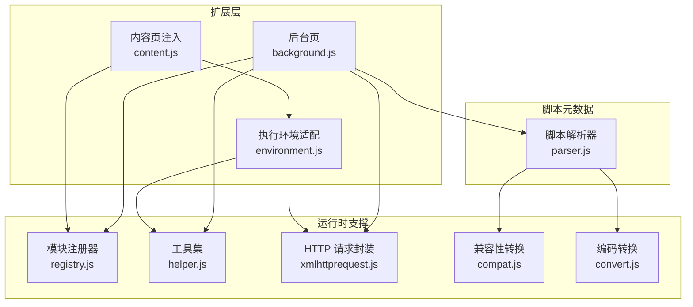
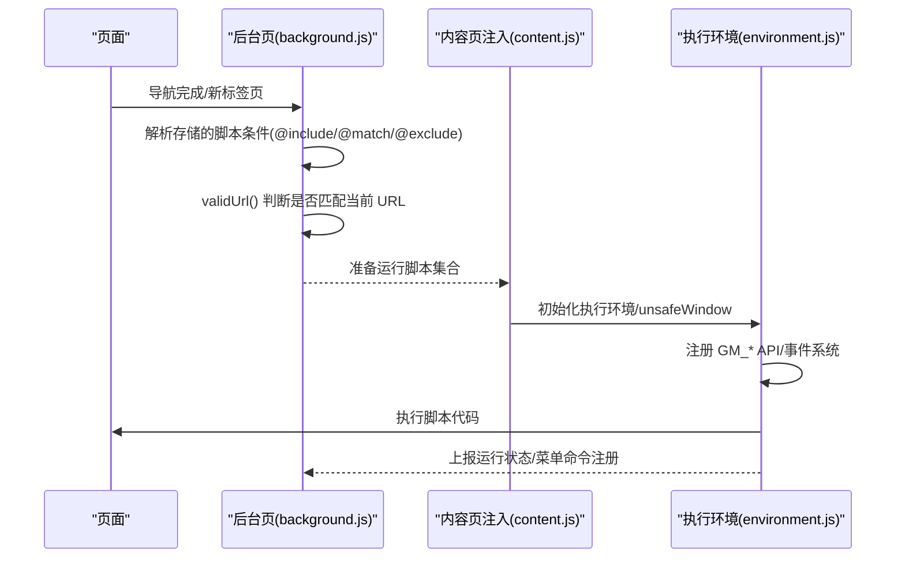
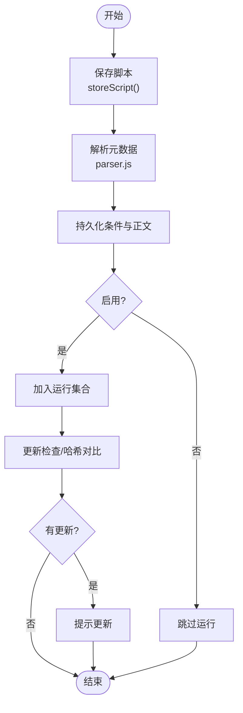
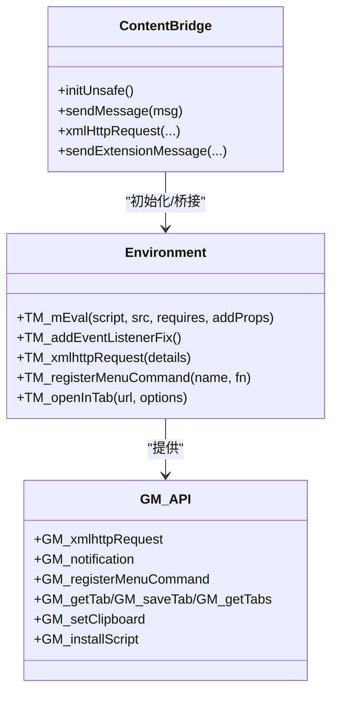
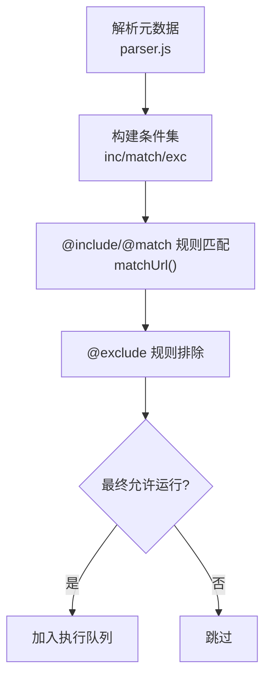
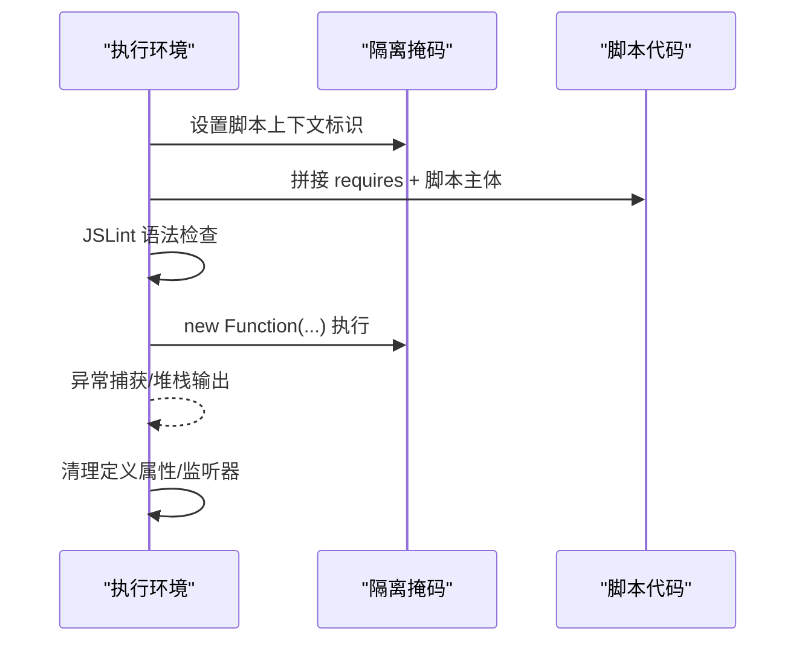
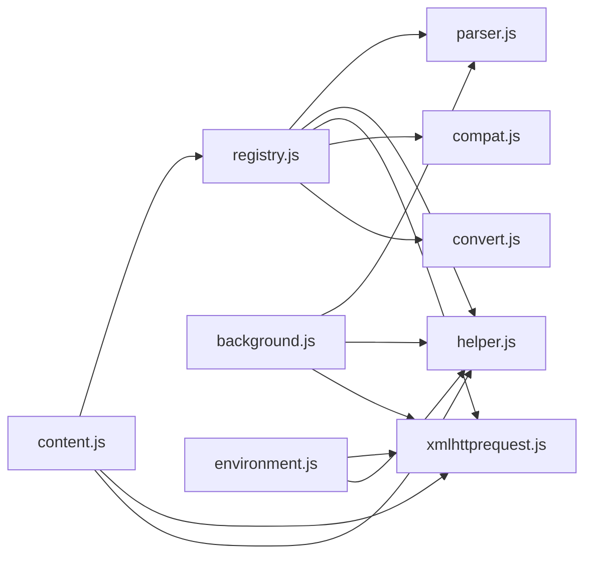

# 脚本管理功能

<cite>
**本文档引用的文件**
- [README.md](file://README.md)
- [background.js](file://src/background.js)
- [content.js](file://src/content.js)
- [environment.js](file://src/environment.js)
- [parser.js](file://src/parser.js)
- [helper.js](file://src/helper.js)
- [xmlhttprequest.js](file://src/xmlhttprequest.js)
- [registry.js](file://src/registry.js)
- [compat.js](file://src/compat.js)
- [convert.js](file://src/convert.js)
</cite>

## 目录
1. [简介](#简介)
2. [项目结构](#项目结构)
3. [核心组件](#核心组件)
4. [架构总览](#架构总览)
5. [详细组件分析](#详细组件分析)
6. [依赖关系分析](#依赖关系分析)
7. [性能考量](#性能考量)
8. [故障排查指南](#故障排查指南)
9. [结论](#结论)
10. [附录](#附录)

## 简介
本文件面向 Tampermonkey 用户脚本管理功能，系统性阐述脚本的全生命周期（安装、验证、启用/禁用、卸载）、执行环境设计（unsafeWindow 访问、GM_* API 实现、事件系统）、元数据处理与 URL 匹配算法、脚本编译与执行及沙箱隔离、调试与错误处理、权限与安全策略。内容基于仓库源码进行深入分析，并以图示方式呈现关键流程。

## 项目结构
Tampermonkey 的脚本管理由后台页（background）协调、内容页（content）注入执行环境、环境适配层（environment）提供 API 与事件、解析器（parser）处理元数据、工具模块（helper、xmlhttprequest、registry、compat、convert）支撑运行时能力。

**图表来源**
- [background.js](file://src/background.js)
- [content.js](file://src/content.js)
- [environment.js](file://src/environment.js)
- [parser.js](file://src/parser.js)
- [helper.js](file://src/helper.js)
- [xmlhttprequest.js](file://src/xmlhttprequest.js)
- [registry.js](file://src/registry.js)
- [compat.js](file://src/compat.js)
- [convert.js](file://src/convert.js)

**章节来源**
- [README.md:1-112](file://README.md#L1-L112)
- [background.js:1-120](file://src/background.js#L1-L120)
- [content.js:1-120](file://src/content.js#L1-L120)
- [environment.js:1-120](file://src/environment.js#L1-L120)
- [parser.js:1-60](file://src/parser.js#L1-L60)
- [helper.js:1-60](file://src/helper.js#L1-L60)
- [xmlhttprequest.js:1-60](file://src/xmlhttprequest.js#L1-L60)
- [registry.js:1-60](file://src/registry.js#L1-L60)
- [compat.js:1-60](file://src/compat.js#L1-L60)
- [convert.js:1-39](file://src/convert.js#L1-L39)

## 核心组件
- 后台页（background.js）
  - 负责脚本存储、版本迁移、更新检查、URL 匹配决策、脚本列表排序与持久化。
  - 提供脚本保存、修改选项、批量操作（启用/禁用/删除/触发更新）等请求处理。
- 内容页注入（content.js）
  - 注入执行环境，初始化 unsafeWindow 访问，桥接消息通道，转发请求到后台。
- 执行环境适配（environment.js）
  - 提供 GM_* API（如 GM_xmlhttpRequest、GM_notification、GM_registerMenuCommand 等），构建事件系统，执行脚本代码，维护清理逻辑。
- 解析器（parser.js）
  - 解析用户脚本头部元数据（@include/@match/@exclude/@require/@resource 等），生成脚本对象与配置。
- 工具集（helper.js）
  - 提供字符串处理、正则构造、URL 安全处理、序列化等通用能力。
- HTTP 请求封装（xmlhttprequest.js）
  - 统一封装 XHR 行为，支持重试、进度回调、响应头处理、协议校验。
- 模块注册器（registry.js）
  - 动态加载与注册模块，避免循环依赖，统一模块接口。
- 兼容性转换（compat.js）
  - 将旧式语法或特性转换为可运行形式，提升跨浏览器兼容性。
- 编码转换（convert.js）
  - 提供 UTF-8/Base64 等编码转换工具。

**章节来源**
- [background.js:120-300](file://src/background.js#L120-L300)
- [content.js:120-240](file://src/content.js#L120-L240)
- [environment.js:120-240](file://src/environment.js#L120-L240)
- [parser.js:60-140](file://src/parser.js#L60-L140)
- [helper.js:60-140](file://src/helper.js#L60-L140)
- [xmlhttprequest.js:60-140](file://src/xmlhttprequest.js#L60-L140)
- [registry.js:60-107](file://src/registry.js#L60-L107)
- [compat.js:60-140](file://src/compat.js#L60-L140)
- [convert.js:1-39](file://src/convert.js#L1-L39)

## 架构总览
下图展示从页面导航到脚本执行的关键交互：后台根据 URL 与元数据决定是否运行脚本；内容页注入执行环境；环境适配层提供 API 并执行脚本。

**图表来源**
- [background.js:3583-3640](file://src/background.js#L3583-L3640)
- [content.js:455-608](file://src/content.js#L455-L608)
- [environment.js:646-747](file://src/environment.js#L646-L747)

## 详细组件分析

### 脚本生命周期管理
- 安装与保存
  - 通过后台页保存脚本文本与条件，写入存储并触发同步回调。
  - 存储键包含脚本正文与条件三元组（includes/matches/excludes）。
- 验证与更新
  - 后台页定期检查脚本更新，比较 hash 或版本号，必要时拉取新元数据并提示更新。
- 启用/禁用
  - 修改脚本 enabled 标记后，重新计算运行集合并持久化。
- 卸载
  - 删除存储中的脚本条目与条件键，触发同步移除回调。

**图表来源**
- [background.js:3739-3770](file://src/background.js#L3739-L3770)
- [parser.js:251-281](file://src/parser.js#L251-L281)

**章节来源**
- [background.js:3739-3770](file://src/background.js#L3739-L3770)
- [parser.js:251-281](file://src/parser.js#L251-L281)

### 执行环境设计与实现
- unsafeWindow 访问
  - 在安全上下文中通过 DOM 事件桥接机制在 unsafeWindow 中注入属性，回填 window 对象或定义只读属性，避免直接暴露高危对象。
- GM_* API 实现
  - 提供 GM_xmlhttpRequest、GM_notification、GM_registerMenuCommand、GM_getTab/GM_saveTab/GM_getTabs、GM_setClipboard、GM_installScript 等。
- 事件系统
  - 模拟 DOMContentLoaded/load/DOMNodeInserted 等事件，支持监听器注册与重放，保证脚本在合适时机执行。

**图表来源**
- [content.js:455-608](file://src/content.js#L455-L608)
- [environment.js:646-747](file://src/environment.js#L646-L747)
- [environment.js:107-193](file://src/environment.js#L107-L193)

**章节来源**
- [content.js:455-608](file://src/content.js#L455-L608)
- [environment.js:646-747](file://src/environment.js#L646-L747)
- [environment.js:107-193](file://src/environment.js#L107-L193)

### 脚本元数据处理与 URL 匹配算法
- 元数据解析
  - 解析 @include/@match/@exclude/@require/@resource/@run-at/@user-agent/@noframes 等标签，生成脚本对象与选项。
- URL 匹配
  - 支持 @include 正则风格与 @match Chrome 扩展风格。
  - 使用正则构造函数将通配符转换为可匹配表达式，区分大小写（@include 不区分，@match 区分）。
  - 排除规则优先级高于包含规则。

**图表来源**
- [parser.js:157-213](file://src/parser.js#L157-L213)
- [background.js:3583-3640](file://src/background.js#L3583-L3640)
- [helper.js:56-80](file://src/helper.js#L56-L80)

**章节来源**
- [parser.js:157-213](file://src/parser.js#L157-L213)
- [background.js:3583-3640](file://src/background.js#L3583-L3640)
- [helper.js:56-80](file://src/helper.js#L56-L80)

### 脚本编译与执行、沙箱隔离
- 编译与执行
  - 环境适配层将脚本代码与 require 片段拼接，使用 Function 构造执行，捕获异常并输出堆栈信息。
  - 使用 JSLint 输出语法错误定位，便于调试。
- 沙箱与隔离
  - 通过在安全上下文中注入 DOM 事件桥接，将 unsafeWindow 属性映射至 window，避免直接暴露高危对象。
  - 清理阶段撤销定义的属性与监听器，确保上下文干净。

**图表来源**
- [environment.js:107-193](file://src/environment.js#L107-L193)
- [content.js:455-608](file://src/content.js#L455-L608)

**章节来源**
- [environment.js:107-193](file://src/environment.js#L107-L193)
- [content.js:455-608](file://src/content.js#L455-L608)

### 调试与错误处理
- 错误捕获
  - 执行期异常被捕获并打印错误信息与堆栈；必要时复制脚本源到剪贴板以便反馈。
- 语法检查
  - 使用 JSLint 输出错误原因与行号，区分脚本与 require 片段。
- 运行状态上报
  - 执行前后统计运行/禁用计数，便于诊断脚本冲突与执行失败。

**章节来源**
- [environment.js:107-193](file://src/environment.js#L107-L193)
- [background.js:4357-4369](file://src/background.js#L4357-L4369)

### 权限与安全考虑
- unsafeWindow 访问
  - 通过 DOM 事件桥接注入属性，避免直接暴露 window.top/frames 等高危对象；若检测到脚本拦截器，会向后台发送告警。
- HTTP 请求限制
  - 仅允许 http(s) 协议，本地图片资源例外；对请求头进行前缀处理以规避受限字段。
- URL 安全处理
  - 对危险通配符进行替换，避免路径穿越；支持 @match 的严格模式匹配。

**章节来源**
- [content.js:455-608](file://src/content.js#L455-L608)
- [xmlhttprequest.js:12-153](file://src/xmlhttprequest.js#L12-L153)
- [helper.js:56-80](file://src/helper.js#L56-L80)

## 依赖关系分析
模块间依赖清晰，采用注册器统一加载与依赖声明，避免循环引用。

**图表来源**
- [registry.js:48-107](file://src/registry.js#L48-L107)
- [parser.js:9-16](file://src/parser.js#L9-L16)
- [xmlhttprequest.js:7-15](file://src/xmlhttprequest.js#L7-L15)
- [helper.js:7-16](file://src/helper.js#L7-L16)
- [compat.js:9-11](file://src/compat.js#L9-L11)
- [convert.js:7-16](file://src/convert.js#L7-L16)
- [background.js:28-35](file://src/background.js#L28-L35)
- [content.js:80-91](file://src/content.js#L80-L91)
- [environment.js:35](file://src/environment.js#L35)

**章节来源**
- [registry.js:48-107](file://src/registry.js#L48-L107)
- [background.js:28-35](file://src/background.js#L28-L35)
- [content.js:80-91](file://src/content.js#L80-L91)
- [environment.js:35](file://src/environment.js#L35)

## 性能考量
- 脚本缓存与复用
  - 后台页对 require 资源设置缓存周期与清理任务，减少重复网络开销。
- URL 匹配优化
  - 使用预编译正则与快速路径判断，降低无效匹配成本。
- 事件重放
  - DOMContentLoaded/load/DOMNodeInserted 事件在合适时机重放，避免不必要的等待。

[本节为通用建议，无需特定文件引用]

## 故障排查指南
- 无法访问 unsafeWindow
  - 若检测到脚本拦截器，控制台会记录告警；可通过后台消息确认拦截状态。
- 脚本未运行
  - 检查 @include/@match/@exclude 是否正确；确认脚本已启用且未被 @exclude 排除。
- HTTP 请求失败
  - 确认 URL 协议为 http(s)，检查请求头是否包含受限字段；查看重试与进度回调日志。
- 更新不生效
  - 检查脚本 hash/version 是否变化；确认更新检查开关与网络可达性。

**章节来源**
- [content.js:487-499](file://src/content.js#L487-L499)
- [background.js:3605-3640](file://src/background.js#L3605-L3640)
- [xmlhttprequest.js:114-153](file://src/xmlhttprequest.js#L114-L153)

## 结论
Tampermonkey 的脚本管理以“后台决策 + 内容注入 + 环境适配”为核心架构，结合解析器与工具模块，实现了从元数据解析、URL 匹配、执行环境搭建到 API 提供与错误处理的完整闭环。通过严格的沙箱隔离与安全策略，兼顾了可用性与安全性；通过缓存与事件优化，提升了整体性能与用户体验。

## 附录
- 常用 API 参考
  - GM_xmlhttpRequest：异步 HTTP 请求，支持 onload/onreadystatechange/onerror 回调。
  - GM_registerMenuCommand：注册右键菜单命令，支持动态注销与再次注册。
  - GM_notification：显示桌面通知。
  - GM_getTab/GM_saveTab/GM_getTabs：标签页相关操作。
  - GM_setClipboard：设置剪贴板内容。
  - GM_installScript：触发脚本安装流程。

**章节来源**
- [environment.js:693-747](file://src/environment.js#L693-L747)
- [environment.js:648-667](file://src/environment.js#L648-L667)
- [environment.js:1102-1131](file://src/environment.js#L1102-L1131)