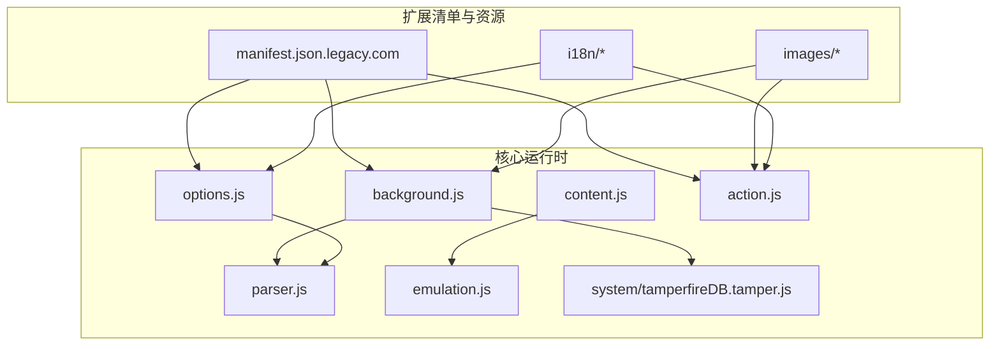
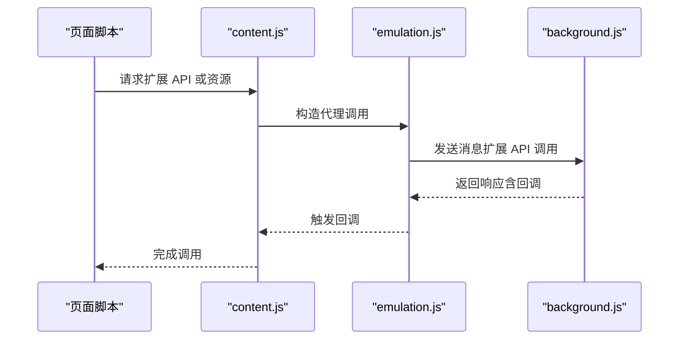
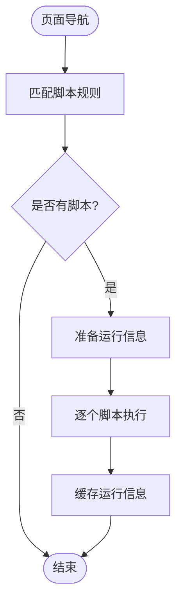
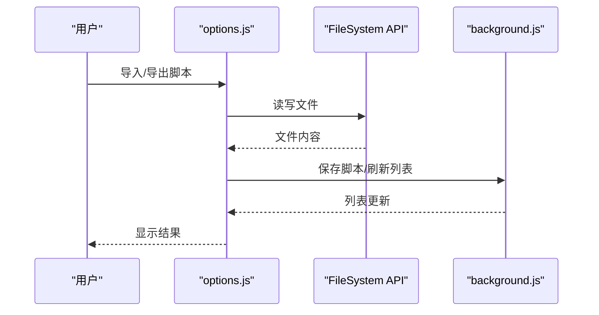
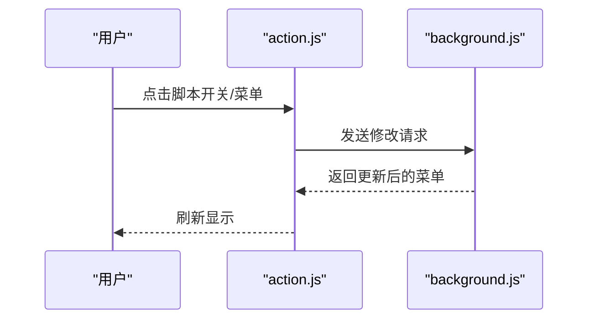
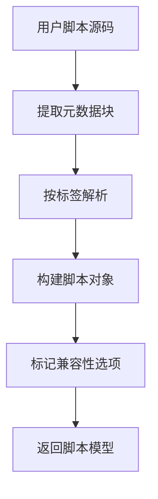
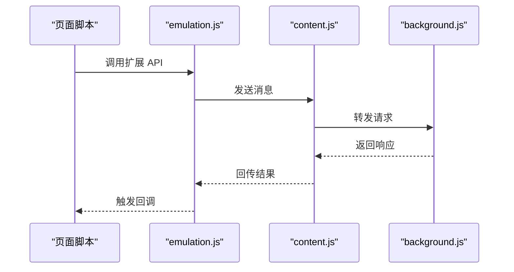
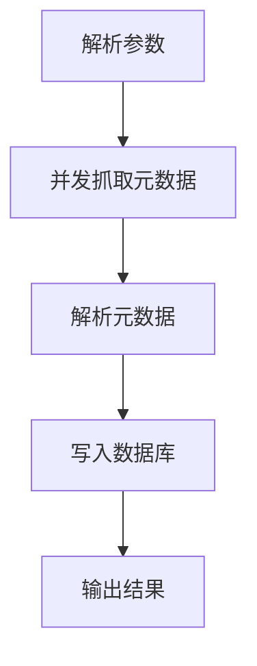
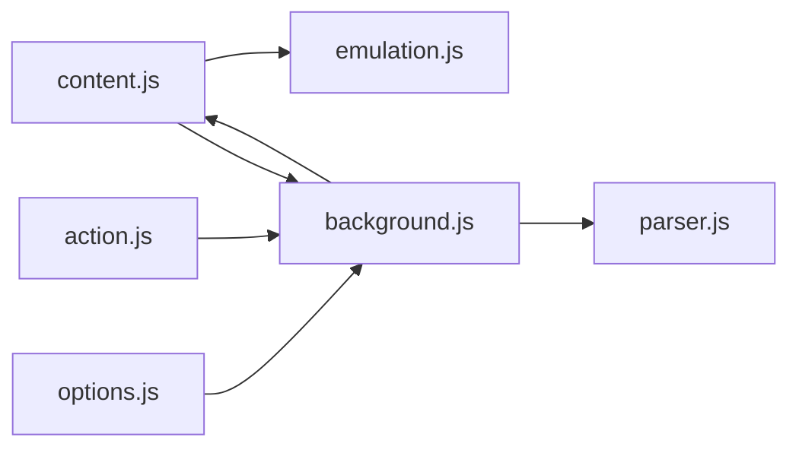

# 项目概述

<cite>
**本文引用的文件列表**
- [README.md](file://README.md)
- [background.js](file://src/background.js)
- [options.js](file://src/options.js)
- [content.js](file://src/content.js)
- [action.js](file://src/action.js)
- [parser.js](file://src/parser.js)
- [emulation.js](file://src/emulation.js)
- [manifest.json.legacy.com](file://build_sys/manifest.json.legacy.com)
- [messages.json](file://i18n/en/messages.json)
- [tamperfireDB.tamper.js](file://src/system/tamperfireDB.tamper.js)
</cite>

## 目录
1. [简介](#简介)
2. [项目结构](#项目结构)
3. [核心组件](#核心组件)
4. [架构总览](#架构总览)
5. [详细组件分析](#详细组件分析)
6. [依赖关系分析](#依赖关系分析)
7. [性能考量](#性能考量)
8. [故障排查指南](#故障排查指南)
9. [结论](#结论)
10. [附录](#附录)

## 简介
Tampermonkey 是 Google Chrome 最受欢迎的用户脚本管理器（Userscript Manager）。它允许用户安装、启用/禁用、编辑和同步用户脚本，支持与 Greasemonkey 兼容的元数据标签与 API，提供强大的脚本运行环境与扩展能力。该项目以 GPLv3 许可证发布，源码包含在仓库中，面向开发者与高级用户提供深入的技术洞察与二次开发基础。

- 市场地位：作为 Chrome 生态中最广泛使用的用户脚本管理器之一，Tampermonkey 在用户数量与社区影响力方面具有显著优势。
- 核心价值：通过统一的脚本生命周期管理、安全沙箱隔离、跨页面脚本注入与兼容层，降低用户脚本的编写与维护成本，提升用户体验与安全性。
- 技术定位：基于 Chrome 扩展架构，结合内容脚本注入、后台页调度、消息通道与本地存储，实现对用户脚本的全生命周期管理。

**章节来源**
- [README.md:1-112](file://README.md#L1-L112)

## 项目结构
该仓库采用模块化组织方式，围绕“扩展清单”、“核心运行时”、“内容脚本注入”、“后台页调度”、“选项界面”、“国际化资源”等维度进行分层设计。关键目录与文件如下：
- build_sys：构建与清单配置，包含旧版 Manifest V1 清单模板
- src：核心运行时与扩展逻辑
  - content.js：内容脚本注入与脚本执行上下文桥接
  - background.js：后台页，负责脚本解析、调度、更新检查、存储与同步
  - options.js：选项页，提供脚本管理、导入导出、设置编辑等
  - action.js：浏览器按钮弹出菜单，提供快速开关与操作入口
  - parser.js：用户脚本元数据解析与兼容处理
  - emulation.js：Chrome API 模拟层，桥接页面脚本与扩展 API
  - system/tamperfireDB.tamper.js：辅助工具脚本，用于生成或处理 TamperFire 数据库
  - 其他通用模块：convert.js、xmlhttprequest.js、helper.js 等（在各模块中被 require）
- i18n：多语言资源，当前以英文为主
- images：扩展图标与资源图片
- docs、misc、server：文档与服务器侧脚本（示例）



**图表来源**
- [manifest.json.legacy.com:1-38](file://build_sys/manifest.json.legacy.com#L1-L38)
- [background.js:1-120](file://src/background.js#L1-L120)
- [content.js:1-120](file://src/content.js#L1-L120)
- [options.js:1-120](file://src/options.js#L1-L120)
- [action.js:1-120](file://src/action.js#L1-L120)
- [parser.js:1-120](file://src/parser.js#L1-L120)
- [emulation.js:1-120](file://src/emulation.js#L1-L120)
- [tamperfireDB.tamper.js:1-120](file://src/system/tamperfireDB.tamper.js#L1-L120)

**章节来源**
- [manifest.json.legacy.com:1-38](file://build_sys/manifest.json.legacy.com#L1-L38)
- [README.md:1-112](file://README.md#L1-L112)

## 核心组件
- 内容脚本注入（content.js）：负责在页面上下文中注入脚本执行环境，建立与扩展后台的消息通道，模拟 Chrome API 并处理事件与请求转发。
- 后台页（background.js）：承担脚本解析、调度、更新检查、存储迁移、版本升级、上下文注册与缓存管理等职责。
- 选项页（options.js）：提供脚本列表、编辑、导入导出、设置项与工具集，支持多语言与本地存储。
- 浏览器按钮弹出菜单（action.js）：提供脚本开关、菜单命令、脚本更新触发等快捷操作。
- 用户脚本解析器（parser.js）：解析用户脚本元数据块，提取名称、版本、匹配规则、资源、依赖等信息，并进行兼容性标记。
- Chrome API 模拟层（emulation.js）：在页面脚本中提供与扩展 API 对应的代理方法，实现消息发送、连接、响应与回调管理。
- 系统工具脚本（system/tamperfireDB.tamper.js）：辅助生成或处理 TamperFire 脚本索引数据库。

**章节来源**
- [content.js:1-200](file://src/content.js#L1-L200)
- [background.js:1-200](file://src/background.js#L1-L200)
- [options.js:1-200](file://src/options.js#L1-L200)
- [action.js:1-200](file://src/action.js#L1-L200)
- [parser.js:1-200](file://src/parser.js#L1-L200)
- [emulation.js:1-200](file://src/emulation.js#L1-L200)
- [tamperfireDB.tamper.js:1-200](file://src/system/tamperfireDB.tamper.js#L1-L200)

## 架构总览
Tampermonkey 的整体架构围绕“内容脚本注入 + 后台页调度 + 选项页管理 + 弹出菜单入口”的模式展开。页面加载时，content.js 将注入到目标页面，建立与扩展后台的消息通道；background.js 负责脚本生命周期管理、更新检查与存储；options.js 提供图形化管理界面；action.js 提供快速操作入口；parser.js 解析用户脚本元数据；emulation.js 提供 Chrome API 的页面端代理。

```mermaid
graph TB
subgraph "页面上下文"
P["页面脚本"]
E["emulation.js<br/>Chrome API 代理"]
end
subgraph "扩展层"
C["content.js<br/>注入与桥接"]
B["background.js<br/>调度与存储"]
O["options.js<br/>管理界面"]
A["action.js<br/>弹出菜单"]
R["parser.js<br/>元数据解析"]
end
P --> E
E <- --> C
C --> B
O --> B
A --> B
B --> R
```

**图表来源**
- [content.js:1-200](file://src/content.js#L1-L200)
- [background.js:1-200](file://src/background.js#L1-L200)
- [options.js:1-200](file://src/options.js#L1-L200)
- [action.js:1-200](file://src/action.js#L1-L200)
- [parser.js:1-200](file://src/parser.js#L1-L200)
- [emulation.js:1-200](file://src/emulation.js#L1-L200)

## 详细组件分析

### 组件一：内容脚本注入与执行桥接（content.js）
- 功能要点
  - 在页面上下文中初始化执行环境，注入必要的全局变量与事件处理逻辑
  - 建立与扩展后台的消息通道，转发请求与响应
  - 提供 XMLHTTPRequest 代理，支持跨域与异步回调
  - 处理 DOMContentLoaded、DOMNodeInserted 等事件，确保脚本按需执行
  - 支持安全上下文与 unsafeWindow 访问策略，避免脚本冲突
- 关键流程
  - 页面加载后，content.js 注入到页面上下文，初始化事件系统与消息通道
  - 当需要调用扩展 API 时，通过 tmCE 发送消息至后台，后台再通过 emulation.js 代理返回结果
  - 对于 require 资源与资源文件，通过本地文件访问或 iframe message 方式获取内容



**图表来源**
- [content.js:108-215](file://src/content.js#L108-L215)
- [emulation.js:40-120](file://src/emulation.js#L40-L120)
- [background.js:350-420](file://src/background.js#L350-L420)

**章节来源**
- [content.js:1-200](file://src/content.js#L1-L200)
- [emulation.js:1-200](file://src/emulation.js#L1-L200)

### 组件二：后台页调度与存储（background.js）
- 功能要点
  - 版本升级与数据迁移：根据版本差异执行配置迁移与脚本重保存
  - 脚本上下文注册：记录每个标签页的脚本运行状态、URL 与 UA 信息
  - 脚本运行控制：决定是否在当前页面/帧中运行脚本，支持缓存与复用
  - 更新检查：定期检查脚本更新，维护更新计数与进度
  - 本地文件访问：通过 XMLHTTP 或 iframe message 获取本地文件内容
  - 同步与存储：提供存储监听与同步信息管理
- 关键流程
  - 页面导航时，后台根据 URL 匹配规则确定需要运行的脚本集合
  - 对于需要运行的脚本，通过 content.js 初始化运行环境并执行
  - 对于 require 资源，使用缓存与清理策略减少网络开销



**图表来源**
- [background.js:560-640](file://src/background.js#L560-L640)
- [background.js:642-766](file://src/background.js#L642-L766)

**章节来源**
- [background.js:1-200](file://src/background.js#L1-L200)

### 组件三：选项页管理（options.js）
- 功能要点
  - 脚本列表展示与排序：支持按名称、版本、站点、更新时间等字段排序
  - 导入导出：支持从文本区、沙盒文件系统与本地文件导入导出脚本
  - 设置编辑：提供通用设置、编辑器设置、外观与安全设置等
  - 工具集：提供脚本修复、兼容性选项、工厂重置等高级功能
- 关键流程
  - 加载所有脚本与设置项，渲染为表格与分组控件
  - 支持批量操作与单个脚本的启用/禁用、删除、编辑
  - 导入导出通过 FileSystem API 与 Blob 对象完成



**图表来源**
- [options.js:457-718](file://src/options.js#L457-L718)
- [options.js:720-792](file://src/options.js#L720-L792)

**章节来源**
- [options.js:1-200](file://src/options.js#L1-L200)

### 组件四：弹出菜单（action.js）
- 功能要点
  - 快速开关脚本：点击脚本条目切换启用状态
  - 菜单命令：执行注册的菜单命令
  - 脚本更新：触发脚本更新检查
  - TamperFire 集成：显示可用脚本数量与进度
- 关键流程
  - 页面加载后，向后台查询脚本状态并渲染菜单
  - 用户交互触发消息发送，后台更新状态并回传



**图表来源**
- [action.js:22-190](file://src/action.js#L22-L190)
- [action.js:269-321](file://src/action.js#L269-L321)

**章节来源**
- [action.js:1-200](file://src/action.js#L1-L200)

### 组件五：用户脚本解析器（parser.js）
- 功能要点
  - 解析用户脚本元数据块，提取名称、版本、描述、图标、主页、匹配规则、依赖与资源等
  - 识别 @include/@match/@exclude/@require/@resource/@run-at/@user-agent 等标签
  - 生成脚本对象并标记兼容性选项
- 关键流程
  - 从源码中提取元数据块，按标签解析并填充脚本对象
  - 根据脚本内容判断兼容性需求，设置选项标志位



**图表来源**
- [parser.js:72-282](file://src/parser.js#L72-L282)

**章节来源**
- [parser.js:1-200](file://src/parser.js#L1-L200)

### 组件六：Chrome API 模拟层（emulation.js）
- 功能要点
  - 提供 extension、tabs、i18n 等 API 的页面端代理
  - 管理响应回调 ID，处理异步消息与连接
  - 将页面脚本中的扩展 API 调用转发至后台并通过 content.js 回传
- 关键流程
  - 页面脚本调用 chrome.xxx，由 emulation.js 代理
  - 通过 content.js 发送到后台，后台处理后回传



**图表来源**
- [emulation.js:40-313](file://src/emulation.js#L40-L313)
- [content.js:273-453](file://src/content.js#L273-L453)

**章节来源**
- [emulation.js:1-200](file://src/emulation.js#L1-L200)

### 组件七：系统工具脚本（system/tamperfireDB.tamper.js）
- 功能要点
  - 生成或处理 TamperFire 脚本索引数据库
  - 支持参数化并发抓取、错误重试与进度统计
- 关键流程
  - 解析元数据块，提取脚本基本信息与匹配规则
  - 并发请求脚本元数据，汇总为数据库结构



**图表来源**
- [tamperfireDB.tamper.js:30-352](file://src/system/tamperfireDB.tamper.js#L30-L352)

**章节来源**
- [tamperfireDB.tamper.js:1-200](file://src/system/tamperfireDB.tamper.js#L1-L200)

## 依赖关系分析
- 模块耦合
  - content.js 与 emulation.js 紧密协作，前者负责注入与桥接，后者提供 API 代理
  - background.js 依赖 parser.js 进行脚本解析，依赖 options.js 与 action.js 进行用户交互
  - options.js 与 action.js 通过消息与后台交互，实现脚本管理与状态更新
- 外部依赖
  - Chrome 扩展 API：content_scripts、browser_action、background、permissions 等
  - 本地存储：localStorage、IndexedDB（通过封装接口）
  - 文件系统：FileSystem API 用于导入导出
- 可能的循环依赖
  - 模块间通过消息与回调解耦，未见直接循环引用



**图表来源**
- [content.js:1-200](file://src/content.js#L1-L200)
- [background.js:1-200](file://src/background.js#L1-L200)
- [options.js:1-200](file://src/options.js#L1-L200)
- [action.js:1-200](file://src/action.js#L1-L200)
- [parser.js:1-200](file://src/parser.js#L1-L200)
- [emulation.js:1-200](file://src/emulation.js#L1-L200)

**章节来源**
- [manifest.json.legacy.com:1-38](file://build_sys/manifest.json.legacy.com#L1-L38)

## 性能考量
- 脚本缓存与复用：后台对脚本运行信息进行缓存，减少重复计算与网络请求
- require 资源缓存：对 @require 资源设置有效期与清理周期，降低重复下载
- 并发控制：导入导出与脚本更新采用并发策略，平衡吞吐与稳定性
- DOM 事件优化：仅在必要时机监听 DOMContentLoaded 与 DOMNodeInserted，避免过度事件风暴
- 本地文件访问：提供 XMLHTTP 与 iframe message 两种方式，按需选择以规避缓存与跨域限制

[本节为通用性能建议，不直接分析具体文件]

## 故障排查指南
- 脚本无法运行
  - 检查脚本匹配规则与页面 URL 是否匹配
  - 查看后台日志与控制台输出，确认脚本是否被启用与加载
- unsafeWindow 访问失败
  - 确认未被脚本拦截器（如 ScriptNo）阻止
  - 后台会检测并提示脚本拦截器的存在
- 导入导出失败
  - 确认 FileSystem 权限与文件路径正确
  - 检查 JSON 格式与编码问题
- 更新检查异常
  - 检查更新 URL 与网络连通性
  - 查看后台更新计数与错误日志

**章节来源**
- [content.js:456-608](file://src/content.js#L456-L608)
- [background.js:768-800](file://src/background.js#L768-L800)
- [options.js:589-635](file://src/options.js#L589-L635)

## 结论
Tampermonkey 通过清晰的模块划分与稳健的扩展架构，实现了用户脚本的高效管理与安全执行。其内容脚本注入、后台调度、选项管理与弹出菜单协同工作，形成完整的用户脚本生命周期管理体系。配合解析器与模拟层，项目在兼容性与易用性之间取得良好平衡，既满足初学者的快速上手，也为高级用户提供深入定制空间。

[本节为总结性内容，不直接分析具体文件]

## 附录
- 目标用户与使用场景
  - 初学者：通过选项页与弹出菜单快速安装与启用常用脚本
  - 开发者：利用编辑器与兼容性选项调试与优化脚本
  - 高级用户：通过导入导出、TamperFire 与系统工具脚本进行批量管理与索引维护
- 主要特性
  - 脚本管理：安装、启用/禁用、排序、删除、编辑
  - 编辑器功能：语法高亮、自动补全、键映射（Windows/Emacs/Vim）、缩进与换行策略
  - 同步机制：跨设备脚本同步与更新检查
  - 兼容性：支持 Greasemonkey 标签与 API，提供兼容性选项
  - 多语言：内置国际化资源，支持多语言界面
- 技术栈概览
  - JavaScript（ES5/ES6 兼容）
  - Chrome 扩展 API（Manifest V1）
  - CodeMirror（编辑器）
  - FileSystem API（导入导出）
  - XMLHttpRequest（网络请求）
  - 本地存储（localStorage/IndexedDB）

**章节来源**
- [README.md:6-17](file://README.md#L6-L17)
- [messages.json:1-200](file://i18n/en/messages.json#L1-L200)