# Tampermonkey 项目文档

## 项目简介

**Tampermonkey** 是最流行的 Chrome 浏览器用户脚本管理器扩展。本仓库包含 **v2.9 及以前版本**的开源源代码（GPLv3 协议），更新版本已转为专有许可。

### 主要功能

#### 脚本管理

- 脚本列表总览，显示名称、版本号、最后更新时间、同步状态
- 一键启用/禁用脚本（勾选框）
- 脚本排序（按位置拖拽调整执行顺序）
- 删除/卸载脚本
- 手动检查脚本更新（点击更新时间列）
- 同步状态图标标识（Pastebin / Google Sync / 未同步）
- 脚本主页链接（`@homepage` / `@namespace` URL）
- userscripts.org 源链接自动关联

#### 脚本编辑

- 内置 CodeMirror 代码编辑器（语法高亮、行号、代码折叠）
- 编辑器工具栏：保存、编辑器重置、完全重置、关闭、语法检查（JSLint）
- 支持 Vim / Emacs / Windows 三种键位映射
- 代码搜索与光标定位（`searchcursor.js`）
- 代码自动格式化（`formatting.js`）
- 注释续行自动补全（`continuecomment.js`）
- ESC 快捷键关闭编辑器（Windows 键位模式）
- 编辑器重置（恢复到上次保存的代码）与完全重置（清除所有变更，恢复原始安装代码）
- 脚本后台修改检测（编辑器打开时脚本被外部更新，弹出提示）

#### 脚本设置

- 运行时机设置（`@run-at` 下拉选择：document-start / document-end）
- 自定义匹配规则覆盖（用户 `@include` / `@match` / `@exclude`，可与原始规则合并或替换）
- 脚本执行位置调整
- 兼容性选项独立配置（`@require` 兼容、CDATA 转换、forEach 替换、for...in 修复、数组赋值转换、原型链扩展）
- 脚本备注/注释（`comment` 文本区域）
- 更新 URL 设置（`file_url` / `updateURL`）

#### 工具与批量操作

- 脚本批量导出（JSON 格式，含 Base64 编码的脚本源码、选项、位置）
- 脚本批量导入（从 JSON 或 HTML 中解析并安装）
- 脚本另存为 `.user.js` 文件（基于 FileSaver.js）
- 配置模式分级（`configMode`：不同级别显示不同设置项）
- 在不同 Chrome 实例之间同步脚本
- 通过 TamperFire 按 URL 搜索 userscripts.org 上的脚本
- 完整的 `unsafeWindow` 访问支持
- 支持所有 `GM_*` 函数（见下方完整列表）
- 支持 Greasemonkey 和 Scriptish 的大量标签（如 `@resource`、`@require` 等）

### GM_* API 支持

| API | 功能 |
|-----|------|
| `GM_addStyle(css)` | 向页面注入 CSS 样式 |
| `GM_setValue(name, value)` | 存储脚本持久化数据 |
| `GM_getValue(name, default)` | 读取脚本持久化数据 |
| `GM_deleteValue(name)` | 删除脚本持久化数据 |
| `GM_listValues()` | 列出所有存储的键名 |
| `GM_addValueChangeListener(name, cb)` | 监听跨标签页数据变更 |
| `GM_removeValueChangeListener(id)` | 移除数据变更监听器 |
| `GM_xmlhttpRequest(details)` | 发起跨域 HTTP 请求 |
| `GM_notification(msg, title, icon, cb)` | 显示桌面通知 |
| `GM_openInTab(url, options)` | 在新标签页打开 URL |
| `GM_setClipboard(data, type, cb)` | 写入系统剪贴板 |
| `GM_registerMenuCommand(name, fn)` | 注册浏览器菜单命令 |
| `GM_getResourceText(name)` | 获取 `@resource` 定义的文本资源 |
| `GM_getResourceURL(name)` | 获取 `@resource` 定义的资源 URL |
| `GM_info` | 获取当前脚本元信息 |
| `GM_installScript(url, cb)` | 通过 URL 安装新脚本 |
| `GM_getTab(cb)` | 获取当前标签页数据 |
| `GM_saveTab(tab)` | 保存标签页数据 |
| `GM_getTabs(cb)` | 获取所有标签页数据（跨标签页通信）|
| `GM_log(message)` | 输出日志信息 |

### 脚本运行控制

- **`@run-at` 支持**：控制脚本注入时机
  - `document-start` — 文档开始加载时注入
  - `document-end` — 文档加载完成后注入
  - `document-idle` — 浏览器空闲时注入
- **`@noframes` 支持**：限制脚本不在 iframe 中运行
- **安全沙箱环境**：脚本在隔离环境中运行，防止与页面脚本冲突

### 脚本元数据标签支持

| 类别 | 标签 |
|------|------|
| 匹配规则 | `@match`、`@include`、`@exclude` |
| 资源引用 | `@require`、`@resource`、`@icon`、`@icon64` |
| 运行控制 | `@run-at`、`@noframes`、`@grant` |
| 更新与安装 | `@updateURL`、`@downloadURL`、`@version` |
| 信息描述 | `@name`、`@namespace`、`@description`、`@author`、`@copyright`、`@homepage`、`@license` |

### 脚本同步

- 基于 Chrome Storage Sync API 实现跨设备脚本同步
- 支持多种同步源（Pastebin 等）
- 脚本导入状态标识（Imported 标记）

### 脚本更新

- 自动检查脚本更新（基于 `@updateURL` / `@downloadURL`）
- 手动触发更新检查
- TamperFire 数据库自动更新

### 脚本导入/导出

- 支持将脚本导出为 `.user.js` 文件（基于 FileSaver.js）
- 支持从 URL 或文件安装脚本

### 通知系统

- `GM_notification` 桌面通知（支持标题、正文、图标、延迟关闭）
- 权限请求通知（`requestPerm`）
- 通知点击回调处理

### 兼容性选项

每个脚本可独立配置兼容性选项：

- `compatopts_for_requires` — 对 `@require` 脚本启用兼容模式
- `compat_metadata` — 元数据兼容模式
- `compat_foreach` — `forEach` 兼容修复
- `compat_arrayleft` — 数组左值兼容
- `compat_prototypes` — 原型链扩展兼容（如 `Object.prototype.toSource`）
- `compat_uW_gmonkey` — `unsafeWindow.gmonkey` 兼容
- `compat_forvarin` — `for...in` 循环兼容修复
- `noframes` — 不在 iframe 中运行
- `awareOfChrome` — Chrome 环境感知
- 自定义 `@include`/`@match`/`@exclude` 覆盖（`override` 选项）
- 自定义 User-Agent（`user_agent` 选项）

### 安全特性

- **`unsafeWindow` 安全访问**：通过 DOM 属性注入方式获取真实 `window` 对象
- **安全上下文模式**（`safeContext`）：防止页面脚本攻击
- **脚本拦截检测**：检测 ScriptNo 等脚本拦截器并提示用户
- **JSON 保护**：备份原生 JSON 对象，防止页面脚本篡改
- **DOM 属性变更修复**：修补 Chrome 不支持的 `DOMAttrModified` 事件（使用 `MutationObserver` 或 `DOMSubtreeModified` 回退）

### 跨域请求

- `GM_xmlhttpRequest` 实现完整的跨域 HTTP 请求
- 集成 Chrome WebRequest API（自动检测并启用 `Referer` 等头部支持）
- 支持 `FormData`、`ArrayBuffer` 等特殊数据类型

---

## 技术栈

### 运行平台

| 类别 | 内容 |
|------|------|
| 宿主环境 | Google Chrome / Chromium 17+ |
| 扩展标准 | Chrome Extension Manifest V2 |
| 脚本语言 | 原生 JavaScript（无构建工具，无框架依赖）|
| 页面标记 | HTML + CSS |

### 核心依赖

| 库 | 版本 | 用途 |
|----|------|------|
| CodeMirror | 内嵌 | 脚本代码编辑器，支持语法高亮、搜索、格式化 |
| FileSaver.js | 内嵌 | 脚本导出/另存为功能 |
| JSLint | 内嵌 | JavaScript 代码语法静态检查 |

### 编辑器键位支持

- **Vim** 键位映射
- **Emacs** 键位映射
- **Windows** 默认键位映射

### 国际化（i18n）

使用 Chrome Extension 原生 `chrome.i18n` API，支持以下语言：

| 语言代码 | 语言 |
|----------|------|
| `en` | 英语 |
| `de` | 德语 |
| `fr` | 法语 |
| `ja` | 日语 |
| `es` | 西班牙语 |
| `pl` | 波兰语 |
| `zh_CN` | 简体中文 |
| `zh_TW` | 繁体中文 |

### 构建工具

| 工具 | 用途 |
|------|------|
| Shell 脚本（`mkcrxfolder.sh`）| 准备扩展目录结构 |
| Chrome/Chromium `--pack-extension` | 原生打包为 `.crx` 文件 |
| SVN | 源码版本管理（历史）|
| Cygwin（Windows）| Windows 环境下执行 Shell 脚本 |

> 无 webpack、npm、Make 等现代构建工具，完全依赖浏览器原生打包能力。

### 功能架构图

```mermaid
graph TD
    A[Tampermonkey] --> B[Script Lifecycle]
    A --> C[Editor & IDE]
    A --> D[Execution Engine]
    A --> E[UI & UX]
    A --> F[Infrastructure]
    B --> B1[Install & Metadata]
    B --> B2[Edit & Save]
    B --> B3[Enable / Disable]
    B --> B4[Sync Across Devices]
    C --> C1[CodeMirror Integration]
    C --> C2[Keymap Support]
    C --> C3[Formatting & Search]
    D --> D1[Script Injection]
    D --> D2[GM_API Implementation]
    D --> D3[unsafeWindow Access]
    E --> E1[Options Panel]
    E --> E2[Notification System]
    E --> E3[Action Popup]
    E --> E4[Tab View]
    F --> F1[Localization i18n]
    F --> F2[Auto-Update Service]
    F --> F3[Storage Registry]
```



---

## 目录结构

```
tampermonkey/
├── src/                        # 核心源代码
│   ├── background.html/js      # 扩展后台页面
│   ├── content.js              # 内容脚本，注入所有页面
│   ├── options.html/js         # 扩展设置页面
│   ├── action.html/js          # 工具栏弹窗
│   ├── ask.html/js             # 权限询问对话框
│   ├── notification.html/js    # 通知页面
│   ├── fire.html/js            # TamperFire 功能
│   ├── parser.js               # 用户脚本元数据解析
│   ├── registry.js             # 脚本注册与管理
│   ├── xmlhttprequest.js       # GM_xmlhttpRequest 实现
│   ├── emulation.js            # Greasemonkey API 模拟
│   ├── environment.js          # 脚本运行环境
│   ├── helper.js               # 工具函数
│   ├── convert.js              # 数据转换
│   ├── syncinfo.js             # 脚本同步信息
│   ├── i18n.js                 # 国际化支持
│   ├── jslint.js               # JS 语法检查
│   ├── compat.js               # 兼容性处理
│   ├── curtain.js              # 遮罩层
│   ├── htmlutil.js             # HTML 工具函数
│   ├── pingpong.js             # 消息通信
│   ├── crcrc.js                # CRC 校验
│   ├── hexdump.debug.js        # 十六进制调试工具
│   ├── tabview.js              # 标签页视图
│   ├── style.css               # 全局样式
│   ├── cm/                     # CodeMirror 内嵌编辑器
│   │   ├── codemirror.js/css   # CodeMirror 核心
│   │   ├── javascript.js       # JavaScript 语法高亮
│   │   ├── searchcursor.js     # 搜索光标
│   │   ├── formatting.js       # 代码格式化
│   │   ├── continuecomment.js  # 注释续行
│   │   ├── mirrorframe.js      # 编辑器框架
│   │   └── keymap/             # 键位映射
│   │       ├── vim.js          # Vim 键位
│   │       ├── emacs.js        # Emacs 键位
│   │       └── windows.js      # Windows 键位
│   ├── saveas/                 # FileSaver.js（脚本导出）
│   └── system/
│       └── tamperfireDB.tamper.js  # TamperFire 内置脚本
│
├── i18n/                       # 多语言翻译
│   ├── en/                     # 英语
│   ├── de/                     # 德语
│   ├── fr/                     # 法语
│   ├── ja/                     # 日语
│   ├── es/                     # 西班牙语
│   ├── pl/                     # 波兰语
│   ├── zh_CN/                  # 简体中文
│   └── zh_TW/                  # 繁体中文
│
├── images/                     # 扩展图标与 UI 图片资源
├── misc/                       # GIMP 源文件（.xcf 图标）
├── server/
│   └── update.php              # 脚本自动更新服务端接口
├── build_sys/                  # 构建脚本
│   ├── compress.sh             # 压缩打包
│   ├── mkcrxfolder.sh          # 生成 .crx 扩展文件（Linux）
│   ├── mkcrxfolder_mac.sh      # 生成 .crx 扩展文件（macOS）
│   ├── manifest.json.google.com    # Chrome Web Store 版 manifest
│   ├── manifest.json.legacy.com    # Legacy 版 manifest
│   └── tm_legacy.legacy.xml    # Legacy 构建配置
├── docs/                       # 项目文档
├── README.md
└── COPYING                     # GPLv3 许可证
```

---

## 核心模块说明

| 模块 | 作用 |
|------|------|
| `content.js` | 注入所有匹配页面，负责执行用户脚本 |
| `background.js` | 扩展后台，管理脚本存储、更新与消息通信 |
| `parser.js` | 解析脚本头部元数据（`@name`、`@match`、`@require` 等）|
| `registry.js` | 脚本注册表，决定哪些脚本在哪些页面运行 |
| `emulation.js` | 提供 `GM_*` API，兼容 Greasemonkey 规范 |
| `xmlhttprequest.js` | 实现跨域请求 `GM_xmlhttpRequest` |
| `environment.js` | 构建脚本运行沙箱环境 |
| `pingpong.js` | content script 与 background 之间的消息通信 |
| `cm/` | 内嵌 CodeMirror 编辑器，支持语法高亮和多种键位 |

---

## 构建说明

### 环境要求

- Google Chrome 或 Chromium 17+
- Windows 系统需安装 Cygwin

### 构建步骤

```bash
# 克隆代码
svn checkout http://tampermonkey.googlecode.com/svn/trunk/ tampermonkey-read-only
cd tampermonkey-read-only

# 创建构建脚本软链接
ln -s build_sys/mkcrxfolder.sh .

# 执行构建
./mkcrxfolder.sh -e0

# 打包为 .crx 扩展文件
google-chrome --pack-extension=rel/
# 或
chromium-browser --pack-extension=rel/
```

构建完成后会生成：
- `rel.crx` — Chrome 扩展安装包
- `rel.pem` — 扩展签名密钥（用于保持相同扩展 ID）

### 安装

```bash
# 拖拽安装，或命令行安装
google-chrome rel.crx
chromium-browser rel.crx
```

---

## 许可证

本项目使用 **GPLv3** 开源协议。详见 [COPYING](../COPYING)。

v2.9 之后的版本已转为专有许可，不再开源。

---

## 相关资源

### Tampermonkey 官方

- 官网：http://tampermonkey.net
- FAQ：http://tampermonkey.net/faq
- API 文档：http://tampermonkey.net/api
- 元数据说明：http://tampermonkey.net/metadata
- 问题反馈：http://tampermonkey.net/bug
- 捐赠支持：http://tampermonkey.net/donate.html

### 依赖库官方文档

- CodeMirror：https://codemirror.net/
- FileSaver.js：https://github.com/eligrey/FileSaver.js
- Chrome Extension Manifest V2：https://developer.chrome.com/docs/extensions/mv2/

作者：Jan Biniok \<jan@biniok.net\>
