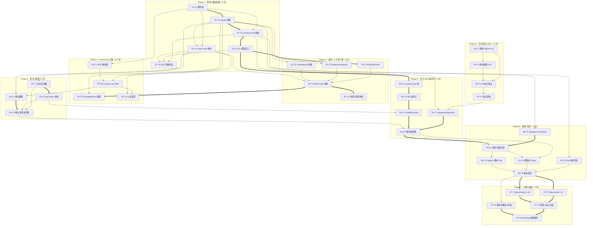

# 鲁班 Luban · 分阶段开发任务计划

> 版本：v1.0　依据：[ai-automation-technical-design.md](./ai-automation-technical-design.md) §九 分阶段交付计划 + [ai-automation-product-requirements.md](./ai-automation-product-requirements.md) §10.3 质量验收
>
> 任务粒度：0.5-2 天 / 任务；所有验收标准均为可实测、可复现的具体条件。文件路径均相对 `luban/` 目录。

---

## 概览

| Phase | 目标 | 任务数 | 预估工时 | 退出标准 |
|-------|------|--------|---------|---------|
| P0 注入验证 Spike | 验证 MAIN world 注入可行性 + 降级链 | 4 | 3 天 | ≥ 8/10 benchmark 站点 Method 1 通过，注入策略定稿 |
| P1 骨架 + 通信链路 | SW ↔ Content ↔ Side Panel 消息路由跑通 | 6 | 3 天 | Side Panel 按钮 → SW → CS → 页面 console 全链 ≤ 1s |
| P2 元素选择 + 上下文引擎 | 点选元素产出结构化脱敏上下文 | 5 | 4 天 | 任意页面选元素 → Side Panel 显示结构化 JSON，采集 P50 < 100ms |
| P3 AI Client + Prompt 引擎 | 上下文 + 意图 → MiMo → 可解析脚本 JSON | 4 | 3.5 天 | 真实上下文 + 意图 → AI 返回合法 JSON（10 次 ≥ 9 次直接解析成功） |
| P4 安全扫描 + 预览 | 生成代码经扫描后展示并确认 | 4 | 2 天 | AI 代码 + 解释可预览；含 `eval` 的代码被拦截 |
| P5 注入引擎 + GM_* 运行时 | 确认脚本在 MAIN world 执行，GM_* 可用 | 5 | 4 天 | 淘宝「标红价格」脚本经 GM_addStyle 运行生效 |
| P6 脚本管理 + 状态恢复 | 脚本持久化 + SW 休眠可恢复 | 6 | 3 天 | 保存 → 关面板 → 重开 → 脚本在列表 → 再次运行成功 |
| P7 打磨 + Benchmark 验收 | 通过 PRD §10.3 五项质量验收 | 5 | 3 天 | PRD 10.3 五项验收全通过 |
| **合计** | — | **39** | **25.5 人日** | 排期 22-25 天：P0 若 Method 1 一次全过可省 0.5-1 天；P2-T5 / P3-T4 / P4-T1 可与前置任务并行压缩 1-1.5 天 |

---

## Phase 0: 注入验证 Spike（3 天）

### 阶段目标

用最小成本验证最高技术风险（PRD §11 #1）：`chrome.scripting.executeScript({world:'MAIN'})` 在 10 个 benchmark 站点的注入成功率、各降级路径的真实 CSP 行为，产出指导 Phase 5 设计的站点兼容矩阵与注入策略定稿。

### 任务清单

| ID | 任务 | 说明 | 关键文件 | 依赖 | 验收标准 | 工时 |
|----|------|------|---------|------|---------|------|
| P0-T1 | 最小 MV3 骨架 + MAIN world 注入 PoC | 手写最小 manifest.json（permissions: storage/activeTab/scripting/sidePanel，无 content_scripts 声明）；SW 注册 action.onClicked；点击图标用 executeScript({world:'MAIN'}) 注入硬编码样式脚本（所有 `<a>` 标红，页面 window 打 `__luban_poc` 标记）；PoC 代码放独立 spike/ 目录与正式 src 隔离 | `spike/manifest.json`、`spike/background.js` | 无 | ① chrome://extensions 加载解压扩展零报错（SW console 无 error）② 普通站点（example.com）点击图标后所有链接变红 ③ Console 切到页面主上下文执行 `__luban_poc` 输出 true（证明运行于 MAIN world）④ chrome:// 内置页点击图标异常被 catch 并 toast 提示，SW 不崩 | 1 天 |
| P0-T2 | 降级注入路径 PoC | 实现 Method 2（ISOLATED world content script 创建 `<script>` textContent 注入）与 Method 3（Blob URL `<script src>` 注入）最小实现；后台开关切换三种方法；捕获并记录各方法的 CSP violation 报错形态 | `spike/background.js`、`spike/content.js` | P0-T1 | ① GitHub（CSP 严格站）Method 1 注入成功，证明浏览器级注入绕过页面 CSP ② 自建 CSP 测试页（`script-src 'self'` 无 unsafe-inline）Method 2 触发 CSP violation 且被捕获上报 ③ Method 3 在允许 blob: 的页面生效、被禁页面失败可捕获 ④ 三种方法经开关切换后均返回各自的执行结果标记 | 0.5 天 |
| P0-T3 | 10 站点逐站注入验证 | 对 PRD §10.3 的 10 个站点（淘宝/京东/知乎/微博/GitHub/B站/百度/豆瓣/掘金/V2EX）逐一执行 Method 1→2→3，记录成功方法、注入耗时（executeScript 前后 performance.now 差）、CSP 响应头摘要与报错 | `spike/`（复用）、`docs/spike-injection-results.md`（数据记录节） | P0-T1、P0-T2 | ① 10 个站点逐一有记录行：站点 / URL / Method 1-3 各自结果 / 耗时 ms / CSP 头摘要 ② Method 1 成功率有明确数字（目标 ≥ 8/10）③ 每个失败站点附 CSP 头原文或报错截图证据 ④ 每站点注入耗时均已记录（供 P95 统计）| 1 天 |
| P0-T4 | Spike 结论与注入策略定稿 | 汇总结果输出结论：默认注入方法、降级链顺序、失败站点清单、是否需要 webNavigation.onCommitted 时序处理；结论回写技术设计（如有偏差）；cross-reference 设计 §3.5 | `docs/spike-injection-results.md`（结论节） | P0-T3 | ① 文档含「结论 / 降级链定稿 / 风险站点清单」三节 ② Method 1 ≥ 8/10；若 < 8 则附替代方案与对 Phase 5 工期影响评估 ③ 结论与设计 §3.5 降级链表逐一对应，差异处已标注 ④ 结论中明确「已知失败站点在正式版的行为预期」（优雅降级文案）| 0.5 天 |

### 阶段验收门

- [ ] 10/10 站点测试记录完整（含 CSP 证据），无跳过项
- [ ] Method 1 成功率 ≥ 8/10（PRD §10.3 #2 的前置保障）
- [ ] 注入策略定稿文档完成，Phase 5 可直接引用
- [ ] 决策点确认：若某站点 Method 1 失败，正式版是走降级链还是直接「暂不支持」

---

## Phase 1: 骨架 + 通信链路（3 天）

### 阶段目标

以 Vite + CRXJS 搭建正式工程，实现三上下文（SW / Isolated / Side Panel）类型安全的消息路由，端到端验证「Side Panel → SW → Content Script → 页面」链路。

### 任务清单

| ID | 任务 | 说明 | 关键文件 | 依赖 | 验收标准 | 工时 |
|----|------|------|---------|------|---------|------|
| P1-T1 | 项目脚手架初始化 | 初始化 Vite + @crxjs/vite-plugin + TypeScript(strict) + Preact/HTM；配置 scripts（dev/build/test/zip）、ESLint 基础规则、.gitignore | `package.json`、`vite.config.ts`、`tsconfig.json`、`.eslintrc` | 无 | ① `npm run dev` 构建成功，dist 可加载进 chrome://extensions 零报错 ② `npm run build` 产出 SW / sidepanel / options 三入口产物 ③ 修改 sidepanel 源码 HMR 生效（不重载扩展即可见变化）④ `tsc --noEmit` 零错误 | 0.5 天 |
| P1-T2 | shared 类型与常量定义 | types.ts（PageContext/TargetElement/DOMSummary/GenerationResult/Script/Settings，对齐 PRD §7 与设计 §3.2）；messages.ts（12 个 MessageType 联合类型 + 各自请求/响应 payload）；constants.ts（存储 key 前缀、GM P0 白名单 6 项、7 个意图 chips、超时默认值）；errors.ts（LubanError + ErrorLayer 五层 + ErrorAction）；i18n-strings.ts（中文文案集中管理骨架） | `src/shared/types.ts`、`messages.ts`、`constants.ts`、`errors.ts`、`i18n-strings.ts` | P1-T1 | ① 全部类型可被入口 import 且编译通过 ② messages.ts 覆盖设计 §3.1 全部 12 个消息类型，payload 类型齐备 ③ GM 白名单与 PRD §6 P0 清单逐项一致（6 项）④ LubanError 经 structuredClone 序列化/反序列化往返后 layer/code/userMessage/actions 不丢失（单测） | 0.5 天 |
| P1-T3 | manifest 正式化 + SW 入口与消息路由 | 按设计 §八写正式 manifest（4 权限 + 4 条 MiMo host_permissions + side_panel + options_page）；service-worker/index.ts：顶层同步注册全部事件（MV3 强制）、action.onClicked → sidePanel.open、runtime.onMessage 类型分发路由（handler 注册表 + 统一错误包装为 LubanError） | `manifest.json`、`src/service-worker/index.ts` | P1-T1、P1-T2 | ① 图标点击打开 Side Panel；options 页可从扩展详情进入并渲染 ② SW 冷启动到可处理首消息 < 50ms（console.time 三次均值）③ 发送未注册消息类型返回结构化错误 `{layer:'NET', code:'UNKNOWN_MSG'}` 而非静默 ④ chrome://extensions 对 manifest 零警告，host_permissions 与设计 §八逐条一致 | 0.5 天 |
| P1-T4 | Content Script 按需注入机制 | 实现「activeTab + chrome.scripting.executeScript 注入 CS 打包产物」；content/index.ts 幂等注册（`window.__luban_cs` 标记防重复）、runtime.onMessage 监听、PING/ECHO 测试消息 | `src/content/index.ts` | P1-T3 | ① SW 注入后 content console 出现注册日志且仅一次（连续触发两次注入不重复注册）② SW 发 PING → CS 回 ECHO，RTT < 50ms ③ 对 chrome:// 与 Web Store 页注入失败被 catch，返回 CAP 层 LubanError ④ 页面刷新后重新注入正常工作 | 0.5 天 |
| P1-T5 | Side Panel 最小页面 | Preact 骨架：App.tsx + 5 视图占位组件（Idle/Intent/Generating/Preview/Result）+ state-machine.ts 纯函数 reducer（IDLE/PICKING/INTENT_INPUT 三态迁移先行）+ CSS 变量主题基础样式 | `src/sidepanel/index.html`、`index.ts`、`App.tsx`、`state-machine.ts`、`views/*.tsx`、`styles/` | P1-T1、P1-T2 | ① 打开显示 IdleView，按钮触发经 reducer 的状态迁移（日志可见）② state-machine 单测 ≥ 8 条迁移用例符合 PRD §8.3 主链路 ③ 首屏渲染 < 100ms（performance.mark）④ 5 个视图按 state.type 条件渲染可切换 | 0.5 天 |
| P1-T6 | E2E 通信链路验证（阶段退出门） | 串完整链路：IdleView 临时按钮 → START_PICKER 消息 → SW 路由 → 注入 CS → CS 向页面 MAIN world 打 console.log 标记；每跳加结构化日志（SP→SW→CS→MAIN） | `src/sidepanel/App.tsx`（临时按钮）、`src/service-worker/index.ts`、`src/content/index.ts` | P1-T3、P1-T4、P1-T5 | ① 点击按钮 ≤ 1s 内页面 Console 打出 `[luban-main]` 标记 ② 链路每跳均有可追踪的结构化日志 ③ 在 chrome://serviceworker-internals 手动 Stop SW 后再发消息，SW 自动唤醒并完成处理 ④ 任意一跳的异常能冒泡到 Side Panel 呈现（非静默）| 0.5 天 |

### 阶段验收门

- [ ] 「Side Panel 按钮 → SW → CS → 页面 console」退出标准达成（≤ 1s）
- [ ] SW 被 Stop 后消息可唤醒（风险 #2 前置验证）
- [ ] 12 个消息类型全部有类型定义与路由占位
- [ ] `npm run build` / `tsc --noEmit` / 单测全绿

---

## Phase 2: 元素选择 + 上下文引擎（4 天）

### 阶段目标

实现 PRD §A 页面上下文引擎：DevTools 式元素选择、稳健选择器生成（回退链）、TreeWalker 限流摘要与三级脱敏，性能达到 P50 < 100ms / P95 < 300ms。

### 任务清单

| ID | 任务 | 说明 | 关键文件 | 依赖 | 验收标准 | 工时 |
|----|------|------|---------|------|---------|------|
| P2-T1 | 元素选择器 ElementPicker | 进入选择模式：mouseover 用 CSS outline 类高亮（纯 CSS 零逐帧 JS）、元素标签提示浮层（tag/id/class）、click 在 capture 阶段拦截 + stopPropagation 防页面响应、Esc 退出、iframe 主文档兼容 | `src/content/element-picker.ts`、`toast.ts`（提示浮层） | P1-T4 | ① 悬停任意元素出现高亮且移出即消失，页面滚动时高亮层不错位 ② 点击后页面原生行为被完全屏蔽（链接不跳转/按钮不提交）且触发采集 ③ Esc 即时退出并移除全部监听器与高亮节点（连续进出 10 次后 listener 计数不增长）④ 含 position:fixed 顶栏与 iframe 的页面可正常选中主文档元素 | 1 天 |
| P2-T2 | 选择器生成器 SelectorGenerator | 候选链：`#id` → 稳定 `[data-*]` → 稳定 `.class`（排除 css-*/jsx-* 等动态类）→ `tag.class` → 父级 nth-child 兜底；每元素 3-4 候选；querySelectorAll 验证唯一性；按稳健度降序输出 | `src/content/selector-generator.ts` | P1-T2 | ① 单测 ≥ 12 用例：有 id 首选 #id；无 id 有 data-testid 命中属性选择器；动态 class（css-1a2b3c）被排除且回退有效；无特征深层元素经 nth-child 兜底仍唯一 ② 每个候选在真实页面 querySelectorAll 返回长度 1 且为同一元素 ③ 候选数组顺序符合稳健度降序（断言）④ 单元素生成 < 5ms（100 次均值）| 1 天 |
| P2-T3 | TreeWalker DOM 摘要 + 脱敏 | context-engine 三阶段：Phase 1 目标元素同步采集（~3ms）；Phase 2 TreeWalker 限流摘要（inputs≤20 / buttons≤15 / depth≤8 / forms / notes，200ms 强制截断返回部分结果）；Phase 3 脱敏（URL 去 token/session/auth/key/secret 参数、password 值不采集、敏感站点域名清单命中则降级为仅 meta） | `src/content/context-engine.ts` | P1-T2 | ① 淘宝商品页与掘金首页实测采集+序列化 P50 < 100ms、P95 < 300ms（各 20 次）② 脱敏单测：`?token=abc&session=xyz` 参数被移除；password input 的 value 永不出现在输出 ③ > 5000 节点测试页 200ms 内强制返回部分结果且标记 truncated ④ 敏感清单命中时输出仅 meta 且 notes 标注「敏感站点已降级」| 1 天 |
| P2-T4 | 上下文串联 Side Panel 展示 | ELEMENT_PICKED 链路：CS 采集 → SW → Side Panel 进 INTENT_INPUT 态；IntentView 渲染元素信息卡（tag/text/候选选择器）+ 意图输入框 + 7 个快捷意图 chips（多选叠加，normalized 标签映射）| `src/sidepanel/views/IntentView.tsx`、`state-machine.ts` 扩展、`src/service-worker/index.ts` | P2-T1、P2-T2、P2-T3、P1-T5 | ① 任意普通页面选元素 ≤ 200ms 内 Side Panel 显示元素卡片且 tag/文本正确 ② 7 个 chips 可多选且 normalized 映射正确（对照 PRD §B 清单）③ 返回/取消回 IdleView 后重选新元素，旧数据被覆盖不残留 ④ 跨域 iframe 内点击触发降级采集：仅元素信息 + 「上下文不完整」标注，UI 不崩 | 0.5 天 |
| P2-T5 | 上下文引擎单测与性能基线 | tests：脱敏规则 8 条、限流规则 4 条、选择器回退链 12 条；3 个真实站点 × 20 次采样性能基线落档；lint 清零 | `tests/context-engine.test.ts`、`tests/selector-generator.test.ts` | P2-T4 | ① `npm test` 全绿且覆盖数达标（8+4+12 条）② 性能基线表落档（P50/P95 数据）③ `npm run lint` 零 error ④ Phase 2 退出标准演示：任意页面选元素 → Side Panel 显示结构化 JSON | 0.5 天 |

### 阶段验收门

- [ ] 任意页面选元素 → Side Panel 显示结构化 JSON（设计 Phase 2 退出标准）
- [ ] 采集性能 P50 < 100ms、P95 < 300ms 有实测数据
- [ ] 脱敏规则全部有单测覆盖，password/token 类数据零泄漏
- [ ] 选择器回退链 ≥ 12 用例全绿

---

## Phase 3: AI Client + Prompt 引擎（3.5 天）

### 阶段目标

打通 BYOK 直连小米 MiMo（Token Plan）：SSE 流式、错误映射、Port 保活；Prompt 拼装满足 ≤ 8K token 预算与分级裁剪；响应 JSON 容错解析链；设置页完成 Key 管理闭环。

### 任务清单

| ID | 任务 | 说明 | 关键文件 | 依赖 | 验收标准 | 工时 |
|----|------|------|---------|------|---------|------|
| P3-T1 | SSE 增量解析器 | sse-parser.ts：ReadableStream 增量解析 data:/event:/[DONE]，处理跨 chunk 粘包/断包与 CRLF；纯函数零依赖；输出 StreamChunk 迭代器 | `src/service-worker/sse-parser.ts`、`tests/sse-parser.test.ts` | P1-T1 | ① 单测 ≥ 10 用例：跨 chunk 断行的 data 行正确拼接；[DONE] 终止；空 data/未知 event 不崩溃 ② 用 MiMo 真实 SSE 录制样本回放，输出与基准拼接一致 ③ 解析 1MB 流 < 50ms | 0.5 天 |
| P3-T2 | Provider 抽象 + OpenAI 兼容适配器 + AI Client | base.ts（AIProvider 接口 + 注册表 Map，P1 加 Provider 只加文件）；openai-compatible.ts（chat/completions 构造、response_format:json_object、thinking 开关、stream、usage 提取、401/403/429/超时→中文文案映射、testConnection）；ai-client.ts（AbortController 60s 超时、自动重试 1 次指数退避 2s、429 读 Retry-After、Port 长连接推 delta、cancel()）；keepalive.ts（流期间 Port 保活、流毕即断） | `src/service-worker/ai-providers/base.ts`、`openai-compatible.ts`、`ai-client.ts`、`keepalive.ts`、`tests/ai-client.test.ts` | P1-T2、P3-T1 | ① 真实 tp- Key 对 token-plan-cn 流式请求：首 token P50 ≤ 6s，delta 逐个到达 Side Panel ② 错误映射：错 Key→401「Key 无效」、429→含倒计时文案、60s 超时→自动重试 1 次后报「生成超时」，三者均携带 ≥ 1 个 ErrorAction ③ cancel() 200ms 内中止（AbortError 捕获为「已取消」非错误）④ testConnection 返回 {ok, latencyMs}；流结束 Port 断开（无残留连接）⑤ ai-client 单测 mock fetch 覆盖成功/超时/429/401 四分支 | 1.5 天 |
| P3-T3 | Prompt Builder + 响应容错解析 | prompt-builder.ts：中文 System Prompt（安全/输出格式/选择器质量/脚本质量四类约束，~1200 tokens）；上下文 JSON 按 PRD §I.2 模板拼装 + capabilities 注入；token 估算（中文 1.5/字）与分级裁剪（target/intent 不裁 → domSummary 裁 → siblings/notes 裁）；响应容错链：parse → 剥 Markdown 围栏 → 正则提取首个 {...} → 强化重试 1 次 → 切 pro 模型 → MOD 层 LubanError | `src/service-worker/prompt-builder.ts`、`tests/prompt-builder.test.ts` | P1-T2、P2-T4（类型就绪后可先行，用 mock PageContext）| ① 真实 PageContext + 意图产出 prompt 估算 ≤ 8K tokens（日志分段输出）② 800 输入框极端 DOM 裁剪后 ≤ 8K 且 target 完整 ③ 容错链单测：围栏包裹可解析、杂文可正则提取、两次失败自动以 flash→pro 重发（断言第二次请求 model=pro）④ 真实链路：手动上下文 + 意图 → MiMo 返回 6 字段完整 JSON，10 次尝试 ≥ 9 次直接解析成功 | 1 天 |
| P3-T4 | AI 设置页（Options · AI 设置 Tab） | AiSettings：billing 切换（Token Plan ↔ 按量付费，附 PRD 附录 B.6 合规提示）、cluster 三选一、baseUrl 展示、Key 输入（base64 混淆存 local 不进 sync）、前缀校验（tp-/ttp- ↔ sk-）、testConnection 按钮（显示延迟）、模型选择（flash 默认/pro）、超时配置；settings-store.ts（sync 存非敏感 + local 存 Key） | `src/options/index.html`、`App.tsx`、`tabs/AiSettings.tsx`、`src/service-worker/settings-store.ts` | P3-T2、P1-T5 | ① tp- Key + token-plan 保存通过；sk- Key + token-plan 被前端拦截并提示不匹配 ② 保存后 chrome://sync-internals 确认 Key 不在 sync；storage.local 中为 base64 非明文 ③ 「测试连接」3s 内返回成功 + 延迟 ms（真实 Key）④ 刷新页面设置回显正确；「一键清除」可删除 Key | 0.5 天 |

### 阶段验收门

- [ ] 「手动上下文 + 意图 → AI 返回合法 JSON」退出标准达成（10 次 ≥ 9 次解析成功）
- [ ] 四类错误（401/403/429/超时）均映射为中文文案 + 可执行 ErrorAction
- [ ] prompt ≤ 8K tokens 且极端页面裁剪有效
- [ ] Key 仅存 local（混淆）、不进 sync，已验证

---

## Phase 4: 安全扫描 + 预览（2 天）

### 阶段目标

AI 返回代码在用户确认前经过静态黑名单扫描与 gmGrants 白名单校验；Side Panel 预览态完整呈现 explanation / code / warnings / confidence，并打通确认/拒绝/重生成流程。

### 任务清单

| ID | 任务 | 说明 | 关键文件 | 依赖 | 验收标准 | 工时 |
|----|------|------|---------|------|---------|------|
| P4-T1 | 安全扫描器黑名单 | safety-scanner.ts 按设计 §3.8 实现 7 类规则：eval/new Function 拦截、cookie 外发拦截、localStorage.clear/indexedDB.deleteDatabase 拦截、跨域 fetch/XHR 警告、死循环（while(true)/for(;;) 无 break）拦截、__proto__/constructor.prototype 警告、支付关键词强警告；输出 {blocked, warnings[]}；纯函数 | `src/service-worker/safety-scanner.ts`、`tests/safety-scanner.test.ts` | P1-T2 | ① 单测 ≥ 14 用例（每规则 ≥ 2 正反例）：eval → blocked；跨域 fetch → warning；while(true) → blocked；setTimeout 定时刷新不误拦 ② 扫描 10KB 代码 < 10ms ③ blocked 代码不进入可运行预览，UI 报「包含被禁止的操作」并提供「重新生成」按钮 | 0.5 天 |
| P4-T2 | gmGrants 白名单校验 | 对照 constants P0 白名单（6 项）校验 AI 返回 gmGrants：超范围 API（如 GM_xmlhttpRequest）打桩为 no-op 并写入 warnings；code 中直接调用越权 GM_* → 拒绝运行并提示重生成 | `src/service-worker/safety-scanner.ts`（扩展） | P4-T1 | ① gmGrants 含 GM_xmlhttpRequest → warnings 出现「该脚本申请了不支持的权限」，运行时该 API 为 no-op 不抛错 ② code 直接调用 GM_notification → 校验层拦截并提示重生成 ③ 单测覆盖三分支：合法白名单 / 超范围声明 / 越权调用 | 0.5 天 |
| P4-T3 | 预览视图 PreviewView | explanation 正文（普通用户核心阅读区）、code 折叠块（等宽字体、microlighter 语法高亮、点击展开/收起）、warnings 黄色提示区逐条渲染、confidence < 0.6 显示「建议重生成」角标、操作条（运行/取消/重生成/编辑占位） | `src/sidepanel/views/PreviewView.tsx`、`components/CodeBlock.tsx`、`package.json`（microlighter 依赖） | P3-T2、P1-T5 | ① 含 10KB code 时预览首屏渲染 < 300ms（含 microlighter 语法高亮，关键字/字符串等 token 正确着色） ② 默认折叠仅显 explanation，展开/收起无布局跳动 ③ mock confidence=0.4 显示角标；warnings 逐条渲染 ④ GENERATING→PREVIEW 经 reducer 正确迁移；预览态 Esc 有二次确认 | 0.5 天 |
| P4-T4 | 确认 / 拒绝 / 重生成流程 | 串联 GENERATION_COMPLETE → 扫描 → PREVIEW → 运行（INJECT_SCRIPT 占位）/ 取消 / 重生成；重生成请求自动携带上一轮代码 + warnings + 用户追加要求 | `src/sidepanel/state-machine.ts`、`src/service-worker/index.ts`、`views/IntentView.tsx` | P4-T1、P4-T2、P4-T3 | ① 真实链路：生成 → 预览 → 追加「同时隐藏按钮」重生成，SW 日志确认第二次 prompt 含首轮代码与追加要求 ② blocked 代码的「运行」按钮不可用 ③ 取消回 IntentView 且表单内容保留 ④ 阶段退出演示：eval 脚本被拦截 + 正常脚本经占位注入返回成功 | 0.5 天 |

### 阶段验收门

- [ ] AI 代码（microlighter 语法高亮）+ 解释完整展示，warnings/confidence 角标生效（设计 Phase 4 退出标准）
- [ ] 黑名单能拦截 `eval()`（设计 Phase 4 退出标准，单测 + 真实链路双验证）
- [ ] 重生成携带失败上下文，用户无需重复输入
- [ ] 任何 blocked / 校验失败均有可读提示 + 恢复动作（§4.1 原则）

---

## Phase 5: 注入引擎 + GM_* 运行时（4 天）

### 阶段目标

确认后的脚本注入 MAIN world 执行：降级链调度（依据 Phase 0 定稿）、UUID 密钥 CustomEvent 桥、GM_* P0 子集运行时（同步读 + 异步回写）、脚本执行器错误捕获与回报。

### 任务清单

| ID | 任务 | 说明 | 关键文件 | 依赖 | 验收标准 | 工时 |
|----|------|------|---------|------|---------|------|
| P5-T1 | 注入调度器 InjectionDispatcher | 按 P0-T4 定稿降级链依次尝试（Method 1 executeScript MAIN → 2 script 标签 → 3 Blob URL → 4 报告「暂不支持」）；SiteCompatibility 持久化（luban:site:{domain}：lastTested/injectionMethod/failures）；已知站点直用缓存方法、失败方法 7 天后重试；「tab was closed」100ms 重试 | `src/service-worker/injection-dispatcher.ts` | P0-T4、P1-T3 | ① CSP 测试页强制 Method 1 失败 → 自动降级 Method 2，INJECTION_RESULT.method 记录实际方法 ② 首次失败后 storage 出现 luban:site:{domain} 记录；再次注入跳过已证伪方法（日志验证）③ 关闭 tab 后立即注入触发 100ms 重试一次 ④ 全部失败 → 「该站点暂不支持」错误 + 落库，总尝试 ≤ 3 次无死循环 | 1 天 |
| P5-T2 | CustomEvent 跨世界桥 | event-bridge.ts（Isolated 侧）+ bridge-shim.ts（MAIN 侧）：crypto.randomUUID 密钥经一次性 CustomEvent 在 document_start 共享；事件名 `__luban_to_main_{uuid}` / `__luban_to_content_{uuid}`；requestId 关联异步响应；数据用 Object.create(null) 防原型污染；pending 请求 5s 超时 reject | `src/content/event-bridge.ts`、`src/main-world/bridge-shim.ts` | P1-T4 | ① Isolated ↔ MAIN 往返 RTT < 10ms（100 次均值）② 并发 50 条消息 requestId 全部正确配对零串扰（自动化断言）③ 页面注入探测脚本无密钥无法构造有效消息（安全单测）④ 页面跳转后 Isolated 侧 pending 请求 5s 超时 reject 非悬挂 | 1 天 |
| P5-T3 | GM_* P0 运行时 | gm-runtime.ts 按 gmGrants 按需注入：GM_getValue 同步读预注入 `__luban_storage` 快照；GM_setValue/deleteValue 立即更新内存快照 + 经桥异步回写（SW 侧临时直写 luban:gm:{scriptId}，Phase 6 由 StorageManager 统一）；GM_addStyle 带 data-luban-script 标记防重复；GM_info 拼装元信息；unsafeWindow 即 window | `src/main-world/gm-runtime.ts`、SW 侧 GM 存储临时 handler | P5-T2 | ① 注入前 SW 预写 {k:'v'}，脚本首行 GM_getValue('k') 同步返回 'v' ② GM_setValue 写入后 ≤ 500ms storage.local 可见 luban:gm:{id} 更新；刷新重注入读到新值 ③ GM_addStyle 连跑 3 次仅 1 个 style 节点（幂等）④ 未申请的 GM API（如 GM_xmlhttpRequest）为 undefined 且注入代码体积不含其实现（按需注入生效）⑤ 6 个 API 行为矩阵单测全绿 | 1 天 |
| P5-T4 | 脚本执行器 ScriptExecutor | script-executor.ts：用户 code 以 IIFE + 'use strict' + 顶层 try/catch 包装；错误捕获（message/lineno）经桥回传；注入前 GM 存储快照预注入；执行完成信号（脚本尾部 `__luban_done` 标记）+ 10s 无信号标记「脚本未正常结束」（不阻断页面） | `src/main-world/script-executor.ts` | P5-T3、P4-T2 | ① 正常脚本运行后 Side Panel 收 success ≤ 200ms ② 构造 null.querySelector 抛 TypeError：错误摘要含 message + 行号并回传结果态 ③ 死循环脚本 10s 后结果态标记「脚本未正常结束」且 SW 不阻塞 ④ 注入前后 window 快照 diff 仅新增 __luban_* 键（不污染页面全局）| 0.5 天 |
| P5-T5 | 注入链路端到端串联（阶段退出门） | 完整链路：意图 → 生成 → 扫描 → 预览 → 确认 → INJECT_SCRIPT → MAIN world 运行 → 结果回传 → RESULT 视图；淘宝真实验证 | 全链路联调（少量修 bug） | P5-T1、P5-T4、P4-T4 | ① 淘宝商品页点选价格元素 + 意图「标红该价格」→ 确认运行后价格变红（截图留档）② E2E 手表（含 AI 生成）3 次均值 P50 ≤ 15s ③ 已知 CSP 失败站点走「暂不支持」路径 UI 正常 ④ GitHub 重复完整流程一次成功（跨站稳定性）| 0.5 天 |

### 阶段验收门

- [ ] 淘宝「标红价格」脚本经 GM_addStyle 运行生效（设计 Phase 5 退出标准）
- [ ] 降级链依据 Phase 0 实测定稿实现，站点兼容追踪生效
- [ ] CustomEvent 桥安全性与并发正确性验证通过
- [ ] GM_* 6 项 API 行为矩阵全绿，同步读 + 异步回写语义正确

---

## Phase 6: 脚本管理 + 状态恢复（3 天）

### 阶段目标

脚本可持久保存（PRD §F P0 范围）并在当前页再次运行；SW 休眠/面板误关后状态可恢复；Options 脚本管理 Tab 与运行结果态视图完成。

### 任务清单

| ID | 任务 | 说明 | 关键文件 | 依赖 | 验收标准 | 工时 |
|----|------|------|---------|------|---------|------|
| P6-T1 | StorageManager + ScriptStore | storage-manager.ts：批量 get/set 封装（单次 IPC）+ 内存缓存；script-store.ts：luban:scripts_index 轻量索引（id/name/updatedAt）+ luban:script:{id} 单条按需读取；CRUD；GM 存储读写迁入统一通道；Script 数据模型落库对齐 PRD §7 全字段（含 aiMeta） | `src/service-worker/storage-manager.ts`、`script-store.ts`、`tests/script-store.test.ts` | P1-T2 | ① 单测：CRUD 后索引与单条数据一致；删除脚本同步清理 luban:gm:{id} 与索引项 ② 批量写 100 条索引 spy 验证 chrome.storage.local.set 仅调用 1 次 ③ 内存缓存命中时第二次 get 同 key 零 storage 调用（spy 验证）| 0.5 天 |
| P6-T2 | SAVE_SCRIPT / RUN_SAVED_SCRIPT 消息链 | 保存消息（ResultView「保存」→ ScriptStore → 返回 id）；RUN_SAVED_SCRIPT（再次运行 → SW 读脚本 → 走 Phase 5 注入链在当前页执行）；非当前页场景的明确提示 | `src/service-worker/index.ts`、`script-store.ts` | P6-T1、P5-T5 | ① 保存后 Options 列表出现该脚本且字段完整（含 aiMeta.model / pageContextSnapshot）② 在页面点「再次运行」2s 内执行成功回结果态 ③ 保存两次产生两条独立记录，删除后各 -1（MVP 不做去重）④ 当前页不匹配脚本目标域时提示「请先打开目标页面」而非静默失败 | 0.5 天 |
| P6-T3 | Options 脚本管理 Tab | ScriptManager：列表（名称/来源标记 ai·manual/更新时间）+ 操作（在当前页运行/删除带二次确认）+ 空态引导；IdleView「脚本列表」入口 + 最近脚本 ≤ 3 条一键再运行 | `src/options/tabs/ScriptManager.tsx`、`src/sidepanel/views/IdleView.tsx` | P6-T2 | ① 50 条脚本列表渲染 < 200ms；来源徽标正确 ② 删除有 confirm 二次确认，确认后列表与 storage 同步消失 ③ IdleView 最近脚本 ≤ 3 条按 updatedAt 降序，点击即运行 ④ 空列表显示引导文案无布局破版 | 0.5 天 |
| P6-T4 | 运行结果态视图 + Toast 通知 | ResultView：成功（效果说明 + 再次运行 + 保存到列表 / 仅本次运行）/ 失败（错误摘要 + 行号 + 「反馈 AI 重生成」→ 回 IntentView 预填错误上下文）；toast.ts 页面浮层（成功/失败摘要、≤ 5s 自动消失、点击聚焦 Side Panel）| `src/sidepanel/views/ResultView.tsx`、`src/content/toast.ts` | P5-T5、P6-T2 | ① 成功运行后「保存」触发页面右下角 Toast 且 5s 内消失 ② 运行时错误场景 ResultView 显示摘要 + 行号；「反馈重生成」回 IntentView 且输入框预填错误信息 ③ 「仅本次运行」后脚本不出现在列表 ④ Toast 点击后 Side Panel 获得焦点 | 0.5 天 |
| P6-T5 | SW 状态持久化与恢复 | state-recovery.ts：GENERATING 每 5s 写 chrome.storage.session（luban:uiState）；PREVIEW 结果（含 code/explanation/warnings）写入；SW 唤醒读 session：generating 已超时 → 标记失败通知 UI，未超时 → 流断整体重试；keepalive 归位模块化 | `src/service-worker/state-recovery.ts`、`keepalive.ts` | P1-T3 | ① 生成中手动 Stop SW → 重开面板恢复到「生成中/失败提示」而非白屏 ② 预览态 Stop SW → 重开恢复预览完整内容 ③ session 写入实测约 5s 一次（storage.onChanged 计数）④ 浏览器完全重启后 session 清空，UI 回 IdleView 无脏状态 | 0.5 天 |
| P6-T6 | Side Panel 重连恢复 + 阶段退出门 | Side Panel 启动经 GET_STATE 拉 session 恢复视图；完成设计退出标准全链演示：保存 → 关面板 → 重开 → 脚本在列表 → 再次运行成功（录屏留档） | `src/sidepanel/index.ts`、`App.tsx` | P6-T5、P6-T4、P6-T3 | ① 关闭 Side Panel 重开：进行中任务状态 ≤ 1s 完整恢复 ② 退出标准全链演示成功且录屏存档 ③ 无进行中状态时打开直接 IdleView 无闪烁 | 0.5 天 |

### 阶段验收门

- [ ] 「保存脚本 → 关面板 → 重开 → 脚本在列表 → 再次运行成功」退出标准达成（录屏留档）
- [ ] SW 被 Stop 后 GENERATING/PREVIEW 状态可恢复，无白屏
- [ ] 脚本 CRUD + 索引一致性单测全绿
- [ ] 再次运行的本地功能在断网时仍可用（§4.1 网络断开场景前置）

---

## Phase 7: 打磨 + Benchmark 验收（3 天）

### 阶段目标

通过 PRD §10.3 五项质量验收：10 场景生成成功率 ≥ 7、10 站点注入成功率 ≥ 8、E2E ≤ 15s（P95）、§4.1 错误场景全覆盖无静默失败、安全零违规；产出 MVP 验收报告。

### 任务清单

| ID | 任务 | 说明 | 关键文件 | 依赖 | 验收标准 | 工时 |
|----|------|------|---------|------|---------|------|
| P7-T1 | Benchmark 场景 1-5 端到端 | 按本文档末尾「Benchmark 验证矩阵」执行场景 1-5（价格标红/隐藏广告/批量图片/表单填充/定时刷新），每场景记录：站点/意图/一次生成是否可运行/E2E 耗时/安全扫描结果/截图 | `tests/benchmark/acceptance-records.md`（验收记录） | P6-T6 | ① 5 场景各 ≥ 1 次完整执行记录 ② 一次生成可运行 ≥ 4/5（为总目标 ≥ 7/10 留余量）③ 零 eval / 外发敏感数据 / 删除类代码生成（扫描器 blocked=0）④ 每场景 E2E 耗时在案 | 0.5 天 |
| P7-T2 | Benchmark 场景 6-10 端到端 | 执行场景 6-10（监控变化/展开折叠/暗色模式/表格提取/隐藏评论）；场景 9 剪贴板受限时验证 GM_setValue + Toast 降级路径 | `tests/benchmark/acceptance-records.md` | P6-T6 | ① 5 场景各 ≥ 1 次完整执行记录 ② 累计 10 场景一次生成可运行 ≥ 7（PRD 10.3 #1 达标）③ 场景 9 降级路径可用（无剪贴板权限站点）④ 场景 5 定时刷新未被死循环黑名单误拦 | 0.5 天 |
| P7-T3 | 失败项修复 + 10 站点注入复验 | 修复 P7-T1/T2 失败场景（选择器回退调优 / Prompt 迭代 / 降级链修正）；对 10 站点复验注入成功率并更新站点兼容矩阵为最终版 | 按失败点而定；更新 `docs/spike-injection-results.md` | P7-T1、P7-T2 | ① 10 站点注入成功率 ≥ 8/10（PRD 10.3 #2），失败站有「暂不支持」正确兜底 ② 修复后失败场景复跑通过，或明确记录为已知限制并给替代方案 ③ 站点兼容矩阵最终版（每站实际注入方法在案）| 1 天 |
| P7-T4 | §4.1 错误场景全覆盖 + 离线检测 | 对照 PRD §4.1 十个错误场景逐一注入故障验证（错 Key / 403 / 429 / 断网 / 超时 mock / CSP 站 / 跨域 iframe 点选 / SW Stop / 坏 JSON mock / 元素消失 mock / 越权 gmGrants mock）；实现 navigator.onLine 监听：断网禁用 AI 入口 + 恢复自动解除 | `src/sidepanel/App.tsx`（离线横幅）、`tests/benchmark/error-scenarios-checklist.md` | P6-T6 | ① §4.1 表 10 行逐条有验证记录：可读文案 + ≥ 1 个恢复动作 ② 断网 5s：生成入口置灰显示「网络不可用」，脚本列表与再次运行不受影响；网络恢复自动解除 ③ 抽查 3 条链路日志确认无白屏/无静默失败（PRD 10.3 #4）| 0.5 天 |
| P7-T5 | 性能 profiling + MVP 验收报告 | 采样：上下文采集 P50/P95、AI 生成 P50/P95、E2E P95、SW 冷启动、Side Panel 首屏；汇总 PRD 10.3 五项验收结果；标记已知限制与 P1 建议 | `docs/mvp-acceptance-report.md` | P7-T3、P7-T4 | ① 报告含 10.3 五项逐条 PASS/FAIL 及证据链接 ② 上下文采集 P50 < 100ms、E2E P95 ≤ 15s 实测数据在案（PRD 10.3 #3）③ 10 benchmark 零安全违规记录在案（PRD 10.3 #5）④ 全部 P0 任务关闭，遗留项列入 P1 backlog | 0.5 天 |

### 阶段验收门（= PRD §10.3 五项）

- [ ] #1 脚本生成成功率：10 benchmark ≥ 7 个一次生成可运行
- [ ] #2 站点注入成功率：10 站点 ≥ 8 个注入执行正常
- [ ] #3 端到端耗时：点选到运行 ≤ 15s（P95，含 AI 生成）
- [ ] #4 错误恢复：§4.1 全场景有可读提示，无白屏/无响应/静默失败
- [ ] #5 安全：10 benchmark 零 eval / 外发敏感数据 / 删除操作

---

## 任务依赖关系图

关键路径（粗线）：P1-T1 → P1-T2 → P1-T3 → P1-T4 → P2-T1 → P2-T4 → P3-T3 → P4-T3 → P4-T4 → P5-T5 → P6-T2 → P6-T6 → P7-T5。

可并行组：`P2-T2 / P2-T3`（与 P2-T1 并行）、`P3-T1 / P3-T2`（与 Phase 2 并行）、`P4-T1 / P4-T2`（与 P3-T4 并行）、`P6-T1 / P6-T5`（与 Phase 5 后段并行）、`P7-T1 / P7-T2 / P7-T4`（三者可并行）。

---

## 文件变更总览

| Phase | 新建文件 | 修改文件 |
|-------|---------|---------|
| P0 | `spike/manifest.json`、`spike/background.js`、`spike/content.js`、`docs/spike-injection-results.md` | —（PoC 与正式 src 隔离，验证后归档） |
| P1 | `package.json`、`vite.config.ts`、`tsconfig.json`、`.eslintrc`、`.gitignore`、`manifest.json`、`src/shared/{types,messages,constants,errors,i18n-strings}.ts`、`src/service-worker/index.ts`、`src/content/index.ts`、`src/sidepanel/index.html`、`index.ts`、`App.tsx`、`state-machine.ts`、`views/{IdleView,IntentView,GeneratingView,PreviewView,ResultView}.tsx`、`src/assets/icon{16,48,128}.png`、`_locales/zh_CN/messages.json` | — |
| P2 | `src/content/element-picker.ts`、`src/content/selector-generator.ts`、`src/content/context-engine.ts`、`src/content/toast.ts`、`tests/context-engine.test.ts`、`tests/selector-generator.test.ts` | `src/sidepanel/views/IntentView.tsx`（完善）、`state-machine.ts`（INTENT_INPUT 态）、`src/service-worker/index.ts`（ELEMENT_PICKED 路由） |
| P3 | `src/service-worker/sse-parser.ts`、`ai-client.ts`、`keepalive.ts`、`ai-providers/{base,openai-compatible}.ts`、`prompt-builder.ts`、`settings-store.ts`、`tests/{sse-parser,ai-client,prompt-builder}.test.ts`、`src/options/index.html`、`App.tsx`、`tabs/AiSettings.tsx` | `manifest.json`（如需调整 host_permissions） |
| P4 | `src/service-worker/safety-scanner.ts`、`tests/safety-scanner.test.ts`、`src/sidepanel/views/PreviewView.tsx`、`components/CodeBlock.tsx` | `package.json`（新增 microlighter 依赖）、`state-machine.ts`（PREVIEW 态）、`src/service-worker/index.ts`（扫描接入）、`views/IntentView.tsx`（追加要求入口） |
| P5 | `src/service-worker/injection-dispatcher.ts`、`src/content/event-bridge.ts`、`src/main-world/{bridge-shim,gm-runtime,script-executor}.ts` | `src/service-worker/index.ts`（INJECT_SCRIPT/INJECTION_RESULT 路由）、`src/content/index.ts`（桥挂载） |
| P6 | `src/service-worker/{storage-manager,script-store,state-recovery}.ts`、`tests/script-store.test.ts`、`src/options/tabs/ScriptManager.tsx`、`src/sidepanel/views/ResultView.tsx`（完善）、`tests/benchmark/`（验收记录目录） | `src/sidepanel/views/IdleView.tsx`（最近脚本）、`src/content/toast.ts`（完善）、`src/sidepanel/index.ts`（GET_STATE 恢复） |
| P7 | `tests/benchmark/acceptance-records.md`、`tests/benchmark/error-scenarios-checklist.md`、`docs/mvp-acceptance-report.md`、CSP/极端 DOM 测试页（本地 fixtures） | 按失败项修复涉及的任意模块；`docs/spike-injection-results.md`（最终矩阵） |

---

## Benchmark 验证矩阵（Phase 7 用）

### 场景 × 站点分配（PRD §10.3 十场景 + 十站点）

| # | Benchmark 场景 | 主测站点 | 备用站点 | 预期涉及 GM API / 能力 | 关键风险与验证点 | 对应验收项 |
|---|---------------|---------|---------|----------------------|----------------|-----------|
| 1 | 电商详情页：价格元素标红高亮 | 淘宝 | 京东 | GM_addStyle | 动态渲染延迟 → 选择器判空 + 有限次等待；降级链实战 | 10.3 #1/#2/#5 |
| 2 | 列表页：隐藏指定广告/推荐模块 | 知乎 | B 站 | GM_addStyle | 多元素批量匹配唯一性；动态 class 排除 | 10.3 #1/#2 |
| 3 | 图片站：批量提取图片链接并通知 | 微博 | 豆瓣 | GM_setValue + 页面 Toast（P0 无 GM_notification，降级呈现） | 懒加载图片仅统计已加载；数据量限流 | 10.3 #1/#4 |
| 4 | 登录表单自动填充（测试环境凭据） | 本地 fixtures 测试页 | GitHub 登录页（仅填充不提交） | unsafeWindow / DOM 操作 | 凭据零外发（扫描器验证无跨域 fetch）；安全重点场景 | 10.3 #1/#5 |
| 5 | 页面定时刷新（30s） | 百度搜索 | 掘金 | setTimeout / location.reload（无 GM API） | 死循环黑名单不得误拦 setTimeout 定时器 | 10.3 #1/#4 |
| 6 | 监控价格/文本变化并弹窗提示 | 京东 | 淘宝 | GM_setValue / GM_getValue | 定向 MutationObserver（禁全文档轮询）性能 | 10.3 #1/#2 |
| 7 | 自动点击「查看更多」展开折叠内容 | 知乎 | V2EX | DOM click 模拟 | 点击后 DOM 重建 → 选择器回退链生效 | 10.3 #1（风险 #6） |
| 8 | 页面暗色模式（注入全局样式） | 豆瓣 | V2EX | GM_addStyle | 全局样式作用域、幂等防重复注入 | 10.3 #1/#8 |
| 9 | 表格数据提取并写入剪贴板 | 掘金 | GitHub | GM_setValue + Toast（clipboard 权限受限时降级） | navigator.clipboard 失败降级路径可用 | 10.3 #1/#4 |
| 10 | 隐藏包含特定关键词的评论 | 微博 | 知乎 | GM_addStyle | 批量 display:none 匹配稳定性；关键词变更重生成 | 10.3 #1/#2 |

### 站点注入复验矩阵（Phase 0 初测 → Phase 7 终测）

| 站点 | 特征 | Phase 0 记录项 | Phase 7 复验项 |
|------|------|---------------|---------------|
| 淘宝 | 严格 CSP + 重动态渲染 | Method 1 结果 / 耗时 / CSP 头 | 场景 1、6 全链路成功 |
| 京东 | SPA、价格异步加载 | 同上 | 场景 1（备用）、6 全链路成功 |
| 知乎 | React SPA、登录墙 | 同上 | 场景 2、7、10（备用）成功 |
| 微博 | SPA、图片懒加载 | 同上 | 场景 3、10 成功 |
| GitHub | 严格 CSP（无 unsafe-inline） | Method 1 必须通过（绕过 CSP 的关键证据站） | 场景 4（备用）、9（备用）成功 |
| B 站 | SPA、CSP | 同上 | 场景 2（备用）成功 |
| 百度搜索 | 相对宽松 | 同上 | 场景 5 成功 |
| 豆瓣 | 传统服务端渲染 | 同上 | 场景 3（备用）、8（主测）成功 |
| 掘金 | SPA | 同上 | 场景 5（备用）、9（主测）成功 |
| V2EX | 传统渲染、宽松 | 同上 | 场景 7（备用）、8（备用）成功 |

> 站点特征为预判，以 Phase 0-T3 实测为准；任何站点在 Phase 0 已证伪 Method 1 时，Phase 7 按「暂不支持」兜底验证（计入 10.3 #2 的 ≤ 2 个失败额度）。

### PRD §10.3 五项验收 ↔ 任务映射

| 验收项 | 标准 | 主责任务 | 佐证任务 |
|--------|------|---------|---------|
| #1 生成成功率 | ≥ 7/10 场景一次生成可运行 | P7-T1、P7-T2 | P3-T3（Prompt 质量）、P7-T3（修复） |
| #2 注入成功率 | ≥ 8/10 站点可注入执行 | P7-T3 | P0-T3/T4（前置验证）、P5-T1（降级链） |
| #3 端到端耗时 | ≤ 15s（P95，含 AI） | P7-T5 | P2-T5（采集 <100ms）、P3-T1/T2（流式首 token） |
| #4 错误恢复 | §4.1 全覆盖、无静默失败 | P7-T4 | P6-T5（SW 恢复）、P6-T4（Toast/结果态） |
| #5 安全 | 10 benchmark 零违规 | P7-T1、P7-T2 | P4-T1/T2（扫描 + 白名单）、场景 4 专项 |

---

## 附：执行说明

1. **每日节奏**：每完成一个任务即在本文档对应任务 ID 处勾选（可加 ✅ 标记），阶段验收门未过不进入下一 Phase。
2. **并行建议**（单人 22-25 天排期压缩空间）：P3-T1/T2 与 Phase 2 后段并行开发（上下文用 mock）；P6-T1/P6-T5 与 Phase 5 后段并行；P7-T1/T2/T4 可穿插执行。
3. **风险触发点**：若 P0-T3 结果 < 8/10，立即升级评审——评估引入 P1 的 manifest 声明式 MAIN world 持久注入作为补充方案，并顺延 Phase 5 工期。
4. **合规提醒**：开发自测期使用 Token Plan（tp-）Key 仅限小流量；P7 验收完成后、对外发布前，设置页默认引导切换按量付费 sk- Key（PRD 附录 B.6）。
