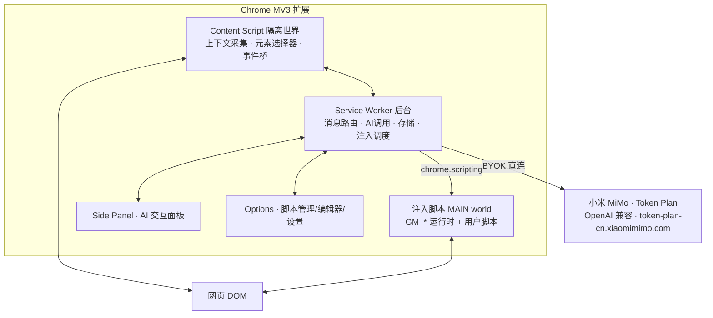
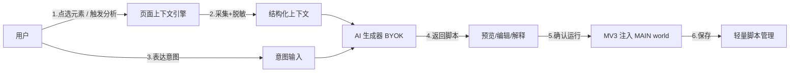
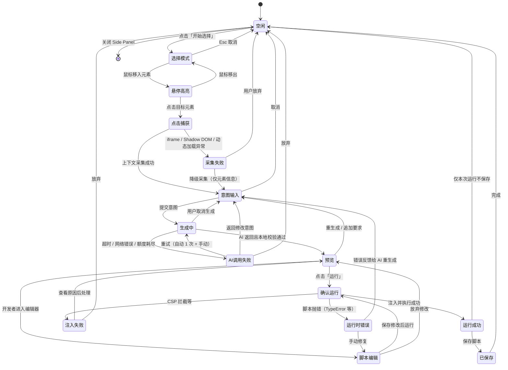
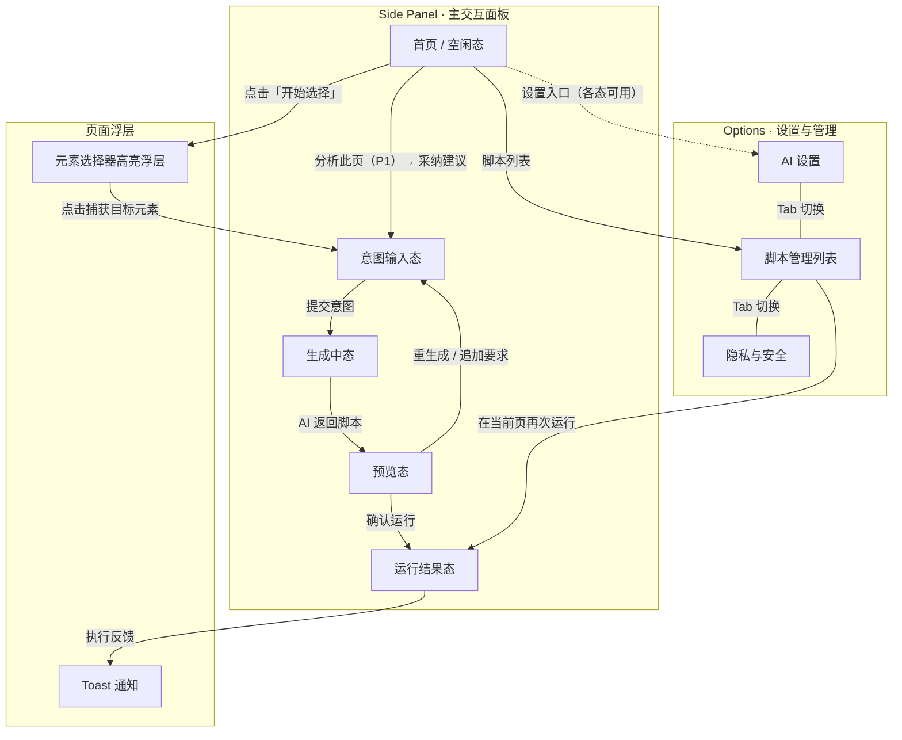

# 鲁班 · Luban ｜ AI 网页自动化扩展 · 产品需求文档（PRD）

> 版本：v0.5　状态：需求已梳理 · 关键决策已确认 · 工程化细化完成（v0.5 新增：Prompt 工程策略 §3.I · 用户交互状态机 §8.3 · UI 信息架构 §8.4 · 错误处理与降级 §4.1 · 成功度量与质量验收 §10 · 产品定名 鲁班/Luban · Provider = 小米 MiMo Token Plan · 仅中文 · MVP 仅当前页运行）
>
> **鲁班（Luban）**——一个基于 Chrome **Manifest V3** 的 **AI 原生网页自动化扩展**：以"页面上下文"为驱动，用户点选元素并表达意图、或由 AI 主动分析页面推荐可自动化点，通过 **BYOK（用户自带 Key）** 直连大模型生成用户脚本，并在当前网页运行 / 持久管理。
>
> 参考基础：本仓库 [`docs/project-overview.md`](../../../docs/project-overview.md)（Tampermonkey v2.9，MV2）。本产品为**全新独立项目**，继承"用户脚本 + GM_*"心智，但架构全面 MV3 化、AI 原生化。

---

## 1. 产品定位与愿景

| 维度 | 说明 |
|------|------|
| 一句话定位 | "看着当前网页，说出你想干嘛，AI 帮你写好并运行脚本" |
| 与 Tampermonkey 的关系 | 继承"用户脚本"心智与 GM_* 生态，但 **AI 原生、页面上下文驱动、MV3 架构** |
| 核心差异 | Tampermonkey 是"脚本管理器"（先有脚本再运行）；本产品是"脚本生成器 + 轻量管理器"（先有意图，AI 造脚本） |
| 核心价值 | 把"写油猴脚本"的门槛从"会 JS"降到"会点选 + 说人话" |

### 1.1 产品决策基线（已确认）

| 决策项 | 选择 |
|--------|------|
| 产品命名 | **鲁班 · Luban**——取「鲁班造器」之意：AI 如能工巧匠，替用户打造趁手的网页脚本工具；英文代号 **`Luban`**（仓库 / 代码用）。品牌语：**「网页鲁班，AI 造器——说出意图，工具即成」** |
| AI 脚本化形态 | **点选元素 + 意图**、**AI 主动分析推荐**（不含纯自然语言生成、不含录制回放，二者列入后续） |
| AI 模型来源 | **BYOK**：用户自带 Key，扩展直连云端，无自建后端；**首个 Provider = 小米 MiMo（OpenAI 兼容）**，当前采用 **Token Plan 订阅**（专属 Base URL + `tp-`/`ttp-` Key）⚠️ 使用范围限制见附录 B.6 |
| 目标用户 | **两者兼顾**：普通用户（no-code，生成即用） + 开发者（可审阅/编辑脚本、用 GM_*） |
| 产品范围 | **AI 为核心 + 轻量脚本管理**（MVP 不对标 Tampermonkey 全功能） |
| 界面语言 | **仅中文**（暂不做多语言 i18n，文案集中管理以便日后扩展） |
| MVP 边界 | **仅“当前页运行”**：生成后在当前页即时生效；`@match` 域名持久注入 / 自动运行延至 P1 |
| 平台 | Chrome / Chromium，Manifest V3 |

---

## 2. 目标用户与典型场景

### 2.1 用户画像

- **普通用户（no-code）**：只想"这个页面帮我自动做点事"，不关心代码，生成即用，重体验、隐藏代码细节。
- **开发者 / 极客**：会审阅并修改 AI 生成的脚本，需要 GM_* 能力、稳健选择器与精细控制。

### 2.2 典型场景（用户故事）

1. 作为普通用户，我在商品页点选价格元素并说"每次打开标红降价商品"，扩展生成脚本并当场生效。
2. 作为普通用户，我打开一个论坛，AI 主动提示"检测到 20 张图片，可一键批量下载 / 检测到登录表单，可自动填充"，我点采纳即可。
3. 作为开发者，AI 生成脚本后我打开编辑器微调选择器逻辑，保存到该域名下持久运行。
4. 作为用户，我保存的脚本在下次访问匹配页面时自动运行，可在管理面板启停。
5. 作为注重隐私的用户，我能清楚看到"哪些页面信息会被发给 AI"，并可关闭主动分析。

---

## 3. 核心功能需求

### A. 页面上下文引擎（Page Context Engine）—— 两大 AI 形态的共同基座

- **采集**：当前页面 URL、标题、DOM 结构摘要、表单 / 输入框、按钮、链接、图片、可交互元素。
- **脱敏（安全关键）**：
  - URL 去除 `token` / `session` / `auth` 等敏感查询参数；
  - 不采集密码框明文、cookie、localStorage 敏感值；
  - 敏感站点（银行 / 邮箱等）默认不采集或强提示；
  - 采集深度可配置。
- **摘要限流**：限制上报元素数量（如 ≤ 20 输入框、≤ 15 按钮）与 DOM 层级，控制 token 成本与隐私面。
- **稳健选择器**：为选中元素生成 CSS 选择器（含父级回退、`nth-child` 兜底），供 AI 精准定位。

### B. 点选元素 + 意图 → 脚本生成（P0，核心形态一）

- **选择器模式**：类似 DevTools 元素高亮，鼠标悬停预览、点击捕获目标元素。
- **意图输入**：自由文本 + 常用意图快捷项（高亮 / 隐藏 / 批量下载 / 自动填充 / 定时刷新 / 监控变化 / 去除广告 …）。
- **生成管线**：打包 `{ 元素信息 + 局部 DOM 上下文 + 意图 }` → AI（BYOK）→ 返回脚本（Prompt 拼装规范与返回 Schema 详见 §I）。

### C. AI 主动分析推荐（P1，核心形态二）

- **触发方式**：页面加载后按需触发 / 手动点"分析此页"（默认不自动，避免每页消耗 token）。
- **输出**：AI 返回"可自动化点"建议卡片列表，用户一键采纳 → 复用 §B 生成管线。
- **可控**：全局开关 + 每站点开关。

### D. 脚本生成、预览与确认（P0）

- 生成后**先预览**：展示代码 + 自然语言解释"这段脚本会做什么"。
- **用户确认后才运行**（安全底线）；支持"仅本次运行"或"保存到该站点"。
- 开发者可进入编辑器（CodeMirror）修改；普通用户可折叠 / 隐藏代码。
- 支持"重新生成 / 追加要求"迭代。

### E. 脚本执行引擎（MV3）（P0，最关键技术点）

- 将用户脚本注入到页面 **MAIN world**，提供 `unsafeWindow` 级访问。
- 提供 **GM_* 兼容子集**（见 §6），保证脚本可移植、能力够用。
- 隔离世界 ↔ MAIN world 通过事件桥通信（借鉴 Tampermonkey `Eventing`，改用 MV3 兼容的 `window.postMessage` / `CustomEvent`）。
- 处理目标站 CSP / 脚本拦截器，失败时给出可读提示。

### F. 轻量脚本管理（P0 / P1）

- **P0（MVP）**：保存生成的脚本到本地列表（名称 / 来源标记 / 更新时间），支持“在当前页再次运行”、删除。
- **P1**：启用 / 禁用、编辑、按 `@match` 域名规则**持久注入 / 自动运行**（MVP 暂不做）。
- **P2**：导入 / 导出、跨设备同步、自动更新。

### G. AI 模型接入（BYOK · 小米 MiMo）（P0）

- 用户在设置页填入自己的 Key，扩展**直连云端**（无自建后端）。
- **首个 Provider = 小米 MiMo**（Xiaomi MiMo API 开放平台）。MiMo **兼容 OpenAI Chat Completions 协议**，因此 BYOK 只需实现一个**通用 OpenAI 兼容客户端**（配置 `baseUrl` + `apiKey` 即可），无需专用 SDK。接入规格见文末**附录 B**。
- **多 Provider 扩展（P1）**：Anthropic Claude / OpenAI / Google Gemini / 其它 OpenAI 兼容端点（复用同一适配器抽象）。
- Key 仅存 `chrome.storage.local`（**不进 sync**），做基本混淆；请求由后台 Service Worker 统一发出（`host_permissions` 需含所用集群域名，如 Token Plan 的 `https://token-plan-cn.xiaomimimo.com/*`）。
- **计费方式可配置**：当前 **Token Plan 订阅**（专属 Base URL + `tp-`/`ttp-` Key），并预留**按量付费**（`https://api.xiaomimimo.com/v1` + `sk-` Key）一键切换。⚠️ Token Plan 有使用范围限制，详见附录 B.6。
- 支持模型选择（`mimo-v2.6-flash` 默认 / `mimo-v2.6-pro` 复杂场景）、超时 / 重试 / 取消、用量与错误提示（含额度耗尽 / Key 过期）。
- **善用 MiMo 能力**：`response_format`（结构化 JSON 输出，稳定解析“代码 + 解释 + 选择器”）、`thinking`（复杂脚本开启思考模式）、`stream`（流式展示生成过程）。

### H. 安全与隐私（贯穿全程）

- 生成代码**执行前必须用户确认**；明示将发送哪些页面信息给 AI。
- 上下文脱敏（见 §A）；敏感站点默认不采集或强提示。
- 脚本执行权限最小化；host permission 按需申请（可选权限 / `activeTab`）。
- API Key 本地加密存储、不同步、可一键清除。

### I. Prompt 工程策略（P0）

> 生成质量的上游决定项：同一份页面上下文，Prompt 的约束方式直接决定脚本可用率（对应 §11 风险 #2「AI 生成质量 / 选择器失效」）。本节是 §B 生成管线与 §G 模型接入的实现依据，定义 System Prompt 设计原则、上下文拼装规范与 AI 返回 JSON Schema。

#### I.1 System Prompt 设计原则

System Prompt 随每次生成请求固定下发，包含四类硬约束：

| 约束类别 | 具体要求 |
|---------|---------|
| **安全约束** | ① 禁止生成删除 / 破坏数据类操作（如 `localStorage.clear()`、批量 `GM_deleteValue`、清空表单后提交）；② 禁止外发敏感信息（cookie、密码框内容、token、个人身份信息发往第三方域名）；③ 禁止资金类不可逆操作（下单、支付、转账、批量点击「删除 / 确认收货」）；④ 禁止恶意逻辑（键盘记录、钓鱼替换、绕过验证码）；⑤ 禁止死循环 / 全文档高频轮询等拖垮页面的写法；⑥ 仅可调用 `capabilities.gmApis` 白名单内的 GM_* API（范围见 §6） |
| **输出格式约束** | ① 必须返回**单个结构化 JSON 对象**（配合 `response_format: { type: "json_object" }` 双保险），不得输出 Markdown 围栏或任何前后缀说明文字；② 六个字段全部必填（`warnings` 允许为空数组）；③ `code` 为纯 JavaScript（用户脚本环境），不得包含 `<script>` 标签或 HTML 片段 |
| **选择器质量要求** | ① 优先级：语义化 `id` > 稳定 `class`（非哈希 / 非动态后缀）> `data-*` 等属性选择器 > 结构组合（tag + nth-child），绝对路径仅作兜底；② 回避脆弱选择器：构建工具生成的 class（如 `css-1a2b3c` / `jsx-123`）、纯文本匹配、超长绝对路径；③ 每个目标元素给出主选择器 + 回退链（`selectors` 数组按稳健度降序），脚本内按序 try / catch 逐级回退；④ 元素位于跨域 iframe / Shadow DOM 时，须在 `warnings` 中说明并给出穿透方案 |
| **脚本质量要求** | ① 防御性编码：所有 `querySelector` 判空，DOM 未就绪时等待（`DOMContentLoaded` 或有限次轮询）；② 错误处理：顶层 try / catch，失败时 `console.warn` 记录；③ 幂等安全：重复运行不叠加副作用（如重复插入样式前先查重）；④ 注释完整：头部注释块（意图 / 来源 / 生成时间）+ 关键分支注释；⑤ 代码风格：`const` / `let`、`async / await`，不依赖外部库（MVP 不支持 `@require`）；⑥ 性能：批量 DOM 操作合并执行，避免全文档 MutationObserver 轮询 |

> 安全约束在**本地二次兜底**：AI 返回后，扩展对 `code` 做静态黑名单扫描（`eval`、`new Function`、向未声明域名发起 `fetch` / `GM_xmlhttpRequest`、`localStorage.clear` 等），命中即拦截运行并提示重生成（承接 §H）。

#### I.2 上下文拼装规范

发给 AI 的 user message =「结构化上下文 JSON + 用户意图」，字段与 §A 采集 / 脱敏输出对应，模板如下：

```jsonc
{
  "meta": {                                    // 页面元信息（已脱敏）
    "url": "https://example.com/item?id=123",  // 已去除 token / session / auth 等敏感参数
    "title": "某商品详情页",
    "siteType": "ecommerce"                    // ecommerce | forum | docs | tools | other
  },
  "target": {                                  // 选中元素信息
    "selectorCandidates": [                    // 候选选择器，按稳健度降序（即回退链）
      "#price",
      ".item-price.current",
      "[data-sku-price]",
      "div.product-panel > div:nth-child(2)"
    ],
    "tag": "span",
    "text": "¥129.00",                         // 元素可见文本摘要
    "attributes": { "id": "price", "class": "price current" },
    "contextPath": "body > div.main > div.product-panel > span#price",
    "siblings": ["span#old-price", "button.add-cart"]  // 同级关键元素摘要
  },
  "domSummary": {                              // 页面 DOM 摘要（限流，见 §A）
    "interactive": { "inputs": 12, "buttons": 15, "links": 48 },
    "forms": [{ "action": "/search", "fields": ["#kw", "#sort"] }],
    "notes": ["页面含 1 个跨域 iframe（广告）", "价格元素带 data-sku-price 属性"]
  },
  "intent": {
    "raw": "每次打开自动标红降价商品",          // 用户原文
    "normalized": "高亮 / 样式注入"            // 归一化意图标签（快捷 chips 映射）
  },
  "capabilities": {                            // 告知 AI 可用能力边界
    "gmApis": ["GM_addStyle", "GM_setValue", "GM_getValue", "GM_deleteValue", "GM_info", "unsafeWindow"],
    "runAt": "document-end",
    "world": "MAIN"
  }
}
```

拼装规则：

- **消息顺序**：System Prompt（固定）→ 上下文 JSON → 意图 → 输出 Schema 说明（字段清单 + 一条极简示例），单次请求完成；MVP 不做多轮澄清，「模型按需索取更多上下文」（`tools`）列为 P1（见附录 B.3）；
- **Token 预算**：整体 prompt ≤ 8K tokens；超限时优先裁剪 `domSummary`（保 `target` 完整），仍超限再压缩 `siblings` / `notes`；
- **意图快车道**：命中快捷意图 chips（清单见 §B）时附 `normalized` 标签，提升生成稳定性与解释文案质量。

#### I.3 AI 返回 JSON Schema

AI 必须按以下结构返回（字段与 §D 预览态、§E 执行引擎、§7 数据模型一一对应）：

```jsonc
{
  "code": "string // 可运行的 JavaScript 脚本",
  "explanation": "string // 自然语言解释这段脚本会做什么",
  "selectors": ["string // 脚本中使用的 CSS 选择器列表"],
  "gmGrants": ["string // 需要的 GM_* API 权限"],
  "confidence": "number // 0-1，AI 对生成结果的置信度",
  "warnings": ["string // 潜在风险提示"]
}
```

| 字段 | 消费方 | 用途 |
|------|--------|------|
| `code` | §E 执行引擎 | 注入 MAIN world 运行；运行前过本地安全扫描 |
| `explanation` | §D 预览态 | 面向普通用户的核心展示（代码默认折叠） |
| `selectors` | 稳健性校验 / 重生成 | 与采集端候选选择器比对，评估脆弱度 |
| `gmGrants` | §H 权限最小化 | 超出 §6 白名单的申请直接拒绝并提示重生成 |
| `confidence` | §D 预览态 | < 0.6 时 UI 提示「AI 置信度较低，建议重生成或补充意图」 |
| `warnings` | §D 预览态 | 风险提示区（如 iframe / Shadow DOM 限制）；确认运行前必须展示 |

**解析容错**：优先依赖 `response_format: json_object`；解析失败先剥离 Markdown 围栏再试，仍失败自动重试 1 次（追加「必须输出纯 JSON」强化指令）；连续失败则提示「重试 / 切换模型（flash → pro）」。完整错误处理见 §4.1。

---

## 4. 非功能需求

| 类别 | 要求 |
|------|------|
| 隐私 | 页面数据默认最小化上报；脱敏；Key 本地存储不同步；提供"不联网降级"提示 |
| 性能 | 上下文采集 < 100ms；注入不阻塞首屏；AI 调用有超时 / 重试 / 取消 |
| 可用性 | 普通用户 3 步内完成"点选 → 说意图 → 运行"；错误信息可读、可操作 |
| 兼容性 | Chrome MV3（Chromium 系）；主流站点 CSP 下尽量可注入 |
| 可维护性 | 模块化、Provider 可插拔（适配器模式）；界面仅中文，暂不做 i18n，文案集中管理以便日后扩展 |
| 成本可控 | 摘要限流、按需分析，减少 token 消耗 |

### 4.1 错误处理与降级策略

> 总原则（对应上表「可用性」）：**任何错误不得静默失败**——必须给出可读提示 + 至少一个下一步动作（重试 / 修改 / 放弃 / 跳转设置）。错误按链路分五层：**采集层 → 传输层 → 模型层 → 注入层 → 运行层**，逐场景定义如下。

| 错误场景 | 触发条件 | 用户感知 | 降级 / 恢复策略 |
|---------|---------|---------|----------------|
| AI 调用超时 | 网络慢 / 模型响应慢，超过阈值（默认 60s，可配置） | 生成中态显示已耗时与进度，超时提示「生成超时」 | 自动重试 1 次（指数退避）；仍失败提供「重试」「返回修改意图」；流式已收到部分内容时提示可基于已生成内容继续 |
| API Key 无效 / 过期 / 额度耗尽 | 401 / 403 / 429，或 Key 前缀与计费方式不匹配（`tp-`/`ttp-` ↔ `sk-`） | 明确区分「Key 无效」「Key 已过期」「额度耗尽」三种文案，不笼统报错 | 一键跳转设置页更换 Key；保存时预校验（前缀 + 连通性）；额度耗尽提示续费或切换按量付费（见附录 B.5 / B.6） |
| CSP 阻止脚本注入 | 目标站点 CSP 拦截，MAIN world 注入失败 | 提示「该站点安全策略限制了脚本注入」 | 自动尝试备选注入路径（`chrome.scripting` MAIN world → `<script>` 标签 → Blob URL）；均失败则明确「该站点暂不支持」，记录至受限站点清单，不做无意义重试 |
| 脚本运行时报错 | 注入成功但执行抛错（`TypeError`：选择器为 null、页面 API 变化等） | Toast 显示错误摘要；运行结果态展示错误堆栈与行号 | 提供「将错误反馈给 AI 重新生成」（错误信息拼入上下文再次生成）；开发者可进编辑器修复 |
| 页面上下文采集失败 | 目标位于跨域 iframe / closed Shadow DOM / 动态加载未稳定 | 提示「无法完整读取该元素所在区域」 | 降级采集：仅上报元素自身信息并标注「上下文不完整」；跨域 iframe 引导用户进入 iframe 所在页面使用；open Shadow DOM 自动穿透 |
| 网络完全断开 | `navigator.onLine === false` 或请求立即失败 | 首页与生成入口置灰，显示「网络不可用」 | 禁用 AI 生成入口；脚本列表、「再次运行」等纯本地功能不受影响；网络恢复后自动解除 |
| Service Worker 休眠后恢复 | MV3 SW 空闲被回收，用户交互将其唤醒 | 目标为「无感知」 | 生成中 / 待确认等关键状态持久化到 `chrome.storage.session`，SW 重启后恢复 UI；AI 流式请求若被中断则整体重试 |
| 目标元素已变化 / 消失 | 确认运行时 `querySelector` 返回 null（SPA 路由切换 / 局部刷新） | 运行结果态提示「目标元素未找到」，而非静默失败 | 脚本模板内置选择器回退链 + 有限次等待（如 5s 内每 500ms 重试）；仍失败提供「重新选择元素」一键回到选择模式 |
| AI 返回 JSON 解析失败 | 模型输出不规范（Markdown 围栏包裹 / 字段缺失） | 生成中态短暂停顿后自动重试，用户基本无感 | 容错解析（剥围栏、提取首个 JSON 对象）→ 自动重试 1 次（附「必须输出纯 JSON」强化指令）→ 仍失败提示重试或切换模型（flash → pro） |
| GM_* 权限申请超范围 | 返回的 `gmGrants` 超出 §6 白名单 | 预览态标注「该脚本申请了不支持的权限」 | 本地拦截：超范围 API 打桩为 no-op 并在 `warnings` 中标注；若核心逻辑依赖越权 API，拒绝运行并提示重生成 |

---

## 5. 关键技术约束（MV2 → MV3 迁移影响）

> 这是与 Tampermonkey v2.9（MV2）**最大的架构差异**，直接决定实现方式。

| 能力 | Tampermonkey MV2 | 新产品 MV3 |
|------|------------------|------------|
| 后台 | 常驻 `background.html/js` | **Service Worker**（非持久、事件驱动） |
| 脚本注入 | 拼字符串 + `<script>` / `eval` | `chrome.scripting.executeScript({ world:'MAIN' })` 或注入 script 标签 |
| 远程代码 | 允许 | **禁止远程托管代码**；用户脚本作为"数据"注入页面上下文执行（受目标站 CSP 约束）⚠️ |
| 跨域请求 | WebRequest 改 header | `declarativeNetRequest` 规则 + `host_permissions`；GM_xhr 走 `fetch` |
| 存储 | `localStorage` + sync | `chrome.storage.local/session/sync`（SW 无 localStorage） |
| AI 交互 UI | 弹窗 / 页面 | 推荐用 **Side Panel API**（比 popup 更适合持续交互） |

⚠️ **最高技术风险**：MV3"禁止远程代码" + 各站点 CSP，使动态用户脚本注入成为难点（Tampermonkey 的 MV3 版亦在此踩坑）。需在技术设计阶段做**注入方案验证 Spike**：MAIN world 注入 + Blob / script 标签 + 逐站 CSP 兼容策略。

---

## 6. GM_* API 支持范围（分期）

| 阶段 | API |
|------|-----|
| **P0（最小可用）** | `GM_addStyle`、`GM_setValue` / `GM_getValue` / `GM_deleteValue`、`GM_info`、`unsafeWindow` |
| **P1** | `GM_xmlhttpRequest`、`GM_notification`、`GM_openInTab`、`GM_setClipboard`、`GM_registerMenuCommand`、`GM_addValueChangeListener` |
| **P2** | `GM_getResourceText/URL`（`@resource`）、`GM_getTab(s)` / `GM_saveTab`、完整 `@require` |

---

## 7. 数据模型（草案）

```jsonc
// Script —— 单条用户脚本
{
  "id": "string",
  "name": "string",
  "description": "string",
  "code": "string",
  "matches": ["*://example.com/*"],   // @match / glob 域名规则
  "enabled": true,
  "runAt": "document-end",            // document-start | document-end | idle
  "source": "ai",                     // ai | manual
  "gmGrants": ["GM_addStyle", "GM_setValue"],
  "aiMeta": {
    "intent": "标红降价商品",
    "provider": "xiaomi-mimo",
    "model": "mimo-v2.6-flash",
    "pageContextSnapshot": { "url": "...", "title": "..." },
    "createdAt": 0
  },
  "createdAt": 0,
  "updatedAt": 0
}

// Settings —— 全局设置
{
  "aiProvider": {
    "type": "openai-compatible",      // 通用 OpenAI 兼容适配器
    "provider": "xiaomi-mimo",
    "billing": "token-plan",          // token-plan（当前）| pay-as-you-go，可一键切换
    "model": "mimo-v2.6-flash",
    "cluster": "cn",                  // Token Plan 集群：cn | sgp | ams
    "baseUrl": "https://token-plan-cn.xiaomimimo.com/v1",  // 以 Token Plan 页面展示的专属 Base URL 为准
    "apiKeyRef": "local:mimoKey"      // tp-xxxxx / ttp-xxxxx；仅存 chrome.storage.local，混淆、不同步
  },
  "autoAnalyze": false,
  "safetyLevel": "normal",
  "uiLanguage": "zh-CN"               // 固定中文
}
```

**存储策略**：脚本 → `chrome.storage.local`；设置（非敏感）→ `chrome.storage.sync`；**API Key → 仅 `local`、混淆存储、不同步**。

---

## 8. 系统架构与核心流程（草图）

### 8.1 高层架构



### 8.2 核心生成流程（点选 → 生成 → 执行）



### 8.3 用户交互状态机（点选生成主链路）

覆盖正常路径、异常分支与可回退节点（各错误的降级细节见 §4.1；各状态对应的界面布局见 §8.4）：



关键交互规则：

- **全局退出**：任意状态按 `Esc` 或关闭面板 → 丢弃未保存中间态回到空闲；「生成中」退出前二次确认（避免误触浪费 token）；
- **主回退锚点**：`意图输入`——预览重生成 / AI 失败 / 运行时错误反馈均回到该状态，并自动携带「失败原因」作为追加上下文；
- **状态持久化**：「生成中」「预览（待确认）」写入 `chrome.storage.session`，应对 SW 休眠与面板误关（见 §4.1）；
- **视图对应**：空闲 / 意图输入 / 生成中 / 预览 / 运行结果五个正常态，与 §8.4 Side Panel 五个视图一一对应。

### 8.4 UI 信息架构（页面清单与导航）

**① Side Panel（主交互面板）**——五个状态视图，对应 §8.3 状态机：

| 视图 | 核心区块 | 说明 |
|------|---------|------|
| 首页 / 空闲态 | 品牌区 + 快捷入口：「开始选择」「分析此页」（P1）「脚本列表」 | 附加最近脚本（≤ 3 条）一键再运行；全局设置入口 |
| 意图输入态 | 选中元素信息卡（标签 / 文本 / 候选选择器）+ 意图输入框 + 快捷意图 chips | chips 可多选叠加（高亮 / 隐藏 / 批量下载 / 自动填充 / 定时刷新 / 监控变化 / 去除广告），输入框支持自由文本补充 |
| 生成中态 | 流式输出展示（代码 / 思考过程）+ 已耗时 + 取消按钮 | 流式渲染 AI 返回（`stream: true`，见附录 B.3）；取消需二次确认 |
| 预览态 | 代码预览（普通用户默认折叠）+ 自然语言解释（`explanation`）+ 风险提示区（`warnings`）+ 操作条 | 操作条：确认运行 / 取消 / 重生成 / 编辑（进编辑器）；`confidence < 0.6` 显示「建议重生成」角标 |
| 运行结果态 | 成功 / 失败提示（失败含错误摘要与行号）+ 保存选项 | 保存到列表 / 仅本次运行；成功态提供「再次运行」 |

**② Options 页（设置与管理）**——三个 Tab：

| Tab | 内容 |
|-----|------|
| AI 设置 | Provider（MVP 仅小米 MiMo）· 计费方式一键切换（Token Plan ↔ 按量付费，附合规提示见附录 B.6）· Base URL / API Key（保存时预校验前缀与连通性）· 模型选择（`flash` 默认 / `pro` 复杂场景）· 超时阈值 |
| 脚本管理 | 脚本列表：名称 / 来源（ai / manual）/ 更新时间 / 操作（在当前页运行 · 编辑 · 删除）；启停与 `@match` 持久注入为 P1 |
| 隐私与安全 | 敏感站点清单管理 · 采集深度配置 · 主动分析开关（P1）·「将发送给 AI 的信息」预览说明 · 一键清除所有本地数据 |

**③ 页面浮层（注入当前网页）**：

| 浮层 | 触发 | 内容 |
|------|------|------|
| 元素选择器高亮浮层 | 进入选择模式 | 悬停高亮 + 元素标签提示（tag / id / class）+ Esc 退出 |
| Toast 通知 | 运行结果 / 错误发生 | 成功 / 失败摘要；点击跳转 Side Panel 详情；自动消失（≤ 5s） |

**页面导航关系图**：



---

## 9. MVP 范围与优先级

| 优先级 | 内容 |
|--------|------|
| **P0（MVP）** | 页面上下文引擎（采集 + 脱敏）、点选元素 + 意图生成、脚本预览与确认、**在当前页即时运行**、BYOK 接入**小米 MiMo**（OpenAI 兼容）、MV3 注入 + GM_* 最小子集、轻量脚本保存 / 列表 / 手动再运行、安全确认、**仅中文界面** |
| **P1** | AI 主动分析推荐、CodeMirror 编辑器、`@match` 域名**持久注入 / 自动运行**、GM_* 扩展集、**多 Provider**（Claude / OpenAI / Gemini）、导入 / 导出 |
| **P2** | 跨设备同步、自动更新、录制转脚本、模板 / 市场、完整 `@require` / `@resource`、高级沙箱 |

**MVP 明确不做**：持久注入 / 自动运行（仅当前页运行）、多 Provider（仅小米 MiMo）、多语言界面（仅中文）、完整 Tampermonkey 功能对齐、自建后端、脚本市场、跨浏览器（先只做 Chromium）。

---

## 10. 成功度量与验收标准（MVP）

### 10.1 成功度量指标

> 目标值为上线初期参考基线，上线后按真实数据校准。度量数据默认**仅本地记录**，经用户明确同意后才匿名上报（与 §H 隐私原则一致，MVP 不强制上报）。

**① 核心漏斗指标**（主链路各步转化率，链路定义见 §8.2 / §8.3）：

| 漏斗步骤 | 定义 | 目标（参考） |
|---------|------|-------------|
| 进入选择模式 | 会话内点击「开始选择」 | —（漏斗起点） |
| 成功捕获元素 | 进入选择模式后完成元素点选 | ≥ 90% |
| 提交意图 | 捕获后输入并提交意图 | ≥ 80% |
| AI 生成成功 | 返回合法 JSON 且通过本地校验 | ≥ 85% |
| 用户确认运行 | 预览后点击「运行」 | ≥ 60% |
| 脚本执行成功 | 确认后注入并执行无错误 | ≥ 85% |
| 保存脚本 | 执行成功后保存到列表 | ≥ 40% |

> 整体漏斗目标：进入选择模式 → 保存脚本 ≥ 20%。

**② 体验指标**：

| 指标 | 定义 | 目标（MVP） |
|------|------|------------|
| 上下文采集耗时 | 点选完成 → 上下文就绪 | P50 < 100ms · P95 < 300ms |
| AI 生成耗时 | 提交意图 → 脚本返回 | P50 ≤ 8s · P95 ≤ 15s |
| 一次生成成功率 | 无需重生成即可运行的占比 | ≥ 70% |
| 重生成率 | 每次成功产出前的平均生成次数 | ≤ 1.5 次 |
| 端到端耗时 | 进入选择模式 → 脚本运行成功 | P95 ≤ 15s（含 AI 生成） |

**③ 留存 / 价值指标**：

| 指标 | 定义 | 目标（参考） |
|------|------|-------------|
| 脚本保存率 | 成功运行后会话保存脚本的比例 | ≥ 40% |
| 脚本再次运行率 | 已保存脚本 7 日内被再次运行的比例 | ≥ 30% |
| 人均保存脚本数 | 活跃用户平均保存脚本数 | ≥ 2 个 / 周 |
| 活跃用户周留存 | 本周活跃且次周仍活跃 | ≥ 30% |

### 10.2 功能验收

1. 用户可在任意普通网页进入“点选”模式，选中一个元素并输入意图。
2. 扩展采集并脱敏页面上下文，经 BYOK 调用小米 MiMo，返回一段可运行脚本 + 自然语言解释。
3. 用户确认后，脚本在当前页 MAIN world 生效（如高亮 / 隐藏 / 注入样式），可见结果。
4. 用户可将脚本保存到本地列表，并在当前页“再次运行”或删除（MVP 不含跨页自动注入，该项为 P1）。
5. API Key 全程仅存本地、不同步；执行任何生成代码前均有用户确认。
6. 采集 / 注入 / AI 调用失败时，给出可读错误提示且不崩溃。

### 10.3 质量验收

| # | 验收项 | 标准 |
|---|--------|------|
| 1 | **脚本生成成功率** | 10 个常用 benchmark 场景（清单见下）中 **≥ 7 个一次生成可运行脚本** |
| 2 | **主流站点注入成功率** | 10 个主流站点（清单见下）中 **≥ 8 个**可正常注入并执行 |
| 3 | **端到端耗时** | 从点选到脚本运行 **≤ 15s（P95，含 AI 生成时间）** |
| 4 | **错误恢复** | §4.1 所列全部可预见错误场景均有可读提示；**无白屏 / 无响应 / 静默失败** |
| 5 | **安全** | 10 个 benchmark 中**无一次**生成含 `eval` / 外发敏感数据 / 删除操作的脚本 |

**Benchmark 场景清单（10 个）**：

1. 电商详情页：价格元素标红高亮
2. 列表页：隐藏指定广告 / 推荐模块
3. 图片站：批量提取图片链接并通知
4. 登录表单自动填充（测试环境凭据）
5. 页面定时刷新（30s）
6. 监控价格 / 文本变化并弹窗提示
7. 自动点击「查看更多」展开全部折叠内容
8. 页面暗色模式（注入全局样式）
9. 表格数据提取并写入剪贴板
10. 隐藏包含特定关键词的评论

**注入验证站点清单（10 个）**：淘宝 · 京东 · 知乎 · 微博 · GitHub · B 站 · 百度搜索 · 豆瓣 · 掘金 · V2EX。

---

## 11. 主要风险与待确认问题

| # | 风险 / 问题 | 说明 / 处理 |
|---|-------------|-------------|
| 1 | **MV3 注入 + CSP 兼容** | 最高风险；需尽早做技术验证 Spike |
| 2 | **AI 生成质量 / 选择器失效** | 生成"稳健选择器 + 回退"，支持一键重生成 |
| 3 | **MiMo 直连 CORS / 限流** | 由 Service Worker `fetch` 调用 Token Plan 专属域名（`token-plan-cn.xiaomimimo.com`），`host_permissions` 需声明；OpenAI 兼容，风险较低，仍需验证跨域与限流 |
| 4 | ⚠️ **Token Plan 使用范围合规（重要）** | 官方条款限定 Token Plan“仅用于编程工具”，**禁止**用于自动化脚本 / 自定义应用后端等非 Coding 场景；本产品作为扩展调用有**封 Key 风险**。开发自测可用，**正式发布建议改用按量付费 `sk-` Key**（详见附录 B.6） |
| 5 | ~~起步先支持哪些 Provider？~~ | ✅ **已确认：首个 Provider = 小米 MiMo**（OpenAI 兼容），多 Provider 延至 P1 |
| 6 | ~~是否中文界面优先？~~ | ✅ **已确认：仅中文** |
| 7 | ~~MVP 是否仅“当前页运行”？~~ | ✅ **已确认：MVP 仅当前页运行，持久注入延至 P1** |

---

## 12. 下一步

1. **技术设计 / 实施规划**：针对 MV3 注入方案、模块划分、GM_* 运行时、AI Provider 抽象，输出可落地的技术方案与分期任务拆解（建议切 Plan 模式）。
2. **MVP 技术验证（Spike）**：搭最小 MV3 骨架，跑通"点选元素 → 生成 → MAIN world 注入运行"闭环。
3. **需求评审**：§11 待定项（Provider、语言、MVP 边界）已确认并更新入本 PRD；如需调整请提出。

---

## 附录 A：术语

| 术语 | 含义 |
|------|------|
| MAIN world | 页面主世界，用户脚本运行处，可访问真实 `window` / `unsafeWindow` |
| Isolated world | 内容脚本隔离世界，可访问 `chrome.*` 扩展 API |
| BYOK | Bring Your Own Key，用户自带 AI 服务 Key |
| GM_* | Greasemonkey 系列用户脚本 API（如 `GM_setValue`） |
| Side Panel | Chrome MV3 侧边栏 UI，适合持续交互 |
| 上下文引擎 | 采集 / 脱敏 / 结构化页面信息，作为 AI 输入的模块 |

---

## 附录 B：小米 MiMo API 接入规格

> 来源：Xiaomi MiMo API 开放平台官方文档（`mimo.mi.com`）。MiMo 兼容 OpenAI / Anthropic 两种协议，本产品采用 **OpenAI 兼容协议**。
>
> **当前计费方式：Token Plan 订阅**（专属 Base URL + `tp-`/`ttp-` Key）。⚠️ Token Plan 有严格的使用范围限制，接入前务必阅读 **B.6 合规提示**。

### B.1 基本信息（当前：Token Plan 订阅）

| 项 | Token Plan（当前） | 按量付费（备选） |
|----|--------------------|------------------|
| OpenAI 兼容 Base URL | **专属**，以 Token Plan 页面为准；集群三选一：<br/>中国 `https://token-plan-cn.xiaomimimo.com/v1`<br/>新加坡 `https://token-plan-sgp.xiaomimimo.com/v1`<br/>欧洲 `https://token-plan-ams.xiaomimimo.com/v1` | `https://api.xiaomimimo.com/v1` |
| Chat Completions 端点 | `<Base URL>/chat/completions` | `https://api.xiaomimimo.com/v1/chat/completions` |
| Anthropic 兼容（备选协议） | 同域 `/anthropic` | `https://api.xiaomimimo.com/anthropic` |
| 鉴权头 | `api-key: $MIMO_API_KEY`（或 `Authorization: Bearer`） | 同左 |
| API Key 格式 | 个人版 `tp-xxxxx`、团队版 `ttp-xxxxx` | `sk-xxxxx` |
| 获取方式 | 小米账号登录 → 订阅 Token Plan → 在 **Token Plan 页面**取专属 Base URL 与 Key | 控制台 → API Keys 创建 |
| 计费 / 额度 | 固定订阅费，按套餐 Credits 限量；额度耗尽停服，Key 到期需续费 | 按实际 token 用量计费，无场景限制 |
| 使用范围 | ⚠️ **仅限编程工具**，禁止自动化脚本 / 自定义应用（见 B.6） | 无此限制 |

> 两套 Key **相互独立、不可混用**（`tp-`/`ttp-` ↔ `sk-`）。

### B.2 可用模型

| 模型 ID | 定位 |
|---------|------|
| `mimo-v2.6-flash` | 快速、低成本（**建议默认**，简单脚本生成） |
| `mimo-v2.6-pro` | 能力强（**主动分析推荐 / 复杂脚本**） |
| `mimo-v2.6-pro-ultraspeed` | Pro 的加速版 |
| `mimo-v2.5-pro` / `mimo-v2.5` | 上一代模型（官方公告 2026-10-21 下线，建议用 v2.6） |

> Token Plan 各套餐支持全部 8 款模型，额度按 **Credits 折算**（`flash` 成本约为 `pro` 的 1/3）；生成脚本默认 `mimo-v2.6-flash` 更省额度，复杂场景再切 `pro`。

### B.3 对本产品有用的能力

- **结构化输出** `response_format`（`json_object`）：让模型直接返回 `{ code, explanation, selectors }`，避免从自然语言解析代码，提升稳定性。
- **思考模式** `thinking: { type: "enabled" | "disabled" }`：复杂脚本开启可提升质量（注意：思考模式下 `temperature` / `top_p` 会被强制为默认值 1.0 / 0.95）。
- **流式** `stream`：SSE 流式返回，可在 Side Panel 实时展示生成过程与 `reasoning_content`。
- **函数调用** `tools` / `tool_choice`：后续可用于“让模型按需索取更多页面上下文”。
- **用量** 响应含 `usage`（prompt / completion / total tokens），可用于成本提示。

### B.4 请求示例（Token Plan · 生成脚本）

```bash
# Token Plan：BASE_URL 与 Key 以控制台 Token Plan 页面为准（Key 形如 tp-xxxxx）
curl -X POST 'https://token-plan-cn.xiaomimimo.com/v1/chat/completions' \
  -H "api-key: $MIMO_API_KEY" \
  -H "Content-Type: application/json" \
  -d '{
    "model": "mimo-v2.6-flash",
    "messages": [
      { "role": "system", "content": "你是网页自动化脚本生成器，只输出可在 Chrome 用户脚本环境运行的 JavaScript。" },
      { "role": "user", "content": "<页面上下文 + 选中元素 + 用户意图>" }
    ],
    "response_format": { "type": "json_object" },
    "thinking": { "type": "disabled" },
    "stream": false
  }'
```

### B.5 扩展侧接入要点（MV3）

- `manifest.json` 的 `host_permissions` 需包含所用集群域名，如 Token Plan 的 `https://token-plan-cn.xiaomimimo.com/*`（如同时支持按量付费再加 `https://api.xiaomimimo.com/*`）。
- 由 **Service Worker** 用 `fetch` 发起请求（Key 集中管理、规避页面 CORS 干扰）。
- API Key 存 `chrome.storage.local` 且混淆，**绝不写入 `chrome.storage.sync`**、绝不随页面上下文外发。
- 默认用 `mimo-v2.6-flash`；“主动分析推荐 / 复杂脚本”再切 `mimo-v2.6-pro`。
- **Key 校验**：Token Plan Key 形如 `tp-`/`ttp-`，按量付费形如 `sk-`；保存时按 `billing` 校验前缀，避免混用。
- **错误处理**：识别额度耗尽 / Key 过期（订阅到期）/ 401，给出“续费或切换按量付费 Key”的可操作提示。

### B.6 ⚠️ Token Plan 使用范围合规（务必阅读）

> 官方条款要点：**Token Plan 套餐额度仅可在编程工具（如 OpenCode、OpenClaw、Claude Code 等）中使用，禁止以 API 调用形式用于“自动化脚本、自定义应用程序后端”等明显非 Coding 场景**；超范围调用视为违规，平台有权暂停服务 / 封禁 API Key。

本产品是一个“自定义应用（Chrome 扩展）”通过 API 调用 MiMo，**与上述限制存在冲突**。据此给出分场景建议：

| 使用场景 | 合规性 | 建议凭证 |
|----------|--------|----------|
| 你本人在编程工具中用 MiMo 开发本扩展 | ✅ 合规 | Token Plan（`tp-`） |
| 开发 / 本地自测阶段，扩展调用 MiMo | ⚠️ 灰区 | Token Plan 仅限自测、小流量，风险自担 |
| **正式对外发布的扩展**（用户各自 BYOK） | ❌ 用 Token Plan 可能违规 | **按量付费 `sk-` Key**（`https://api.xiaomimimo.com/v1`），按 token 计费、无场景限制 |

**落地策略（重要）**：
1. Provider 适配层把 `billing`（`token-plan` / `pay-as-you-go`）、`baseUrl`、`cluster`、`apiKey` 全做成**可配置**，两套凭证一键切换。
2. **开发期**：你用 Token Plan 调试，省成本。
3. **发布期**：设置页**默认引导用户填按量付费 `sk-` Key**，并明确告知“本扩展属自定义应用，请使用按量付费 Key 以符合小米条款”；Token Plan 作为高级选项保留但附风险提示。
4. 该限制属外部条款，可能调整，**上线前需再次核对 mimo.mi.com 最新政策**。
