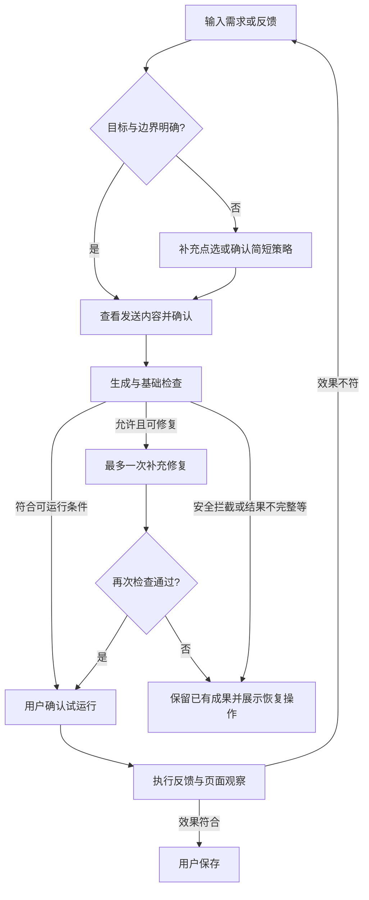

# 鲁班 V2.1 优化需求：从生成代码到确认效果

版本：V2.1。日期：2026-10-14。状态：需求已按执行计划实施并通过工程检查；真实环境待人工验收，采用参数与边界见实施记录。

## 1. 背景与依据

V2 已具备独立工具工作区、持续修改基线、试运行、保存/恢复、同站自动运行、导出和可选页面分析。V2.1 不重新建设聊天系统，重点补齐用户从描述意图到确认效果的体验。

| 来源 | 已观察事实 | 产品问题 |
|---|---|---|
| [V2 TODO](../v2/todo.md) | 用户要求追加基础代码检查、一次自动修复、多轮修改与复杂任务策略确认 | 优化范围已明确，尚未实施 |
| [P6 淘宝与豆瓣案例](../v2/verification/v2-acceptance-record.md) | 淘宝代码多余独立变量导致运行失败；豆瓣代码曾不完整，后续存在等待再次点击、只隐藏主体、标签与空白残留，最终多轮修正后有效 | 用户被迫诊断代码、补写定位规则和验收条件 |
| [V2 PRD](../v2/v2-product-requirements.md) | 已定义持续修改、草稿保护、执行结果不等于视觉验证 | 应补强现有链路，不把已有能力描述成新建能力 |
| [P7 记录](../v2/verification/v2-enhancement-record.md) | 分析此页与自定义端点已获用户人工验收确认 | 页面分析可以提供建议，但不能替代具体操作目标确认 |

豆瓣场景替换原因、十场景完整统计及逐项环境记录仍待补；不以少量案例推算普遍失败率。代码截断是否源于模型输出上限尚未证实。

文档按用户此前确认的个人项目、现有 Markdown 文档方式编写，不接入企业模板、KBP、LUCP 或度量上报。

## 2. 目标与范围

**目标：用户无需懂代码，也能明确“改哪里、保留什么”，并以简短反馈逐步得到符合预期的工具。**

| 优先级 | 需求 | 交付结果 |
|---|---|---|
| 必做 | F1 基础代码质量检查与一次受控修复 | 明显错误在运行前发现，失败不覆盖已有成果 |
| 必做 | F2 围绕实际效果的工具内多轮修改 | “标签还在”“空白没消失”可直接成为下一轮修改要求 |
| 必做 | F3 更准确的目标定位与有限上下文 | 区分单个元素和完整模块，目标不足时要求重新点选 |
| 必做 | F4 效果反馈与保存闭环 | 区分可执行、执行完成、效果确认和已保存 |
| 配套 | F5 复杂任务策略确认 | 在目标或边界有歧义时确认，简单任务不强制增加步骤 |
| 配套 | F6 状态、错误恢复与可访问性 | 主操作清晰，用户能取消、保留草稿和继续处理 |

不包含：完整 IDE、无限聊天记录、多模型自动竞赛、无限自修复、跨站代理、自动截图上传、自动视觉验收、任意 iframe 穿透、通用广告过滤器。基础检查不能证明任意代码安全。

P6 遗留 Chrome 138 与真实容量边界仍是独立验收事项，不用 V2.1 功能替代。此文档只定义产品需求，不包含技术方案或研发排期。

## 3. UI/UX 审视与设计原则

| 现有痛点 | 设计判断 | V2.1 规则 |
|---|---|---|
| 一次提示词难以完整 | 用户描述应允许逐步补充 | 同工具持续对话；反馈保留前一轮已确认功能和边界 |
| 模型生成成功被误解为工具成功 | 生成、运行和效果属于不同阶段 | 状态文案分开，不用统一绿色“成功”覆盖全部阶段 |
| 用户不知道该点哪一层 | 目标选择应可感知、可修正 | 点选后显示范围；需要时提供候选容器预览 |
| 隐藏内容后仍有空白 | 用户目标通常针对可见模块 | 明确元素/模块差异，不默认无限向祖先扩大范围 |
| 每轮都要求复杂策略确认 | 对简单任务会增加负担 | 简单任务直接生成，歧义任务才停留在策略确认 |
| 修复请求不可见 | 自动请求会增加费用和等待 | 发送前说明最多一次补充修复，允许关闭；处理中展示进度 |
| 笼统“代码语法无效” | 错误描述无法帮助非开发用户 | 优先说原因与下一步，位置和代码放在可展开详情 |
| 用户必须重写整段需求 | 反馈入口应贴近运行结果 | 结果卡下直接继续反馈，提供少量问题快捷项 |

工作区采用“对话为主，目标与当前结果可见，代码按需展开”的信息顺序。避免新增常驻诊断表、底层通信状态和多层设置入口。

## 4. 核心用户旅程

### 4.1 简单任务

描述需求或点选 → 查看发送内容 → 确认生成 → 基础检查 → 明确试运行 → 检查页面 → 效果符合并保存。

无歧义的改色、隐藏明确单个元素等，不强制单独“先分析”或先填写策略表。

### 4.2 复杂或模糊任务

描述需求/点选 → 发现操作范围不清 → 确认目标与简短策略 → 查看实际发送内容 → 生成与检查 → 试运行 → 根据效果继续反馈。

策略无法从已有信息确定时，先请求重新点选或补充目标；不得用一段看似完整的解释掩盖定位信息不足。

### 4.3 多轮修正

试运行 → 用户反馈“标签还在” → 保留当前代码、目标和边界 → 更新需求/必要时补充采集 → 再生成与检查 → 再试运行 → 确认保存。

每轮都属于同一工具，不自动创建新工具；多轮修正不增加自动运行权限，不把草稿替换为自动运行版本。

## 5. 功能需求

### 5.1 F1：生成质量检查与一次受控修复

**需求说明：** 在允许试运行前发现语法错误、可确定的未定义变量及权限声明不一致，减少由用户承担基础排错的次数。

检查生成结果和手动修改后的代码。正确识别局部变量、作用域、浏览器环境变量及受支持 GM 能力；不能把正常环境引用误判成缺失变量。注释和普通字符串中的 API 名称不应被误判为实际权限依赖。

| 检查结果 | 产品行为 | 运行与保存 |
|---|---|---|
| 基础检查通过 | 显示“检查通过，可试运行” | 仍需用户试运行，不能直接保存 |
| 确定性语法/未定义变量错误 | 展示错误摘要及位置，可在授权范围内修复一次 | 错误候选不能运行或保存 |
| GM 声明缺失 | 说明实际引用与缺失权限，提供现有权限选择入口 | 不静默增加授权；确认权限后重新检查并试运行 |
| 输出截断/不完整 | 显示“结果不完整”，如有明确停止原因则解释 | 不把流式半成品写成可运行草稿 |
| 安全规则拦截 | 解释限制，允许修改需求 | 不通过自动修复规避安全规则 |
| 无法判断的动态引用 | 显示无法确认的原因及受影响操作 | 不宣称完全验证，具体拦截边界在技术评审中明确 |

自动修复规则：

- 发送预览中展示“允许检查失败时自动修复一次”，本次默认勾选；确认发送即授权该次有条件的补充请求，用户可以取消勾选。默认值为本次建议，评审冻结后实施。
- 不新增页面采集；补充请求只使用本次已确认的上下文、失败候选代码与诊断。预览说明这类追加内容，实际诊断生成后可查看。
- 每次用户确认生成最多一次补充修复请求。既有格式纠正和代码纠正共用预算，不层层叠加；网络失败不后台无限重发，提供用户手动重试。
- 自动修复限于确定性基础错误及完整结果格式问题。识别为截断的结果先明确提示，重新生成由用户发起；不靠机械补括号宣称恢复完整意图。
- 修复中显示“发现基础错误，正在修复（1/1）”，可取消。完成后说明已修复，并回到待试运行状态，不自动执行。
- 修复失败、取消、超时、配置/页面变化时保留请求前草稿和保存版本。失败候选及诊断可展开查看，不作为下一轮默认基线；用户可明确选择编辑候选。
- 手动修改不会在每次键入时自动发送模型请求；先完成本地检查，再由用户点击修复并确认发送。原试运行资格立即失效。
- 不静默改变适用网站、扩大 DOM 操作范围、引入额外 GM/站点权限或增加外发行为。修复涉及这些变化时停止自动替换，要求用户重新确认目标和发送范围。

### 5.2 F2：围绕实际效果的多轮修改

**需求说明：** 用户可以在原工具内通过简短自然语言持续修正效果，不需要每轮重新贴代码或从空白需求开始。

对话展示用户需求、简短生成解释、执行错误和用户效果反馈；不把逐字流式输出或内部推理当成聊天内容。每轮清楚标记“已生成”“已检查”“已运行”“已保存”及当前是否仍有草稿。

下一轮修改以当前有效草稿为基线，无草稿才使用保存版本。手动编辑后的代码必须成为修改基线。用户确认的“只隐藏广告、不影响正文”等约束持续保留；新需求与旧约束冲突时先指出冲突，不静默扩展范围。

运行结果卡提供一个反馈输入框，提示“哪里还不符合预期？”。针对隐藏任务可提供“标签还在”“仍有空白”“隐藏范围太大”；针对其他任务仅展示相关选项，快捷项只填入反馈，不立即发送。

用户再次点选时，明确是“替换当前目标”还是“补充目标线索”，默认替换当前目标；不因点选自动变为多目标批处理。沿用 A/B 工具隔离、离开保留/放弃草稿与并发冲突规则。

历史超出预算时说明较早消息已省略，保留当前代码、本轮要求、目标和有效约束；核心材料过大则要求缩小任务，不静默截断。缺少历史不编造“记得用户说过”。

### 5.3 F3：目标范围与有限上下文

**需求说明：** 用户不仅能点中内容，还能确认操作作用于单个元素还是完整模块，减少部分隐藏和误伤正文。

点选后展示目标摘要和作用范围。对于“移除广告模块”这类需求，提供相关元素、有限祖先和必要相邻结构线索；受既有采集预算限制，不上传整页 HTML、完整 iframe 或无限祖先链。

| 交互 | 规则 |
|---|---|
| 目标摘要 | 显示可读的区域描述及当前准确网站，技术选择器按需展开 |
| 单元素/完整模块 | 用户可明确选择；不因点击图片就默认隐藏整个侧栏 |
| 候选范围预览 | 在页面临时高亮待处理范围，可确认、返回或重新点选 |
| 最小完整容器 | 包含目标内容及相关标签/模块自身占位，不能包含无关正文或相邻推荐 |
| 排除自身 UI | 鲁班点选器、高亮层和工具 UI 不参与目标推断或操作 |
| 目标不足 | 明确要求补充点选，不猜测站点专用选择器 |
| iframe / Shadow DOM | 根据实际采集能力说明限制；不能宣称外层点击监听可穿透 iframe |
| 页面变化 | 导航、文档更换或目标失效时清除过时预览，要求重新采集 |

隐藏模块的验收不要求从 DOM 删除节点。用户可见内容、标签及该模块的布局占位应一起消失；保留 DOM 且没有占位属于有效结果。

预览不得提前隐藏/删除内容或执行生成脚本。Esc 和取消清除临时高亮但保留需求，不能使页面进入不可恢复的修改状态。

### 5.4 F4：执行反馈与效果确认

**需求说明：** 用户能理解“执行结束”和“达到目标”的区别，并直接决定保存或继续修改。

| 状态 | 主文案示例 | 主操作 / 恢复操作 |
|---|---|---|
| 检查通过 | 检查通过，可试运行 | 试运行 |
| 执行失败 | 执行失败：未找到目标 | 根据错误修改 / 重新点选 |
| 执行完成 | 执行已完成，请检查页面效果 | 效果符合，保存 / 继续反馈 |
| 效果不符 | 已记录问题，保存版未改变 | 编辑反馈并查看发送内容 |
| 继续观察 | 需要等待页面变化或倒计时 | 保留草稿 / 反馈问题 |
| 已保存 | 已保存此版本 | 用户主动决定是否开启自动运行 |

将当前主保存动作改为“效果符合，保存”，直接进入已有命名/保存流程，不额外强制“确认效果”弹窗后再点一次保存。用户点击表示人工确认，不意味着系统完成自动视觉验证。

对于提取结果、下载准备、监控和延时任务，提示相应观察内容，不统一要求“页面外观改变”。有后续异步行为时，只显示可确认的阶段，不把初始化完成写成全部任务已完成。

反馈期间仍可保留草稿；反馈本身不撤销已发生的页面副作用或 GM 写入。重新执行可能叠加旧监听时，明确提示刷新再试，不承诺任意脚本都能热替换。

只有检查通过、当前版本试运行无错误且由用户点击效果符合保存，才提交。代码、权限或目标页面变化后，旧运行资格失效；不沿用旧版本的效果确认。

### 5.5 F5：复杂任务的简短策略确认

**需求说明：** 只在影响执行范围的歧义存在时，让用户在生成前校正操作意图，避免大量事后修正。

触发情形：明确目标与完整模块边界不一致；多个相似模块无法唯一定位；要求监听/定时/多步操作但触发时机不清；修改要求与已确认保留内容冲突。

不把输入字数、模型自报置信度或单纯使用 GM API 作为唯一触发依据。

策略卡只包含：

| 项目 | 内容 |
|---|---|
| 操作目标 | 准备处理哪个元素或模块 |
| 生效方式 | 立即执行、点击后、变化时或延时执行 |
| 预期效果 | 用户可观察的完成条件 |
| 保留范围 | 哪些相邻内容或功能不改变 |
| 待确认点 | 只有实际歧义才展示，不虚构问题 |

提供“按此策略继续”“调整目标/要求”“取消”。策略不包含隐藏的执行代码，不因确认就试运行或开启自动运行。

优先用已有上下文给出可核对的范围说明；确需模型辅助制定策略时，先预览并确认该次分析发送。不要通过自动调用分析服务制造隐性额外费用。与 P7“分析此页”区分：分析此页给出可做的任务建议；策略确认校准用户已经选定的任务。

需求未改变且目标仍有效时复用已确认策略，不在每次修正中重复确认；新增操作范围、触发条件或保留边界改变时重新确认。策略说明与实际后续操作不一致时，以失败记录处理，不接受“解释正确、代码偏离”。

### 5.6 F6：交互状态与异常恢复

同一时间只突出一个主动作。生成/修复中保留取消入口，避免多处同时显示可点击的“生成”“保存”。发生失败时把恢复入口放在错误附近，不要求用户去设置页找权限或阅读 Console。

| 异常 | 预期行为 |
|---|---|
| 限流 | 解释当前请求失败，供应商有等待信息则展示；不连续自动轰炸请求 |
| 网络/超时 | 保留原草稿，显示用户可发起的重试；不误导为代码错误 |
| 修复失败 | 展示本次已用完一次自动修复，可手动编辑或重新描述 |
| 取消/关闭面板 | 已持久保存草稿保留；重开不自动补发修复 |
| 目标失效/页面切换 | 停止旧结果进入当前工作区，重新点选或采集 |
| 保存冲突 | 保留当前修改，提示加载最新版本，不静默覆盖 |
| 上下文不足 | 说明缺少哪类定位信息，提供最少补充动作 |

## 6. 页面、字段与可访问性规则

不增加一级导航。改造现有工具工作区、发送预览和运行反馈区域；工具库、自动运行开关、恢复与导出的基本规则不变。

| 区域 | 新增/修改 | 输入及默认 |
|---|---|---|
| 工具顶部 | 准确网站、草稿状态、目标范围摘要 | 沿用当前工具与当前有效目标 |
| 对话区 | 轮次摘要、已确认约束、效果反馈 | 按工具隔离；代码详情默认折叠 |
| 目标卡 | 单元素/完整模块、范围预览、重新点选 | 无点选显示整页模式；不默认扩大范围 |
| 策略卡 | 目标、触发方式、效果与保留内容 | 无歧义不强制展示确认卡 |
| 发送预览 | 本轮基线、有效范围、一次自动修复选项 | 修复选项本次建议默认开，发送前可关闭 |
| 质量结果 | 检查摘要、错误详情、修复进度 | 无结果不能显示通过 |
| 运行结果 | 效果符合保存、反馈、继续观察 | 无错误时仍待用户观察 |
| 反馈输入 | 多行自然语言，按任务提供少量快捷项 | 空白不可提交，快捷项不自动发送 |

窄侧栏主操作可见，长错误和代码换行/折叠，不横向撑开布局。键盘可达所有操作，焦点状态清晰；取消点选或关闭确认后返回触发入口。状态变化应可被辅助技术感知，不在每个流式字符更新时打断阅读。操作禁用需有附近的可读原因，不能只靠颜色表达。

## 7. 权限、隐私与兼容

沿用现有个人工具权限体系，不引入团队角色。生成、修复、策略辅助分析均使用已配置模型及已授权端点，不因修复切换供应商或模型。

新增父级/相邻上下文必须出现在实际发送预览范围中。页面文本仍可能含秘密，不能因使用“模块上下文”而取消脱敏或预算限制。诊断不包含 API Key、Cookie、认证头或完整本地存储。

旧工具不强制重新生成，不自动迁移为多目标工具、不改保存版本或自动运行状态。旧对话不补造不存在的效果确认；新交互只对后续操作产生记录。恢复代码版本不回退对话或 GM 数据。

## 8. 验收标准

| ID | 场景 | 通过标准 |
|---|---|---|
| O01 | 淘宝多余独立变量 | 运行前定位未定义变量，旧保存版不变；允许时最多修复一次，再由用户试运行 |
| O02 | 正常作用域/浏览器/GM 引用 | 正常局部变量与支持环境不误报，未声明权限有明确确认入口 |
| O03 | 残缺代码/输出截断 | 明确显示不完整，不能运行/保存；不只补括号伪报修复 |
| O04 | 自动修复预算 | 关闭选项不补发；格式与代码修复共用一次额度；无无限重试 |
| O05 | 取消和迟到 | 取消、页面变化及设置变化后结果不覆盖原草稿，重开不自动重发 |
| O06 | 手动修改 | 使用手改基线；检查失败可定位，键入不调用模型，旧试运行资格失效 |
| O07 | 豆瓣完整广告模块 | 主体、标签、占位一起消失，正文和相邻内容保留；记录实际 URL 与目标证据 |
| O08 | 部分生效继续修改 | “标签还在/空白还在”在同工具内修正，保留既有已确认功能，不创建重复工具 |
| O09 | 目标不足 | 明确引导补充点选，不猜测选择器，不误选鲁班高亮层或整个侧栏 |
| O10 | 简单与复杂路径 | 简单改色不强制策略确认；歧义模块出现可核对策略；策略不自动执行 |
| O11 | 效果与保存 | 无异常只显示待观察；效果符合保存提交当前验证版本，反馈不覆盖保存版 |
| O12 | 延时/监控/提取 | 按任务显示完成条件，不用页面是否变色代替功能结果，不虚报长期效果 |
| O13 | A/B/新草稿/并发 | 对话、策略、反馈和错误隔离，旧面板不能覆盖新版本 |
| O14 | 发送与隐私 | 预览与请求一致；补充修复范围明确，不增加页面秘密或更广权限 |
| O15 | 键盘与窄侧栏 | 主操作可达、焦点可见、取消返回合理、无信息溢出、状态可读 |
| O16 | 核心回归 | 创建、自动运行、恢复、导出及受影响 GM/生命周期检查通过 |

复用 V2 十场景开展同一构建和固定模型配置下的质量比较，分别记录：首次生成可用、修复后可用、最终效果由用户确认、总请求次数、耗时及人工修改。重试不能提高首次成功分子；不把一次案例改善解释为总体留存或满意度提升。目标改善幅度待取得完整基线后评审，不编造百分比或性能门槛。

## 9. 分步交付建议与退出条件

此处为产品依赖顺序，不代表研发排期。

1. **基础保护：** F1/F6，先保证错误可定位、修复次数受控、草稿不丢失。以 O01–O06 及相关隐私/并发项验收。
2. **反馈闭环：** F2/F4，让用户在工具内继续反馈并确认效果，保留现有版本保护。以 O08、O11–O13 为核心。
3. **范围与策略：** F3/F5，提高模块定位，复杂任务才确认策略。以豆瓣案例 O07、O09、O10 验收。
4. **整体验证：** 完成 O01–O16 和十场景比较，更新当前构建证据，保留失败与修复记录。

任何阶段不得仅凭代码检查通过宣称用户目标完成。V2.1 需求落盘不代表 TODO 功能已完成。

## 10. 相关开发项目信息与待评审事项

| 名称 | 描述 |
|---|---|
| 协作地址 | 本地仓库，沿用个人项目；不关联 LUCP |
| 产品 | 鲁班 Luban V2.1；产品负责人待补充 |
| 开发 | 待补充 |
| 宣讲时间 | 待补充 |
| 计划上线时间 | 待补充，不在本需求中预设日期 |
| 版本计划 | 基础质量保护 → 反馈闭环 → 目标/策略 → 综合回归 |

待评审：自动修复选项默认开启的产品建议；动态引用无法可靠判断时的阻断范围；有限目标上下文采集预算与候选层级；策略辅助分析是否需要单独常驻开关。缺省行为应遵循“不自动扩大范围、不隐性追加请求、不覆盖原成果”，具体数值和实现由后续技术方案明确。

## 11. 交互原型

[打开 V2.1 交互 Demo](./demo-v2.1.html)。独立 HTML 原型，六类可切换演示场景，左侧示例页与右侧工作区联动；模型、检查与执行为本地模拟，不代表正式扩展功能已实现。

## 12. 技术方案

实现边界、状态与数据一致性、质量检查、模型预算、目标策略及验证设计见 [V2.1 技术方案](./v2.1-technical-design.md)。实现与自动检查已完成，真实环境待人工验收。
