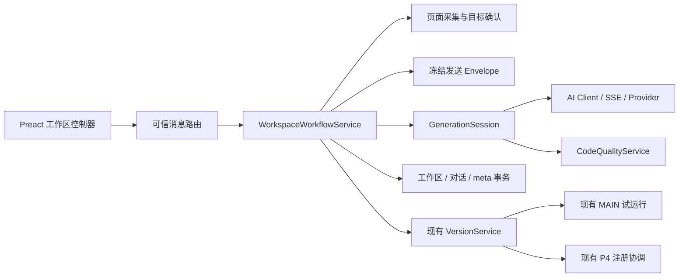

# 鲁班 V2.1 优化技术方案

> 2026-10-15 R2：Chat 正式代码已实施，底部输入、制品浮层、Markdown 与代码选行引用已接入；工程结果与真实 Chrome 待验收边界见 [R2 验收记录](./verification/v2.1-chat-acceptance-record.md)及 [人工清单](./verification/v2.1-chat-manual-checklist.md)。本文主体保留 R1 服务设计，R2 增量见文末。
日期：2026-10-14。状态：2026-10-14 已实施并通过工程检查；真实环境待人工验收，具体边界见验证记录。

依据：[V2.1 优化需求](./v2.1-optimization-requirements.md)、[交互 Demo](./demo-v2.1.html)、[V2 技术方案](../v2/v2-technical-design.md)、[TODO](../v2/todo.md)。发生差异以需求为准，Demo 的模拟响应、关键词判断、定时器与本地页面效果不进入生产逻辑。

## 1. 总体决策

V2.1 改造现有创作链路，保持工具、保存版、上一版、GM、自动注册和导出的核心模型。以“请求会话、目标确认、候选检查、效果反馈”四类状态补齐质量闭环。

| 决策 | 方案 |
|---|---|
| 前端 | 继续 Preact/TypeScript；拆分现有侧栏 App，不引入新 UI 框架或完整 IDE |
| 多轮修改 | 复用当前工作区与对话，增加结构化反馈和有效约束，不另建聊天存储系统 |
| 代码检查 | 复用 Acorn，增加作用域分析和环境能力清单，不能用正则识别未定义变量 |
| 模型调用 | 一次用户确认生成最多 2 次真实模型 HTTP 调用：首次 + 共用的一次格式/代码修复 |
| 网络异常 | V2.1 生成/修复链路关闭底层自动超时重发；限流、超时由用户主动重试 |
| 结果提交 | 只有完整、检查通过且仍属于当前页面/工作区的结果才写入有效草稿 |
| 目标策略 | 内容脚本提供候选与只读高亮；用户确认范围后 SW 冻结上下文，不自动执行 |
| 运行与保存 | 复用 VersionService、试运行凭证和 P4 注册协调器；增加效果确认与上下文有效性校验 |
| 持久化 | 复用现有 IDB stores，工作流辅助记录置于 meta；不增加 DB 版本或重写已保存脚本 |
| 隐私 | 实际发送预览、有限采集、现有脱敏和能力限制继续有效；不采集截图或认证信息 |

需求中一次修复选项的建议默认开启在此按可配置策略实现：发送前可见，用户可关闭；评审若改默认值，不影响会话预算和数据模型。

## 2. 代码基线与改动点

以下基于本轮本地代码检查，不沿用旧文档中已过时的缺口判断。

| 文件/模块 | 当前实现 | V2.1 改动 |
|---|---|---|
| `sidepanel/App.tsx` | 需求、代码、凭证及多个操作状态集中在组件中 | 工作区控制器 + 显式 UI 状态；拆分目标、策略、聊天、质量、结果卡 |
| `services/workspace-generation.ts` | 冻结 envelope、两轮 JSON 解析重试、成功后写草稿 | 统一会话预算、质量检查、一次修复、失败候选隔离 |
| `services/generation-envelope.ts` | 按预算组合当前代码、历史与页面上下文 | 加入结构化约束/反馈/确认目标，冻结修复授权说明 |
| `ai-client.ts` | 超时可自动重试一次 | 显式请求策略；V2.1 禁用内部重试，由会话统一计数 |
| `sse-parser.ts` | 接口有 finish_reason，但高层迭代未返回它 | 返回停止原因、完成标记和流结束方式，不丢失异常状态 |
| `services/trial-runner.ts` | Acorn 语法检查，GM 使用文本正则匹配 | 复用新的 AST 检查，替换误判注释/字符串的逻辑 |
| `services/version-service.ts` | 页面身份、草稿 hash、CAS、30 分钟凭证、提交协调 | 新生成及手改候选质量复核；凭证绑定工作流上下文，保存需人工效果确认 |
| `content/context-engine.ts` / picker | 有目标选择器、路径与有限兄弟标签摘要 | 有限祖先/相邻摘要、候选范围、目标指纹、排除自身 UI |
| `services/page-analysis.ts` | P7 主动分析、最多四条建议、取消保护 | 保持独立入口；策略辅助分析使用明确单次确认，不暗中调用 |
| `repositories/*` | IDB 事务、逻辑容量、工作区 revision、草稿缓冲 | 辅助工作流记录与工作区变更同事务 CAS，清理/容量保护覆盖新记录 |

本地最小验证：现有 Acorn 与本机 `eslint-scope` 8.4.0 可识别裸变量 n、document 和 typeof 可选变量为待解析引用，闭包内局部变量不会出现在未解析列表。此验证不等于完整规则或生产浏览器兼容性通过。

## 3. 模块结构与职责

建议新增文件：

- `shared/v21-types.ts`：工作流、诊断、目标范围、反馈与请求策略契约。
- `services/code-quality.ts`：纯检查，不读写库、不调用模型或执行脚本。
- `services/generation-session.ts`：请求预算、候选分支、诊断及修复编排。
- `services/workspace-workflow.ts`：协调上下文版本、CAS、反馈和策略确认。
- `content/target-context.ts`、`content/range-preview.ts`：有限采集与只读范围预览。
- `sidepanel/workspace-controller.ts`：事件/状态转换及通信，不复制 SW 领域规则。
- `sidepanel/components/`：TargetCard、StrategyCard、ConversationThread、QualityCard、ExecutionCard、SendPreview。

正式实现以现有服务边界为基础，可合并小型纯模块，不为每张卡片建立独立状态机或数据库。

## 4. 工作流状态与一致性

### 4.1 单一状态来源

SW 决定持久业务状态，UI 通过状态投影显示。聊天、错误、运行结果和按钮权限不能各用互不相关的布尔值决定。

持久记录只保存可恢复事实：有效草稿、确认范围、用户约束、最近诊断与会话结论。生成/修复中的连接和 AbortController 仅在内存；SW 重启将相关工作区置为 interrupted，不自动续发。

UI 状态建议为 discriminated union：editing、needsTarget、needsStrategy、previewing、generating、checking、repairing、readyToTrial、trialRunning、awaitingEffect、failed、saving、saved。视图离开不等于自动放弃草稿。

### 4.2 关键失效规则

| 变化 | 失效对象 | 保留内容 |
|---|---|---|
| 代码或 grants 修改 | 质量结果、运行凭证、效果确认、发送 envelope | 对话、原保存版本 |
| 目标范围/触发条件/有效约束改变 | 策略确认、envelope、运行资格 | 代码草稿、用户输入 |
| 页面 documentId/URL/host 改变 | 目标句柄、临时高亮、在途结果、凭证 | 已持久草稿和对话 |
| 模型/端点/相关配置改变 | 已冻结 envelope 和在途结果 | 原草稿 |
| 取消或新会话启动 | 旧会话所有后续事件 | 请求前有效草稿 |
| 显式保存/恢复 | 工作区基线、相关确认 | 对话不回滚，GM 不回退 |

文档内 DOM 变化不一定更换 documentId，因此执行前还需验证目标指纹/唯一性；不能只靠标签页身份确认目标仍是同一模块。

### 4.3 取消与迟到保护

每次会话绑定 workspaceId、draftRevision、workflowRevision、requestId、binding、配置指纹。收到进度和完成事件均检查会话归属。取消先撤销有效会话，再 abort 请求；供应商晚到数据不能恢复会话资格。

请求结束写入采用同一事务：重新读取 workspace 和 workflow，验证 revision/activeRequestId，再写有效候选、对话摘要和检查记录。不得在 IDB 事务中等待网络、Chrome API 或异步摘要计算。

同工作区禁止并发生成/修复/试运行/保存。多个 UI 入口通过相同 SW 服务和 CAS 协调，不能仅靠侧栏按钮禁用。

## 5. 数据与迁移设计

### 5.1 复用与新增记录

`ScriptRecord.current/previous`、GM namespace、自动注册日志不改变结构。`ScriptVersion.hash` 继续由 code、排序 grants、runAt 计算，不混入聊天或界面状态。

使用 `meta` 中带前缀的辅助记录：

| 记录 | 主要字段 | 生命周期 |
|---|---|---|
| `v21:workflow:<workspaceId>` | workflowRevision、targetScope、constraints、confirmedStrategy、recentFeedback、lastQuality、lastOutcome | 随工作区清理；原记录缺失即默认状态 |
| `v21:session:<requestId>` | workspaceId、开始/结束时间、真实请求数、授权预算、首次/修复后结论、状态 | 保存精简审计；不保留认证或隐藏推理 |
| `v21:failure:<workspaceId>` | 最近失败候选、结构化诊断、来源、时间 | 仅最近一次；新候选覆盖，工具/草稿删除时清理 |

候选失败正文与有效 `workspace.draft` 分开。用户主动选择“编辑失败候选”时，才通过 CAS 将候选复制为未验证草稿，立即失效旧凭证。

新记录参与现有 40 MiB 逻辑总量统计，诊断和反馈参与适当的单项容量限制。建议失败候选遵守现有 256 KiB 单版限制、诊断最多 20 项、结构化辅助数据每工作区不超过 32 KiB；这些是工程预算建议，编码前固化为常量并测试，不宣称现有实现已支持。超限拒绝新增辅助记录且保留原成果，不静默删用户代码/对话。

对话延续现有 role/text，并可添加可选 kind、turnId、requestId；旧消息缺少字段仍正常显示。有效约束独立于历史裁剪保存，不从被裁掉的聊天臆造事实。

### 5.2 兼容与删除

数据库继续当前版本 1，通过 meta 扩展，不因 V2.1 新字段强制重建数据库。初始化不遍历重写旧工具；仅在首次 V2.1 编辑时创建辅助记录。需记录应用数据能力版本，旧运行包只保留已验证的兼容范围。

工具删除、草稿丢弃、失联会话清理须同时处理辅助记录；与现有 tombstone/注册清理保持事务顺序。单独恢复代码不回退反馈、策略历史或 GM。

不能承诺任意降级包都保留新交互信息：功能关闭可回到稳定创作入口，已保存标准代码仍可运行；旧 UI 不展示新反馈。所有降级或版本替换都需关闭旧面板再重载，禁止不同版本同时写库。

## 6. 基础检查引擎

### 6.1 检查流程

字节上限 → 结果结构/完整性 → Acorn 解析 → 作用域引用 → GM 声明/支持集 → 现有安全扫描 → 与目标策略的可确认约束比较。

检查统一输出 QualityReport：status、codeHash、checkerVersion、diagnostics、repairEligibility。每条诊断包含稳定 code、severity、用户摘要、代码行列、详情和恢复动作；原始异常不直接显示给用户。

### 6.2 作用域分析

选型为 Acorn + 独立 `eslint-scope`，不把完整 ESLint 放入扩展运行时。`eslint-scope` 当前只是本地开发依赖的传递包，实施时必须作为显式运行依赖锁定并验证打包产物，不能依赖偶然存在于 node_modules。

按真实执行语义解析 async wrapper，支持已有顶层 await/return 兼容行为。位置映射回用户原始正文，wrapper 偏移不能出现在界面报错行号中。动态语法超出分析器能力时返回 CHECK_UNSUPPORTED，不以异常冒充通过。

环境清单版本化，包括 ECMAScript 标准全局、实际浏览器能力及包装器注入的 GM API。只为已声明支持的 GM 能力放行；不能从页面可枚举全局自动导入允许名单，否则广告/宿主页变量会掩盖模型错误。

区分声明、对象属性名、标签、解构、闭包、默认参数、类字段与真实引用。`typeof optionalGlobal` 用于特性探测不直接判未定义错误；后续无保护读取仍可报告。`window.someProperty` 的存在性无法靠一般作用域分析证明，不伪报已验证。

### 6.3 AST GM 校验与动态边界

实际引用才参与 grant 校验，替换试运行的全文正则。注释和普通字符串不产生权限依赖。已引用但未声明的支持 API 返回 MISSING_GRANT，交给用户确认现有权限勾选，不静默追加。

动态 `window[name]`、别名、宿主页私有全局等分级说明。运行能力与导出能力保持区分：已有运行允许的 GM 别名不因导出拒绝而统一禁止试运行；导出仍执行 P5 更严格的独立性检查。

静态检查不能验证最终视觉效果、目标是否真实存在或异步操作是否完成，这些由试运行与效果确认承担。

## 7. 流完整性与模型请求预算

### 7.1 SSE 与响应完整性

扩展流解析事件保留 delta、usage、finishReason、terminalSeen、streamEnd。SSE 畸形事件、响应断开、Abort 和正常 EOF 分开记录。

- 明确 finishReason=length：OUTPUT_TRUNCATED，不运行、不自动拼接，用户主动缩小任务或重新生成。
- content_filter/refusal 等终止：明确限制，不进入自动代码修复。
- 缺少 finishReason 但有 DONE：继续结构和 AST 检查，不编造具体停止原因。
- 服务只返回干净 EOF：完整 JSON、完整代码且无流错误时可继续检查，并记录服务未提供停止原因；不一律判截断。
- 异常断流、残缺结构或不完整代码：不写成有效草稿。无法确认原因时说明结果不完整，不把所有语法错误都解释为 token 不够。

保持 P7 Chat Completions 兼容，不依赖供应商私有字段。仅记录响应实际提供的 token/停止信息，缺失时为空。

### 7.2 单次会话预算

GenerationSession 独占请求额度。AI Client 提供 autoRetry=false；所有首次、格式纠正、代码纠正和可选模型辅助均通过明确的编排入口计数。

本次生成预算：repairAllowed=false 最多 1 次 HTTP；repairAllowed=true 最多 2 次。格式纠正已用掉追加额度时，后续代码检查失败直接展示错误，不再第三次调用。请求一旦发出即计数，包括 429、超时和断流；不能仅统计成功响应。

策略辅助分析是生成之前另一次用户明确确认的调用，单独显示费用/请求事实，不混进“生成最多一次修复”的承诺。不得在准备策略时偷偷调用 P7 分析。

### 7.3 修复范围保护

冻结原 envelope、模型配置和预算，修复消息只追加失败候选与结构化诊断。追加内容在本地预算内，超预算时停止并提示缩小任务；不截断当前代码、不新增页面内容。

自动候选重新执行全部检查，并比较 host、grants、目标选择器、触发机制、网络/存储相关能力。对于可静态确认的局部改动，例如移除独立未定义引用，可接受为待试运行草稿。

**不能一般性证明完整模型代码语义等价。** 修复出现范围变化或无法确认其与已授权策略一致时，停留在“修复建议待确认”，展示差异和目标预览；用户重新确认后才作为有效草稿，不能仅凭模型自述接受。不增加站点权限、不执行修复正文来验证安全性。

## 8. 目标范围采集与策略确认

### 8.1 有限采集

内容脚本对目标、有限祖先与必要相邻节点生成摘要，包含可定位属性、简短可见文本、选择器候选、结构关系和区域标识；不读取 input value、Cookie、localStorage，不上传截图或完整 DOM。

建议工程上限：目标 1 个、祖先最多 4 层、每层相邻节点最多 3 个、每段文本最多 120 字，且受原采集 deadline 与整体 token 预算约束。上限是新方案建议，不能突破原预算；不足时先裁辅助线索，再要求用户重选目标。

picker 与预览层使用统一自身 UI 标记，祖先/兄弟采集和候选生成都过滤该标记。预览高亮使用独立 overlay，不改变宿主布局、display 或用户业务属性。

### 8.2 目标身份与候选

页面内 Element 句柄仅保存在内容脚本内存，SW 保存 targetId、documentId、选择器链和摘要指纹。确认前重新解析候选，验证唯一性、层级关系与必要特征；目标已消失或变成多个时重新点选。

整个侧栏、body/html、包含正文或无关模块的祖先不自动当作“完整模块”候选。没有可靠最小容器时返回 needsTarget；容器存在不等于能无歧义识别广告，用户确认仍是必要证据。

iframe 跨文档目标不使用父 document 的事件捕获伪装支持；超出现有权限和采集能力时提示用户选择外层 iframe 或可访问容器，不扩张权限穿透。

### 8.3 策略来源与有效期

先用目标候选、用户显式边界和已有操作上下文决定是否需要策略确认。不能根据文字长度或单个关键词就视为确定性分类。

策略结构包括 target、trigger、expectedEffect、preserve、unresolved；用户确认产生 strategyFingerprint，与 targetFingerprint、workflowRevision 绑定。改变模块范围、触发方式或有效约束必须失效旧确认。

生成结果即使解释与策略一致，也不证明代码一致。能识别的目标/触发差异标记出来；无法验证时要求用户试运行并观察，不承诺自动语义验收。

## 9. 多轮反馈、效果确认与保存

### 9.1 多轮上下文

每轮 envelope 包含本轮需求、有效草稿/保存版、已确认约束、最新匹配页面目标、相关反馈与必要历史。反馈归属 workspaceId/turnId 和当次 trialReceipt；不能混入另一工具。

约束变更由用户可见并确认，不由模型后台改写成新事实。较早聊天可裁剪，当前代码、本轮输入及有效约束不可静默截断。错误、用户效果反馈和模型解释分别标记来源。

快捷反馈只填充输入，不自动发请求。反馈“空白还在”涉及从单元素扩大到模块时，重新采集/预览范围并确认策略；不能像 Demo 的关键词分支一样直接扩大目标。

### 9.2 运行资格与人工确认

UI 的“效果符合，保存”是明确人工确认，不调用视觉识别。提交消息增加 effectAcknowledged=true，并绑定 receiptId、当前 workflowRevision/targetFingerprint；后台不相信仅有布尔值就代表任意旧代码可保存。

TrialReceipt 扩展可选 workflowRevision/targetFingerprint/checkerVersion。在试运行完成签发时绑定；提交时重新验证工作区、hash、页面、质量和工作流确认。旧 receipt 不满足 V2.1 绑定时要求重新试运行，不静默补造确认。

既有 current/previous 轮换、opId 幂等、P4 coordinate 和 GM typed delta 保持不变。更新版本仍通过现有外部注册日志事务，反馈不能直接改 current。

### 9.3 异步效果

初始化成功只返回“执行完成/等待观察”，不证明倒计时、监控或下载的后续结果成功。用户可继续观察、保留草稿或反馈；本期不额外承诺常驻远程监控状态。

修改后已有页面监听可能仍存在。现有相同代码文档内幂等保护不能代替任意脚本卸载，必要时提示刷新再试；停止等待不承诺撤销已发生 DOM/GM 副作用。

## 10. 消息边界与前端交互

新增命令建议：PREPARE_WORKFLOW、CONFIRM_TARGET_SCOPE、CONFIRM_STRATEGY、CHECK_DRAFT、PREPARE_REPAIR、SUBMIT_EFFECT_FEEDBACK。生成仍使用长连接承载阶段事件，不另开每张卡片的连接。

所有管理命令经过 assertExtensionPage、字段长度/枚举验证和 workspace CAS；内容脚本报告只接受真实 sender 的 tab/frame/document，并用 requestId 关联，不相信页面自报身份。MAIN 页面不能通过 DOM 事件发起修复、读设置或扩大权限。

前端仅投影业务状态：

- 一个主操作随状态切换：发送确认、试运行、效果符合保存。
- 复杂策略内联展示，不重复叠加策略弹窗与保存弹窗；真正发送确认沿用现有预览。
- 代码与诊断默认折叠；主错误先给原因与恢复入口。
- 确认范围和代码修改后及时取消旧运行资格，不只灰掉按钮而保留可提交凭证。
- 键盘支持 Esc 取消预览、焦点返回触发入口；处理中保留取消，辅助技术状态公告不过度播报流式内容。
- 设置页复用同一工作区控制器和领域服务，不能出现两套保存/反馈逻辑。

## 11. 错误、存储与运行预算

建议错误码：UNDEFINED_REFERENCE、CHECK_UNSUPPORTED、MISSING_GRANT、OUTPUT_INCOMPLETE、OUTPUT_TRUNCATED、REPAIR_EXHAUSTED、REPAIR_SCOPE_CHANGED、TARGET_STALE、STRATEGY_REQUIRED、EFFECT_CONFIRM_REQUIRED。网络继续使用现有 RATE_LIMITED、OFFLINE/超时类错误，不误报代码质量问题。

检查按当前代码字节上限及有限 AST 规模执行；记录耗时和 bundle 体积，防新分析器使 SW 长时间阻塞。不先承诺 P95 数字，取得样本后评估是否需要隔离检查任务。

生成检查缓存可按 codeHash + grants + runAt + checkerVersion 键控；目标/策略检查另含指纹。保存前重新验证关键条件，不能仅依赖 UI 缓存。检查器升级不改已保存脚本、不大批自动停用，但新生成/手改/提交使用新规则，兼容性回归单独记录。

辅助会话与失败候选有清理规则，且不得让记录写入失败破坏有效草稿。无法写入辅助记录时明确提示诊断未完整保存，不宣称历史已归档。

## 12. 验证方案与验收映射

| 测试层 | 必测内容 | 需求验收 |
|---|---|---|
| 纯检查单测 | 裸变量、作用域、闭包、解构、typeof、浏览器/GM、注释字符串、wrapper 行号 | O01/O02/O06 |
| 流与传输 | length、stop、DONE、clean EOF、异常断流、畸形事件、取消 | O03/O05 |
| 会话集成 | 授权开关、真实 HTTP 次数、格式+代码共享额度、429/超时无自动重发 | O04/O05 |
| 修复边界 | grants/host/目标/触发变化、未知语义需确认、失败候选隔离 | O01/O04/O14 |
| IDB/CAS | 工作区和 meta 同事务、失败回滚、容量、重启中断、删除清理 | O05/O13 |
| DOM 夹具 | 完整广告、单图片、标签、留白、相邻正文、自身 overlay、目标变化、iframe 限制 | O07/O09 |
| UI 集成 | 简单直达、复杂策略、反馈只填入、效果保存、键盘/窄侧栏 | O08/O10/O11/O15 |
| 真实 Chrome | 淘宝与豆瓣复验、手动/自动、GM、恢复导出、页面/SW 生命周期 | O07/O12/O16 |

测试使用真实生产模块，缩小预算夹具不能替代真实上限验收。正式模型十场景对比保存首次、追加修复、最终效果、请求数、耗时、人工编辑；不覆盖既有 P6 首次失败记录。

修改生成 prompt 重跑十场景；修改 runner/注册才重跑受影响 P4 断点，若确未改注册器，不无条件重跑无关矩阵。发布前仍做创建、自动、恢复、导出烟测和完整工程四项。

## 13. 实施顺序与退出条件

| 阶段 | 主要交付 | 退出要求 |
|---|---|---|
| T1 基础质量 | CodeQualityService、SSE 完整性、统一预算与失败候选 | O01–O06、O14 的相关单测/集成通过，正式模型首次/修复记录可区分 |
| T2 反馈工作区 | 状态控制器、结构化反馈、效果保存与辅助记录 | O08/O11–O13/O15；A/B/并发/重启无覆盖 |
| T3 目标与策略 | 有限上下文、范围预览、策略确认与指纹 | O07/O09/O10/O14；豆瓣主体/标签/占位整体消失，相邻内容保留 |
| T4 综合出口 | 十场景质量比较、真实 Chrome 与核心回归 | O01–O16、四项工程检查、构建指纹和实际证据齐全 |

本轮实现与自动工程检查已完成，执行计划和人工清单已建立。TODO 待真实验收满足后才勾选，不把代码完成等同全部验收完成。

## 14. 风险与需冻结的参数

- `eslint-scope` 显式依赖版本、语法支持矩阵和 Vite 浏览器打包需在 T1 验证；失败时不能退回正则“近似通过”。
- 环境全局清单和动态引用分级需形成检查规则表，避免误伤已有用户脚本。
- 自动修复默认值、候选祖先/相邻数量、辅助记录预算为本方案建议，实施前随评审固化。
- 一般 DOM 操作范围和模型语义不能完全静态证明，用户范围确认和试运行观察不可删除。
- 现有 token 预算与服务商输出限制可能不同；流停止原因缺失时保持不确定性，不自动加大模型输出或隐性切换配置。
- P6 的 Chrome 138、实际 1 MiB/40 MiB 及明细证据仍单独保留，不能以 V2.1 单元测试替代。

## 15. 执行计划

连续实施与验收拆解见 [V2.1 一次连续执行计划](./v2.1-execution-plan.md)。任务编号用于依赖与证据追踪，不要求逐阶段确认；本轮实现和自动检查完成，真实环境待人工验收。

## 16. 实施记录

实现和自动检查见 [V2.1 实施与验收记录](./verification/v2.1-acceptance-record.md)。本轮 308 项测试通过；真实模型质量、豆瓣页面效果和浏览器视觉仍待验收，不将原型或 jsdom 当作真实扩展证据。

## R2 增量：Chat 工作区与代码引用（2026-10-15）

### 界面与状态

正式 `sidepanel/App.tsx` 使用纵向 flex 容器：顶部站点/快捷操作、唯一可滚动消息区、制品栏、底部输入。窄侧栏不把 composer 放入消息滚动区。代码、名称、权限、版本、导出、自动运行和诊断进入原生 dialog；范围与保留约束按需展开。options 中复用的 embedded 工作区同样使用 Chat 布局。

`ChatMarkdown` 用 Preact 文本节点渲染安全 Markdown 子集，不插入原始 HTML，不加载外部图片，仅允许 HTTP(S) 链接。代码使用轻量词法高亮；这不是完整 IDE。过程展示真实生成/修复状态和模型 explanation 的流式片段，不把原始输出或内部推理作为成功凭据。

输入支持 Enter 发送、Shift+Enter 换行、IME 组合态保护。生成/分析中输入进入本地 next-input 缓冲，结束或主动停止后恢复，不与当前服务锁争写。未自动提交的此类文字只存在当前挂载 UI，强制关闭/重载不保证恢复；已经停止并恢复到正常输入后走现有持久化。上滚关闭自动跟随，回到最新重新启用。

点击输入框发送直接 PREPARE 并 GENERATE，不再依赖首次/范围变化发送确认或 UI consent 缓存。每轮仍校验页面/目标/版本/CAS，复杂模块策略与权限校验不变。用户主动点击「发送范围」只生成不可变预览，不调用模型；可返回修改或从该入口发送生成。分析沿用单独确认。

### 代码引用协议

共享 `CodeReference`：`workspaceId/versionId/hash/name/lines/text`。lines 有序去重，text 为准确的 `L行号: 原代码` 快照；hash 由 code、排序后的 grants、runAt 计算 SHA-256。单引用最多 200 行、32 KiB。每个输入只有一个待发送引用，再选时明确标为替换。

WorkspaceRecord/DraftPatch 可选 `codeReference`，ConversationMessage 可选历史引用，沿用 IDB stores 与容量守卫，无 DB 版本升级。生成 prepare 核对所属工作区、当前有效 baseline 的版本与重新计算的 hash，逐行重建并对比快照；不一致或旧版本在模型请求前拒绝，要求重新选择。历史预览可以引用，但不会静默当作新版行号使用。

引用进入 workflowContext，故实际 envelope、预算估算和模型发送一致；本轮 user 消息同时存引用。成功写草稿后清空待发送引用；失败保留。保存、恢复、丢弃清空待发送引用。旧历史附件作为记录保留，后续对话历史按现有文本历史预算传递，不自动重新附加所有旧代码快照。

单独引用元数据更新仍递增工作区 CAS revision；同事务只顺延恰好绑定更新前 revision 的有效 receipt revision。代码、输入、权限、工作流或含其他字段的 patch 不享受此规则；expiry、hash、binding、workflowRevision 等提交校验不变。已经失效的凭证不能通过添加/移除引用复活。

### 交付与验证

新增代码引用、Markdown/浮层 DOM 测试；正式 App 使用真实仓储/生成/版本服务贯通多轮、引用、IME 与 next-input，Chrome transport/执行器/模型为替身。生产构建仍输出 `luban/dist`。真实 Chrome 布局、焦点、网页效果及自动注册按 C01–C14 人工清单验收；不以 DOM 测试宣称实测通过。

### iframe 点选增量（2026-10-15）

内容脚本选择器改为非模态 Popover 顶层遮罩，临时移出 hit-test 后定位主文档真实元素，finally 恢复拦截。跨域 iframe 仅选择外框，不读取内部文档。独立矩形绘制高亮，不修改目标 class/style；↑/↓ 保持祖先返回路径，Enter 或原位置点击确认当前层级，Esc/stop 幂等清理并恢复焦点，滚动和 resize 重绘。完整广告容器由用户核对，不自动选整个侧栏。真实 CSDN 验收见 [专项清单](./verification/v2.1-picker-iframe-checklist.md)。

### 网页代码浮层增量（2026-10-15）

制品名称默认经 OPEN_CODE_PREVIEW 在当前匹配普通网页注入/显示预览，失败回退原侧栏 dialog。复用 CodeArtifactDialog，在 ISOLATED 内容脚本内用 closed Shadow Root 隔离样式，原生 dialog 提供网页区域模态与焦点行为；浏览器侧栏属于独立界面，继续承载聊天。只渲染文本与高亮，不执行代码或修改业务布局。

SW CodePreviewService 从原仓储获取代码，签发 sessionId 并绑定 workspace/tab/document。metadata 保存 current version/hash、版本身份、名称与创建时间，放入既有 IDB meta 容量守卫；恢复时重读原代码核验，30 分钟过期，最多保留 50 条会话元数据。正常 SW 休眠重启后可恢复，不复制完整代码到另一存储。

选行/编辑通过扩展 runtime 通道，不走网页 postMessage。内容脚本消息核验 extension id、主 frame、tab 与 document，编辑再核验当前代码身份/hash、工作区状态、互斥锁与 CAS。选行复用 codeReference 协议；编辑仍为未验证草稿，旧检查/凭证失效。关闭/更多操作允许清理已过时会话，避免旧浮层无法退出。

浮层打开时新聊天输入暂存当前 UI，避免与浮层草稿写入争抢 CAS；引用/编辑回传加载最新工作区后仍恢复新输入，关闭/开始生成前提交缓存。未保留的左侧编辑会阻止右侧主动关闭/生成/运行。名称、权限、自动运行/导出/恢复等高级操作回到侧栏原服务。真实边界与验收见 [左侧预览专项](./verification/v2.1-page-code-preview-checklist.md)。

### 推理模式增量（2026-10-15）

Settings 新增 thinkingEnabled（默认 true，已有 false 保留）与 customThinkingProtocol（auto/thinking/none）。由 toProviderConfig 传递，输入区快捷勾选即时持久化，AI 设置页按原保存规则处理；storage.onChanged 同步已打开侧栏。开关变更本身不请求模型。

GenerationEnvelope/AnalysisPreview 冻结本轮 enabled 和有效协议；发送前、上下文复查时校验设置未变化。首次生成及受控修复沿用同一值，仍保留一轮最多两次 HTTP 的预算，不靠协议降级额外请求。页面分析沿用同一全局设置。旧生成入口也跟随设置；轻量连接探测显式关闭推理。

MiMo 原生采用 thinking.type，兼容端点自动识别 MiMo/DeepSeek 域名；未知端点自动模式不传扩展参数，UI 发送详情明确服务端默认。支持 thinking.type 的代理可显式选择，none 明确不承诺关闭服务端推理。具体字段以官方协议为准，不把 OpenAI 兼容当成推理参数通用标准。

SSE reasoning_content 只转换为布尔进度信号，AiClient 每次请求至多通知一次 onThinking；不累积、存储、显示推理原文，不混入正文 JSON 或后续历史。UI 只呈现实际推理状态与修改说明。业务不使用模型 tool_calls，因此未增加推理历史回传。

验收及协议来源见 [推理专项清单](./verification/v2.1-thinking-manual-checklist.md)。

### 模型推理文本展示增量（2026-10-15）

按用户追加要求，reasoning_content 不再只转状态：SSE 分离推理 delta，AiClient 独立累计，每次请求 64 KiB UTF-8 上限，100ms 节流并在结束时补发最后状态。正文累积/解析不变。生成 Port 使用 GENERATION_REASONING，分析按预览身份广播 ANALYSIS_REASONING；UI 独立安全 Markdown 折叠区，生成中展开、结束收起，修复分段。成功结果在 ConversationMessage.reasoning 保存附件，既有历史组装仍只选 text，故不自动回传推理。附件也受对话容量守卫，容量不足时标注省略；失败/取消只保留当前 UI 内容。明确不模拟未由供应商返回的过程。验收见 [专项清单](./verification/v2.1-reasoning-display-checklist.md)。

### 推理节点呈现增量（2026-10-15）

复用现有 ReasoningStage 数据和 ReasoningDetails 入口，将首次/修复请求下的原始文本按标题/编号步骤优先、无标题时按段落确定性分组；代码围栏不拆，单请求最多 64 节点，超出合并末节点。节点 key 为 attempt/index；原生 details/summary 提供独立折叠。live 默认展开最新节点，单节点覆盖与 all/none 模式控制批量行为；用户操作后保持外层展开偏好。Markdown 继续使用文本安全渲染。不新增模型调用，不改变推理传输/存储和生成服务。

### 脚本上下文与管理页增量（2026-10-15）

WorkspaceGeneration.prepare 从有效 baseline（draft 优先 current）构造 ScriptAttachment 身份：workspace/script/version/hash/filename/source；进入 envelope、workflowContext 和本轮 user 历史。完整代码继续复用 previousCode 正文，避免重复传输或增加 Files API。输入区文件标签指向当前预览，发送中的身份来自冻结 envelope，历史消息保留原始版本。

ScriptManager 不再嵌入 WorkspaceApp；复用精简 ScriptLibrary 与 CodeArtifactDialog，管理页不渲染对话、不提供选行发 chat。已保存脚本列表保留搜索/排序、查看编辑、删除、自动运行；详情支持当前/保存版/上一版。编辑复用原工作区和 DraftPatch，确认保存仍经 VersionService trial/commit，恢复经 restore，开关/删除经现有自动注册服务。试运行及保存前激活已打开匹配网页（保存绑定原 trial tab），不新建任意网页或绕过页面凭证。

未保存的当前草稿可在重新打开管理详情时继续，但不作为历史会话/草稿列表展示。自动开关、删除失败后刷新真实状态。适用人工标准见 [专项清单](./verification/v2.1-script-context-manager-checklist.md)。
