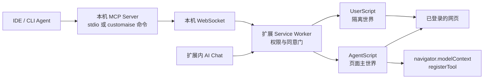
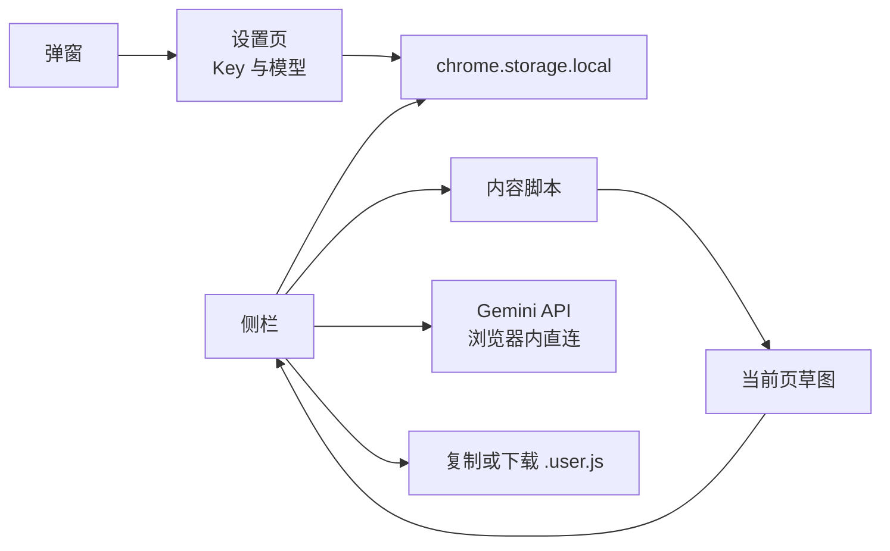
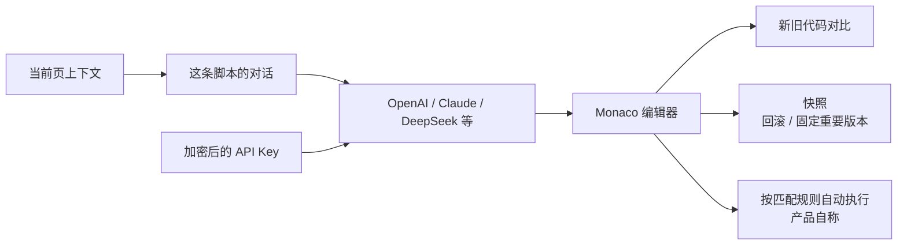

# Customaise、VibeMonkey、ScriptGenie

> 调研日期：2026-10-11。配套：[同类产品调研](./competitive-research.md)。
>
> 材料边界：Customaise 来自官网、UserScript / AgentScript 文档和 `[@customaise/mcp](https://github.com/getcustomaise/customaise-mcp)`。VibeMonkey 来自 [仓库源码](https://github.com/dorser/vibemonkey)（截至本次抓取只有 2025-08-20 一次提交）和作者当天的公开说明。ScriptGenie 仓库明确不包含源码，架构只根据官网、商店页和 1.0.0–1.0.5 发布说明反推，不写成已核实的内部实现。

三家都在做「用大白话改网页，留下一段用户脚本」。差别在脚本生成之后交给谁。

|       | Customaise                                    | VibeMonkey               | ScriptGenie                         |
| ----- | --------------------------------------------- | ------------------------ | ----------------------------------- |
| 生成之后  | 自己运行、可回滚，并可导出                                 | 只复制或下载 `.user.js`，交给油猴   | 自己按匹配规则运行（产品自称）                     |
| 页面理解  | 可视点选 + 选择器分级；Agent 还可拿 DOM 快照和截图              | 整页草图：焦点元素、地标、按钮/链接/输入框计数 | 把当前页当作上下文（未公开采集字段）                  |
| 模型    | 扩展内基础模型额度；付费可 BYOK Gemini；脚本还能调本机 Gemini Nano | 只用 Gemini，Key 放本机        | OpenAI、Claude、DeepSeek 等，Key 加密后存本地 |
| 再往前一步 | 把网站包成工具，给 IDE 里的 Agent 调用                     | 作者说想做得更一体，仓库没有后续提交       | 对话、编辑器、快照、新旧代码对比                    |

## Customaise

官网：[customaise.com](https://customaise.com/)。文档：[UserScripts](https://customaise.com/learn/userscripts)（页眉写 2026-09 更新）、[AgentScripts](https://customaise.com/learn/agentscripts)（页眉写 2026-05 更新）。

### 核心思路

网站不是为当前这个用户做的，所以用户自己写一小段脚本改它。格式不新造：沿用 2004 年 Greasemonkey 定下的 `==UserScript==` 头、`@match` / `@grant` / `@run-at`，以及 Tampermonkey 那套 `GM_*`。AI 只负责把「一句话」写成这个已有格式，并在当前已登录的页面上跑一遍；写坏了可以回到上一版。导出的仍是普通 `.user.js`，可以放进 Tampermonkey 或 Violentmonkey。

第二步不是把 AI 变成替用户点击的代理，而是把脚本变成 Agent 能调用的工具。一段 AgentScript 在匹配页面上注册若干有名字、有参数结构的工具；Cursor、Claude Code 等通过本机 MCP 发现并调用。调用发生在用户已经登录的标签页里，敏感动作用扩展再问一次。他们的对比对象是「看截图操作浏览器」：工具调用回的是结构化 JSON，不把整页像素塞进上下文。

免费档含每月 20 万扩展内 AI token、MCP 每天 50 次（滚动 7 天 150 次）、无限条脚本、编辑器、市场和基础模型。Power User 为 9 美元/月，含不限 MCP、自带 Gemini Key、跨设备同步和市场发布。注册带 7 天 Power 试用，不要求绑卡。

### 产品架构

四层，外面的 Agent 不直接碰页面。

**脚本层有两种文件，共用一个管理器。**

- UserScript（`.user.js`）默认跑在隔离世界。文档列出 26 个与 Tampermonkey 对齐的 `GM_*`（存储、跨域请求、样式、菜单、通知、剪贴板、标签页状态等），外加 5 个 `CM_*`：本机 Gemini Nano（`CM_promptAI`，写明 Chrome 148+）、Chrome DevTools（`CM_devtools`，默认关，每次浏览器重启要重新打开，打开时有调试横幅）、以及把点选结果解析成活元素的 `CM_findElement` / `CM_findExternalElement`。
- AgentScript（`.agent.js`）用 `==AgentScript==` 头。每个工具一行 `@webmcp <名字> allow|prompt|deny`，页面加载时调用 `navigator.modelContext.registerTool`。因为它要碰 `navigator.modelContext`，所以跑在页面主世界，而不是隔离世界。头里没声明的工具默认拒绝。

**同意门在 Service Worker，三条调用路径共用。** `allow` 直接执行，文档写往返大约 50–100 毫秒，仍会过权限检查。`prompt` 弹出工具名、参数和来源脚本，5 分钟不处理就自动拒绝。`deny` 直接失败。扩展 1.3.6 增加「完全访问」：用户打开后，符合条件的 prompt 工具可以不再次弹窗；显式拒绝、未声明工具、停用脚本和 DevTools 权限仍然有效。Power User 还可以把这次确认同步到手机，先到的决定生效。文档写远程确认的参数在 Google Cloud KMS 中加密保存。

**本机桥是独立进程，不是扩展里的云接口。** `[@customaise/mcp](https://github.com/getcustomaise/customaise-mcp)` 仓库创建于 2026-03-23。IDE 用 stdio 拉起它，只有 Shell 的 Agent 用 `customaise` 命令走同一个守护进程。桥再经 WebSocket 连扩展。公开工具面是 19 个，分成脚本生命周期（列出、导入、导出、删除、启停）、页面上下文、标签页控制、可视点选、截图、列出并调用 WebMCP 工具、批量同步。另外提供两份「写法手册」资源，要求 Agent 改脚本前先读。MCP 不能自己批准 `prompt`，也不能自己打开「完全访问」。

生成侧是扩展内的 AI 编辑器：自然语言，可以指向页面元素；写出脚本后在当前页应用；Monaco 里改；每次修改有版本，可以撤回。市场用来一键安装别人发布的脚本。DOM 点选得到的是稳定选择器和截图，不是把整棵 DOM 交给模型。

### 演进路径

公开材料能排成一条线，没有内部路线图，日期以文档和仓库为准。

1. **先做可带走的用户脚本。** 同一套头和 `GM_`*，AI 负责写和在当前页验证。导出格式不变，所以不把用户锁在扩展里。
2. **再让脚本自己用上本机能力。** `CM_`* 是旧 API 里没有的三件事：点选定位、本机小模型、DevTools。文档把 `CM_promptAI` 写成「AI 不再只是写脚本的人，也是脚本运行时能调用的东西」。
3. **然后把脚本变成工具。** AgentScript 是 UserScript 的兄弟格式，不是另一个产品。多出来的只有工具声明、`registerTool` 和每次调用的同意。站点自己发布的 WebMCP 覆盖网站愿意公开的能力；AgentScript 覆盖用户自己的流程，不需要网站配合。
4. **最后把工具接到 IDE。** 2026-03 起的 MCP 包负这个连接。扩展侧后续版本都在收紧这条链，而不是加新入口：1.3.4 给保存加 90 秒上限和提交回执，并用代码哈希避免覆盖旧版本；1.3.5 把每个工具的允许 / 询问 / 拒绝跟着脚本同步；1.3.6 才允许用户主动关掉反复确认。桥的协议版本和 19 个工具在这些小版本里保持不动。

## VibeMonkey

仓库：[dorser/vibemonkey](https://github.com/dorser/vibemonkey)。作者 Dor Serero 在 2025-08-20 说明了起因：在亚马逊内部用油猴改后台成了习惯，同事要一段内部看板脚本，他没找到「说一句就生成」的工具，于是当天用生成式编码做了这个扩展。仓库只有一次提交，信息是 `feat: vibemonkey first commit`，版本号 1.0。作者当时写明：体验还不完整，希望以后更一体，这只是一个开头。

### 核心思路

只解决「描述一个视觉改动，得到一段合法的油猴脚本」。不运行、不保存到扩展、不在下次访问时注入。侧栏是对话入口，油猴才是运行时。这样扩展不用处理 CSP、`GM_*` 和站点匹配，也因此到不了「回来还在」。

模型被限制成只做视觉改动：提示词要求稳健、可重复执行、考虑无障碍，并禁止访问本地存储、Cookie，禁止 `eval` 和 iframe。返回里要有主选择器和备用选择器、完整脚本、一份人工检查清单。这是生成约束，不是运行时沙箱。

### 产品架构

Manifest V3，权限是 `sidePanel`、`storage`、`activeTab`、`scripting`、`downloads`，主机权限为全部网址。Webpack 打包。界面分三块：工具栏弹窗、侧栏、设置页。后台 Service Worker 只有一件事：把点击图标设成打开侧栏。

生成时侧栏把用户原文发给内容脚本。内容脚本不上传整页 HTML，只拼一段文字：标题、URL、用户目标、当前焦点元素（标签、id、class、最多 50 字文本）、`main` 地标，以及按钮、链接、输入框、下拉框的数量。侧栏用 `@google/generative-ai` 直接请求 Gemini。默认模型是 `gemini-1.5-flash`，设置里还可以选 `gemini-1.5-pro` 和带视觉的 Gemini Pro。Key 存在 `chrome.storage.local`，设置页用密码框展示，存储本身没有再加密。

返回文本靠查找 `// ==UserScript==` 和 `})();` 截出代码，再检查有没有 `@match`。通过后才能复制，或用 `chrome.downloads` 另存为 `.user.js`，文件名取自 `@name`。

源码里有两处还没接上，说明它停在原型：弹窗发送 `open_side_panel`，后台没有对应监听；生成时又用 `scripting.executeScript` 注入 `src/content-script.js`，而清单里注册的是打包后的 `dist/content-script.bundle.js`。内容脚本的注释写着以后可以用用户目标筛选 DOM，当前 `goal` 只是被原样放进草图。

### 演进路径

没有第二条提交，也就没有已发布的第二阶段。能说的只有作者当天的意图：从「生成一个文件」走到「更一体」。以现有结构，更一体只可能是下面几步，都还没做。

1. 侧栏里预览并在当前页试运行，而不是只给文件。
2. 按 `@match` 记住脚本，下次自己注入。
3. 用用户目标裁剪 DOM，而不是每页同一份计数草图。
4. 生成失败后带着报错再问一次。

2025-08-20 之后仓库没有新提交。它适合当作「最小生成器长什么样」，不适合当作仍在演进的竞品。

## ScriptGenie

中文名脚本精灵。官网：[scriptgenieai.github.io](https://scriptgenieai.github.io/)。商店页版本 1.0.6，页面标注更新于 2026-04-12。GitHub 仓库 [scriptgenieai/scriptgenie](https://github.com/scriptgenieai/scriptgenie) 创建于 2025-08-03，说明文字写明只收反馈，不含源码。

### 核心思路

把「写脚本」做成围绕一条脚本的对话，而不是一次生成。用户用自然语言描述自动化（填表、抓取、监控、去广告、改样式、批量操作），模型看当前页，改的是这条脚本的代码。编辑器、快照和回滚都挂在脚本上，所以改坏了可以回到某一版，而不是只剩最后一次回答。

和 VibeMonkey 相反，它自称兼容 Tampermonkey 的 URL 匹配，并自动执行相关脚本。扩展同时是生成器和运行器。和 Customaise 相反，公开材料里没有把脚本交给外部 Agent，也没有写可以导出到油猴。

### 产品架构

源码未公开，下面是发布说明能够支撑的对象关系，不是模块图。

一条脚本是中心对象。1.0.2 修复了「新建脚本还没保存的消息，写进了已有脚本的历史」，说明对话历史按脚本分开，不是一个全局聊天。1.0.4 修复了「新建脚本却显示上一次打开的脚本」，说明编辑器有当前脚本的缓冲。1.0.3 增加新旧代码对比。快照支持回退，官网还写了可以把重要版本固定住。

模型在扩展里切换，官网点名 OpenAI、Claude、DeepSeek。1.0.5 修复「大模型密钥解密失败」，因此 Key 是加密后存在本地，不是明文。官网写本地存储、不收集用户数据，并提供中英文界面。安装说明仍是下载压缩包后以开发者模式加载；商店里同时有 1.0.6。

不能从公开材料确认的部分：页面上下文具体采了哪些字段、脚本跑在隔离世界还是主世界、有没有 `GM_*`、匹配规则由谁调度、密钥用什么算法加密。这些都不写入架构结论。

### 演进路径

功能骨架在 1.0.0 就齐，之后两个月都在修「脚本是独立对象」这件事。

| 版本    | 时间              | 实际在补什么                                         |
| ----- | --------------- | ---------------------------------------------- |
| 1.0.0 | 2025-09-01      | 多模型对话、当前页上下文、编辑器、快照、本地存储。首版即按「脚本工作台」发布，不是单次生成器 |
| 1.0.2 | 2025-09-19      | 模型的正常回复被当成错误渲染；未保存的新脚本消息串到旧脚本历史                |
| 1.0.3 | 2025-09-23      | 新旧代码对比                                         |
| 1.0.4 | 2025-09-29      | 新建脚本时编辑器残留上一条脚本                                |
| 1.0.5 | 2025-11-09      | 密钥解密失败                                         |
| 1.0.6 | 商店页写 2026-04-12 | 发布说明里没有对应条目，变更未知                               |

这条路径没有走向 Agent 或市场。它停在把对话、编辑和版本收成一个脚本对象，并让匹配到的页面自己跑。1.0.6 之后没有新的公开版本说明。

## 对照

|          | Customaise                         | VibeMonkey                         | ScriptGenie                                  |
| -------- | ---------------------------------- | ---------------------------------- | -------------------------------------------- |
| 用户的一句话变成 | 可运行、可撤回的脚本；进一步可以变成工具               | 一个 `.user.js` 文件                   | 某条脚本的新版本                                     |
| 谁负责下次再生效 | 扩展自己，按匹配规则                         | 用户安装进油猴之后                          | 扩展自己（产品自称）                                   |
| 页面怎么交给模型 | 点选元素和选择器；桥上还有 DOM 快照、控制台、截图        | 固定模板的文字草图，不含元素点选                   | 当前页上下文，字段未公开                                 |
| 改错了怎么办   | 版本回滚；保存时用代码哈希拒绝过期写入                | 再生成一次，没有历史                         | 快照回滚、固定版本、代码对比                               |
| 安全边界     | 生成前可编辑；Agent 调用按工具询问；DevTools 单独授权 | 提示词禁止存储、Cookie、`eval`、iframe；扩展不执行 | 密钥加密。执行前是否确认，未见说明                            |
| 锁不锁用户    | 格式可导入导出                            | 本来就不持有脚本                           | 未见导出说明                                       |
| 公开成熟度    | 文档、MCP 仓库、1.3.x 小版本都还在更新           | 一天内的原型，之后无提交                       | 闭源；2025-09 到 2025-11 连续修补，2026-04 商店还有 1.0.6 |

## 对鲁班的取舍

鲁班已经比 VibeMonkey 多了确认后注入和最小 `GM_*`，缺的是它那种「整页说一句就生成」，以及把结果交成标准 `.user.js`。VibeMonkey 的 DOM 草图太粗，只数交互元素，选择器质量靠模型自己猜，不值得照搬。

ScriptGenie 值得学的是对象，不是模型列表。对话、编辑器和快照都属于同一条脚本；新建和历史不能串。鲁班现在一次生成覆盖上一次，没有版本。代码对比和「固定一版」可以晚于自动运行，但脚本从第一天起就应该是独立对象。

Customaise 的后半段先不要做。AgentScript、本机 MCP、手机确认，都建立在「脚本已经能按站点自己跑、并且可以导出」之上。鲁班还没到这一步。可以先拿走三件已经验证过的做法：不点选也能描述整页、脚本用标准头保存并允许导出、改动可撤回。工具化和 IDE 桥，等自动运行有人用了再看。