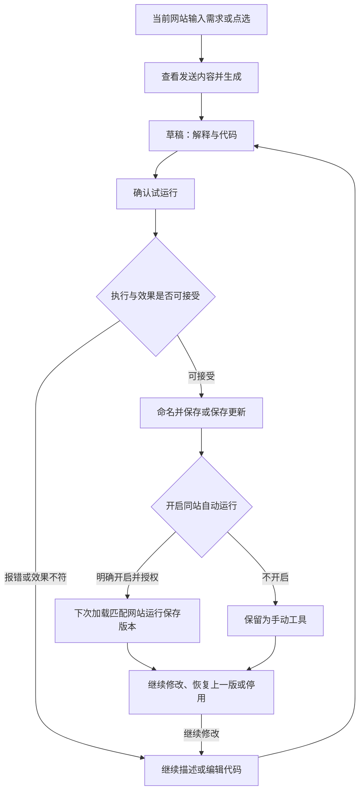

# 鲁班 V2 产品需求文档（PRD）

> 版本：V2 · 评审稿 · 2026-10-13
> 依据：[V2 需求与范围](./v2-requirements-scope.md)。本文将范围展开为可评审、可实现、可验收的产品行为，不代表已实现。
> 资料：[v1 PRD](../v1/ai-automation-product-requirements.md)、[功能评审](./feature-review.md)、[竞品细化调研](./customaise-vibemonkey-scriptgenie.md)。竞品结论沿用已有材料，未重新核实最新版本。
> 个人项目，沿用已确认的仓库文档结构；本轮不查询公司模板或 KBP，不关联 LUCP，不上报产品 AI 度量。技术实现另文。

## 1. 背景与目标

v1 已具备点选、意图输入、生成、确认运行、本地保存和手动再运行。主要产品缺口是：必须先点选；脚本难以持续修改；改坏后无法恢复；再次访问不会自动生效；成果无法标准导出。

V2 的定位是：**用户用一句话为当前网站创建一个小工具，现场试用，持续修改，保存后再次访问自动生效。**

核心闭环为创建、修改、保存、再次生效、恢复或停用。产品体验参考 Customaise 的网站与脚本管理方式，生成入口参考 VibeMonkey，脚本持续迭代参考 ScriptGenie。现场执行属于基础能力，差异化通过真实生成质量和持续复用验证。

### 目标与成功标准

| 目标 | 用户可观察结果 |
|---|---|
| 降低首次门槛 | 不点选也能生成并运行整页工具 |
| 保留用户成果 | 已有脚本可继续修改，失败不覆盖可用版本 |
| 支持长期使用 | 明确开启后，匹配网站再次加载即可生效 |
| 让修改可恢复 | 更新前版本可恢复，用户能理解恢复边界 |
| 允许带走成果 | 标准文件可在目标脚本管理器中使用 |

本期沿用已有生成与注入验收门槛，不新增未经验证的留存或耗时数值目标。

## 2. 用户与场景

| 用户 | 典型需求 | 完成标准 |
|---|---|---|
| 普通用户 | 把网站改成暗色、放大字号 | 直接描述，试用并保存，下次访问保持效果 |
| 普通用户 | 隐藏指定干扰模块 | 可选点选定位，隐藏不准时继续描述修改 |
| 高频网站使用者 | 突出价格、状态、关键字段 | 保存独立脚本，需求变化时更新原脚本 |
| 高频网站使用者 | 提取当前页链接、图片地址、表格 | 当页执行后可检查结果，不自动翻页抓取 |
| 开发者 | 修正一个选择器 | 编辑草稿、重新试运行、保存，必要时恢复 |

刷新、监控等已有意图可保留，但不作为主推场景，不新增后台定时调度承诺。

## 3. 范围与优先级

| 编号 | 核心能力 | 交付边界 |
|---|---|---|
| F1 | 整页描述与可选点选 | 默认直接描述；点选用于局部精确修改 |
| F2 | 脚本独立管理 | 名称、网站、保存版本、草稿、独立对话和管理操作 |
| F3 | 持续修改与简单编辑 | 基于当前内容迭代，草稿不覆盖保存版本 |
| F4 | 确认运行与失败修复 | 每次试运行明确确认；错误回灌当前脚本 |
| F5 | 恢复上一版 | 保留一个恢复副本，不做完整历史 |
| F6 | 同站自动运行 | 默认关，准确主机名匹配，可停用 |
| F7 | 标准导出 | 导出已保存版本并验证目标管理器兼容 |
| Q1 | 发布质量 | 隐私透明、安全检查、真实验收与准确设置说明 |

核心范围缺一项，不称为完整 V2。分析此页与自定义兼容端点为可选增强，另行验收，不阻塞核心交付。

本期排除：通用聊天、独立翻译/总结/搜索入口、跨站代理、录制与工作流画布、市场、账号与云同步、脚本导入、完整版本时间线及固定版本、完整 IDE、路径级/跨站匹配、扩充 GM API、`@require`、多语言、AgentScript 和 MCP。

## 4. 产品结构与页面

以下为本期页面行为要求，不是已有视觉原型；视觉稿待补充。所有操作面向当前本机用户，无新增账号或角色权限。

### 4.1 首页：围绕当前网站开始

| 区域 | 内容与操作 | 默认与限制 |
|---|---|---|
| 当前网站 | 展示准确主机名、页面可用状态 | 标签页切换后更新，不沿用旧页上下文 |
| 需求输入 | 多行文本，“你想怎么改这个网站” | 默认整页模式；空白输入不能生成 |
| 局部点选 | “点选页面元素”及目标摘要 | 可取消、清除目标，恢复整页模式 |
| 发送内容 | 查看本次发送的数据 | 请求前可展开；以实际请求内容为准 |
| 当前站脚本 | 匹配该站的已保存工具 | 可打开修改、查看状态、关闭自动运行 |
| 最近脚本 | 最近使用的脚本入口 | 与当前站脚本分区；非匹配站不允许直接运行 |
| 设置入口 | Key、模型、隐私说明、脚本管理 | 生产构建不出现通信自检 |

空列表分别显示“这个网站还没有保存的工具”和“暂无最近脚本”，不展示示例为真实记录。受限页面显示原因，并保留本地管理入口。

### 4.2 脚本工作区

显示脚本名称或“未保存的新工具”、适用网站、采集范围、独立对话、生成解释、代码区、运行反馈和草稿状态。

| 操作 | 可用条件 | 结果 |
|---|---|---|
| 生成/继续修改 | 输入非空，模型已配置，页面上下文可用且匹配 | 产生待确认草稿 |
| 取消生成 | 请求进行中 | 保留请求前草稿和用户需求，不替换保存版本 |
| 查看/编辑代码 | 有代码且无保存/恢复等进行中操作 | 编辑后标记未保存，原试运行结果失效 |
| 确认试运行 | 当前页匹配、草稿完整且检查通过 | 明确确认后在当前页执行 |
| 保存/保存更新 | 当前代码已确认试运行且执行无错误，名称有效 | 首次创建或替换原脚本保存版本 |
| 放弃草稿 | 有未保存修改 | 确认后回到保存版本；新建时回到空工作区 |
| 恢复上一版 | 有上一版且当前无进行中操作 | 先处理草稿，再确认替换 |
| 自动运行 | 已保存且非更新/恢复中 | 用户主动开启并完成站点授权 |
| 导出 | 有保存版本 | 导出保存版本，有草稿时提示不包含草稿 |

仅执行无错误不等于效果正确。保存前展示“请检查页面是否符合预期”，不增加自动视觉验证承诺。用户观察到效果不符时可继续修改。

### 4.3 脚本管理页

- 列表字段：名称、主机名、自动运行实际状态、更新时间；默认更新时间倒序。
- 一个搜索框按名称或主机名筛选；无结果与空列表使用不同提示。
- 单条操作：打开修改、当前页运行、自动运行开关、导出、删除。
- 已保存脚本在当前页手动运行也由用户明确点击确认，不因浏览列表而执行。
- 删除确认列出将删除的脚本、对话、草稿与上一版；同时停止后续自动运行。停止失败则显示删除未完成，保留可重试记录。
- 删除、停用和恢复均提示当前页效果可能仍在，通常需要刷新。

### 4.4 设置与隐私说明

Key 使用密码输入并可切换显示；不回显到对话或请求预览。新安装默认按量付费，已有用户设置不覆盖。Token Plan 保留已有自测和条款风险说明，发布前复核供应商条款。

隐私页说明请求直接发往所选模型服务，解释页面内容、脚本代码、相关对话和错误信息的发送条件，描述本地保存范围、清除脚本的影响和 Key 存储事实，不把混淆称为加密。

## 5. 信息与状态规则

### 5.1 产品信息

这是用户可理解的信息规则，不限定数据库字段或接口。

| 信息 | 输入/来源 | 必填与默认 | 规则 |
|---|---|---|---|
| 名称 | 模型建议；用户文本编辑 | 保存时必填 | 去除首尾空白后不能为空；同名不合并脚本 |
| 适用网站 | 新建时当前主机名 | 保存时必有 | 修改脚本不随标签页切换而扩大范围 |
| 需求 | 用户多行文本 | 生成时必填 | 纯空白不可提交；修改需求属于当前脚本 |
| 采集范围 | 整页或点选 | 默认整页 | 清除点选恢复整页；发送前可见 |
| 当前保存版本 | 确认保存的代码与说明 | 首次保存前为空 | 唯一用于自动运行与默认导出的版本 |
| 当前草稿 | 生成或手动编辑 | 初始为空 | 保留但不自动执行；保存后不再标记待保存 |
| 上一版 | 更新前保存版本的代码与说明 | 首次保存为空 | 最多一个；恢复后可反向恢复 |
| 对话 | 用户需求、修改说明、必要错误 | 初始为空 | 按脚本隔离，保存代码版本不回退对话 |
| 自动运行 | 用户开关和实际可用状态 | 默认关闭 | 用户意愿不等于权限与运行能力都可用 |
| 更新时间 | 最近成功保存或恢复 | 首次保存时产生 | 试运行、生成失败不改变保存更新时间 |
| 最近运行反馈 | 能获得的执行结果与错误 | 无记录显示未运行 | 不将执行完成解释为视觉效果已验证 |

名称长度、对话保留条数等具体上限待实现方案与评审补充；本期不凭空承诺无限容量。超过实际容量时明确失败并保留已有可用成果。

### 5.2 草稿与运行状态

| 状态 | 允许行为 | 禁止或保护行为 |
|---|---|---|
| 空工作区 | 输入需求、点选、查看设置 | 无代码不可运行/保存 |
| 生成中 | 查看进度、取消 | 防重复提交，不把流式半成品用于运行 |
| 待确认草稿 | 查看说明、编辑、确认试运行、放弃 | 不替换自动运行版本 |
| 运行中 | 查看执行状态 | 不同时修改、保存或恢复当前脚本 |
| 运行失败 | 查看错误、继续修改、重试、保留草稿 | 保存按钮不可用，旧版本不变 |
| 执行完成待保存 | 检查效果、保存或继续修改 | 编辑代码即失去当前试运行资格 |
| 已保存 | 手动运行、开启自动运行、修改、恢复、导出 | 开启自动运行仍需明确操作 |
| 保存/恢复中 | 查看处理中状态 | 防重复提交，失败不得误报成功 |

初次保存也须试运行成功。草稿可独立保留，因此用户无需通过保存未验证代码来避免丢失修改。多个面板修改同一脚本时，不允许旧工作区静默覆盖新保存版本；提示重新加载，保留当前草稿供用户处理。

### 5.3 自动运行状态

对用户区分关闭、已开启、不可用及最近执行失败。不可用显示具体原因，例如站点权限撤销、未允许用户脚本或注册失败；最近执行失败不等于开关已经关闭。

最近错误旁提供修改和关闭入口。扩展无法确认运行结果时显示“暂无可确认的执行结果”，不能显示运行正常。

## 6. 功能需求

### 6.1 F1：整页描述与可选点选

整页描述不启动元素选择器。页面上下文提供有限、脱敏的结构与可定位线索，沿用既有采集上限，不上传无限制整页 HTML；不能仅用元素计数代替定位信息。

点选后展示目标摘要，用户可更换或清除。Esc/取消退出点选后保留已输入需求。不支持的页面、采集失败或跨域 iframe 上下文不完整应提示限制，允许重试或调整目标。

采集数据绑定当前页面；生成前页面已变化则重新采集并更新发送预览，采集失败不继续使用旧页数据冒充当前页。跨网站需求提示本期只能创建当前网站工具。

**验收 F1-A：** 无点选完成暗色工具；点选完成隐藏指定模块；两条链路均预览并确认后执行，取消点选不丢需求。

### 6.2 F2：脚本独立管理

首次保存产生独立脚本，修改已有脚本默认更新原记录。生成前的新建内容属于独立新建工作区，不能挂入上次脚本对话；首次保存后保留本次创建对话。

离开有修改的工作区时提供“保留草稿并离开”“放弃修改并离开”“继续编辑”。保留草稿需本地保存成功才离开；失败提示并停留。保留的新建草稿需可从首页找回，明确标注未保存，不能混入已保存脚本列表作为可自动运行工具。

浏览器面板被直接关闭后，恢复最近已持久保存的草稿，不能声称尚未保存到本地的输入必然可恢复。生成请求被中断时回到可重试状态，不显示永久生成中。

**验收 F2-A：** A/B 脚本交替修改与关闭重开，对话、代码、草稿、错误互不串联；未保存新建草稿可找回；更新不新增第三条脚本。

### 6.3 F3：持续修改和简单编辑

继续修改以当前草稿为基线；没有草稿则以保存版本为基线。手动编辑后下一次生成必须使用编辑后的代码。请求包含本次需求、当前代码、有限相关对话、匹配页面的最新上下文；历史可裁剪，但不能裁掉当前代码或需求，过大时明确提示而非静默截断核心内容。

代码区使用普通文本编辑即可。手动编辑后标记“代码已修改，请重新试运行”，旧解释不再冒充完全准确说明，提示用户检查实际代码。模型返回不完整或无法解析时保留原草稿，错误内容不得当作可运行代码。

取消请求、生成失败、运行失败不覆盖保存版本或上一版。点击保存更新前重新检查当前实际代码；只修改名称而不改代码不要求重复试运行，不消耗代码恢复副本。

**验收 F3-A：** 在暗色脚本上追加字号需求保留暗色；改选择器后继续生成沿用改后代码；试运行后再改代码不可直接保存更新；失败和取消均不覆盖可用版。

### 6.4 F4：确认运行与失败修复

预览包括预计效果、适用网站和已识别风险，代码默认折叠但可查看。用户点击明确的“确认在当前页运行”才执行当前代码；被安全规则拦截时展示原因，不通过编辑或保存绕过。

执行完成显示“脚本执行完成，请检查页面效果”，同时呈现预计效果。只有获得可靠的具体结果时才展示目标数量或效果信息；未找到目标、未知效果时不得声称已完成具体改动。

错误反馈保留当前代码与有限错误信息，用户点击继续修复后，发送内容预览包含这些材料。效果不符但无报错时，用户可输入现象继续修改。

再次试运行前提示残留效果，提供刷新后验证路径；刷新前保留草稿，刷新失败不丢修改。生成要求避免重复插入控件、重复绑定操作或累积样式，实际回归验证重复运行。

**验收 F4-A：** 无确认不执行；静态拦截后不可保存；失败可在原脚本内继续修复；重复运行无重复控件或操作；无效果证据不显示虚假成功。

### 6.5 F5：恢复上一版

一次成功代码更新将原保存版本及说明保留为唯一上一版。试运行、草稿保留、名称修改、失败保存不轮换上一版。恢复入口显示上一版说明和保存时间；首次保存无上一版时禁用并解释原因。

恢复前若有草稿，先保留或放弃，再明确确认恢复。恢复替换代码与对应说明，不回退脚本名称、匹配范围、对话、权限、自动运行开关或 GM 数据。恢复完成后，恢复前代码成为上一版，可恢复回去。

自动运行已开启时，恢复与更新都应同步替换后续运行版本。成功标准是保存版本和后续运行版本一致；失败不能只更新界面宣称成功。保留旧可用版、恢复副本及未保存草稿，允许重试。若无法保障继续运行旧版，暂停自动运行并明确说明原因。

恢复不自动重跑当前页面，不撤销已发生的页面修改、下载或其他副作用。提示刷新后验证；关闭自动运行时刷新也不会主动运行恢复后的代码，用户需手动运行或重新开启。

**验收 F5-A：** A 更新 B 后恢复 A；自动运行开启时新开页面分别运行 B/A；恢复后可再恢复 B；GM 数据不回退；更新/恢复失败不丢可用版本。

### 6.6 F6：同站自动运行

保存表单可提供独立复选框“以后在这个网站自动运行”，默认不选，旁边展示准确主机名和“覆盖该主机名下全部路径”。保存与开启的结果分别反馈：例如“脚本已保存，自动运行未开启：未授权该网站”。

匹配范围为 `*://主机名/*`，仅 HTTP/HTTPS；裸域、www 和其他子域不合并。授权拒绝不撤销保存。自动运行仅使用保存版本，修改草稿、打开对话或查看列表都不替换运行代码。

完整页面加载时运行；不承诺单页应用无刷新路由切换重新执行。同站多脚本独立管理，不承诺执行先后或自动解决冲突。

关闭停止后续运行，代码和对话保留；删除停止运行并清理脚本相关内容。操作失败保留实际状态和重试入口，不能显示已停用但仍继续注入。权限撤销或浏览器执行能力关闭后展示不可用状态，不自动扩大授权范围。

**验收 F6-A：** 不点扩展图标新开匹配页生效；跨主机名不执行；拒绝授权、关闭、删除、撤销权限后不再运行；旧脚本升级默认关闭。

### 6.7 F7：标准导出

导出对象固定为当前保存版本；草稿未保存时先告知，不自动保存或导出草稿。默认文件名来自脚本名称，处理文件名非法字符，后缀为 `.user.js`。

文件包含标准 UserScript 头、名称、命名空间、匹配规则、实际使用且支持的授权、运行时机与正文。只导出脚本本身，不包含 Key、对话、页面快照、运行日志或 GM 存储数据。不能通过删除授权声明掩盖不支持的 API；发现不支持依赖时提示无法保证兼容，并阻止以“兼容导出成功”呈现。

核心功能不能依赖鲁班私有桥。鲁班侧自动运行关闭状态不随文件迁移，安装后由目标管理器控制；导出说明需提示避免两边同时启用造成重复执行。

**验收 F7-A：** 样式脚本和使用 GM 存储的脚本，在 Tampermonkey 导入后匹配与核心行为均可用；GM 数据从目标管理器自己的初始状态开始，记录环境和限制。

## 7. 主要流程

### 更新、恢复与停用的共同规则

- 用户在所有页面始终能辨认正在操作的脚本及网站。
- 保存/恢复成功才切换当前版本和上一版；错误时明确哪个步骤未完成。
- 未保存草稿不参与自动运行，不因导出、关闭开关而被隐式保存。
- 恢复和停用不等于当前页面即时还原；刷新提示与开关状态一起说明。

## 8. 异常与降级

| 情况 | 界面反馈与处理 | 保留内容 |
|---|---|---|
| Key 未配置或失效 | 引导设置，修正后重试 | 当前需求、代码与草稿 |
| 断网、限流、超时 | 说明原因，可重试或取消 | 保存版本不变；离线可查看、编辑、导出、恢复 |
| 模型返回残缺代码 | 生成失败，不开放运行 | 原草稿与用户需求 |
| 当前页不匹配脚本网站 | 可查看/编辑，禁用带错误页面上下文的生成和运行 | 当前脚本；提示回到适用网站 |
| 受限页面或采集失败 | 解释限制，允许换页或重试 | 输入需求，不伪造上下文 |
| 代码检查拦截 | 展示规则与原因，允许修改 | 草稿，不自动保存 |
| 运行错误或找不到目标 | 区分报错与未验证效果，提供继续修复 | 当前代码与有限错误 |
| 本地存储失败 | 不显示保存成功，不自动离开 | 旧版、上一版和当前可保留内容 |
| 自动运行替换失败 | 显示更新未完成，保留旧版；无法保证旧版时暂停并提示 | 可用代码、草稿、恢复副本 |
| 权限被撤销 | 状态不可用，可重新主动授权 | 脚本内容不删除 |
| 多处编辑产生旧版本提交 | 拒绝静默覆盖，提示重新加载 | 当前未提交草稿 |
| 删除或停用失败 | 保留记录与实际状态，允许重试 | 不误报停止成功 |

## 9. 隐私、安全与兼容

### 9.1 发送内容

生成前可展开查看实际将发送的脱敏 URL、标题、采集范围、有限页面摘要；点选时包含目标信息。修改时另外包含当前代码、有限相关对话，修复时包含有限错误。重试或页面变化后预览同步更新。

不采集或发送密码值、Cookie、localStorage、扩展设置中的 Key。Key 仅用于向用户选定模型服务认证，不作为提示内容。用户手输和页面可见文本仍可能包含敏感信息，隐私说明不承诺“绝无敏感信息”。

### 9.2 执行边界

执行和保存都检查实际代码，手动编辑不能绕过。沿用 v1 GM 白名单：`GM_addStyle`、`GM_setValue`、`GM_getValue`、`GM_deleteValue`、`GM_info`、`unsafeWindow`。静态扫描不称为完整沙箱。

用户首次创建/修改草稿须明确确认试运行；开启自动运行是对保存版本及声明网站的持续运行授权。更新须先试运行、再保存，不能让模型响应直接替换现行自动运行代码。

### 9.3 平台与升级

Chrome / Chromium、Manifest V3、中文、BYOK、无自建后端。旧脚本原内容迁为当前保存版本，草稿、上一版、对话为空；自动运行默认关闭，原手动运行仍可用。原设置不覆盖。

本地管理、编辑、恢复与导出不依赖模型在线。浏览器最小支持版本及实际管理器兼容范围待技术方案和验收记录补充，不在 PRD 猜测版本号。

## 10. 可选增强

### E1 分析此页

仅用户点击才发送页面上下文；展示发送内容，返回最多四条建议，建议不包含可直接执行动作。采纳建议填入意图并进入生成，仍须确认运行。加载页面不自动分析，解析失败可重试且不提供残缺建议。快捷芯片仅保留少量高频动作。

### E2 自定义兼容端点

设置增加 Base URL、模型名和 Key，均为启用自定义端点的必填项；默认使用现有预设，已有设置不变。仅接受有效 HTTP/HTTPS 地址，说明使用 Chat Completions 兼容协议，不能暗示原生兼容所有厂商。

保存自定义源站需明确授权；拒绝则不切换到不可用配置。请求失败提示地址、模型或认证问题，保留旧配置供恢复；不把 Key 写入错误说明。只做兼容接口，不新增厂商专用功能。

## 11. 验收计划

### 11.1 核心验收矩阵

| 编号 | 覆盖 | 场景与通过标准 |
|---|---|---|
| AC01 | F1/F4 | 整页生成暗色与点选隐藏模块均经过确认后运行 |
| AC02 | F2 | A/B 脚本及新建工作区交替使用无代码、对话、草稿串联 |
| AC03 | F2/F3 | 保留草稿后重开可恢复；放弃后返回保存版；失败不覆盖 |
| AC04 | F3 | 继续修改保留原功能，手改代码作为下一轮基线 |
| AC05 | F3/F4 | 运行后再编辑需重试运行；拦截代码不能运行或保存 |
| AC06 | F4 | 运行错误可回灌原脚本；执行无错误不虚报效果已验证 |
| AC07 | F4 | 重复运行不产生重复组件或重复操作 |
| AC08 | F5/F6 | A→B→恢复 A→恢复 B，保存版和后续自动运行版一致 |
| AC09 | F5 | 首次无恢复副本；失败、试运行和改名不轮换副本；GM 数据不回退 |
| AC10 | F6 | 不点图标新开匹配页生效，其他主机名不生效 |
| AC11 | F6 | 授权拒绝不影响保存；权限撤销、停用、删除后不再运行 |
| AC12 | F5/F6 | 模拟替换失败不误报成功，不丢可用版，必要时暂停并说明 |
| AC13 | F7 | 样式与 GM 存储脚本导出到 Tampermonkey 后核心行为通过 |
| AC14 | Q1 | 请求与发送预览一致，秘密不进入提示，生产无自检 |
| AC15 | 升级 | 旧脚本保持手动可用、自动运行关，原设置不覆盖 |
| AC16 | 状态 | 多面板旧提交不覆盖新版本；页面变化不混用旧上下文 |

### 11.2 真实场景出口

沿用 v1 的十个场景与十个站点：一次生成可运行至少 7/10，至少 8/10 站点可注入。记录入口、意图、代码执行结果、观察效果、耗时、失败原因与自动运行结果；四类优先场景均有覆盖。

至少一条脚本走通完整生命周期：创建 → 修改 → 保存更新 → 不点图标新开页面生效 → 恢复上一版 → 刷新验证 → 停用。可将生命周期验证附在十场景记录中，但不能把多个步骤计作多次独立生成以抬高通过率。

记录保存到 `v2-acceptance-record.md`，包含浏览器、扩展和目标管理器版本、已知限制。AC01–AC16 和真实场景门槛均满足才可宣布核心 V2 完成；增强项各自另验收。

### 11.3 产品观察口径

| 指标 | 口径 |
|---|---|
| 不点选完成率 | 不点选发起且确认执行完成的创建次数 / 不点选创建尝试次数 |
| 保存率 | 成功首次保存的工具数 / 完成试运行的新建工具数 |
| 自动运行开启率 | 成功开启的已保存工具数 / 已保存工具数 |
| 7 日复用情况 | 开启后有匹配访问机会且再次执行、未停用的工具比例，注明无访问机会样本 |
| 继续修改成功率 | 成功保存更新次数 / 发起修改尝试次数 |
| 恢复使用情况 | 记录恢复次数、原因及恢复后是否可用，不将次数高解释为产品更好 |
| 导出成功率 | 生成可用导出文件次数 / 导出尝试次数；目标管理器兼容结果另记 |

以有同意的人工试用或本地验证记录为依据，不新增云端统计。分子分母使用同一观察窗口并说明样本量；缺少数据标记无法判断，不以单次开发测试推导留存。观察指标不替代功能验收，无新增数值目标。

## 12. 交付与待补充

| 阶段 | 交付结果 |
|---|---|
| 1 创建工具 | 整页与点选、预览确认、错误反馈，隐私与安全要求同步满足 |
| 2 持续维护 | 独立脚本、对话修改、简单编辑、草稿与上一版恢复 |
| 3 长期生效 | 同站自动运行、版本联动、停用和导出，完成核心出口 |
| 4 可选增强 | 分析此页、自定义端点，按实际发布分别验收 |

[技术方案](./v2-technical-design.md)与[执行计划](./v2-execution-plan.md)已按本 PRD 和 Demo 重写，分别定义实现决策与分阶段验收；两份文档仍为待执行设计，不能视为功能已交付。PRD 不指定接口、数据库或实现框架。

| 待补充项 | 影响 |
|---|---|
| 视觉原型与文案细化 | 页面布局待设计；本文行为规则先作为评审依据 |
| 浏览器支持版本、容量上限 | 由技术验证补充，发布前明确 |
| 试用用户和真实站点安排 | 验收前落实，不能以无样本免验 |
| 负责人、发布日期 | 待项目安排，不编造排期 |
| 供应商条款复核 | 发布前核实，已有风险说明不代表最新条款结论 |

## 13. 相关开发项目信息

| 名称 | 描述 |
|---|---|
| 协作地址 | 当前仓库 `luban/docs/v2/`，未关联外部需求平台 |
| 产品 | 个人项目；负责人待指定 |
| 开发 | 待指定 |
| 宣讲时间 | 未安排 |
| 计划上线时间 | 待确定 |
| 版本计划 | V2 核心闭环；增强项按实际验收单独标注 |
| 文档来源 | 已确认的 V2 需求范围及仓库既有材料 |
| 模板与外部流程 | 沿用现有结构；不查询公司模板/KBP，不关联 LUCP，不上报 AI 度量 |
