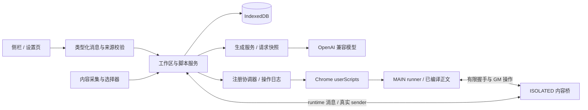
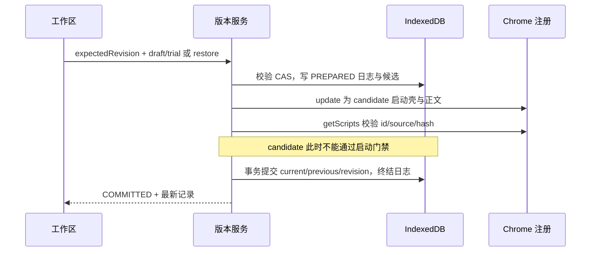

# 鲁班 V2 技术方案

> 状态：P1 数据基础、P2 创作工作区与 P3 手动版本闭环已实现并完成阶段自动检查；P3 权限、GM 与生命周期已由用户人工验收通过，P2 及专项集成证据待补，P4 人工清单已通过，专项证据待综合验收补齐；P5 工具库、标准导出与隐私说明已实现，真实管理器及发布体验已由用户确认人工清单全部通过，问题闭环见 P5 人工清单；P6 第 1–6 节已获用户人工确认，延期项待验；P7 E1/E2 实现、工程检查及人工清单验收通过（用户确认），详见 P7 实施记录。详见执行计划与阶段记录。
> 日期：2026-10-13。依据：[V2 PRD](./v2-product-requirements.md)、[需求范围](./v2-requirements-scope.md)、[交互 Demo](./demo-v2.html)。执行与验收见 [执行计划](./v2-execution-plan.md)。本文替代旧技术方案。
> 优先级：PRD 决定产品规则，Demo 提供交互参考，本文定义实现。发生差异以 PRD 为准；技术探针失败必须修订本文与相关计划，不得静默删减需求。

## 1. 目标与关键决策

核心交付为 F1–F7：整页/点选生成、独立脚本、持续修改、确认运行、上一版恢复、同站自动运行和标准导出。E1 分析此页、E2 自定义端点为独立增强。

| 决策 | 结论 | 原因 |
|---|---|---|
| UI 与构建 | 沿用 Preact、TypeScript、Vite、CRXJS | 不引入新的 UI 框架；复用现有扩展入口 |
| Demo 使用方式 | 提取布局、文案层级和状态反馈，重建组件 | Demo 的关键词匹配、CSS 模拟与 localStorage 不是生产执行链 |
| 业务存储 | IndexedDB 保存脚本、工作区、对话、GM 数据及操作日志 | 需要事务、版本冲突检测和崩溃恢复；不以多次 chrome.storage 写入冒充事务 |
| 设置 | Key 继续 chrome.storage.local，非敏感设置沿用 sync | 不混入脚本、对话、请求预览或导出 |
| 唯一写入者 | Service Worker（SW）通过领域服务写业务数据 | 侧栏和设置页不能直接覆盖完整脚本记录 |
| 注入 | 手动沿用 userScripts.execute；自动使用 register/update | 自动运行不能依赖 activeTab 点击或 UI 存活 |
| 执行世界 | 核心继续 MAIN；受控 ISOLATED 桥提供状态与 GM 通道 | 保持现有 unsafeWindow 行为；明确 MAIN 不能对宿主页保密 |
| 一致性 | IDB 事务 + 外部注册操作日志 + 每次启动版本门禁 | 浏览器注册与本地数据库没有跨系统原子事务 |
| 版本 | current + previous，草稿独立 | 恢复只轮换代码与说明，不恢复对话/权限/GM 数据 |
| 导出 | 导出标准正文与元数据，不导出鲁班 runner | 私有桥不能成为外部脚本的依赖 |

不引入后端、账号、云同步、完整编辑器、完整版本时间线、跨站代理或新增 GM 权限。

## 2. 当前代码基线与改动

2026-10-13 对 `luban/src` 的读取结果如下，不能将旧评审中的缺口全部当作仍未实现。

| 已有文件/能力 | 实际基线 | V2 改动 |
|---|---|---|
| `shared/types.ts`、`content/context-engine.ts` | 已有 scope=page/element 与无目标整页采集 | 增加页面身份、结构定位摘要和请求预算 |
| `service-worker/outgoing-context.ts` | 有发送内容描述函数 | 升级为完整请求快照，覆盖实际摘要、代码、对话与错误 |
| `service-worker/script-store.ts` | chrome.storage 索引/正文，直接保存覆盖 | 迁入事务仓储，CAS、工作区与上一版 |
| `service-worker/index.ts` | 单 activeClient、点击时缓存 tabId、消息入口直接保存对象 | 按工作区分配请求；执行绑定文档；统一服务层校验 |
| `shared/injected-runner.ts` | MAIN 正文注入、同步 GM 快照、结束时 dirty 回传 | 自动启动握手、持续写入回执、标准 GM_info 兼容处理 |
| `pageMatchesScript` | 当前接受子域并未先限制协议 | V2 新规则改为 HTTP/HTTPS + 准确 hostname |
| 侧栏/设置 | 已有状态机、生成预览、脚本列表；隐私页仍占位 | 工作区、草稿恢复、工具列表、真实隐私说明 |
| Manifest | 无可选站点权限，无最低版本声明 | 增加可选权限，能力探针通过后声明 Chrome 138+ |

现有代码工作区有用户修改，实施时以实际 diff 为准，不覆盖无关变更。新增功能的“已有单测”不等于本期真实站点验收通过。

## 3. 浏览器能力与先行探针

> P0 执行状态（2026-10-13）：[探针记录](./verification/v2-runtime-spike.md)。基线通过；用户手动确认当前环境 MAIN/桥/GM/版本门禁与 SW/扩展重载恢复等六项验证符合预期。Chrome 138 与总容量/对话上限尚待补齐；用户 JSON 已归档，机器证据覆盖范围与清理前快照时点见核对报告；区分人工确认与自动化证据，P0 尚未整体退出；用户已授权将 Chrome 138 与真实容量边界留到最终测试，继续 P1。

### 3.1 API 基线

目标最低 Chrome 138，运行时同时检测 API 与实际调用是否可用。文档记录 userScripts 基础 API 为 Chrome 120+、execute 为 135+；138 起使用扩展详情中的“允许用户脚本”开关。MAIN 与 USER_SCRIPT 行为不同，消息能力不能被假设为 MAIN 自带。扩展更新会清除用户脚本注册，须恢复对齐。依据：[Chrome userScripts 官方参考](https://developer.chrome.com/docs/extensions/reference/api/userScripts)。

代码中的 `runAt` 使用浏览器枚举 `document_end`，不能把 UserScript 头中的 `document-end` 原样传入 Chrome API。本期新脚本仅顶层 frame；不监听 SPA 路由重新执行。

可选站点权限通过 UI 用户点击直接请求，成功后调用 SW 开启；不要延迟到异步读取结束后再假设仍有 user gesture。动态内容桥使用 `scripting.registerContentScripts`，ISOLATED、document_start、顶层 frame。依据：[Chrome scripting 官方参考](https://developer.chrome.com/docs/extensions/reference/api/scripting)。

### 3.2 必须先验证的探针

1. Chrome 138 基线与一版当前稳定版：MAIN register、update、getScripts、execute 可用；开关关闭时给出真实错误。
2. 没有点过扩展图标的新标签，授权站点的 bridge 与自动 runner 能完成握手并执行；桥缺失、SW 休眠或失败时不得继续执行正文。
3. 动态桥 document_start、runner document_end 的握手可重试但有超时，不能依赖未验证的跨世界事件顺序。
4. 手动/自动 GM_setValue 和 deleteValue 在同步正文、Promise、定时器回调中均有持续回写；刷新后读取新值。
5. update/register 在确认前只会被启动门禁拒绝；崩溃重启可根据日志恢复一致状态。
6. standard GM_info 对象及现有函数式用法兼容问题，须验证并确定迁移/导出规则。

证据记录到 `verification/v2-runtime-spike.md`。任一失败，先调整注入/桥设计并补探针，不能用 Demo 模拟通过代替。

## 4. 系统结构与边界



- UI 负责布局、用户确认和用户手势授权，不作版本事实来源。
- SW 负责数据校验、权限检查、请求隔离、试运行凭证与版本提交。
- 内容采集不读取 Cookie、localStorage、input value 或扩展 Key。
- runner 只能操作页面与当前脚本的允许 GM 能力；不会获得扩展设置或通用 privileged API。
- 来源校验分开处理扩展页面命令与内容桥回执。内容脚本不得发送“保存脚本/开启自动运行/请求模型”等管理命令。

## 5. 数据模型与持久化

> P1 已实现基础，见 [迁移验证](./verification/v2-migration-record.md)。采用全批次原子迁移；500ms 草稿缓冲待 P2 接入 UI；未完成操作保持 recovery_required，P4 接入真实注册恢复。总量守卫当前在写事务内统计序列化记录，容量与性能最终验收仍保留。

### 5.1 IndexedDB 仓储

数据库 `luban-v2`，schemaVersion 从 1 起。建议 store 如下：

| Store | 主要信息 | 事务关系 |
|---|---|---|
| scripts | id、name、host、matches、current、previous、recordRevision、autoRun、tombstone | current/previous、revision 与日志终结同事务 |
| workspaces | workspaceId、scriptId?、baseRevision、draft、input、targetScope、draftRevision | 接受生成结果和追加对话同事务 |
| conversations | workspaceId、sequence、role、text、createdAt | 按工作区索引；首次保存保持 workspace 身份 |
| gm | scriptId、key、value、revision | 单次增量批量写事务，删除有明确操作类型 |
| operations | opId、scriptId、type、expectedRevision、candidate、phase、error | 外部注册变更的恢复日志 |
| receipts | trialId、workspaceId、draftHash、tabId、documentId、result、expiresAt | 试运行成功后签发；提交时由 SW 校验 |
| runtimeStatus | scriptId、registeredVersionId、lastRun、lastError、availability | 运行反馈不污染脚本内容 revision |
| meta | schema、迁移进度、容量统计 | 迁移和升级检查 |

不存全页面 HTML。页面上下文默认短期保留在请求快照/session；工作区只持久化脱敏的最低必要元信息，避免把每次采集内容无限积累为历史。

### 5.2 类型建议

```typescript
interface ScriptVersion {
  versionId: string;
  hash: string; // 正文 + grants + runAt 的规范化 SHA-256
  code: string;
  explanation: string;
  grants: string[];
  runAt: 'document_start' | 'document_end' | 'document_idle';
  createdAt: number;
}
interface ScriptRecord {
  id: string;
  schemaVersion: 2;
  name: string;
  host: string;
  matches: string[];
  recordRevision: number;
  current: ScriptVersion;
  previous: ScriptVersion | null;
  autoRun: { desired: boolean; generation: number };
  tombstone?: boolean;
  createdAt: number;
  updatedAt: number;
}
interface Workspace {
  id: string;
  scriptId: string | null;
  baseRevision: number | null;
  draftRevision: number;
  input: string;
  draft: ScriptVersion | null;
  activeRequestId: string | null;
  status: 'idle' | 'generating' | 'interrupted';
}
```

同名不合并。名称修订增加 recordRevision，但不轮换 current/previous；更改自动开关增加控制 generation 与 recordRevision，试运行结果可按 draftHash 保留，提交前仍需重新加载控制状态。列表可由 scripts 索引产生，不保存第二份可漂移的权威版本索引。

### 5.3 写入、冲突与容量

所有 mutation 携带 expectedRevision 或 expectedDraftRevision。在 IDB readwrite transaction 内读、比较、写，冲突返回 `REVISION_CONFLICT`。进程内按 scriptId 队列只用于协调 Chrome 外部操作，不能替代数据库 CAS。UI 收到 revision 变更提示重载，保留本地草稿，不自动覆盖。

建议工程初始限制（不是新增产品承诺）：代码每版 256 KiB，单工作区对话 1 MiB，总业务软上限 40 MiB，输入本地落盘防抖 500ms，离开前强制 flush。具体值在 P0 容量探针中验证并回写；超过限制显式拒绝，不能静默删除上一版或草稿。可展示用量与用户删除入口，不新增无限存储权限。IDB quota/transaction abort 必须保持已提交版本。

## 6. 迁移与启动恢复

1. 首次启动读取旧 `luban:script:*` 与索引、`luban:gm:*`；保留原值作迁移输入，先不删除。
2. 校验结构与 grants，导入 scripts、GM、meta；每条以原 id 幂等迁移，旧 code 原样作为 current，previous/draft/对话为空，autoRun.desired=false。
3. 旧 runAt 元数据由 document-start/document-end/idle 规范化为浏览器枚举，保留原含义；新脚本固定 document_end。V1 的 enabled=true 不转换为自动运行。旧规则含子域/跨域时保留 legacyMatches 供说明，新自动范围必须用户确认准确主机名后产生；无法解析的脚本只保留查看/导出修复，不默默扩大权限。
4. 用 IDB 事务写入迁移成功标志后，V2 业务读写仅走 IDB；旧 chrome.storage 业务键停止写入，保留备份直到用户明确清理。Key 和设置不迁移。
5. 迁移中断按进度重试，不重复创建对象。DB 升级失败阻止写操作，不回退成旧仓储继续覆盖数据。
6. SW 启动先打开 DB、恢复 pending operations，再 reconcile 注册，再接收相关管理 mutation；content runner 的启动请求也等待这个 barrier，超时拒绝执行。
7. 扩展更新、浏览器启动、权限增删、UI 打开时触发受控对齐。不得无限循环重试；失败标记不可用，给用户重试入口。
8. 未完成生成标为 interrupted，保留旧草稿与需求；不自动续发模型请求。

## 7. 请求、页面与 UI 状态

### 7.1 页面身份

取消全局“最近点击 tabId 即当前页”的假设。工作区的采集与执行绑定 tabId + documentId + 准确 host + 采集时间。UI 通过当前窗口 active tab 识别目标；查询到 tabId 不代表取得注入权限，URL 读不到或注入失败时提示点击扩展授权。

采集内容脚本向 SW 报告请求时，使用浏览器 sender.tab、sender.frameId、sender.documentId 建立身份，不相信页面自己传的 host/documentId。runner 执行前再次确认目标与权限，手动 userScripts.execute 优先指定 documentIds，导航后旧凭证失效。

切换网站时允许查看/编辑旧脚本，禁用错误页面的生成/运行，不改变脚本 host。页面已变则重新采集。离开工作区弹出草稿处理；浏览器直接关面板只能保证最近一次已确认落盘内容。

### 7.2 生成会话

以 workspaceId + requestId 管理 AiClient/AbortController，不用单全局 activeClient。每个结果附 expectedDraftRevision；用户编辑、取消或切换后，过期结果不写入草稿。流式内容仅展示，不作为可运行代码。

完整解析与安全扫描后，用事务写 draft 和 assistant message。取消、超时、解析失败只写状态和错误，保留请求前草稿。断开 Port 取消对应请求，已落盘输入可恢复；无需假设长连接保证 SW 永不休眠。

### 7.3 请求快照与预算

SW 构建不可变 `GenerationEnvelope`：脱敏页面上下文、用户需求、当前草稿优先的代码、有限对话、有限运行错误及模型配置摘要（不含 Key）。UI 查看同一 envelope 的真实内容，然后引用 envelopeId/hash 提交；页面身份变化要求重建并更新预览。每一次真正请求，包括 fallback，也有可查看快照。

整页摘要在原 inputs/buttons 计数之外增加 landmarks、重要列表/表格/模块的稳定选择器线索，最多 30 个结构节点、每节点文本 120 字；不读取 input value，不上传整页 HTML。沿用 maxInputs=20、maxButtons=15、maxDepth=8 与采集截止时间。

实际请求由 envelope 生成，不能仅展示字段名或计数却发送另一份完整 DOM。先删除最旧对话，再削减可选摘要；当前需求和代码超过模型输入预算时返回 `CONTEXT_TOO_LARGE`，不截断代码尾部。请求预算按已选模型配置计算，不声称字符估算等于精确 token。原 8K 总预算为预设基线，输出预算须能容纳完整正文，否则提示缩小任务。

敏感 URL 处理覆盖 meta、元素 href 等各 URL 字段；移除凭证部分、fragment 和敏感参数（大小写归一）。可见文本与用户手输不保证完全脱敏。Key 仅 SW 拼到模型认证头，不进日志和 UI envelope。

### 7.4 组件与状态

从现有 App/state-machine 拆出 WorkspaceController，保留已有成功的采集、生成视图逻辑。

- SiteHome：网站状态、默认意图输入、可选点选、当前站脚本、最近脚本、新建草稿恢复。
- ScriptWorkspace：对话、解释、普通代码框、试运行/保存、恢复和导出。
- ScriptLibrary：名称/host 搜索、更新时间排序、自动状态、运行与删除。
- Settings/Privacy：真实设置和发送说明；Demo 的异常模拟选择器不进生产。
- 共用 ConfirmRun、Save、Restore、LeaveDraft、Delete 对话框；键盘焦点、Esc、disabled 状态明确。

业务状态由工作区/运行/注册三个维度组合，避免单个巨型状态枚举。试运行后更改 code/grants/runAt 即废弃 trial；解释手动变更标记未校验。名称修改不要求重新运行。

## 8. 试运行与保存凭证

P3 实现使用 acorn 8.19.0 在后台解析 async 函数体；仅调用 userScripts.execute MAIN 并指定 documentId，不使用旧降级链。新工具首次保存采用工作区 UUID 作为 scriptId，使保存前后同一文档的执行去重标记稳定。opId 结果以 meta 记录与业务事务一起保存，响应丢失重试不轮换两次；P4 前拒绝 autoRun.desired=true 的版本更新/恢复。GM 在正文 await 完成（或报错/超时）回执中提交 typed delta；持续定时回调写入由 P4 桥协议接管，不能把当前实现当作持续 GM 运行时已完成。

1. UI 明确确认当前草稿；SW 读取草稿而不是接受任意前端 code 直接执行。
2. 重新做语法、grant、静态安全检查和页面绑定校验，生成 draftHash。
3. 注入后区分注入成功、脚本报错、超时、执行完成、已验证的结构化效果。超时或报错不签发保存凭证。
4. 成功写 trial receipt，绑定 workspace、hash、tab/document。页面导航、草稿改动后不可复用；建议凭证 30 分钟有效，关闭重开后明确提示是否需重新试运行。
5. 首次保存和代码更新都检查 receipt，不能由 UI 的 tested=true 放行。效果文案只能描述“执行完成，请检查页面”，不自动推断视觉成功。
6. 试运行 GM 写入使用稳定工作区 namespace；保存已有脚本时使用该脚本 namespace，新建首次保存在事务内迁入新 scriptId。取消/失败不回退已经产生的页面副作用或 GM 写入，界面明确说明。

静态检查不保证任意代码安全；不增加 eval/new Function 页面降级。重复执行的样式/组件按 scriptId 标记，生成提示与基准验证避免重复绑定；代码更新遗留效果由刷新验证，不承诺自动清理所有旧监听。

## 9. 自动运行、GM 与桥

P4 已落地，验证边界见 [自动运行记录](./verification/v2-auto-run-record.md)。注册协调使用单 SW 的串行队列与 IDB 操作日志；存在 pending 时该脚本的新启动及旧 lease 写入均暂停。成功替换 Chrome 后，版本、opId 结果与日志清理同事务提交；失败按 DB.current 回补。SW 再启动时重新核对，不把 pending 候选作为事实来源。

### 9.1 权限与注册

Manifest 增加 `optional_host_permissions: ["http://*/*", "https://*/*"]`，仅是可请求范围。UI 一次只请求准确 hostname 的 `*://host/*`，不默认获准所有网站。安装时原模型 host 权限暂保留。

每站一个内容桥 `luban-bridge-{host}`，按站引用计数回收，不为同站每条脚本重复装桥。每条保存脚本注册 id `luban-v2-{scriptId}`，MAIN/document_end/allFrames=false，source 包含 scriptId/versionId/hash/generation，通道使用固定的 luban-v2 协议名。使用稳定 id update 替换，不让两个版本同时注册。

### 9.2 启动门禁与存储快照

自动脚本注册的是“有限启动壳 + 已编译正文”。启动壳先与 ISOLATED bridge 握手；bridge 用 runtime 向 SW 请求执行许可和最新 GM 快照。SW 校验真实 sender 的顶层文档、host、权限、脚本存在/未删除、desired、generation 与 **当前已提交 versionId**。全部匹配才返回许可。

正文写在注册 source 中，不从页面或 SW 返回任意字符串后 eval。MAIN world 无直接 chrome.runtime，通信走有限事件或 MessageChannel；先建立监听再请求，有限重试，建议 3 秒截止。无法取得许可就不执行，并记录可获得的失败。每条脚本每文档只执行一次，防止握手重发重复注入。

不要把 GM 快照嵌入长期注册正文：那会让每次刷新读取过期值。快照来自每次启动时的最新已提交数据。恢复后的旧文档不主动执行新代码，用户刷新。

### 9.3 GM 持续写入

兼容现有同步 GM_getValue/setValue/deleteValue：get 读本次文档快照，set/delete 立即更新局部快照，并排队发送 typed delta。delta 必须在每次调用后持续发送，不能只在正文 Promise 完成时回传，否则定时回调会丢数据。

SW 用 leaseId、sender 文档、scriptId、versionId 与 grants 限定读写 namespace；GM 数据变化独立于代码 revision。按脚本顺序应用操作，同批 IDB 事务写入，操作 id 去重，回执失败给出运行警告和有限重试。delete 是明确 op，不把合法 null 值误当删除。

多标签同步 getValue 是各自快照，不能保证实时跨标签强一致；不同 key 的增量合并，同 key 最后提交写入生效。文档刷新前尚未获得回执的写入不能承诺持久化；长期计时器写入有错误可见性。更新/停用后旧 lease 失效，旧页面的代码不会被强制撤销，但不能继续借桥写已失效版本数据。

### 9.4 MAIN 安全边界

宿主页可观察 MAIN 代码及桥上的数据。随机 token/MessageChannel 不能被当成对宿主页的绝对认证。桥只暴露有限当前文档/当前脚本能力，禁止任意 scriptId 读写、查询 Key、通用网络代理和管理消息；校验大小、频率与 grant。

此架构维持 v1 MAIN 信任模型，不承诺用户脚本数据对匹配宿主页保密。把 GM 数据当作敏感密钥库不受支持。若探针或安全审查要求更强隔离，需另行设计 USER_SCRIPT 与 unsafeWindow 兼容方案并更新文档，不能在本期伪称已完成隔离。

## 10. 版本与注册的一致性协议

### 10.1 不变量

- 成功响应后：DB.current.versionId 等于后续获准自动执行的 versionId。
- 未提交 candidate 不获启动许可；pending 期间可暂时不运行，不冒险跑未提交代码。
- current、previous、recordRevision 与日志终结在同一 IDB 事务内提交。
- 内容变更才轮换 previous；改名、试运行、草稿保留、失败提交不轮换。
- 删除 tombstone 或 desired=false 后，残余注册也不能通过 SW 门禁。

### 10.2 保存更新/恢复（自动运行开启）



不能在 IDB transaction 内 await Chrome API。分段事务前后都做 revision 验证；相关控制操作由脚本队列和 pending 日志阻止交错提交。外部注册成功但 DB 提交失败：以 DB.current 为准补回旧注册；补回也失败则标记不可用、禁止执行门禁，保留可用代码与日志。

重启恢复：对 PREPARED 且 current 未提交的日志恢复旧注册；current 已原子提交则按 current 对齐。只依据 durable DB，不把 UI 消息是否收到当作提交事实。响应丢失时 UI 用 opId 查询结果，不重做版本轮换。

关闭自动运行无需外部替换的普通保存，current/previous/receipt/workspace 清理在一个事务完成。首次保存时先完成数据提交，再单独授权开启；开启失败反馈“已保存，未开启”。

### 10.3 开关、删除与恢复

开启：确认权限 → PREPARED → 装桥与脚本 → 验证 → 提交 desired=true。准备阶段仍不能执行。

关闭：先 durable 写 desired=false/generation++，使门禁立即拒绝后续新启动，再 unregister；卸载失败显示“已阻止启动，清理待重试”，不得显示正常完整关闭。桥无其他引用后卸载；不撤销其他脚本所需的站点权限。

删除：先 tombstone/禁门禁，卸载注册并确认，最后事务清理脚本、工作区、对话、receipts、GM 与日志。中途失败保留 tombstone 供重试，不让 reconcile 复活。已运行页面不承诺立即撤销。

恢复：读取 previous 后同一内容提交协议，交换 current/previous；不回退 name/host/对话/GM/开关。存在草稿时提供保留并取消恢复、放弃后继续；若提供保留并继续，必须另存独立草稿分支，核心不做该额外能力。

## 11. 标准脚本与导出

新生成正文使用标准 GM 形式，运行时 API 与导出语义一致。必须检查实际现有 `GM_info` 被实现为函数的差异：新正文使用标准 GM_info 对象；旧脚本可用兼容对象/适配路径保留手动运行，但带函数式 GM_info() 的脚本不能伪装成标准兼容导出。提示重新生成、试运行保存后再导出，禁止未经用户确认静默改代码。

用明确的 UserScript 元数据生成头：name、namespace、准确 matches、grants、document-end、version；名称净化，避免换行注入头部。正文不包含鲁班 runner/lease/bridge 或 GM 数据快照。GM grant 结合解析和实际使用校验；不支持、不明确的动态用法显式提示，不以删除 @grant 消除错误。

建议增加 Acorn 类 AST 解析器用于语法、GM 引用和非标准依赖检查，实施时选定具体版本并锁定，不用正则声称完整分析任意 JS。通过 `Blob + URL.createObjectURL + a.download` 下载，不新增 downloads 权限；文件名清洗并在完成后 revoke。

验证不能止于字符串：在 Tampermonkey 实装样式和 GM 存储两例，记录 @match 与刷新/数据隔离结果。GM_info 特例、unsupported grant、草稿未保存和名称注入均有拒绝或提示用例。

## 12. 消息协议与模块拆分

每条消息除 requestId 外按需要携带 workspaceId、opId、expectedRevision、expectedDraftRevision。SW 对 payload 做运行时 schema 校验，TS 类型不能作为信任边界。

| 命令 | 结果/限制 |
|---|---|
| OPEN/CREATE_WORKSPACE、SAVE_DRAFT、DISCARD_DRAFT | 返回持久化 revision；新建草稿可恢复 |
| PREPARE_GENERATION、GENERATE、CANCEL_GENERATION | envelope 与请求隔离，拒绝过期结果 |
| TRIAL_DRAFT、RUN_SAVED_SCRIPT | SW 读取实际代码；确认及文档绑定 |
| COMMIT_DRAFT、RENAME_SCRIPT | receipt/CAS；返回 opId 与提交状态 |
| RESTORE_PREVIOUS | 不接受 UI 任意 previous code |
| SET_AUTO_RUN、DELETE_SCRIPT | 版本门禁与日志，权限由 UI 手势获取 |
| GET_OPERATION、GET_SCRIPT、LIST_SCRIPTS | 统一 UI 读路径和冲突恢复 |
| EXPORT_SCRIPT | 读取 current，检查兼容并返回导出内容 |
| RUNNER_START、GM_DELTA、RUNNER_RESULT | 仅内容桥允许，校验真实 sender 与 lease |

新增/改动路径（相对 luban/）：

- `src/service-worker/repositories/`：IDB schema、迁移、脚本/工作区/GM 仓储。
- `src/service-worker/services/`：workspace、generation-session、trial、version、export 服务。
- `src/service-worker/auto-run/`：权限/注册 adapter、journal recovery、reconciler、runtime lease。
- `src/shared/`：类型、消息、准确匹配、envelope、标准元数据/AST 检查与 runtime 编译。
- `src/content/`：采集定位线索、运行桥；不引入设置读取能力。
- `src/sidepanel/`：首页/工作区/工具库、共用对话框与 scoped controller。
- `src/options/`：复用工具库/设置/隐私组件，业务写统一走 SW。

不强制按上述目录一次性重排已有代码，先围绕领域边界拆分，避免无关重构。

## 13. 验证、观测与发布

测试分层：纯函数（匹配、hash、状态、export、envelope）、IDB 集成（CAS/事务/迁移/失败）、Chrome adapter 故障注入（每个日志断点）、加载真实扩展的浏览器验收、真实模型与十站记录。jsdom 和 Demo 测试不能覆盖 userScripts、权限、SW 生命周期或跨世界桥。

日志仅存必要 opId/revision/状态与脱敏错误，不记录 Key、完整 prompt 或页面文本。最近运行结果按脚本保留有限条目，产品统计采用本地/经同意人工样本，无云端上报。

每阶段执行 `npm test`、`npm run typecheck`、`npm run lint`、`npm run build` 中适用检查；预存失败记入基线，不以“无新增失败”替代与本期相关失败的修复。Chrome API 类型需与锁定版本一致。

发布前必须完成运行探针、断点恢复、旧数据升级、真实导出兼容和 PRD AC01–AC16。供应商条款另行复核；本文 API 查询时间为 2026-10-13，Context7 认证失败后使用 Chrome 官方文档核实，仍以 P0 实测环境为发布证据。
