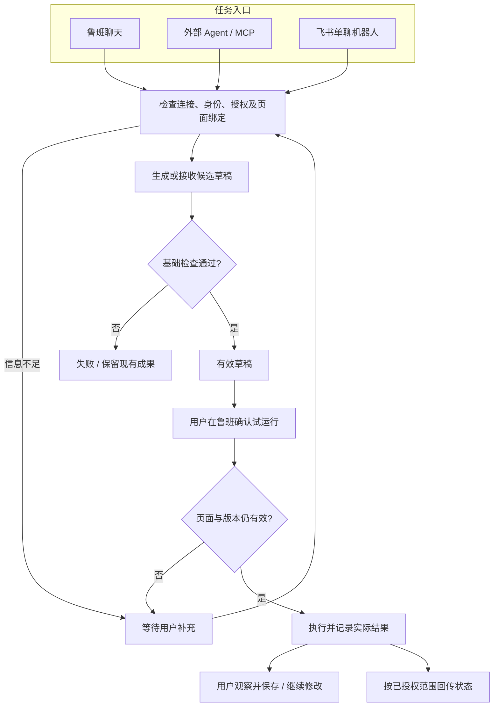

# 鲁班 V3 PRD：网页工具连接飞书与本地 Agent

版本：V3 / R1 · 2026-10-16。状态：产品评审稿；支持范围与接入方案尚未完成真实环境验证。

## 1. 背景、目标与依据

基于 [V3 需求初稿](./v3-product-requirements.md)，将飞书、本地 Agent 会话与 MCP 三条主线细化为页面行为、状态和验收要求。继续沿用 [V2](../v2/v2-product-requirements.md) 的草稿/保存/恢复规则与 [V2.1 R2](../v2.1/v2.1-optimization-requirements.md) 的固定输入、聊天流、制品浮层。

目标是让用户在鲁班或飞书提出网页任务，让本地 Agent 使用经授权的网页能力，最后仍能在鲁班查看、试运行和保存结果。本地 Agent 是本机程序，仍可能调用远程模型；“本地”不代表数据不出电脑。

沿用本项目既有的个人项目、仓库 Markdown 约定。本文未使用企业模板或查询 KBP。没有真实第三方兼容、性能或成功率数据；Demo 仅说明交互。

## 2. 用户与使用场景

| 用户 | 起点 | 目标 | 成功结果 |
|---|---|---|---|
| 网页工具使用者 | 鲁班聊天 | 用本地 Agent 修改工具 | 当前工具获得有效草稿，试运行后由用户保存 |
| 本地 Agent 使用者 | Codex / Cursor | 读取指定页并提交工具 | MCP 返回授权范围内的内容，操作申请在鲁班可确认 |
| 飞书使用者 | 与已绑定机器人的单聊 | 在电脑已打开的页面处理任务 | 飞书可追踪状态；需要写页面时在鲁班确认 |
| 信息整理者 | 鲁班结果 | 将摘要发送到飞书 | 预览指定接收人及正文，确认后得到真实发送状态 |

## 3. 范围与建议默认值

### 3.1 核心范围

| 模块 | P0 | P1 |
|---|---|---|
| 连接 | 本地连接、检查、授权、撤销、独立状态 | 更丰富的安装与升级辅助 |
| MCP | 授权页面发现/读取、工具读取、草稿提交、运行申请、状态/取消 | 多页面任务与更细的持久授权 |
| 会话 | 一个已验证的本地 Agent、生成与多轮修改、停止与失败保护 | 第二种 Agent 适配 |
| 飞书 | 主动发送、单聊机器人收任务、状态及结果回复 | lark-cli 发送适配、群聊、丰富卡片 |
| 统一治理 | 页面绑定、草稿检查、运行确认、并发保护、任务记录 | 更多审计筛选能力 |

三条主线分别验收；只实现消息推送不代表机器人任务入口交付。P0 不开放通过 MCP 直接保存、恢复、删除或开启自动运行。

### 3.2 评审假设

本稿以“Codex 为首批会话适配候选、Cursor 为 MCP 客户端候选、飞书单聊应用机器人、本地确认网页写操作、单个页面授权”设计。候选不代表已支持；lark-cli 暂列 P1。上述建议已由用户在 2026-10-16 确认按建议项执行；技术支持范围仍须真实验证，详见 [执行基线与计划](./v3-execution-plan.md)。

不包含任意终端执行、通用桌面控制、云端调度、无人值守跨站代理、多人共享浏览器与全量飞书办公能力。

## 4. 信息架构与交互原型

[打开 V3 交互 Demo](./demo-v3.html)。Demo 左侧是示例网页或外部入口，右侧是鲁班侧栏；场景切换与故障开关属于评审工具，不属于正式产品导航。

| 页面/区域 | 必须展示 | 主操作 |
|---|---|---|
| 聊天顶部 | 工具名称、准确主机、连接入口、任务入口 | 查看连接与集成、查看任务记录 |
| 消息流 | 本轮来源、执行方、处理阶段、结果或待操作原因 | 确认/拒绝运行申请、取消、重试 |
| 制品栏 | 名称、版本、草稿/已运行/已保存 | 查看代码、试运行、效果符合并保存 |
| 固定输入区 | 执行方、当前页面、发送范围、输入与发送/停止 | 切换执行方、查看范围、继续修改 |
| 连接浮层 | 本地服务、Agent、MCP 客户端、飞书各自状态 | 检查、连接、断开、授权、撤销 |
| 发送飞书浮层 | 通道、接收目标、实际正文、附件范围 | 确认发送、取消 |
| 任务记录浮层 | 身份、来源、目标、执行方、状态和结果 | 返回对应会话、查询或取消可取消任务 |
| 代码浮层 | 当前草稿、保存版、上一版与来源 | 查看版本、恢复上一版 |

长技术详情折叠。弹窗支持 Esc 与关闭按钮，关闭后焦点返回触发入口；错误使用可读文字，不能仅靠颜色。侧栏消息独立滚动，输入及制品保持可达，用户上滚阅读时不强拉回底部。

## 5. 核心用户流程

### 5.1 鲁班调用本地 Agent

连接本地服务 → 连接一个受支持 Agent → 选定页面与工具 → 选择执行方 → 输入需求 → 生成并检查 → 查看制品 → 确认试运行 → 观察 → 效果符合并保存。

已有模型默认值不改变。切换执行方保留草稿与有效约束；不能恢复历史会话时，告知新执行方接收的是当前基线和有限历史摘要。

### 5.2 外部 Agent 调用鲁班

配置 MCP → 鲁班确认客户端及页面范围 → 外部 Agent 获取上下文 → 提交工具草稿 → 本地检查 → 请求运行 → 鲁班展示范围并等待确认 → 执行或拒绝 → 外部 Agent 查询真实结果。

### 5.3 飞书任务

绑定发送者与页面 → 飞书单聊发起任务 → 回复任务已接收 → 以该连接已选执行方处理 → 生成草稿 → 回复等待在鲁班确认 → 本地确认执行 → 回复执行结果。保存仍由用户主动操作。

## 6. 详细功能规则

### 6.1 连接与集成（C）

| 编号 | 规则 | 验收条件 |
|---|---|---|
| C01 | 初次连接由用户发起，展示对象、拟开放能力与页面范围 | 新安装无已开放页面，不因来自本机自动信任 |
| C02 | 本地服务、Agent、MCP 与飞书状态独立 | 服务可用但飞书失效时，不能显示所有能力正常 |
| C03 | 状态包括未配置、未启动、待授权、可用、中断、不兼容 | 每种异常附近都有恢复入口和原因 |
| C04 | 检查只描述实际检查项 | 检查本地连接不能冒称消息已发送或 Agent 已兼容 |
| C05 | 断开阻止新任务；撤销同时终止未执行授权 | 重连不自动重放等待中的写操作 |
| C06 | 删除连接说明授权撤销和历史保留规则 | 已保存工具不随连接删除；密钥不留在普通历史中 |

### 6.2 本地 Agent 会话（L）

| 编号 | 规则 | 验收条件 |
|---|---|---|
| L01 | 执行方按第三方模型/本地 Agent 分类，显示名称及可用性 | 执行期间锁定本轮执行方，不自动降级重发 |
| L02 | 每轮携带当前有效草稿，无草稿才用保存版 | 两轮修改保留前轮成果，手动修改不被旧代码替代 |
| L03 | 输入区可查看实际数据范围 | 告知用户需求、必要历史、代码、有限页面摘要与有效约束 |
| L04 | 处理摘要、状态及最终解释进入同一消息流 | 不将内部推理或不完整代码作为最终制品 |
| L05 | Agent 返回结果通过现有基础检查 | 无效候选不能运行/保存；失败不覆盖原草稿 |
| L06 | 停止后区分已请求停止和已停止 | 无停止确认时不得宣称进程完全停止；迟到结果不覆盖 |
| L07 | Agent 其他文件/终端权限由其自身管理 | 鲁班不代替用户批准外部权限请求 |

### 6.3 对外 MCP（M）

| 编号 | 能力 | 产品规则 |
|---|---|---|
| M01 | 页面发现 | 只返回主动开放页面；无页面时返回需要选择，不泄露其他标签页标题 |
| M02 | 页面读取 | 返回指定页面有限摘要与必要结构，遵守脱敏与预算 |
| M03 | 工具查看 | 只返回已授权工具基线、状态及必要诊断 |
| M04 | 草稿提交 | 绑定工具与基线版本，通过检查后成为候选草稿 |
| M05 | 运行申请 | 展示客户端、任务、目标页、草稿版本和影响范围，在鲁班确认 |
| M06 | 查询/取消 | 返回真实状态；重复请求不重复执行，取消不承诺撤销副作用 |
| M07 | 配置帮助 | 提供能力清单、配置引导、连接检查及已验证客户端版本 |

客户端身份与页面授权分开。授权读取不自动授权执行；相同操作的新任务不复用上一任务运行确认。保存、恢复、删除、自动运行不在 P0 MCP 能力内。

### 6.4 飞书主动发送（S）

发送入口位于结果更多操作，不是常驻一级导航。接收目标必须属于当前通道的有效配置；切换目标后更新预览。

| 编号 | 规则 | 验收条件 |
|---|---|---|
| S01 | 显示实际正文、接收身份/目标、链接和附件范围 | 用户可编辑摘要；代码和整页内容默认不附带 |
| S02 | 用户确认后才发送 | 取消/关闭预览不发送，不消耗会话生成请求 |
| S03 | 区分成功、失败、结果未知 | 通道接收确认不代表用户已读 |
| S04 | 失败保留正文与目标，支持重试 | 未授权或目标无效时先修复连接 |
| S05 | 状态未知先提示核对，不能盲目自动重发 | 手动重发须提示可能重复 |
| S06 | lark-cli 如开放，显示实际发送身份 | 只开放定义的消息操作，不把凭据或任意命令交给模型 |

### 6.5 飞书机器人任务（B）

| 编号 | 规则 | 验收条件 |
|---|---|---|
| B01 | P0 单聊且绑定稳定身份，不按昵称认证 | 未绑定发送者不能读取页面；机器人自己的消息不触发 |
| B02 | 收取后给可追踪任务身份 | 重复事件不生成重复任务或执行 |
| B03 | 必须有明确页面与执行方 | 缺任一项进入等待用户操作，不猜活动页或付费模型 |
| B04 | 外部消息携带任务来源 | 鲁班能打开对应任务与制品，后续消息歧义时先澄清 |
| B05 | 写页面在鲁班确认 | 飞书告知等待确认，超时不默认同意 |
| B06 | 状态回传与任务执行分开记录 | 执行完成但回复失败时，只重试回传，不重跑脚本 |
| B07 | 回传遵守授权范围 | 默认仅简短摘要/状态，不附带完整页面、代码或历史 |
| B08 | 重连不把历史当新任务 | 浏览器关闭或休眠不承诺持续执行 |

### 6.6 页面、版本与并发（U）

- 页面绑定包括具体标签页与页面有效身份；同主机不同页也不能静默替换目标。
- 导航、关闭、失效或重新采集后，旧运行确认失效；重新绑定、检查并确认后才能执行。
- 一项工具同时只接受一个生成/修改任务；显示占用任务来源与取消入口。
- 外部提交带旧基线时保留候选结果，提示冲突并由用户选择，不覆盖最新草稿。
- 当前草稿的代码、权限或目标变化后，已运行资格失效；必须重新试运行才能保存。
- 保存后原保存版成为唯一上一版；恢复沿用 V2 规则。试运行不改变保存版，飞书回传不构成保存。
- 页面内容、外部消息与 Agent 输出不能自行修改权限或安全规则。

## 7. 字段与校验

以下为产品信息要求，不规定接口或存储结构。

| 对象 | 字段 | 展示/校验规则 |
|---|---|---|
| 连接 | 名称、类型、状态、能力、身份、最近检查结果 | 名称去首尾空白后非空；敏感凭据隐藏，不放入消息和日志 |
| 页面授权 | 连接对象、页面、工具、能力、有效范围 | 明确选择后生效，撤销后立即阻止后续访问 |
| 会话执行方 | 类别、名称、可用状态、历史衔接说明 | 选定后用于下一轮，当前处理轮不能变更 |
| 任务 | 身份、来源、摘要、目标页、执行方、状态、时间、结果 | 外部入口可追踪，同一请求去重；显示可获得信息 |
| 制品 | 工具、版本、来源任务、检查状态、运行资格、保存状态 | 缺基线/目标或检查失败时禁用运行，提示原因 |
| 飞书发送 | 通道、身份、目标、正文、附件范围、发送状态 | 目标有效且正文非空才可发送；未知状态不显示成功 |
| 操作申请 | 来源、页面、版本、影响范围、决定 | 绑定本次任务，拒绝或失效后不得继续执行 |

## 8. 状态与异常

### 8.1 任务状态

| 状态 | 触发 | 可用动作/后继 |
|---|---|---|
| 等待确认 | 新连接或网页写操作需许可 | 同意、拒绝、取消；拒绝后不能自动继续 |
| 等待执行 | 校验完成但尚未开始 | 查询、取消，开始后进入处理中 |
| 处理中 | 已开始处理 | 停止；结束进入完成/失败/等待用户操作 |
| 等待用户操作 | 缺页面、配置、权限或效果检查 | 补充后再继续，或取消 |
| 已完成 | 对应任务目标已有可确认结果 | 查看结果；不推导已保存、效果正确或消息已读 |
| 失败 | 本次处理不能完成 | 保留成果，修复后由用户发起重试 |
| 已取消 | 确认任务结束或已阻止未执行操作 | 查看记录；后续迟到结果不更新制品 |

“停止请求中”作为处理中附加状态，直至可确认停止。回复状态单独记录为未发送、发送中、已接收、失败、未知，不改写任务执行结果。

### 8.2 异常规则

| 情况 | 反馈与恢复 |
|---|---|
| 本地断连 | 保留输入/原草稿；重连后用户手动重试，不切到第三方模型 |
| 飞书授权失效 | 提示重新授权，保留待发送正文，不把错误归因于模型 |
| 页面失效 | 清除旧运行资格，请用户重新绑定有效页面 |
| Agent 输出不完整 | 展示诊断，保留当前有效草稿，不机械补齐后宣称正确 |
| 任务占用/版本冲突 | 明确任务或版本冲突，不静默覆盖 |
| 浏览器重启 | 恢复记录，未完成写操作重新确认 |
| 已执行但回传失败 | 展示两个独立结果，只重试回复 |
| 发送结果未知 | 提醒核对目标，明确手动重发可能重复 |

## 9. 初始化、隐私与兼容

升级保留全部既有工具、模型、草稿、上一版与自动运行设置。新连接无页面权限；新功能不自动安装本机依赖。旧消息无来源信息时显示历史记录，不补造任务身份。

页面采集继续遵守脱敏和预算。禁止自动读取密码值、Cookie、浏览器存储及扩展 Key；页面可见文本与手动输入仍可能含敏感内容。需展示真实执行方和外发范围，不宣称本地 Agent 天然不会外发。

兼容声明按“产品、版本、能力、验证环境、结果、限制”分别记录。MCP 客户端可用不代表能作为会话执行方；原型中的 Codex/Cursor 均为候选名称。目标操作系统、安装升级方式及飞书应用权限待技术验证。

## 10. 验收与原型覆盖

| 验收组 | 具体通过条件 | Demo 场景 |
|---|---|---|
| 本地会话 | 真实 Agent 完成新建及两轮修改，草稿保留；未运行不可保存 | 本地 Agent 会话：发送、停止、运行、保存、继续修改 |
| MCP | 只读范围隔离，草稿通过检查，确认前不执行 | MCP：提交草稿、拒绝/确认运行、撤销授权 |
| 飞书入口 | 单聊绑定、任务追踪、本地确认、最终回复 | 飞书机器人：发起、查看进度、确认、回复 |
| 主动发送 | 目标/正文预览、确认后发送、取消不发送 | 任一结果 → 发送到飞书 |
| 故障 | 断连/失效不误执行，取消后迟到结果不覆盖，回传失败不重跑 | 故障模拟及任务记录 |
| 原能力 | 第三方模型完整回归，保存/恢复/自动运行仍按旧规则 | Demo 仅展示模型切换和保存/恢复，自动运行真实回归另验 |
| 安全与并发 | 未授权读取、重复执行、并发覆盖均被阻止 | Demo 覆盖撤销与重复点击；身份认证与跨进程并发需真实验收 |

完整验收沿用源需求 A1–A12；必须验证真实浏览器、客户端、Agent 和机器人。Demo 不验证协议、认证、消息实际送达、真实代码检查或第三方兼容，不代替工程验收。

## 11. 待确认项与相关开发项目信息

已确认：macOS 首发、个人本地加载试用、安装包内置 Node、Codex 首批会话候选、lark-cli 保持 P1、页面授权随导航/浏览器重启失效、任务记录 30 天/诊断 7 天。待验证或补充：OS/架构与各客户端真实支持范围、机器人应用和权限、容量上限、发布日期。当前不增加成功率指标或研发工期承诺。

| 名称 | 描述 |
|---|---|
| 协作地址 | 当前仓库 luban/docs/v3/，未关联外部平台 |
| 产品 | 个人项目，负责人待指定 |
| 开发 | 待指定 |
| 宣讲时间 | 未安排 |
| 计划上线时间 | 待确定 |
| 版本计划 | V3 R1 PRD + 可交互 Demo；技术方案及执行计划另行产出 |
