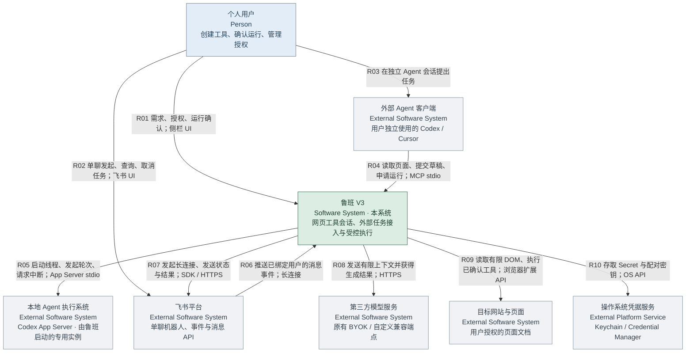
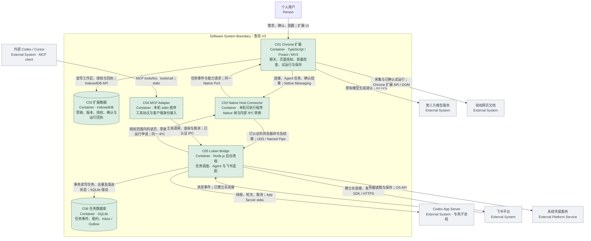
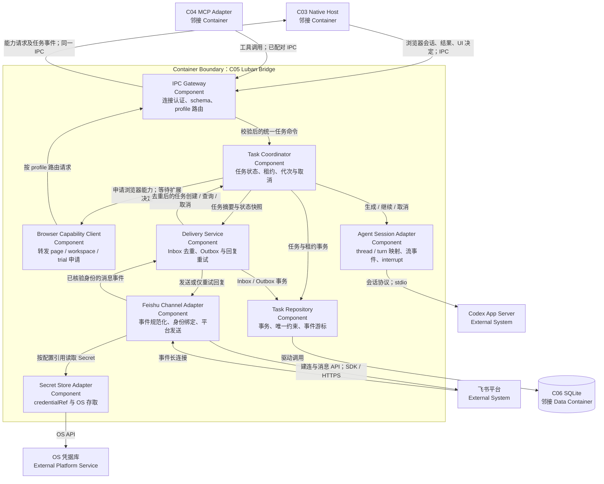

# 鲁班 V3 技术方案与关键对接点

版本：V3 / R1。日期：2026-10-16。状态：技术评审稿，尚未实施；依赖版本、运行环境及兼容范围经专项验证后冻结。

依据：[V3 PRD](./v3-prd.md)、[需求范围](./v3-product-requirements.md)、当前 `luban/src/` 代码。本文定义技术方案，不修改 PRD 的 P0/P1 边界。

## 1. 方案结论

采用 **Chrome 扩展 + 本地桥接服务 Luban Bridge + 协议适配器**：

- 扩展保留页面采集、代码检查、草稿、试运行、保存和自动运行的控制权。
- Bridge 承担外部入口、任务调度、本地 Agent 子进程、飞书连接和持久任务记录。
- 外部 Codex/Cursor 通过鲁班 MCP Server 使用浏览器能力。
- 鲁班调用 Codex 时使用独立的 Agent 适配器，首选 Codex App Server；MCP Server 不充当会话执行方。
- 飞书 P0 使用自建应用机器人，官方 Node SDK 长连接接收事件、服务端 API 发消息；lark-cli 保持 P1 可插拔通道。
- 浏览器与本机优先采用 Native Messaging；MCP 对外优先 stdio。P0 不新增公网服务或公开本机 HTTP 控制端口。

这使原先“纯扩展、无本机安装”的形态增加了一个可选本机组件。只使用原有第三方模型时无需 Bridge；V3 的 Agent/MCP/飞书闭环需要用户安装、连接并授权 Bridge。安装分发是核心交付项。

上述为设计推荐，不是兼容测试结论。用户已确认首发 macOS，其余按建议项执行：先个人本地加载试用、安装包内置 Node、lark-cli 保持 P1。具体 macOS 版本/架构及依赖版本经 S0 验证冻结，Windows/Linux 不在首发范围。

## 2. 已核实依据与不确定性

截至本次查询，官方文档可支持下列选型事实：

| 对接对象 | 已核实的事实 | 本方案推导与待验证 |
|---|---|---|
| Chrome Native Messaging | 扩展可用 `connectNative` 连接已注册本机 Host，需声明权限，采用长度前缀 JSON；Host→Chrome 消息上限 1 MiB | 用于扩展/Bridge 通道；安装路径、扩展 ID、浏览器配置档及休眠恢复需实测。[官方说明](https://developer.chrome.com/docs/extensions/develop/concepts/native-messaging) |
| Codex App Server | 提供线程、轮次、事件、审批和中断等应用集成能力 | 首选会话适配接口，具体方法/字段按冻结版本生成类型并联调。[OpenAI Docs](https://developers.openai.com/codex/app-server/) |
| MCP | stdio 与 Streamable HTTP 均有标准传输定义 | P0 用 stdio，由官方 SDK 协商兼容版本，不能手写并假定所有协议版本相同。[传输规范](https://modelcontextprotocol.io/specification/2025-11-25/basic/transports) |
| Cursor | 官方支持以命令配置本地 MCP Server | 提供鲁班启动器配置，逐版本验证；不能据此声明 Cursor 已可作为鲁班会话执行方。[配置说明](https://prod.cursor.com/help/customization/mcp) |
| 飞书 Node SDK | `WSClient` / `EventDispatcher` 可接收 `im.message.receive_v1`，SDK 提供消息发送；长连接有处理时限及同应用多连接分发约束 | 回调只持久接收，不等待 Agent；应用权限、网络和发布可见范围实测。[官方 SDK](https://github.com/larksuite/node-sdk/blob/main/README.zh.md) |

Context7 查询因 API Key 无效失败，已改查官方文档。本机 Shell 当前找不到 `codex` 命令，本轮未运行 Codex/飞书/MCP 联调，也未安装或修改用户配置。外部文档可变，不能将示例字段视为未来版本保证。

## 3. 现有实现复用与缺口

| 现有代码 | 现状 | V3 改造 |
|---|---|---|
| `manifest.json` | MV3，最低 Chrome 138；无 nativeMessaging | 增加用户主动申请的 Native Messaging 权限及 Host 安装检查；原网页权限体系保留 |
| `src/service-worker/index.ts` | 消息路由与生成 Port，校验扩展页面来源 | 新增独立 Bridge 路由，不把外部 JSON 当内部消息直接透传 |
| `services/page-capture.ts` | `currentSite()` 查询活动页；采集返回 tabId/documentId | 新增 `captureBoundPage(binding)`，外部任务禁止调用活动页回退 |
| `shared/p2-types.ts` | 已有 PageBinding、GenerationEnvelope | 增加浏览器会话身份、授权引用和任务执行代次；保留旧字段兼容 |
| `services/workspace-generation.ts` | 绑定模型配置，处理上下文、受控修复和草稿提交 | 抽出执行方无关的准备/验收流程，新增 AgentExecutor；不伪造模型 ProviderConfig |
| `services/code-quality.ts` / `safety-scanner.ts` | 已有基础检查及规则扫描 | MCP/Agent 产物共用该入口，不能只信 Bridge 返回的“通过” |
| `services/trial-runner.ts` | 按 documentId 执行、草稿摘要及同文档去重 | 外部任务复用，增加持久操作状态与确认凭据校验 |
| `services/version-service.ts` | 试运行、保存、恢复与自动运行协调 | 保存/恢复继续由扩展用户操作；检查具体目标绑定，禁止误用活动页 |
| `services/workspace-lock.ts` | 内存 Map 锁 | 扩展写入路径增加持久租约/代次校验，重启后锁不能假装仍有效 |
| `repositories/workspace-store.ts` | 草稿 CAS、会话与版本校验 | 新任务草稿按 expectedDraftRevision 提交，失败候选单独保留 |
| `repositories/database.ts` | IndexedDB v1，固定 STORES | 显式升级到 v2，新增 V3 stores，覆盖配额统计与被旧窗口阻塞处理 |
| `sidepanel/App.tsx` / `workspace-controller.ts` | 工作区操作、聊天与制品 | 增加执行方、连接浮层、任务来源、操作确认与飞书预览 |

必须审计所有 `currentSite()` / `captureCurrentPage()` 调用链。仅修改读取入口、但试运行或保存仍改用活动页，会破坏页面绑定。

## 4. C4 系统上下文、容器与组件

本节采用 C4 的 C1（System Context）、C2（Container）和局部 C3（Component）表达责任边界，并用 Mermaid flowchart 嵌入文档。节点标明 C4 类型，连线注明调用方、用途及协议；箭头表示依赖/调用方向，响应由同一通道返回，推送事件单独标注。

**系统边界为“鲁班 V3 产品及其自有代码”，不是“用户电脑”或“浏览器”。** 本机第三方程序仍为外部依赖；Container 是可运行应用或数据存储，不是 Docker 容器。以下图描述目标设计，不代表已部署。

### 4.1 C1：系统上下文图

回答：谁使用鲁班，鲁班与哪些外部系统交互？C1 不展开 Bridge、数据库或浏览器进程。



#### 边界与对象解释

| 对象 | 内/外部 | 原因与交互约束 |
|---|---|---|
| 鲁班扩展、Bridge、Native Host、MCP Adapter | 内部 | 项目自行开发、版本管理并承担产品行为责任 |
| IndexedDB、Bridge SQLite | 内部数据存储 | 由鲁班控制 schema 与写入规则；底层浏览器/SQLite 引擎是技术依赖 |
| 用户独立使用的 Codex/Cursor | 外部调用方 | 作为 MCP client 调用鲁班；无权直接操作扩展内部库 |
| Codex App Server 专用实例 | 外部执行系统 | 虽由 Bridge 启动，仍是第三方 Agent 程序，不属于鲁班自有组件 |
| 飞书平台与已配置机器人身份 | 外部系统/通道身份 | 机器人身份不是独立鲁班后台；飞书适配代码属于 Bridge |
| 第三方模型服务 | 外部执行服务 | 原有扩展直连；与“本地 Agent”执行分支分开 |
| 目标网页 | 外部受控对象 | 鲁班的 content script 在页面内运行，但网页本身不属于鲁班 |
| Chrome / 操作系统 / Node.js | 运行平台 | 不作为鲁班业务系统或自有 Container；承载权限、进程与运行时 |
| 系统凭据库 | 外部平台服务 | 鲁班负责适配和 credentialRef，OS 负责保管与访问控制 |
| lark-cli | 外部程序（P1） | 可选通道依赖，不作为 P0 必需项；C1 主图省略以避免混淆当前范围 |

图中 R08 仅表示原有第三方模型分支。外部 Agent 客户端和 Codex App Server 还可能调用其各自模型服务；这属于外部系统内部依赖，C1 不重复展开，也不能由此推断本地 Agent 数据不会外发。

### 4.2 C2：鲁班内部容器图

回答：鲁班由哪些可运行单元/数据存储组成，各自怎样连接外部系统？浏览器与本机位置是部署说明，鲁班边界仍按所有权划分。



> C01 将侧栏、Service Worker 和 Content Script 聚合为一个扩展 Container：它们随一个扩展包发布，在浏览器提供的不同执行上下文中运行。跨上下文消息是该 Container 的内部通信。需要分析权限边界时再展开，不能把它们误认为可互相任意调用。

| Container | 运行/生命周期 | 提供接口 | 有权写入的数据 |
|---|---|---|---|
| C01 Chrome 扩展 | 指定浏览器 profile；SW 可重启，侧栏可关闭 | 用户 UI、受限 Bridge capability RPC | C02；最终页面授权、草稿接受、试运行与保存决策 |
| C02 扩展数据 | 指定 profile 的持久存储 | IndexedDB API，仅由扩展服务封装 | 不对 Bridge/MCP 开放直写 |
| C03 Native Host | 浏览器 connectNative 启动，可重连 | Native 帧端、内部 IPC 端 | 不持有业务数据库；只做连接/帧校验和转换 |
| C04 MCP Adapter | 每个外部客户端启动的 stdio 进程 | MCP Server、内部 IPC client | 不直写 C02/C06，不直接执行网页脚本 |
| C05 Bridge | 当前用户的单实例后台进程 | 本机 IPC、外部适配器 | C06、凭据存储；不直写 C02 |
| C06 任务数据库 | 当前用户的本机持久存储 | SQLite 驱动，由 Bridge 独占业务写入口 | 不作为 Agent 可读写工作目录 |

C03 与 C04 都是适配进程，但协议与启动方不同，必须分别存在。C03 的 stdio 是 Chrome Native Messaging 长度前缀帧；C04 的 stdio 是 MCP 协议；C05 ↔ Codex 的 stdio 又是 App Server 协议，三者不能混用。

### 4.3 C3：Bridge 内部组件与扩展对接

回答：Bridge 怎样协调入口、任务、执行与回传？只展开 C05 的关键组件，不把 SDK、SQLite 驱动或函数逐个画成组件。



C3 中组件归属均为本项目代码。`Agent Session Adapter` 是鲁班自有组件，`Codex App Server` 是外部程序；`Feishu Channel Adapter` 是自有组件，飞书 SDK 是其依赖库，飞书平台是外部系统。lark-cli 若进入 P1，由 Channel Adapter 的另一实现调用，不绕过 Delivery Service。

### 4.4 跨边界交互契约

| 关系 | 发起方 → 接收方 | 请求/数据 | 返回与副作用 | 最终权限检查位置 |
|---|---|---|---|---|
| R01 用户操作 | 用户 → C01 | 需求、执行方、页面选择、运行/保存确认 | 任务与制品状态；确认后才有网页/保存副作用 | 扩展 UI 来源 + 扩展服务 |
| R04 外部 Agent 调用 | Agent → C04 → C05 → C03 → C01 | 工具调用、pageRef、toolRef、版本 | 有限摘要、候选/operation/task 身份；申请不执行 | C05 连接认证；C01 grant/page/version/approval |
| R05 鲁班调用 Agent | C01 → C03 → C05 → App Server | 已准备 Envelope、专用线程、轮次与取消 | 流事件与完整候选；Agent 结束不代表页面执行 | C05 最小进程权限；C01 产物验收与 CAS |
| R06 飞书收任务 | 飞书 → C05 → C03 → C01 | 已绑定 sender/chat、消息与 task 映射 | 接收/等待确认/结果摘要；无绑定时等待 | C05 稳定身份与 Inbox；C01 页面能力校验 |
| R07 飞书发消息 | C01/Task Coordinator → Delivery → 飞书 | 固定目标、正文快照、deliveryId | 平台接收/失败/未知；不代表已读 | C05 通道授权；主动发送需 C01 用户确认 |
| R08 原模型生成 | C01 → 模型服务 | 有限页面上下文、代码、必要历史 | 模型结果；进入检查后才成为有效草稿 | C01 发送范围、质量检查、CAS |
| R09 操作网页 | C01 Service Worker → 指定文档 | 脱敏采集请求或具体草稿版本 | 页面上下文/执行回执；副作用不能通用撤销 | Chrome 权限 + C01 PageGrant/Approval/documentId |
| R10 凭据读写 | C05 → OS 凭据库 | credentialRef、配置时的 Secret | 凭据只用于相应适配器；不回传给 Agent | OS 访问控制 + C05 配置管理权限 |

R02/R03 是用户使用飞书和外部 Agent 的交互，由对应外部系统提供 UI；鲁班不接管其登录、聊天历史或审批设置。任务状态与发送状态分别由 Task Coordinator、Delivery Service 管理；草稿/保存状态以扩展数据库为准。

### 4.5 三条主链路与边界约束

1. **鲁班本地会话**：用户 → 扩展 → Native Host → Bridge → Codex App Server → 返回完整候选 → 扩展质量检查/CAS → 用户确认 → 指定网页试运行 → 用户观察并保存。
2. **外部 MCP**：用户独立使用的 Codex/Cursor → MCP Adapter → Bridge → Native Host → 扩展 → 授权页采集/候选接收。申请试运行返回等待确认；用户在扩展确认后执行，再按 taskId 查询结果。
3. **飞书任务**：用户 → 飞书单聊 → Bridge Channel/Delivery → Task Coordinator → 已选执行方 → 扩展接受候选并请求确认 → 用户本地确认 → 扩展回执 → Bridge Outbox → 飞书回复。

原有第三方模型走扩展直连，不强制绕 Bridge。Codex App Server 不直接读取扩展数据库、飞书凭据或任意浏览器标签；网页能力必须经过授权网关。Bridge 不代替用户保存工具，也不直接注入网页。

外部系统在本机运行不会自动进入鲁班信任边界。浏览器 grant、OS 权限、Agent 原生审批和飞书应用权限是不同权限域，一方许可不能代替另一方。安装器与依赖库属于构建/部署支持，本节运行时主图不单独列为业务容器。

### 4.6 进程职责

- **Native Host Connector**：由浏览器启动，处理二进制帧与 Bridge IPC；stdout 仅写 Native Messaging 帧，日志走 stderr。不能将其 stdin/stdout 同时用作 MCP。
- **Bridge**：单用户后台进程，管理 Agent 与飞书网络连接。只通过受限本机 IPC 接收操作，不直接控制网页或写扩展数据库。
- **MCP Adapter**：每个外部客户端会话独立 stdio 子进程，转换工具调用到 Bridge，stdout 仅写 MCP 消息。
- **Codex Adapter**：Bridge 启动的专用 app-server 子进程；不连接或接管用户正在使用的 Codex Desktop 聊天。

### 4.7 本机 IPC 与多实例

建议 macOS/Linux 使用用户目录下 Unix Domain Socket；Windows 使用带当前用户 ACL 的 Named Pipe。Socket 目录限制为当前用户；握手使用每个连接的随机凭据。它们是内部 IPC，不是对外 MCP 传输。

Bridge 以单实例锁启动，记录 instanceId 和协议版本。Native Connector 可以按固定路径启动已安装 Bridge；MCP Adapter 仅能连接/启动该 Bridge，不能启动浏览器或选择页面。

扩展首次授权生成 profileId，Bridge 为每条扩展连接记录 extensionId、profileId、browserSessionId。多个浏览器配置档同时在线时，按明确授权目标路由；无法确定则等待用户选择，禁止发给“第一个在线浏览器”。tabId 只在对应浏览器会话中解释。

### 4.8 生命周期

使用 `connectNative` 长连接，但不将其视为不会中断的保证；断开、SW 重启、浏览器重启、系统休眠均走恢复握手。Bridge 不依赖侧栏存活；需要确认时写入待确认记录，用户自行打开侧栏处理。

P0 默认随用户启用连接启动 Bridge，不默认安装开机常驻服务。浏览器离线时可在 Bridge 收到飞书事件，但任务只能进入等待浏览器/用户操作，不能执行网页；Bridge 自身离线则不承诺接收和主动反馈。重连先同步状态，不重放写命令。

## 5. 关键依赖与安装交付

| 依赖 | 放置位置 | 用途 | 冻结/验收要求 |
|---|---|---|---|
| 当前 Preact / TypeScript / Vite | 扩展 | 保持现有 UI 与构建 | 保持现有 lockfile，不因 V3 无关升级 |
| 官方 MCP TypeScript SDK | MCP Adapter | 工具注册、schema、stdio 与版本协商 | 选择与目标客户端共同支持的稳定版并锁精确版本；实际包名/导入以选定版本为准 |
| Zod 或同类 schema 库 | 共享协议/Bridge | 不可信输入运行时校验 | 仅保留一种主要校验库，禁止仅靠 TS 类型断言 |
| 官方 `@larksuiteoapi/node-sdk` | Bridge | 收事件、发消息、Token 管理 | 锁定稳定版，关闭正文/凭据日志，验证长连接重连行为 |
| Codex CLI / App Server | 用户本机，Bridge 子进程 | 本地 Agent 会话 | 用户安装和登录；冻结版本及生成协议类型；不复用桌面私有接口 |
| 受支持 Node.js LTS | Bridge / Adapter | 本机运行时 | 冻结 OS/架构与版本；开发期可依赖已安装 Node，正式安装包建议随包提供运行时 |
| SQLite 与单一 TS 驱动 | Bridge | 任务、Inbox、Outbox、唯一索引、事务 | S0 已选择 better-sqlite3 13.0.3：固定 Node 24.14.1/macOS arm64 预编译模块与打包加载通过，干净环境待验 |
| 系统 Keychain / Credential Manager 适配 | Bridge | 飞书 Secret、配对凭据引用 | 首发系统实测；不可用则明确拒绝存储或临时使用，不静默明文降级 |
| Native Host 安装器 | 本机 | 注册 Host Manifest 与绝对可执行路径 | 校验扩展 ID、用户级安装、升级回滚与卸载；不是 npm 依赖可替代的工作 |
| lark-cli（P1） | 用户本机 | 可选通道 | 检查版本/登录/能力，不自动复制令牌，固定参数调用 |

新增依赖只进入本机包和协议包；不将 Node SDK、SQLite 或子进程依赖打入扩展。建议源码布局：

```text
luban/
  packages/protocol/       # Bridge RPC schema / 错误码 / 能力版本
  bridge/src/             # daemon、IPC、任务库、Agent、Feishu
  bridge/native-host/     # Native 帧编解码与浏览器入口
  bridge/mcp/             # stdio MCP adapter
  bridge/install/         # 分平台 Host 注册 / 检查 / 卸载
  src/service-worker/services/bridge-client.ts
  src/service-worker/services/v3-task-gateway.ts
  src/service-worker/services/bound-page.ts
  src/shared/v3-types.ts
```

以上均为待新增路径，不代表文件已经存在。开发桥接包有独立 package.json、lockfile 与构建产物；单独安装只影响 V3 集成能力。

### 5.1 安装与配置

1. 安装器写入固定 Host 名称（拟 `com.luban.bridge`）、可执行文件绝对路径及精确 `allowed_origins`，不允许任意扩展。
2. 扩展主动请求 Native Messaging 权限并连接。可选权限声明是否满足目标分发方式需先验证；若采用必需权限，需评审升级权限提示。
3. Connector 获取并校验浏览器传入的扩展 Origin，启动/连接 Bridge，交换版本和 nonce，用户在扩展确认配对。
4. 初始仅授予管理连接能力，不授予页面能力。用户点击鲁班获得 activeTab 后，选择具体页面/工具建立授权。
5. 安装器输出客户端 MCP 配置示例。每个客户端独立 enrollment，短时配对码只使用一次，长期凭据放当前用户受限配置/凭据库。
6. 飞书 Secret 经专用连接配置流程送入 Bridge 的凭据存储，不经模型消息或任务历史。

开发加载扩展的 ID 可能变化，不能把临时 ID 作为发布值；需要稳定开发 ID 和发布 ID 分别注册。卸载删除 Host 注册和程序；用户任务历史与凭据删除需明确选择。

## 6. 权威数据与状态一致性

### 6.1 单一写入方

| 数据 | 权威写入方 | 其他进程的权限 |
|---|---|---|
| 草稿、保存版、上一版、会话、运行回执 | 扩展 IndexedDB | Bridge 只能调用受限服务，不能直接改数据库文件 |
| 页面身份、浏览器授权、操作确认 | 扩展 | Bridge 缓存仅用于显示，执行时扩展重新校验 |
| 任务事件、外部来源、Agent thread 映射、Inbox/Outbox | Bridge SQLite | UI 通过同步接口展示，不另建可独立推进状态的副本 |
| 飞书绑定身份/目标、应用配置 | Bridge | 扩展可以请求管理，任务不能变更 |
| Secret 与配对密钥 | 系统凭据存储 | 两个数据库仅存 credentialRef；不回显 |

### 6.2 建议数据对象

- `Task`：taskId、source、connectionId、profileId、workspaceId、kind、executorSnapshot、pageRef、expectedDraftRevision、state、cancelState、attemptEpoch、revision、resultRef、createdAt/updatedAt。
- `PageGrant`：grantId、principalId、browserSessionId、tabId、documentId、navigationEpoch、workspaceId、capabilities、expiresAt、grantRevision、revokedAt。不能由外部请求自行填写 principalId。
- `Approval`：approvalId、taskId、operationId、pageRef、draftHash、draftRevision、grantRevision、decision、expiresAt、consumedAt。持久化且一次消费。
- `TaskEvent`：taskId、seq、eventType、summary、resultRef、timestamp；只保存处理摘要，不保存内部逐字推理。
- `Inbox`：appId、eventId、messageId、senderIdentity、chatId、receivedAt、taskId；唯一索引负责去重。
- `Outbox`：deliveryId、taskId、channel、targetSnapshot、contentSnapshot、payloadHash、status、providerMessageId、attempt、lastError；任务执行和回复状态独立。
- `ExecutorSession`：workspaceId、executorId、threadId、configFingerprint、baselineHash、lastTurnId；仅恢复本集成创建的线程。

建议任务 kind 分为 generate / submitDraft / trialRun / readContext / sendMessage；生成任务交付草稿即完成，试运行作为关联子任务。这样不会让同一“已完成”任务随后退回“等待确认”。UI 可用 taskGroupId 聚合为一条任务卡。

### 6.3 持久租约与取消

Bridge 用 SQLite 事务取得 workspace 任务租约；扩展所有草稿/运行路径再检查 IndexedDB 中的 taskOwner、leaseEpoch 和 CAS。原侧栏生成也必须纳入，不能只有外部路径检查锁。

租约过期只能阻止旧任务提交，不能证明原 Agent 已停止。新 owner 获得新 epoch，旧结果只可归档为迟到候选。取消先写取消标记并递增执行代次，再发 Agent interrupt；收到终止事件才标为已停止，未确认则保持“停止请求中”。

不能在 IDB 事务中等待网络或 Chrome API。事务前准备数据、事务内 CAS、提交后调用外部副作用；重启时按 operation 记录对账。

## 7. 扩展 ↔ Bridge 对接协议

拟定义内部 `luban.bridge.v1` RPC，字段名为本项目设计，不是第三方协议：

```ts
interface BridgeRequest {
  protocolVersion: 1;
  requestId: string;
  connectionId: string; // 接收端按已认证连接核对，不信任任意自报值
  method: string;
  taskId?: string;
  attemptEpoch?: number;
  expectedRevision?: number;
  params: unknown;     // 必须由 method 对应 schema 解析
}
interface BridgeEvent {
  protocolVersion: 1;
  taskId: string;
  seq: number;
  attemptEpoch: number;
  type: string;
  payload: unknown;
}
```

| 方法组 | 方向 | 对接入口与约束 |
|---|---|---|
| `connection.hello/status/revoke` | 双向管理 | 协议协商、配对与独立连接状态；不泄露 Secret |
| `grant.list/request/revoke` | Bridge → 扩展 | list 仅列该 principal 已授权范围，request 等待用户操作 |
| `page.read` | Bridge → 扩展 | pageRef 必须匹配有效授权，返回有限上下文 |
| `workspace.read/submitDraft` | Bridge → 扩展 | 仅授权工具，提交带预期版本、候选代码与权限 |
| `operation.requestTrial` | Bridge → 扩展 | 返回等待确认身份，不在 RPC 调用内无限等待 |
| `operation.decide` | 扩展 UI → 扩展服务 | 只接受扩展页面来源，Bridge/网页不能伪造用户决定 |
| `agent.start/cancel` | 扩展 → Bridge | 冻结执行方、Envelope、代次、输出预算 |
| `task.get/events` | 双向 | seq 游标增量同步；断线不重放写命令 |
| `feishu.preview/send/retryDelivery` | 扩展 → Bridge | 正文目标快照、明确确认、单独 deliveryId |

Native Messaging 由独立帧解析器处理碎片/合并帧、长度、JSON 和版本；拟设单帧应用上限 512 KiB，必须小于 Chrome 上限。代码沿用 256 KiB 限制；超出帧预算的内容分块传输并核对总长度/摘要，禁止截断后当完整代码。队列有界，输出高频 delta 合并，最终候选及终态不得丢失。

`PAGE_STALE`、`GRANT_REVOKED`、`WORKSPACE_BUSY`、`REVISION_CONFLICT`、`APPROVAL_EXPIRED`、`BRIDGE_OFFLINE`、`EXECUTOR_UNAVAILABLE`、`OUTPUT_INVALID`、`DELIVERY_UNKNOWN` 等用结构化错误返回。日志只含身份引用、方法、时间和错误码，正文默认不记录。

## 8. 对外 MCP 对接

### 8.1 工具清单

以下工具名及输入为本项目拟定契约：

| 工具 | 关键输入 | 返回 | 后端 |
|---|---|---|---|
| `luban_list_pages` | 无 | 已授权 opaque pageRef 与脱敏摘要 | GrantService |
| `luban_read_page` | pageRef | contextRef、有限摘要、过期信息 | bound-page + context-engine |
| `luban_get_tool` | toolRef | 当前基线、draftRevision、必要状态 | WorkspaceStore |
| `luban_submit_draft` | toolRef、expectedDraftRevision、code、grants、explanation | taskId、检查结果、候选状态 | quality + workspace CAS |
| `luban_request_trial` | toolRef、draftRevision、pageRef | operationId、waitingConfirmation | ApprovalService |
| `luban_get_task` | taskId、afterSeq 可选 | 实际任务/操作/回传状态 | TaskService |
| `luban_cancel_task` | taskId | cancelRequested / cancelled | TaskService + AgentAdapter |

不提供任意 JS 执行工具、任意内部消息转发工具或保存/删除工具。JSON Schema 限制字符串长度、数组、代码大小和枚举；`readOnlyHint` 等标注只供客户端参考，真实权限在服务端执行。

MCP 调用快速返回任务身份，客户端查询待确认结果；不要长时间占住工具调用等待用户点侧栏。外部请求去重以已认证 connectionId + request identity + payloadHash 建立，不能只用代码摘要去重。MCP JSON-RPC id 只用于会话请求关联，不作为跨重连持久业务身份。

### 8.2 客户端配置与认证

Cursor 配置使用已安装启动器的绝对路径及 enrollment 配置引用；Codex 的 MCP 配置由其当前官方配置方式生成。配置示例是模板，不写用户现有配置：

```json
{
  "mcpServers": {
    "luban": {
      "command": "/absolute/path/to/luban-mcp",
      "args": ["--connection-config", "/absolute/path/to/client-enrollment.json"]
    }
  }
}
```

enrollment 文件限制当前用户读取，凭据不可提交 Git；客户端名只是标签，不是认证。stdio 没有提供独立用户安全边界，Bridge 用配对凭据确定 principal；同一 OS 用户下的恶意程序仍属于残余风险，不宣称抵御其完整控制。

内部 Codex Adapter 若需浏览器工具，可接入同一 MCP 实现，但使用仅绑定当前 task/page/workspace 的短期能力；不得继承用户外部客户端全部页面授权。P0 第一阶段仅使用已准备 Envelope 生成代码也可，不依赖实验性动态工具接口。

## 9. Codex 本地会话对接

### 9.1 适配接口

```ts
interface AgentAdapter {
  probe(): Promise<AgentCapabilities>;
  start(input: AgentTaskInput): AsyncIterable<AgentEvent>;
  interrupt(threadId: string, turnId: string): Promise<void>;
  dispose(): Promise<void>;
}
// 类型由本项目定义；Codex 官方协议类型由冻结的 CLI 版本导出。
```

App Server 经子进程 stdio 连接。建议流程为初始化 → `thread/start` 或 `thread/resume` → `turn/start` → 消费事件 → 收到 `turn/completed` → 验收完整产物；取消用 `turn/interrupt`。准确初始化字段、事件名与类型由冻结版本文档/生成 schema 决定，避免手抄不断变化的协议。[官方协议](https://developers.openai.com/codex/app-server/)

### 9.2 上下文与产物

从现有 GenerationEnvelope 抽出执行方无关部分：用户需求、当前草稿代码、有效约束、有限历史、PageBinding 与脱敏页面摘要。第三方模型设置继续走旧分支；Agent 配置单独存储，不把本机 Agent 伪装成 OpenAI 兼容 URL。

每个 workspace + executor + 配置摘要映射一个专用 thread；切换执行方后使用明确的基线摘要。恢复线程时再次发送最新基线和版本，不仅依赖 Agent 自己记忆。目录为专用空工作目录，不将用户整个仓库默认暴露为 Agent 工作区。

输出要求为结构化候选：code、explanation、grants、runAt 或 clarification。可用的 structured output 能力经冻结版本验证；没有此能力时按完整结束结果严格解析，失败进入 OUTPUT_INVALID，不将流式片段拼为可执行草稿。

结果统一经过 parse/shape validation → `scanCode` → `inspectCode` → 页面/授权/代次/CAS 检查 → WorkspaceStore。修复预算沿用原规则；Agent 内部调用次数不能当作一次模型请求，必须按可获得信息展示，不承诺原 BYOK 链路的费用上限。

### 9.3 Agent 权限与认证

Bridge 不携带用户 Key 给 Codex，不读取或转发 Codex 登录令牌，用户在官方程序中登录。进程路径固定、参数数组调用，禁止 shell 字符串拼接；不传模型可控制的命令、可执行路径或工作目录。

Codex 原生文件/终端审批与鲁班网页审批是两套权限。P0 默认选择限制最小的能力配置，不自动批准 Codex 发出的额外权限申请；若需要交互授权，则用户到 Agent 自身授权入口处理，Bridge 返回等待用户操作。无法在目标版本可靠限制或转交审批时，该适配不能作为已支持能力发布。

SDK/非交互 CLI 可作为后续适配候选，需另验多轮状态、取消、输出和审批。Cursor 的 MCP 客户端配置不能反向当成 Agent 会话接口；Cursor 会话适配需按其官方 SDK/协议另做验证，保持 P1。

## 10. 飞书机器人与 lark-cli 对接

### 10.1 P0 应用机器人

建议企业自建应用单用户试点。前置条件：应用已开通机器人、事件订阅及单聊接收/应用身份发送所需权限，发布版本对绑定用户可用。具体 scope 名称和后台审批以实际应用验证为准，不申请全量群消息/通讯录权限作为默认。

Bridge 建立 `WSClient`，用 `EventDispatcher` 处理 `im.message.receive_v1`。不在事件回调内运行模型：校验基础形状 → 持久 Inbox 去重 → 入任务队列 → 立即完成事件处理。官方 SDK 描述了处理超时重推及同应用多连接分发行为，因此**同一应用不默认在多台个人电脑各开独立监听**；先一应用一台已绑定 Bridge，扩展多机需额外集中路由设计。[官方 SDK 接收说明](https://github.com/larksuite/node-sdk/blob/main/README.zh.md)

### 10.2 接收、身份与任务映射

1. 以 tenant/app + sender 稳定身份核对绑定，只处理允许的单聊文本；忽略机器人、自身回复、其他事件及未知类型。
2. 事件级 eventId 与消息级 messageId 分别建唯一约束，事务中创建 Inbox 和 task；同一消息不同重推事件仍不重复任务。
3. 飞书 chatId 映射到明确 profile/workspace/pageGrant/executor，字段缺失进入等待用户操作，绝不使用当前活动页补齐。
4. 查询与取消使用 taskId 且校验任务所有者；自然语言有歧义时澄清，不取消其他连接任务。
5. 将已接收、等待确认、最终摘要作为不同 delivery 入 Outbox。默认不发送原始页面、完整代码或对话历史。

### 10.3 发送与回传

使用消息创建/回复 API，正文以 SDK 要求序列化为 text。把 reply 与主动发送统一为 `DeliveryService`，但分别检查触发来源授权：机器人可回复自身任务已授权摘要；用户主动发送必须有正文/目标预览及确认。

Outbox 保存目标与正文快照，唯一 deliveryId、内容摘要、发送状态及平台 messageId。网络超时后状态为 unknown，不自动重发。若选定 API 提供去重标识，采用同一稳定标识并遵守其有效期；未核实前不能宣称实现平台 exactly-once。收到明确限流/失败时记录可重试原因，限速退避不得导致页面任务重跑。

用户重试回复只操作 deliveryId，不重新进入 Agent 或 trialRun。发送成功表示平台接收，不表示已读。

### 10.4 P1 lark-cli

建立同一个 ChannelAdapter 的可选实现，固定消息发送能力。先检查 binary/version/auth/capability；子进程以参数数组与 stdin 正文传值，按结构化结果解析，不把用户内容拼为 shell。读取 CLI 现有授权而不导出令牌给模型。

本地已安装技能还描述了 `lark-cli event consume` 的 NDJSON 事件能力，可作为后续替代接收候选；本期不直接引入以免与 SDK 同时监听同一应用。其版本、登录身份、ready marker、stdin EOF、停止和事件权限需独立验证，不能把“装了 CLI”视为机器人已打通。

## 11. 页面授权、试运行与恢复

### 11.1 双重权限

鲁班 PageGrant 是应用权限；Chrome activeTab/host permission 是浏览器权限，二者缺一不可。首次授权从用户点击扩展并采集得到具体 tabId/documentId；飞书消息不能模拟用户手势授予 activeTab。

P0 只支持用户明确开放的文档页。授权在导航、浏览器会话变化、用户撤销或过期时失效。activeTab 无效后需要用户重新点击扩展。若后续支持持续整站访问，需在设置页由用户手势申请 optional_host_permissions，不复用旧页面授权。

没有授权页面时 MCP list 返回空与操作建议，不返回其余标签页；受限制页面、跨域 iframe 与无法采集目标沿用现有边界。

### 11.2 操作确认与执行事务边界

1. 创建 trialRun 子任务及 Approval，固定 draftHash、draftRevision、pageRef、grantRevision、epoch。
2. 侧栏显示真实来源、页面、代码版本和操作范围；确认按钮只调用扩展内部路由。
3. 扩展核验 UI 来源、Approval 有效期与未消费状态，再核对授权、页面身份、质量检查和 CAS。
4. IDB 事务将操作标为 executing 并一次消费 Approval；之后按指定 documentId 调用现有 `executeTrial`。
5. 保存回执及 outcome，再通知 Bridge 写 TaskEvent。保存版更新仍需用户观察后点击保存。

崩溃发生在步骤 4 与 5 之间时，状态记为“执行结果未知”，不能重放。现有 trialSource 的同文档 hash 去重只是补充，无法证明外部副作用是否完成；静态检查、MAIN world 注入也不构成完整安全沙箱。

### 11.3 重连与数据迁移

重连交换最后 task event seq、未完成 operation 身份和浏览器 session；按结果引用对账。已提交草稿但响应丢失时，返回原提交结果，不重复提交。旧 epoch 的结果归档，不成为有效草稿。

扩展 IDB v2 migration 只加 stores/默认值，不改已有代码和模型设置；BrowserGrant 默认空。`onblocked` 提示关闭旧窗口，不能清空重建。容量计算纳入新 stores，日志与候选有保留/清理策略；Bridge schema 用版本化事务迁移和备份，升级失败允许回退读取，不默默丢任务。

## 12. 安全与可观察性

- Native Origin allowlist、用户级安装与 IPC 凭据共同限制入口；本机来源不自动可信。
- 网页内容、飞书文本、Agent 输出均为数据；不通过它们修改授权、执行方配置、安装命令或回传目标。
- 外部 MCP 身份不得选择任意 workspace/page 访问；服务端从 grant 解析真实对象。
- 页面执行与飞书外发分别确认；模型端点切换不隐式重发材料。
- 日志关联 requestId/taskId/operationId/deliveryId/seq，不记录完整提示词、正文或凭据。诊断导出先脱敏。
- 展示 native channel、Bridge、Agent auth、MCP enrollment、Feishu listener/send 的独立健康状态；禁止一项 ping 成功等价所有连接成功。
- 高风险路径均可查：批准/拒绝、授权撤销、版本冲突、取消请求/确认、未知执行结果及未知发送结果。

## 13. 对接责任清单

| 对接点 | 本项目准备 | 外部条件 | 实际交付证据 |
|---|---|---|---|
| Chrome ↔ Native Host | Manifest、安装器、固定 ID/Origin、帧解析、断连恢复 | 支持浏览器/用户级 Host 注册 | 干净机器安装、连接、更新、卸载记录 |
| Connector/MCP ↔ Bridge | IPC、认证、协议版本、单实例、多 profile 路由 | OS Socket/Pipe ACL 与进程权限 | 未配对拒绝、多实例隔离、撤销测试 |
| Bridge ↔ 扩展服务 | typed RPC、绑定页采集、CAS/lease、Approval | activeTab/host permission/userScripts 可用 | 切页/导航/关闭/重启不误执行 |
| 外部 Agent ↔ MCP | stdio launcher、工具 schema、独立 enrollment | Cursor/Codex 客户端配置及支持版本 | 两客户端分别记录 initialize/tools/call 结果 |
| Bridge ↔ Codex | 专用 app-server、线程映射、事件及取消、产物验收 | CLI 可执行、用户登录、模型可用、版本兼容 | 新建+两轮修改+中断+权限等待真实记录 |
| Bridge ↔ 飞书 | WS 事件、Inbox、身份绑定、Outbox、错误映射 | 自建应用、机器人权限、可见范围、网络 | 单聊接收、本地确认、平台消息身份及失败恢复 |
| Bridge ↔ 凭据库/SQLite | SecretStore、迁移、安装打包 | 首发 OS、运行时与驱动兼容 | 凭据不入日志、崩溃恢复、打包安装记录 |
| Bridge ↔ lark-cli（P1） | ChannelAdapter 与参数白名单 | CLI 登录及版本/schema | 发送身份准确、取消进程、结构化错误记录 |

## 14. 验证阶段与技术门槛

| 阶段 | 必须先验证 | 通过后产出 |
|---|---|---|
| S0 选型 Spike | Native Host 干净安装；Codex 协议生成/线程/取消；SDK 飞书单聊；MCP 双客户端发现 | 冻结依赖、OS/架构、协议和兼容矩阵，不先铺全量 UI |
| S1 本地基础 | IPC 配对、profile 路由、IDB/SQLite、任务事件、断连恢复 | 原模型链路回归 + 可追踪任务 |
| S2 MCP | 权限隔离、候选草稿、确认试运行、未知结果不重放 | PRD M01–M07 验收记录 |
| S3 Agent 会话 | Envelope、两轮修改、CAS、停止、额外权限等待 | PRD L01–L07 验收记录 |
| S4 飞书 | 身份、重复事件、任务映射、Outbox、未知发送与仅回传重试 | PRD S/B 全流程记录 |
| S5 集成发布 | 并发、重启、升级、撤销、容量、安装与卸载 | 原需求 A1–A12 + 分组件兼容说明 |

关键测试：Native 帧截断/越界；schema 拒绝未知方法；MCP 重复请求；未授权页无泄露；点击运行同时导航；撤销与执行竞争；两个入口改同一工作区；SW 重启后旧租约；Agent 迟到事件；试运行执行后回执丢失；飞书重复事件/机器人循环/同应用多连接；执行成功回复失败；权限与数据库升级失败。

现有 `npm run typecheck/lint/test/build` 在代码实施时执行。本文是文档交付，本轮不以现有测试通过冒充 V3 实现验收。

## 15. 执行基线与待技术验证项

已确认产品选择见 [执行计划第 1 章](./v3-execution-plan.md)。页面授权随导航/浏览器重启失效，任务记录默认保留 30 天、诊断默认保留 7 天；活动/未知操作与去重保护不得按普通历史清理。下列剩余项由实施中验证冻结：

1. macOS 最低版本、支持架构、内置 Node 版本；影响安装器、SQLite 与凭据库选择。
2. 个人本地加载试用的稳定开发扩展 ID、Host 注册及 Native 权限申请方式；公开分发暂不进入本期。
3. Codex 固定版本、认证可用性、生成协议类型和最小权限配置；本机当前命令缺失，必须完成安装验证。
4. MCP SDK 与协议兼容版本，Cursor/Codex 两客户端分别完成真实验证。
5. 飞书应用与租户、单用户绑定方式、最小权限、应用可见范围及“一应用一监听端”部署限制。
6. 记录容量上限、去重保留与安全清理规则；30 天任务/7 天诊断默认期限已确认，本期不默认开放持久整站授权。
7. lark-cli 已确认保持 P1，P0 不引入；后续启用时补独立接收/身份/生命周期验证，避免与 SDK 重复监听。

## 16. 交付说明

本文交付架构、模块改造、关键依赖、协议草案、数据与状态一致性、安装配置、对接清单和验证门槛。所有“拟定”“建议”均待工程 Spike 验证；没有执行外部消息发送、真实 Agent 调用、用户配置更改或生产部署。


## 16. S1 当前实现对照（2026-10-16）

C4 中的 Native Connector → Bridge IPC 已采用当前用户私有 Unix socket 实现，Native Host 为 `com.luban.bridge`，与 S0 探针独立。只有已注册扩展 Origin 可以启动正式入口；Chrome profile 使用随机凭据区分，服务端只保存凭据哈希。页面授权还需绑定 profile、browserSession、documentId 与 navigationEpoch，首次配对不自动授予页面能力。

扩展 IDB 已加性升级至版本 2，原存储保留；扩展本地任务接入持久租约和事务内 owner/CAS。Bridge SQLite 任务与确认仓库完成基础验证，但其与外部 Adapter、扩展任务调度的端到端连接尚未交付。原自动运行继续走既有运行协调器，不能据此声称所有写路径已完成 V3 统一调度。

试运行将确认身份和目标版本在执行前持久化，回执丢失保持 unknown，不重放副作用；人工核对只解除后续阻塞。页面授权在导航、关闭、权限撤销、断连及 Worker/浏览器重启后失效；该阶段采用更保守的 Worker 重启失效规则。

代码组件、验收证据与剩余准出项详见 [S1 执行记录](./verification/v3-s1-record.md)，本节不替代阶段验收结论。


## 18. S3–S5 实现增量（2026-10-17）

C4 关系保持：侧栏→Native Bridge→专用 Codex app-server；外部 MCP→客户端 Gateway→统一任务/页面网关；飞书 SDK 长连接→Inbox→明确 page/workspace/Codex→候选/本地确认→独立 Outbox。三者共用工作区租约/版本与同一扩展执行入口，不新增远程直接 JS 或保存接口。

AgentProcess 使用专用临时工作目录、固定官方 CLI、只读沙箱和 user 审批 reviewer。现阶段采用每轮携带最新基线与有限历史新建 ephemeral 线程；不恢复用户桌面其他会话。AgentService 持久记录归属、任务及完成产物，重启在途变为待核对，不重放。退出/取消状态与迟到写入分别处理。

FeishuChannel 仅在用户启动后监听一个已配置应用/租户/本人单聊，正式配置强制 Keychain 引用。ChannelStore 的 Inbox event/message 双重去重与 Outbox 不可变预览/发送 CAS 进入任务库预算/保留策略。明确发送失败只重试 delivery；响应丢失标 unknown，禁止盲重发。Native profile 断连/撤销取消在途并清理旧目标，重新连接不会自动绑定活动页。

交付 Bridge 0.5.0 和扩展 dist；功能实现/隔离自动检查与真实验收独立记录。当前不声称真实模型、双 MCP 客户端、飞书消息送达或全系统交付已验收，详见统一手动指南和 S3–S5 报告。
