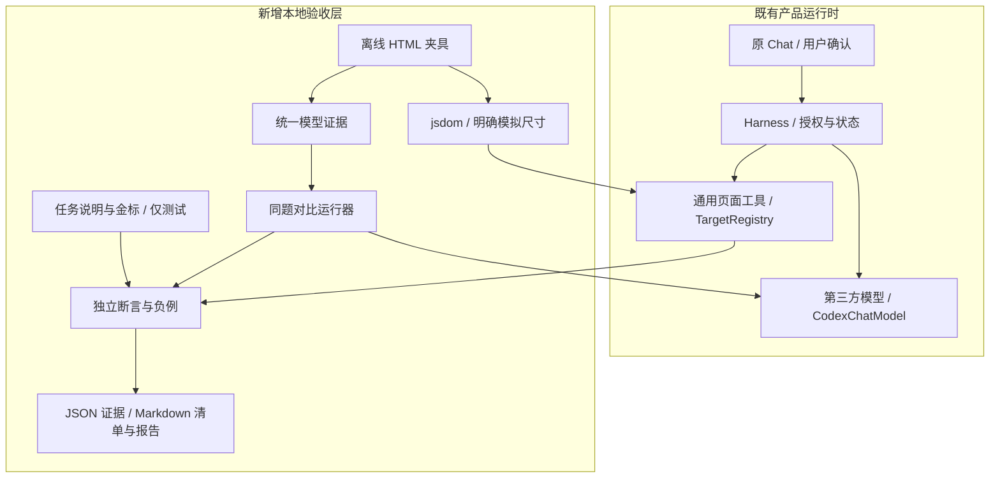

# V4.1 技术方案

## 架构

夹具、金标、模型评估器只位于 tests/scripts，不进入 src/harness/bridge 的产品依赖。数据流单向，禁止将站点金标回灌为系统提示词预置规则。

## 本地执行

Vitest 单独配置加载 tests/v4.1；复用生产 TargetRegistry，jsdom 模拟 getClientRects，只断言 DOM、身份、范围、保留及文本结构，不宣称验证 CSS 布局。HTML 无外部资源、无用户数据；合成案例覆盖历史结构问题，标明非真实站点快照。统计用整数分计算，避免浮点误差，金标独立常量。

## 模型协议

统一输入为任务与 HTML 证据，输出为 JSON：目标选择器数组、统计结果、是否声称完整覆盖、是否请求页面修改。评估器在 DOM 上解析选择器，按节点集合评分，避免正确但不同选择器误判。HTML 与题目哈希绑定；拒绝无效 JSON、未知字段、缺字段、错误类型；不执行模型生成代码。Codex 使用既有受限 AgentProcess，第三方使用显式环境变量的兼容接口；不读取浏览器存储或输出凭据。超时与服务错误独立计数，不吞错重试刷分。

此层验证固定 HTML 上的单轮任务理解，不等于 Harness 多轮工具使用或真实页面处理能力；生产授权由既有自动门禁验证。

## 风险与边界

jsdom 不验证渲染、滚动、布局和真实跨域。不能以选择器结果替代完整脚本执行验收。数据统计目前是评估任务，产品端到端仍需独立验证。真实模型不能访问时保存失败证据并保持待验，不启用假模型顶替。

## 用户确认后的实施补充

用户确认独立项目通用PRD、不关联LUCP和度量，正式PRD已完成。现有第三方配置为MiMo mimo-v2.6-flash，已授权只读复用。evaluate-v41-existing.py按显式Profile/扩展ID解析当前未压缩Chrome存储日志，仅在子进程环境传递密钥；不打印或保存凭据。压缩存储不支持时失败关闭，不猜测旧值。

协议v41-2将动作/筛选目标与只读统计证据分开，纯统计targets为空；目标范围要求完整、互不重叠。题集HTML及金标不变，两后端使用同一新系统指令。第三方JSON模式temperature=0，Codex严格Schema且账号默认采样；对比报告记录这些混杂因素，不声称纯模型能力排名。第三方显式沿用现有thinking配置；原基线为服务端默认thinking，不能把前后差异全部归因于提示词。
