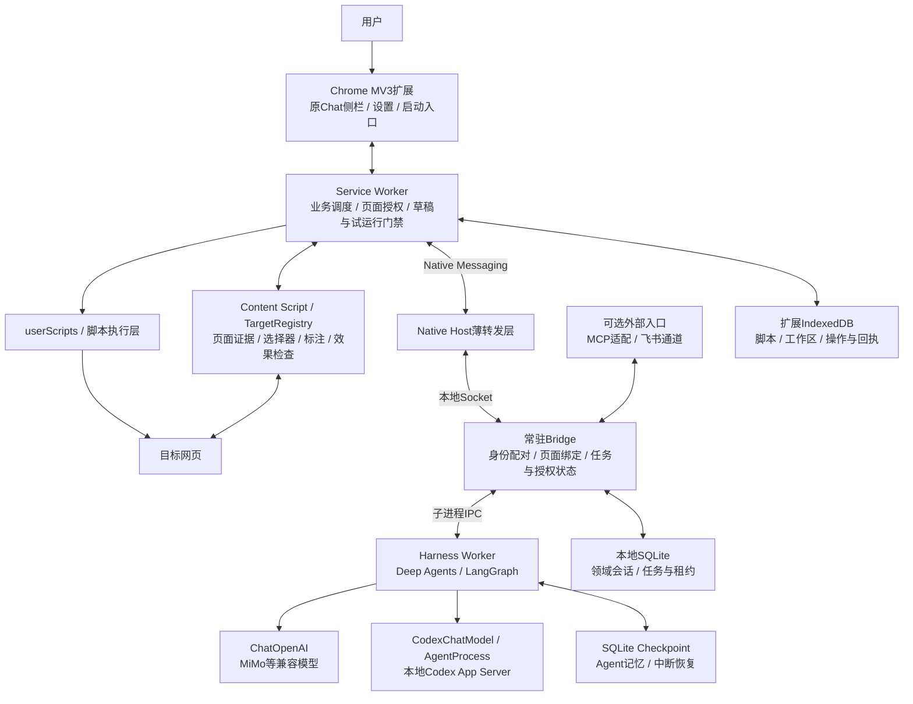
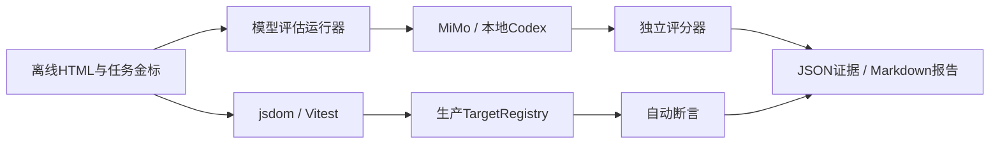

# Luban 当前系统架构

日期：2026-10-19。依据当前源码核对，区分产品运行时和V4.1验收设施，不代表未来规划。

## 模块与职责

| 层 | 当前实现 | 职责 |
|---|---|---|
| 交互 | src/sidepanel、options、launcher；Preact | 对话、候选与方案展示、明确确认、设置 |
| 扩展调度 | src/service-worker；HarnessGateway、PageGrants、工作区服务 | 请求路由、页面与工作区绑定、代码检查、草稿、试运行、保存门禁 |
| 页面能力 | src/content，尤其annotations/registry.ts | 有界结构证据、目标身份与唯一性、标注、目标变化和非目标区域检查 |
| 执行 | 扩展userScripts及相关执行服务 | 经独立授权后执行脚本；模型不能直接修改网页 |
| 本地接入 | bridge/src/bridge-host.mjs、local-daemon.mjs | Native Host转发，Daemon维护本地服务、Profile、任务及外部入口 |
| 领域控制 | bridge/src/harness-domain.mjs、harness-service.mjs | 需求/目标/方案版本、确认与授权、任务幂等、并发隔离、Worker生命周期 |
| Agent编排 | harness/src/runtime.ts、worker.ts；Deep Agents/LangChain/LangGraph | 模型推理、有限工具调用、生成中断与恢复；工具调用交回Bridge裁决 |
| 模型适配 | ChatOpenAI、CodexChatModel、AgentProcess | 第三方兼容接口或本地Codex；本地Codex禁止自行调用宿主工具 |

现有扩展内部还保留直接调用兼容模型接口的分析/生成服务；上图展示当前V4会话的Bridge/Harness主链路，不表示所有历史功能都已迁入Harness。MCP/飞书属于可选外围接入，不是Chat主链路必经项；仓库中仍有旧S0探针，不能按探针README判断当前Daemon能力。

## Agent当前工具边界

仅开放五种领域工具：propose_requirement、read_page_context、propose_targets、propose_plan、request_generation。工具用于提议和请求，不能替用户确认、直接运行或保存。当前结构化改造方案为hide/dim，不是任意网页编辑框架。生成走独立候选制品流程。

## 持久化

- Chrome IndexedDB：脚本、工作区、对话、操作、执行回执、页面授权、批准记录等。
- chrome.storage.sync：非敏感设置；chrome.storage.local：模型凭据与配对信息。
- Bridge SQLite：领域会话、任务、事件与并发/租约等本地状态。
- Harness SQLite Checkpoint：Agent消息、中断与恢复状态；与领域授权状态分开，恢复记忆不等于恢复旧授权。

## V4.1本地验收链路

该层位于tests/scripts，不进入产品运行时。模型评估直接验证固定HTML的单轮输出，不走完整生产Harness授权/工具循环，也不执行模型输出。统计目前是验收任务，不是新增的生产统计引擎。jsdom模拟尺寸；真实Chrome/Native/视觉需另行抽验。

## 关键控制点

1. 页面证据不等于业务目标，业务含义由模型结合用户需求分析。
2. 目标确认、生成、运行、保存分别授权。
3. 页面、节点、范围、方案或代码变化后，相关旧确认必须重新验证。
4. 检查同时考虑确认范围与非目标保留，局部通过不等于完整业务目标达成。
5. 网站与广告规则仅作测试案例，不下沉为运行时适配器。
