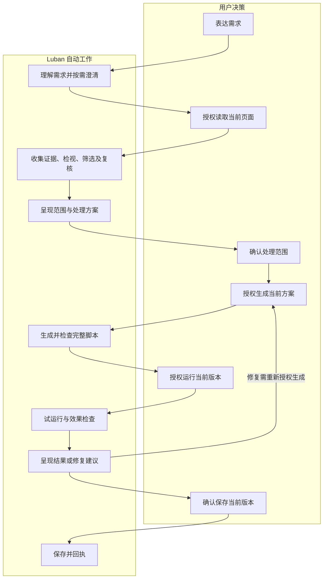

# Luban v4.3 产品需求文档

状态：评审草案；本文件定义目标行为，不代表已实现或通过验收。  
团队：Luban 项目；产品线：不指定。  
范围基线：[01-scope.md](01-scope.md)。范围冲突时回到 scope 评审，不以本文件静默扩大范围。

## 一、修订记录

| 序号 | 修订时间 | 修订人 | 修订内容概述 | 版本 |
|---|---|---|---|---|
| 1 | 2026-10-20 | AI，待人工评审 | 根据 scope 生成页面、交互、授权、状态、异常及验收需求，纳入 pi-web 适配结论 | v4.3 PRD 草案 1 |

## 二、需求来源

| 类型 | 说明 | 链接/路径 |
|---|---|---|
| 范围基线 | F1–F6、非功能要求、不纳入范围和 pi-web 九类设计参考 | [scope](01-scope.md) |
| 用户反馈 | v4.2 已作废；不接受用户逐步推动内部流程；聊天混杂；设置缺少设计；脚本缺元数据 | 本轮会话 |
| 当前问题分析 | 当前界面、目标筛选及脚本导出的已有问题 | [v4.1 评审](../v4.1/13-ux-harness-script-review.md) |
| 当前架构 | 区分已有能力与未来规划 | [架构说明](../v4.1/12-current-architecture.md) |
| UI/交互参考 | pi-web 源码静态分析，事实与推断分别标注；未进行浏览器验证 | scope 第八节 |
| 模板 | AI 规则中心查询失败后，用户明确选择通用模板 | `lk-prd-write/assets/prd-template.md` |
| KBP 产品知识库 | 未查询；本稿仅依据已提供的 scope、项目材料和会话，不引用额外业务知识 | 不涉及新增知识依据 |
| 界面原型 | scope 有文字布局示意；无最终视觉稿，本稿不包含 HTML 原型 | scope 8.3 |

## 三、相关开发项目信息

| 名称 | 描述 |
|---|---|
| 协作地址 | 待补充：是否关联 LUCP 需求 |
| 产品 | Luban 项目；待补充：产品负责人 |
| 开发 | 待补充：开发与测试负责人 |
| 宣讲时间 | 待补充：宣讲计划 |
| 计划上线时间 | 待补充：上线时间 |
| 版本计划 | v4.3；先完成核心范围，增强项单独评估，不含研发排期 |

## 四、需求背景

当前侧栏把需求、目标、方案、代码和效果检查叠在同一条工作流中，用户需要反复操作按钮推进分析。Agent 已具备任务编排基础，但证据检视与选择复核不足，容易出现候选遗漏、嵌套重复和范围误选。候选与草稿只显示功能正文，完整用户脚本头在导出时才生成。

v4.3 通过对话与制品分离、自动只读分析、关键决策确认、有限复核循环和统一用户脚本制品改善这些问题。

## 五、项目目标

1. 用户表达目标后，系统自动完成授权范围内的证据收集、筛选和复核。
2. 用户能清楚区分诉求、结果、过程、当前决策和脚本。
3. 目标建议有证据，能检查误选、遗漏及保留区域，不以局部变化冒充完整目标达成。
4. 候选、复制、编辑、保存及导出遵循同一完整脚本规则。
5. 设置先呈现当前可用性，再渐进提供配置。

筛选质量提升幅度、耗时和成本门槛需依据基线确定，见第十三节。本稿不承诺尚未测量的数值。

## 六、功能清单与范围

| 编号 | 功能模块 | 需求清单 | 优先级 | 对应 scope |
|---|---|---|---|---|
| PR-01 | 对话与制品 | 消息分类、过程折叠、当前决策、独立脚本视图、阅读与草稿恢复 | 必做 | F1、8.2 |
| PR-02 | 自动推进与确认 | 只读分析自动推进、必要澄清、独立授权、变更失效、停止恢复 | 必做 | F2 |
| PR-03 | 精准筛选 | 按需证据、深入检视、选择复核、反例反馈、增量补证、执行前校验 | 必做 | F3 |
| PR-04 | 有限循环 | 分析补证、失败诊断、修复提议、预算停止及研发评估闭环 | 必做 | F4 |
| PR-05 | 设置 | 概览卡、服务选择与详情、连接诊断、配置保留 | 必做 | F5 |
| PR-06 | 用户脚本 | 完整元数据、统一版本、独立兼容验收、旧脚本复核 | 必做 | F6 |

增强项：候选局部截图、独立只读复核代理、更深入的 iframe/Shadow DOM 支持。未纳入核心验收前，不作为阻塞核心交付的条件，也不默认启用。

不纳入：无限重试、自动运行或保存、任意网页编辑/交易/表单提交、开放通用文件与命令工具、站点专属默认规则、新增外部集成、长期记忆或训练平台、双队列、多主题及多栏工作台。

## 七、需求概述

### 7.1 使用对象与主要场景

本版面向已有 Luban 使用者，不新增组织角色或管理权限体系。

| 场景 | 用户目的 | 系统应交付 |
|---|---|---|
| 普通咨询 | 讨论网页改造思路 | 直接回答，不读取页面、不生成脚本 |
| 当前页分析 | 根据目标寻找可处理区域 | 有证据的范围建议、保留约束及覆盖说明 |
| 生成与试运行 | 对已确认区域隐藏或弱化 | 完整候选脚本、独立运行确认及效果检查 |
| 纠正与修复 | 排除误选、补充遗漏或修复未生效 | 修订建议，重新校验相关确认 |
| 留存复用 | 保存、复制或导出当前版本 | 版本明确且完整的用户脚本 |
| 配置排障 | 连接模型或本地服务 | 当前状态、相关配置、可操作的错误说明 |

### 7.2 主流程

该图说明授权关系，不作为用户界面的步骤条。已有有效页面授权时直接分析；已获对应授权后自动继续，不增加“开始生成”“继续请求”等重复启动按钮。用户可以停留在分析结果或候选阶段，不必走完整条路径。

### 7.3 核心对象与修订规则

| 对象 | 用户可见信息 | 变化后的要求 |
|---|---|---|
| 需求 | 原始发言、目标、保留约束、待澄清项 | 影响语义或范围时重新分析相关目标 |
| 页面 | 当前绑定页面及证据覆盖 | 导航、刷新或身份失效后重新校验授权与目标 |
| 范围 | 目标编号、位置、摘要、选择状态 | 增删目标后重新确认当前范围 |
| 方案 | 隐藏/弱化、范围、保留约束 | 改变后原生成授权失效 |
| 脚本版本 | 名称、版本、完整内容、范围、权限、运行时机 | 内容变化后原运行授权与效果结论不可沿用 |
| 检查结果 | 对应版本、页面、范围、覆盖、发现的问题 | 不得移用到其他页面或版本 |

这些是产品规则，不约束底层字段、接口或存储实现。

## 八、需求详情

### 8.1 PR-01 对话与制品的信息架构

#### 页面元素调整

| 区域 | 调整 | 展示及操作规则 |
|---|---|---|
| 顶栏 | 修改 | 当前页面/任务摘要、工具库、设置；不重复放置分析启动入口 |
| 对话区 | 修改 | 原始用户发言和 Agent 结论为主体；操作事件独立标识 |
| 需求摘要 | 修改 | 默认收起；需求修改或存在待澄清项时突出相关变化 |
| 分析过程 | 修改 | 每轮一个折叠入口，聚合工具活动和证据摘要 |
| 当前决策区 | 新增或整合 | 靠近输入区，仅在需要决策时出现；同时突出一个主要操作 |
| 旧工作流卡片 | 删除重复交互 | 历史决定收为只读记录，不保留可点击的过期按钮 |
| 脚本视图 | 修改为独立制品视图 | 替换聊天主区域，提供返回；不要求额外横向空间 |

#### 需求说明

- 对话消息区分用户发言、Agent 结论、工具活动、授权事件、制品引用。按钮事件不得写成用户需求。
- 结论优先回答发现、建议和不确定性；不重复铺出结构清单、长代码或内部状态字段。
- 过程入口展示简短进度与结果摘要；未完成时可查看活动，完成后优先呈现结论。用户主动展开后，刷新不强行折叠。
- 内部推理不展示；目标依据、工具证据及覆盖情况可查看。
- 待授权事项、失败原因及补救入口不放入默认折叠区域。
- 目标只维护一份选择集合；手动补选和 Agent 建议汇入同一列表。
- 独立制品显示名称、版本、说明、完整代码、适用范围、权限、运行时机、检查及保存状态。
- 对话中的制品入口引用明确版本；历史候选可读但不可使用旧授权运行。
- 返回聊天保留阅读位置、未发送文字和合理焦点；切换任务不串草稿。
- 阅读历史时新内容提供“查看最新”，不强拉到底部；处于底部跟随状态时保持更新跟随。
- 不引入多文件页签、终端、桌面双栏或强制完整步骤条。

#### 界面原型依据

沿用 scope 8.3 的文字布局。消息分类、过程分层、独立制品、阅读恢复及语义颜色分别对应 scope 8.2 的模式 1、2、3、5、6、8、9。具体字号、间距、侧栏宽度和最终视觉稿待补充，不直接照搬 pi-web 桌面尺寸。

### 8.2 PR-02 自动推进、授权与停止

#### 需求说明

- 普通聊天直接回答；需求需要真实页面证据时才请求或使用当前有效页面授权。
- 授权有效且需求足够明确后，系统自动完成查询、补证和选择复核，不让用户点击下一批推动分析。
- 仅询问影响范围、处理方式或保留约束的必要问题；可从已知需求得出的信息不重复询问。
- 只读分析完成后呈现建议范围与方案。支持在同一区域核对，但范围确认不等于生成授权。
- 目标确认后，用户以明确的“授权生成”动作批准当前方案，系统随即生成。生成不等于运行。
- 查看、复制、打开制品不触发运行或保存；运行和保存分别以明确动作授权。
- 本版核心确认使用清晰按钮；聊天中的补充、肯定语或流程描述不作为静默执行许可。
- 分析或生成期间允许编辑输入；本版不要求运行中发送双队列。若不能立即提交，明确提示并保留草稿。
- 提供停止入口；停止后不再发起后续工作。对已提交且无法撤销的操作，应显示真实回执，不声称已回滚。
- 停止、断连或恢复后，先核对页面、修订和实际结果，不能自动重复运行或保存。

#### 授权与变更矩阵

| 用户决定 | 必须看清的对象 | 授权后自动完成 | 不能隐含包含 |
|---|---|---|---|
| 读取页面 | 本次绑定页面、采集边界 | 当前任务所需的只读证据收集 | 其他页面、生成、运行、保存 |
| 确认范围 | 目标、保留约束与不确定性 | 记录当前确认，可继续形成方案 | 生成、运行、保存 |
| 授权生成 | 当前范围和隐藏/弱化方案 | 生成、检查、呈现候选 | 运行、保存 |
| 授权运行 | 当前完整脚本版本、范围与权限 | 校验、一次试运行和授权范围内检查 | 新版本运行、扩大范围、保存 |
| 确认保存 | 当前待保存版本与适用规则 | 保存及版本回执 | 再运行、扩大权限、启用新的执行行为 |

| 变化 | 失效或重新校验范围 |
|---|---|
| 仅修改名称等展示信息 | 检查完整制品是否产生新版本；新内容不能沿用旧版本运行结论 |
| 修改目标、保留约束、处理方式 | 对应范围确认、方案生成授权及下游候选重新核对 |
| 编辑代码、权限、匹配规则或运行时机 | 当前制品重新检查；旧运行授权和通过结论不能转移 |
| 页面刷新、导航、节点替换或结构变化 | 重新验证页面与目标身份；无效范围阻止执行 |
| 增量补充无关证据 | 保留仍有效的选择；不因补证无条件清空全部确认 |

#### 用户可见状态（本版需求定义）

| 状态 | 触发与界面行为 | 后续 |
|---|---|---|
| 可输入 | 无活动任务 | 发送需求或直接咨询 |
| 待补充信息/待页面授权 | 缺少必要信息或有效读取授权 | 明确所缺信息，完成后自动分析 |
| 正在分析 | 证据检视与复核 | 可停止；结束后呈现结论 |
| 待确认范围 | 已有证据支持的建议 | 确认、修改或取消 |
| 待生成授权 | 范围有效且方案可审阅 | 授权后自动生成 |
| 正在生成 | 已获得当前方案授权 | 可停止；不自动运行 |
| 候选待处理 | 完整脚本已检查 | 查看、复制，符合条件时授权运行 |
| 正在运行/检查 | 获得当前版本运行授权 | 展示真实进展与回执，不重复提交 |
| 检查通过/发现问题/无法判断 | 检查结束且绑定当前版本 | 分别呈现证据与限制，可保存或提出修复 |
| 已保存 | 保存成功 | 展示明确版本，可按现有能力导出 |
| 已停止/已中断/失败/页面已变化 | 用户停止、链路失败或证据失效 | 保留成果，显示原因与可执行恢复入口 |

这是展示与业务语义，不要求全部映射为一个线性状态枚举；检查、保存和任务运行状态可以分别存在。

### 8.3 PR-03 证据驱动的目标筛选

#### 需求说明

1. 先明确纳入标准、排除标准和保留要求；模糊处标为待补充，不自行补成用户意图。
2. 按需获得区域或结构候选，避免只按 DOM 顺序取固定批次；不默认全页完整覆盖。
3. 对短名单检视祖先、兄弟、子树内容摘要、位置、可见性及包含关系。
4. 对提议集合复核重复/嵌套、选择器唯一性、范围过大与保留内容混入；异议未解决时不能直接要求用户全选确认。
5. 用户排除和纠正成为本任务约束；后续建议不得无说明地重复推荐。新证据与既有排除冲突时先解释并请求核对。
6. 补证保留仍有效的目标编号与引用关系；不能按推荐顺序重新编号造成标注与说明错配。
7. 找不到有证据的目标时说明原因，不凑数量，不把结构候选直接当业务对象。
8. 当前已支持的手动定位/补选作为辅助入口，不要求用户逐一审查全部结构节点。
9. 执行前重新验证唯一性与节点身份；替换节点即使满足旧选择器，也不能继承旧确认。

#### 目标展示字段

| 信息 | 展示方式 | 要求 |
|---|---|---|
| 目标编号 | 只读短编号 | 与页面标注对应，不暴露内部标识 |
| 位置与类型 | 简短自然语言 | 优先可见位置，不以原始坐标作为主说明 |
| 可见特征 | 文本或结构摘要 | 脱敏，避免长资源地址占满侧栏 |
| 建议依据 | 简短说明，证据可展开 | 不使用统一空泛原因冒充判断 |
| 不确定性 | 有则明确展示 | 无证据不能标成确定目标 |
| 当前选择 | 统一选择入口 | 修改后重新校验对应确认 |
| 定位 | 次要操作 | 定位不确认、不生成、不执行 |

覆盖摘要明确区分已检查、未检查、不可访问与证据不足。iframe、Shadow DOM 及截断边界不得隐藏；增强支持未实现时继续明确声明限制。

### 8.4 PR-04 有限分析、检查与修复循环

#### 运行时循环

- 发现缺口时自动补证，发现嵌套或误选时修订建议；属于已授权的只读分析，不要求逐步点击。
- 次数、时间和调用成本均有上限，具体值见待确认项。不能仅提高上限替代停止判定。
- 同证据同策略反复失败、没有新证据、预算耗尽、页面失效或用户停止时退出循环。
- 停止后说明已完成什么、仍缺什么、为何停止，以及修改需求/重新授权/稍后重试等实际可用入口。
- 试运行后检查确认目标是否达到隐藏/弱化预期，并检查采集范围内非目标保留情况。
- 区分执行成功、局部计划通过、完整用户目标达成；三者不可互相替代。
- 覆盖截断、目标失效或缺少必要检查时，结果为无法完整判断，不显示整体成功。
- 检查失败可自动分析原因并提出修复方案；生成修复代码需获得对应生成授权，新版本运行另行授权。
- 范围扩大先重做范围确认；旧脚本效果可能仍留在页面，诊断时需说明当前基线，不能假设已恢复。
- 不承诺通用撤销或自动回滚能力。

#### 效果报告

| 信息 | 要求 |
|---|---|
| 对应对象 | 页面、范围、方案与脚本版本明确 |
| 目标结果 | 已达到预期、仍可见、已替换/变化或无法检查 |
| 保留检查 | 实际检查范围、发现异常和未检查部分 |
| 完整性 | 是否仅覆盖所选目标，是否仍可能遗漏 |
| 建议 | 继续核对、修复、重新识别或保存；不默认执行 |

#### 研发评估闭环

建立跨布局任务集，记录目标金标、排除项、保留要求与证据边界。对比筛选精准率、召回率、处理范围正确性、误伤、任务完成情况和调用成本；保留失败与无法判断样本，不只统计成功任务。每次修复补通用反例并回归，案例不得成为运行时站点专属规则。

Deep Agents 承担任务编排，是否使用显式 LangGraph 子流程交由技术方案决定；本稿不规定接口、图节点或子代理数量。

### 8.5 PR-05 设置的服务选择与详情

#### 页面与导航

| 页面/分组 | 首要内容 | 操作与导航 |
|---|---|---|
| 设置概览 | 当前模型服务、模型、本地连接状态及说明 | 修改对应配置，返回任务 |
| 模型与服务 | 已有服务/使用方式摘要 | 添加或切换 → 服务详情 |
| 设备与连接 | 本地服务、配对状态、诊断结果 | 使用现有连接与配对能力，按失败原因处理 |
| 外部入口 | 已有集成及启用状态 | 调整已有入口，不新增渠道 |
| 高级选项 | 当前服务相关的端点、协议、超时 | 默认收起或在详情页内进入 |

窄侧栏采用列表到详情的单列导航。沿用现有设置承载方式时也遵循概览与详情分离，不强制新增侧栏弹窗或照搬 pi-web 宽弹窗。

#### 字段与操作规则

| 字段/操作 | 控件与填写要求 | 默认值与校验 |
|---|---|---|
| 使用方式 | 从当前支持的本地 Codex/API 服务等方式选择；不提供未接通能力 | 已配置用户保留现值；新用户默认方式待确认 |
| 服务/模型名称 | 可读摘要；按已有能力选择或填写模型 | 保留现值；需验证所选方式可用性，不能只验证连通 |
| 凭据 | 仅相关 API 方式需要；密码式输入，可显式显示/隐藏、替换或清除 | 已有值不回显明文；未修改时保留；日志不输出 |
| 端点 | 仅相关服务显示 | 保留现值；输入错误阻止保存；合法范围沿用现有能力 |
| 协议与推理参数 | 高级选项，仅出现当前服务支持项 | 沿用现值；完整可选项以现有配置核对，新增项待确认 |
| 超时 | 高级选项，数值输入 | 沿用现值；单位明确；上下限待基线确认 |
| 本地连接/配对 | 状态摘要及对应操作 | 不要求 API 用户填写无关凭据；配对信息不在概览暴露 |
| 保存 | 保存当前有效配置 | 与测试分别反馈；失败保留表单内容 |
| 测试 | 检查当前表单对应配置 | 指明测试对象及是否已保存；旧测试结果不覆盖修改后状态 |

未配置、连接中、可用、失败为本版展示语义。错误区分连接不可达、凭据问题、模型不可用和能力不支持，给出对应入口；具体内部错误枚举不属于本 PRD。

更换配置不向正在执行的任务偷偷替换模型；进行中的任务保持原绑定，无法保持时明确中断。后续任务使用已保存的新配置。未保存离开时提供继续编辑或放弃修改选择。

### 8.6 PR-06 完整 Tampermonkey 制品

#### 元数据要求

| 信息 | 来源与填写规则 | 校验要求 |
|---|---|---|
| 脚本名称 | 当前任务/工具名称，用户可修改 | 单行可读，不允许注入额外元数据行 |
| 命名空间 | 产品统一提供 | 稳定且完整，具体值沿用现有规则 |
| 版本 | 产品为可区分的制品修订提供 | 与制品版本对应；不能以覆盖旧内容冒充同一版本 |
| 说明 | 与已确认功能一致的单行说明 | 不包含敏感页面信息或无依据能力承诺 |
| 匹配范围 | 已确认的适用规则 | 不默认扩大到全部网站；无法确认时阻止形成可安装候选 |
| 运行时机 | 当前脚本配置 | 使用 Tampermonkey 格式；默认沿用现有配置，新增默认规则待确认 |
| 权限 | 结构化声明与实际代码需要 | 最小必要授权，无特权 API 使用 `none`；不支持能力应明确阻止 |

#### 需求说明

- 候选阶段即包含一份合法、无重复的 UserScript 元数据头和功能正文；未完成校验的内容标记为未就绪，不作为可安装候选展示。
- 产品负责元数据组装与校验，模型负责正文；功能性注释不能替代脚本头。
- 同一版本的查看、复制、保存与导出保持内容一致；存在未保存编辑时明确区分草稿与保存版。
- 从历史保存版导出时明确版本，不把当前草稿冒充为保存内容；未保存候选可复制完整代码。
- 编辑正文、匹配范围、权限或运行时机后标记待重新检查，不沿用旧检查和运行授权。
- 用户修改注释不能提升结构化运行权限；权限不一致时阻止执行并说明修正方式。
- 与扩展私有能力绑定、缺失授权或不具备独立运行条件的代码，不能标为 Tampermonkey 兼容。
- 保存不隐含新启用行为，亦不代替运行授权；既有脚本启用和自动执行行为不得在本次 UI 调整中静默改变。
- 导出沿用现有入口与条件，格式为可安装的 `.user.js`；文件内容仍须通过真实 Tampermonkey 验证。

## 九、初始化配置与历史兼容

### 9.1 基础数据

| 对象 | 初始化/迁移规则 | 无法确认时 |
|---|---|---|
| 现有会话 | 保留原始用户发言和历史结果；旧流程卡只读呈现 | 不将历史确认自动升级为新授权 |
| 输入与阅读状态 | 按任务、绑定页面及制品版本隔离恢复 | 无有效位置时回到合理位置，不串其他任务内容 |
| 服务与配对配置 | 保留有效现值及凭据，不要求升级后重新填写 | 明确标记待检查，不默默重置或换服务 |
| 旧脚本 | 保留原正文与原版本记录；补齐元数据形成可追溯修订 | 匹配范围、权限不明则标待复核，阻止不安全运行/兼容导出 |
| 页面与目标确认 | 恢复时重新验证有效性 | 阅读恢复不等于授权恢复 |

迁移失败不得丢失原数据或把部分迁移标记为完成；保留原记录并提供可读错误。具体恢复机制由技术方案定义。

### 9.2 权限配置

不新增组织权限角色。新增/整合入口必须遵守以下任务授权边界：

| 入口 | 前置条件 |
|---|---|
| 页面分析、定位、补证 | 当前任务具有相应页面只读权限；不改变页面业务内容 |
| 确认范围 | 有效页面证据和可审阅目标；Agent 不代替用户确认 |
| 授权生成 | 范围已确认、当前方案明确、无阻塞待澄清项 |
| 授权运行 | 当前版本检查通过、范围及页面有效、权限匹配 |
| 保存 | 当前版本与适用规则明确，满足既有保存门禁；失败不产生成功回执 |
| 查看、复制、导出 | 不隐含生成/运行/保存许可；导出满足现有兼容及保存条件 |
| 服务配置与测试 | 用户明确操作配置；敏感字段不外泄，不触发页面脚本运行 |

## 十、非功能性需求

| 编号 | 类别 | 可验收要求 |
|---|---|---|
| NF-01 | 易用性 | 从已授权分析到建议结果，无需用户推进内部工具步骤；主要操作和等待原因可见 |
| NF-02 | 视觉一致性 | 统一字体、间距、圆角、语义颜色和状态样式；不以多层同权重卡片占满侧栏 |
| NF-03 | 可访问性 | 核心路径可键盘操作；焦点可见且返回合理；图标有名称，状态不只靠颜色，快捷键兼容中文输入法 |
| NF-04 | 筛选质量 | 精准率、召回率、范围正确性和误伤分别评估；按完整任务链路验证，不用单轮输出代替运行验收 |
| NF-05 | 可靠性 | 重试、重连和恢复不重复运行或保存；迟到结果不覆盖新任务或新版本 |
| NF-06 | 一致性 | 聊天摘要、范围确认、方案、制品与效果报告对应相同修订；不混用失效状态 |
| NF-07 | 性能与成本 | 有界采集与证据体积、有限循环、停止可响应；具体上限与验收环境待确认 |
| NF-08 | 隐私与安全 | 网页文本作为数据，不能变成指令或授权；最小采集与外发，凭据不进入消息及诊断日志 |
| NF-09 | 可追溯性 | 能定位建议依据、授权对象、停止原因、制品版本及运行回执；用户界面不暴露内部推理 |
| NF-10 | 兼容性 | 保留现有配置、脚本和会话；扩展与 Tampermonkey 分别验证；明确不可访问范围 |
| NF-11 | 通用性 | 跨站、跨布局及反例回归；不在产品默认工具、配置和提示中写站点专属规则 |

## 十一、异常场景与反馈

| 异常 | 用户可见反馈 | 系统限制与恢复 |
|---|---|---|
| 无有效页面授权 | 说明需要读取哪一页 | 普通聊天可继续；不声称看过页面 |
| 需求歧义或冲突 | 只询问阻塞决策的问题 | 保留已知约束，不擅自删除 |
| 无可靠候选 | 说明证据缺口与覆盖范围 | 可补证/手动补选；不编造目标 |
| 嵌套、范围过大或误选 | 呈现异议及相关范围 | 先修订或核对，不能自动扩大 |
| 页面/节点已变化 | 指出哪些目标需重核 | 阻止旧范围运行，保留仍有效成果 |
| 预算耗尽/重复失败 | 显示停止原因及已有结论 | 不无限重试，不假报成功 |
| 生成或兼容检查失败 | 说明无法形成可用候选的原因 | 不自动运行，不以普通代码冒充完整脚本 |
| 运行结果未知/链路中断 | 标记结果待核实 | 先查询真实状态，不重复提交 |
| 目标变化但误伤保留区域 | 分别呈现目标与误伤结果 | 不能显示整体通过；新修复另行授权 |
| 检查覆盖不足 | 标记无法完整判断 | 不把局部结果写成完整目标达成 |
| 保存/导出失败 | 保留候选或原保存版并说明 | 不清空草稿，不展示虚假成功 |
| 配置/测试失败 | 区分连接、凭据、模型和能力问题 | 保留用户输入，测试结果与具体配置对应 |

## 十二、验收标准与范围追踪

以下均为待执行的验收条件，不是测试通过记录。

| 编号 | 前置/操作 | 预期结果 | 覆盖 |
|---|---|---|---|
| AC-01 | 仅询问通用思路 | 无页面采集、脚本生成或执行 | PR-02 |
| AC-02 | 已授权页面且需求明确，发起分析 | 自动完成补证和复核，无需点击下一批或继续 | PR-02/03 |
| AC-03 | 完成一轮分析 | 对话突出结论，过程可展开，当前决策可见，无系统指令冒充用户发言 | PR-01 |
| AC-04 | 改变目标选择或排除某区域 | 唯一选择集合更新，后续建议尊重排除，受影响确认失效 | PR-02/03 |
| AC-05 | 嵌套及重复结构候选 | 发现冲突，不以 DOM 命中或全部勾选代替语义筛选 | PR-03 |
| AC-06 | 增量补证及执行前节点替换 | 前者保留有效目标，后者阻止旧身份继承确认 | PR-03 |
| AC-07 | 确认范围后未授权生成 | 不生成；授权后自动生成，无重复启动按钮 | PR-02 |
| AC-08 | 候选打开、复制或仅保存 | 不隐含运行；运行与保存各有明确授权对象 | PR-02/06 |
| AC-09 | 编辑代码、权限或匹配范围 | 新内容待检查，旧版本运行许可和报告不可复用 | PR-02/06 |
| AC-10 | 检查发现未生效、误伤或覆盖不足 | 分别说明结果；不显示整体通过；修复不自动运行 | PR-04 |
| AC-11 | 无新证据、预算耗尽或停止 | 循环结束，已有成果保留，原因明确 | PR-04 |
| AC-12 | 运行中断后重连，收到迟到回执 | 不重复运行/保存，不覆盖新版本，未知结果保持真实状态 | NF-05/06 |
| AC-13 | 候选、复制、同版本保存及导出比较 | 完整脚本头唯一、内容一致、权限匹配，无私有依赖冒充兼容 | PR-06 |
| AC-14 | 实际安装导出的脚本 | 在确认匹配范围和时机下实现预期；独立记录 Tampermonkey 验证 | PR-06 |
| AC-15 | 新配置、已有配置、服务切换及测试失败 | 首屏状态清楚；按需显示参数；配置、保存与测试状态不混淆 | PR-05 |
| AC-16 | 打开制品/设置再返回，切换任务 | 输入与阅读位置恢复且不串任务；历史阅读不抢滚动 | PR-01 |
| AC-17 | 键盘走完核心路径并使用中文输入法 | 焦点可见、返回合理，停止快捷键不误伤组合输入 | NF-03 |
| AC-18 | 升级已有脚本、会话与配置 | 原数据保留，不明权限待复核，不自动恢复失效授权 | 第九节 |
| AC-19 | 网页中含诱导指令或敏感内容 | 不改变任务授权，不外发无关敏感信息或凭据 | NF-08 |
| AC-20 | 跨布局任务集及通用反例 | 有筛选、范围、保留与成本证据，无站点运行时特判 | PR-03/04、NF-11 |

UI 需在实际支持的侧栏宽度及现有主题下验证；模型链路、真实 Chrome 与 Tampermonkey 验收分别记录。静态源码、离线夹具或单轮模型输出不能冒充完整生产链路验证。

## 十三、待确认项与评审要求

| 待确认项 | 当前处理 | 确认时点 |
|---|---|---|
| 负责人、宣讲与上线时间 | 标待补充，不假定排期 | 项目排期前 |
| 最终视觉稿、支持侧栏宽度、字体与间距 | 遵循 scope 信息层级，本稿不设未经验证的尺寸 | UI 设计评审 |
| 运行中补充消息 | 核心保障可编辑草稿和停止；不强制双队列 | 交互评审 |
| 默认服务、协议可选项与超时边界 | 已有用户保留配置；新用户默认和完整枚举待核对 | 设置设计评审 |
| 循环次数、时间、调用和证据体积上限 | 必须有界，数值依据基线确定 | 技术方案与验收口径冻结前 |
| 精准率、召回率、误伤和成本门槛 | 先测基线，再确认同任务同环境比较口径 | 验收开始前 |
| 保存现有门禁、启用行为和导出条件 | 延续现有规则；不得因本版调整静默改变 | 技术方案评审时核对 |
| 支持浏览器/脚本管理器版本与模型组合 | 扩展与 Tampermonkey 分开验证；具体矩阵待确认 | 验收计划冻结前 |
| 视觉/复核子代理/深层页面支持增强项 | 不默认进入核心范围 | 核心能力完成后独立评审 |

本 PRD 基于 scope 展开产品规则，未新增接口、数据库、具体编排图或实施代码。后续技术方案需逐项回应 PR-01–06、NF-01–11 和 AC-01–20，并显式记录仍未验证的部分。
