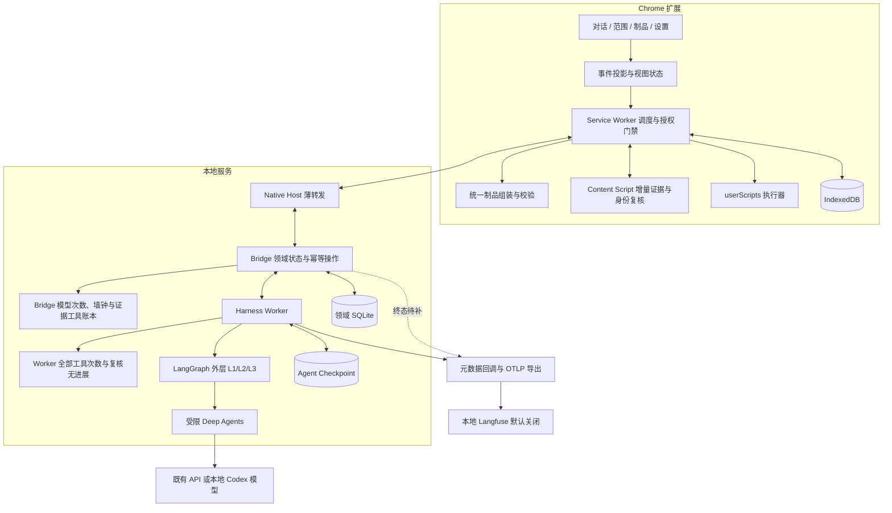
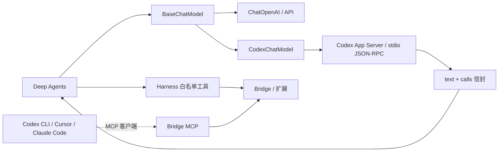
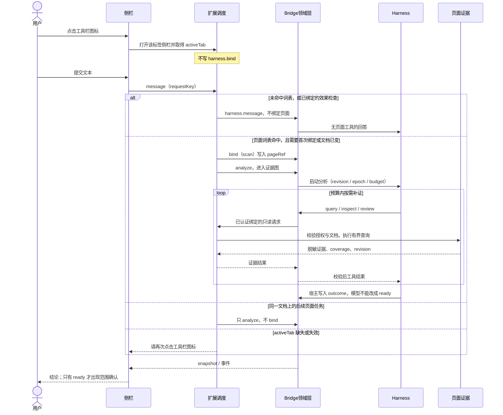
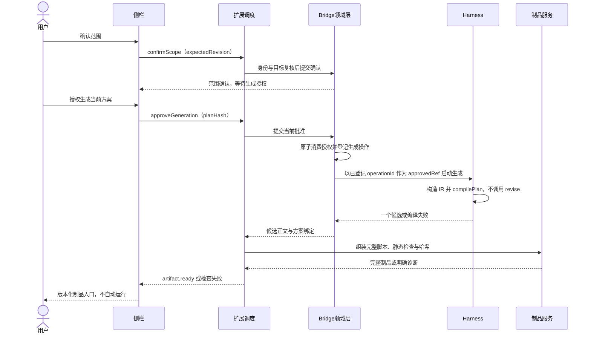
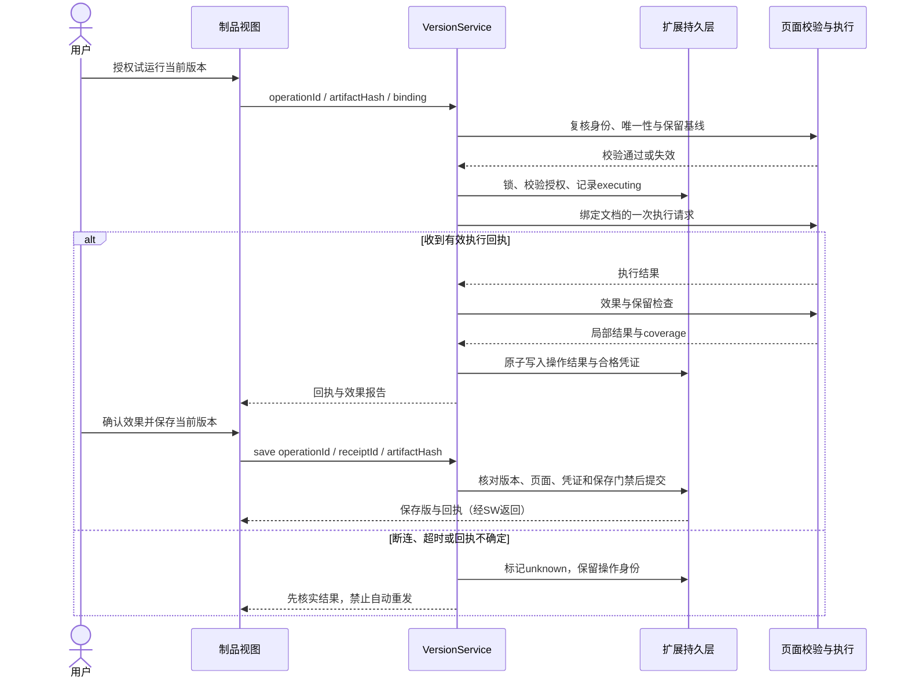
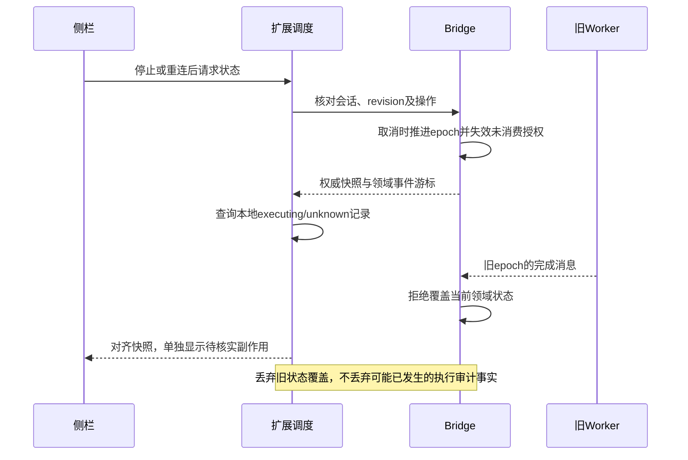
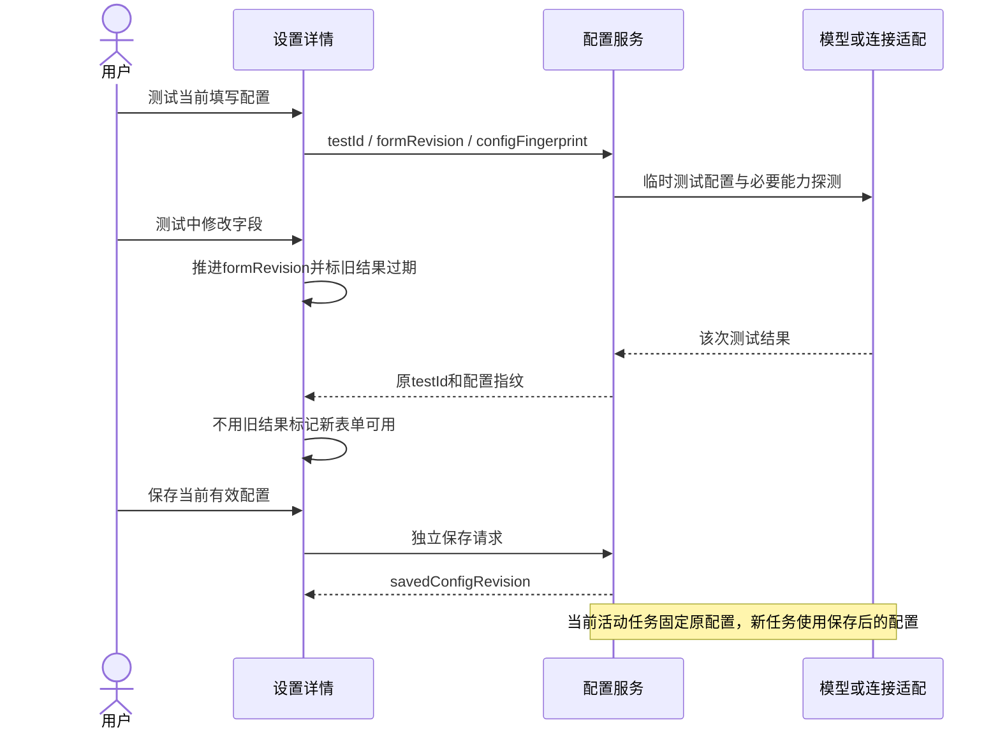
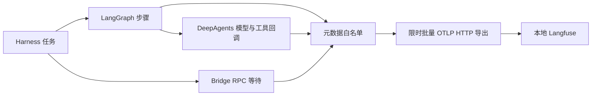

# Luban v4.3 技术设计

> 2026-10-27 更新：结构增强 BM25、批量读取及三组对照已实施；[实施、验收与限制](25-structured-bm25-2026-10-27.md)。仅有限合成样例，完整任务通过数未提升，不作整体准确率或费用承诺。
> 2026-10-27 收敛策略修订见 [预算修复](24-budget-convergence-2026-10-27.md)：保留 8 次总额度，按发现、核实、报告收尾分配；硬停止显示实际已读的部分证据。

> 2026-10-26 实施更新：会话文本、只读工具权限、全领域宿主预算、停止原因、DOM 观察/词法检索和 CSSOM 补证已继续实施；日常观测配置已安装。本文早期“当前实现”段落保留历史断点，最新实现及未验边界见 [继续实施与验收](23-continuation-2026-10-26.md)。架构和独立授权边界不变。

日期：2026-10-20 原稿；2026-10-22 按 Loop 专项与 Langfuse 观测更新。  
状态：当前总设计。架构、授权、本地 Agent、观测、只读出口和失效规则以本文为准。本文不把目标设计写成已全部落地。  
[源码复核](20-technical-review.md) 只保留 2026-10-22 的断点记录，与本文冲突时以本文为准。

依据：[scope](01-scope.md)、[PRD](02-prd.md)、[UI/UX](03-ui-ux.md)、[Demo 边界](04-demo-review.md)。  
细化：[Loop 专项](05a-loop-design.md)、[Langfuse 观测](18-langfuse-observability.md)、[本地部署](19-langfuse-local-deployment.md)。  
DOM 检索仍是待实施补充，见 [17](17-dom-retrieval-agent-design.md)。文中新增名称、契约和存储方案是设计，不是现有 API 声明。

## 一、设计结论

在现有 Preact/MV3 → Native Host → Bridge → Harness 链路上增量演进，不新增服务平台，不重写脚本执行器，不引入第二套浏览器。

1. UI 用类型化事件投影展示交流、过程和制品。视图切换不驱动领域阶段，图节点也不显示成逐步向导。
2. Bridge 裁决需求、范围、方案与生成授权；扩展继续裁决页面读取、运行和保存。模型不能确认、运行或保存。
3. 任务编排采用 **LangGraph 外层流程 + Deep Agents 受限语义节点 + 确定性校验/编译 + 现有领域授权**。Deep Agents 决定看什么、哪些对象符合诉求、如何修订提议；LangGraph 决定能走哪一步、失败退到哪里、何时停止；Bridge 和扩展决定是否真有权执行。
4. 三个 Loop 分开授权：L1 只读补证或结束，L2 一次已批准生成内的确定性编译，L3 真实效果诊断。生产生成路径不调用修订代理。内层 Agent 不中断生成、运行或保存。
5. 当前 hide/dim 走 ScriptPlanIR 和通用模板编译。固定方案可直接编译时，不人为增加模型轮次。隔离夹具宿主和完整图级副作用恢复仍未实现。
6. 观测走 LangChain 元数据回调 → OpenTelemetry span → 本地 Langfuse OTLP。默认关闭，只上传白名单元数据，不作为批准、业务成功或领域事件库。
7. 执行结果未知时先核实，不把重试说成跨进程恰好一次。
8. Deep Agents 只通过 `BaseChatModel` 调用模型。本地 Codex 是受限模型后端，不是对等 Agent；Cursor、Claude Code 未接入这条链路。

不包含视觉识别、深层 iframe/Shadow DOM、站点规则、任意工具、自动运行/保存、自动回滚，以及点击、填写、登录等通用网页动作。Demo 不接入生产链路。

## 二、设计时基线与当前边界

下表第一列是 2026-10-20 设计时看到的限制，不是当前功能清单。「当前边界」记录 [20](20-technical-review.md) 复核当日的源码差异。目标行为以本文其余章节为准。

| 模块 | 设计时限制 | 目标改造 | 当前边界 |
|---|---|---|---|
| Harness | 5 个领域工具；生成是一次模型调用 | 外层图、query/inspect/review、IR 编译 | 已有 8 个白名单工具和外层证据图；页面任务与普通消息仍分叉 |
| Loop | 8 次模型预算和 recursionLimit，不能表达进展 | L1/L2/L3、分项预算、无进展停止 | 证据图成功仍要求非空选择；次数与 120 秒超时共用一个错误 |
| 生成 | 内层 `request_generation` 自己 interrupt | 外层唯一批准，一次 claim 一个候选 | 生产路径是已批准信封到确定性 hide/dim 编译；无生产修订代理 |
| 页面证据 | 固定批次、扫描会清空注册集 | 增量注册、稳定编号、执行前身份复核 | query/inspect/review 已接入；DOM 结构检索未做 |
| 脚本 | 导出时才补头 | 候选起统一 fullCode 与哈希 | 固定编译和宿主校验已有；新哈希体系不重复另造 |
| 运行/保存 | 分散在扩展与 Bridge | 回执绑定版本，unknown 先对账 | 权威仍在宿主；不把运行/保存再复制成第二套图裁判 |
| 观测 | 无任务级 trace | 默认关闭的元数据追踪 | 代码和本地 v4 smoke 已通过；日常 Bridge 未加载配置 |

已知阻断主流程的断点：新会话缺少只读绑定（F01）、只读没有独立成功出口（F02）、需求更新无条件清掉确认（F03）、页面任务未统一进入外层复核（F04）。预算、停止原因和日常 trace 关联见 F05、F06、F11。

## 三、目标架构

组件是职责划分，不要求一框一个进程。Langfuse 在授权链之外。

对应源码见 [diagrams/architecture.mmd](diagrams/architecture.mmd)。Loop 组合、证据、生成和效果图沿用 [diagrams/loop-composition.mmd](diagrams/loop-composition.mmd)、[loop-evidence.mmd](diagrams/loop-evidence.mmd)、[loop-generation.mmd](diagrams/loop-generation.mmd)、[loop-effect-sequence.mmd](diagrams/loop-effect-sequence.mmd)。

### 3.1 状态所有权

| 事实 | 权威方 | 其他层 |
|---|---|---|
| DOM 节点身份、唯一性、几何与可见性 | Content Script | Bridge 只持脱敏证据，不能凭 selector 恢复身份 |
| 页面授权、草稿、运行与保存凭证 | 扩展 | UI 只提交意图；Bridge 不签发运行许可 |
| 需求、排除项、范围、方案与生成授权 | Bridge | Agent 提议，用户确认，扩展验证绑定 |
| 任务阶段、循环引用、中断位置 | 外层图 checkpoint | 记忆不是批准，也不是 DOM 事实 |
| 阅读位置、折叠、表单 | UI | 不持有可放行执行的开关 |
| 生效配置 | 既有配置仓储 | 单次任务绑定配置修订；测试不自动保存 |
| trace、span、token 与诊断计数 | Harness 导出器 | Langfuse 只接收白名单元数据；导出失败不改变任务结果 |

网页文本是不可信数据，不能变成工具权限或授权。trace 正常不等于元素匹配正确，也不代表获得执行授权。

### 3.2 与本地 Agent 的通信

Deep Agents 需要的是一次有界模型调用：输入消息和允许的工具 schema，输出最终文本或工具调用提议。Codex、Cursor、Claude Code 本身是能持有会话、审批和本机工具的 Agent。两者通信有六种常见接法，不能混用。

| 方案 | 谁编排任务 | 传输 | 本地 Agent 的权限 | 当前是否使用 |
|---|---|---|---|---|
| 模型后端 | Deep Agents | 进程内 `BaseChatModel`；Codex 再起独立子进程 | 只返回文本和工具提议，不执行工具 | **当前 Codex 方案** |
| OpenAI 兼容 HTTP | Deep Agents | Chat Completions；仅 HTTPS 或本机 HTTP | 同样只作模型，不获得鲁班工具执行权 | **当前 API 方案** |
| CLI 一次性委托 | 本地 Agent | `codex exec`、`claude -p`、`cursor-agent` 的子进程输入输出 | Agent 按自身配置使用 Shell、文件和 MCP | 不使用 |
| 完整对等会话 | 编辑器或本地 Agent | ACP，或各家 App Server 的长期线程、审批和工具会话 | 对方持有任务、审批和工具循环 | 不使用 |
| MCP 工具服务 | 本地 Agent | Bridge 暴露 stdio MCP，对方作为客户端 | 对方调用已授权的鲁班工具 | 已有独立入口，不接入 Deep Agents |
| 子代理委派 | Deep Agents `task` | 框架内部再调用另一个 Agent | 子 Agent 接管一段任务 | 已关闭 |

| 方案 | 优势 | 劣势 |
|---|---|---|
| 模型后端 | 编排、预算、授权和工具执行留在 Deep Agents 与 Bridge；本地账号可复用；输出被 schema 限制，便于拒绝越权 | 每次调用拉起子进程，延迟和协议适配成本高；收紧后用不到对方的文件、终端和多步规划能力；Cursor、Claude Code 没有统一的同类接口 |
| OpenAI 兼容 HTTP | 与 Deep Agents 的工具调用原生对齐，接入和观测最直接；无本地 Agent 进程和审批状态 | 需要自备端点和密钥；不继承本机 Codex 登录与额度；兼容端点的工具格式仍可能漂移 |
| CLI 一次性委托 | 能直接使用对方已有的仓库、命令和 MCP 能力，接入表面简单 | 编排权、停止条件和副作用离开鲁班；输出是自由文本，难以绑定 L1/L2 授权；取消、重复执行和 unknown 对账都不可靠 |
| 完整对等会话 | 保留对方的线程、流式输出和人工审批，适合编辑器里的长期协作 | 两套会话、两套审批互相覆盖；对方工具循环可以绕过 Bridge；ACP 与各家 App Server 不通用 |
| MCP 工具服务 | 外部 Agent 按需调用鲁班，页面权限仍由 Bridge 控制；不改动 Deep Agents | 对方决定何时调用以及如何理解结果；不能强制走 L1 复核和 L2 编译；工具多时容易超出已授予范围 |
| 子代理委派 | 可把检索、复核拆给独立上下文，主图仍然存在 | 子 Agent 的工具和恢复边界难审计；两层模型调用放大成本和重复；当前没有业务收益足以抵消授权分叉 |

选择取决于要保住的是编排权还是对方的本机能力。鲁班需要稳定的范围确认、生成批准和未知结果对账，所以主链路只用前两种，把本地 Agent 降成模型。CLI、对等会话和子代理会让对方掌握工具循环，不能接上现有 Loop。MCP 适合用户已在 Codex 或 Cursor 中工作、只偶尔调用鲁班的场景，不替代侧栏里的 Deep Agents。

当前 Codex 的具体协议：

1. Harness 按会话选择 `backend=codex` 或 API。Codex 时构造 `CodexChatModel`，API 时构造 `ChatOpenAI`。Deep Agents 不感知子进程。
2. 每次模型调用启动 `codex app-server --listen stdio://`。临时目录只存活这一次调用，结束即删除；它不替换鲁班会话，历史和中断仍在 Harness checkpoint。
3. 帧是按行分隔的 JSON-RPC：`initialize`、`initialized`、`thread/start`、`turn/start`。`thread/start` 使用临时线程、只读 sandbox、`approvalPolicy=untrusted`。账号登录状态留在 Codex，鲁班不读取 `auth.json`，也不把账号凭据写入 API Key。模型调用默认不再执行 `account/read`。
4. `turn/start` 携带 `outputSchema`。合法结果只能是 `{text, calls}`；`calls` 里是白名单工具名和 JSON 对象参数。Deep Agents 解析后再经 Bridge 执行。Codex 反向要求文件或工具权限时直接拒绝。
5. 子进程配置关闭 Shell、MCP、浏览器、计算机操作、多 Agent、插件、记忆和代码执行。提示也要求它不自行使用工具、命令、文件、网络或子代理。

因此，Codex 在这条链上不是协作者，只是被收紧的模型服务。Cursor 和 Claude Code 没有对应的 `BaseChatModel` 适配器。若要让它们执行鲁班任务，那是上表的 CLI 委托或 MCP 客户端，会把编排权和本机工具权交出去，不能靠更换模型名称接入当前 Loop。

Bridge MCP 是相反方向：Codex CLI 或 Cursor 主动连接鲁班，调用已配对页面上的读取、候选和试运行申请。页面文本仍是不可信数据，提交候选不保存、不执行，试运行仍要本地确认。该入口不进入 LangGraph，也不把 MCP 工具注入 Deep Agents。

## 四、协议与状态模型

新增消息放在独立 v4.3 契约，不把 UI 文案当协议。

- 命令外壳：`schemaVersion, requestKey, profileId, workspaceId, conversationId, expectedRevision, runEpoch, payload`。profile 取认证连接，不信任客户端自报。
- 页面请求附带 `pageRef, tabId, documentId, navigationEpoch, evidenceSessionId`，实际身份由扩展复核。
- 事件外壳：`eventId, sequence, conversationId, revision, runEpoch, operationId?, type, payload, createdAt`。
- 建议类型：`user.message`、`agent.summary`、`activity.started/finished`、`scope.proposed/confirmed`、`approval.requested/consumed`、`artifact.ready`、`operation.updated`、`effect.reported`、`run.stopped`。
- 操作事件不伪造成 `role=user`。不存储或展示内部推理，也不把这些正文送入 Langfuse。
- 同一 requestKey 返回原结果；同 key 不同 payload 拒绝。过期 revision/epoch 不覆盖新状态。
- Bridge 与扩展不共享全局事务。扩展操作用 operationId 关联，UI 去重，不假设跨库事件天然有序。

| 维度 | 建议字段 | 约束 |
|---|---|---|
| 任务 | status、runEpoch、stopReason、configRevision | 活动任务本版只保留草稿；停止原因区分无进展、模型次数、工具次数、截止时间、证据超时和取消 |
| 需求与证据 | requirementRevision、evidenceRevision、coverage、excludedTargets | 证据增加本身不使全部确认失效 |
| 范围与方案 | selectionRevision、planRevision、outcome | 失效比较规范化三元组，不用现有 plan.hash |
| 授权 | approvalId、kind、subjectHash、expiresAt、consumedBy | 生成、运行、保存分别绑定对象；图中不存 `approved=true` |
| 制品 | artifactId、artifactRevision、artifactHash、sourcePlanHash | 完整内容变化形成新修订 |
| 操作 | operationId、kind、requestFingerprint、state | proposed/prepared/executing/succeeded/failed/unknown 分开 |
| 检查 | reportId、operationId、artifactHash、binding、coverage、preservation | 执行成功不签发完整目标完成 |
| 视图 | activeView、sourceView、scrollAnchor、expandedIds、draftInput | 恢复界面不恢复旧授权 |
| 观测 | traceId、sessionId 摘要、modelCallId | 不含需求、DOM、选择器、URL、代码和密钥 |

比较的是会话上的三元组，不是某一个工具的入参。`goal`、解释和 `unresolved` 不参与比较。

| 字段 | 来源 | 规范化 |
|---|---|---|
| targets | 已确认目标 id | 去重，按字典序 |
| action | 当前方案 | 只允许 `hide`、`dim`；没有方案记为空 |
| constraints | 当前保留约束 | 连续空白收成一个空格，去掉首尾空白，去重，按字典序 |

更新后整组比较，命中第一条即停止：

1. 换页，或节点已被替换：已确认范围、方案、生成授权一起作废。
2. targets 变化：三者一起作废。
3. action 变化：三者一起作废。
4. constraints 变化，包括新增、改写和删除：三者一起作废。
5. 三者都不变：三者一起保留。

无法完成上述规范化时按作废。比较用这三项相等，不用现有 `plan.hash`。现有 `plan.hash` 含 `revision`，每次提议都会变，不能判断这句话有没有改范围。

`propose_requirement` 和 `propose_plan` 用本次提交的约束列表整体替换旧列表，不与旧约束取并集。少写一条就是删除，命中第 4 条，已确认范围、方案和生成授权一起作废。

`outcome` 与会话 `status` 分开。`status` 仍表示 `idle`、`running`、`candidate` 等运行阶段。只读识别写入 `answered`、`incomplete` 或 `needs_clarification`，选择可为空，不出现范围确认。只有 `outcome=ready` 才出现范围确认。

## 五、页面证据与三个 Loop

### 5.1 工具契约

| 工具 | 输入重点 | 输出重点 | 副作用 |
|---|---|---|---|
| read_page_context | 绑定引用 | 证据摘要、需求、选择、覆盖 | 无；不自动整页倾倒 |
| query_targets | 区域、结构特征、limit、cursor | 稳定 ID、摘要、nextCursor、coverage | 只在授权范围内增量登记 |
| inspect_target | targetId、证据类别 | 祖先、兄弟、子树、布局、截断 | 无业务内容变更 |
| review_selection | IDs、证据/范围修订 | 嵌套、重复、不唯一、过大、保留冲突 | 确定性复核，不替用户确认 |
| propose_targets | IDs、依据与不确定性 | 待确认集合与异议 | 仅提议 |
| propose_requirement / propose_plan | 目标、约束；hide/dim | 需求或方案修订 | 约束整体替换；三元组不变则保留确认，不用 plan.hash |
| request_generation | planRevision/hash | 生成意向 | 不再在内层暂停；外层单独批准 |

工具结果同时做 schema 校验和宿主身份、修订、预算校验。两个模型互相评价不能代替真实节点、唯一性、包含关系和保留约束。

### 5.2 增量注册与执行前检查

1. 这一轮的首次绑定仍用现有 scan。只有还没有 page，或 documentId、navigationEpoch 变了，才 bind。同一文档上的后续分析只调 analyze，不重新 scan，也不因此清空已确认范围。增量注册留到 DOM 检索，不在这一轮用清空扫描代替。
2. query 返回短索引，inspect 返回有限邻域。未登记节点不能伪装成可执行目标。
3. cursor 绑定文档与证据会话。导航失效直接拒绝；大幅变化要求重查，不按旧 offset 静默继续。
4. 已选目标和排除项单独保留。编号在会话内单调分配，不因删行重排。
5. 指纹只用于变化检测，不是授权凭证。替换节点即使命中旧选择器，也不能继承旧确认。
6. 执行前重新核对身份、唯一性和保留基线。两个 Chrome 调用不是原子操作。
7. 运行后分别记录目标变化、非目标保留和不可检查项。节点消失不等于语义完成。
8. 不读取跨源 iframe 或 closed Shadow DOM。不可见范围进入 coverage。

### 5.3 Loop 分工

扩展在模型调用前按固定词表分流，模型不能决定自己是否读页面。词表是：识别、查找、定位、当前页、这个页面、入口、元素、按钮、区域、隐藏、弱化。

按这个顺序判断：

1. 已经绑定，且文本命中现有效果检查正则（检查、check、还在、隐藏不、效果、复核）：走 `harness.message`，附带现有检查。不进入证据图。
2. 没有命中词表：走 `harness.message`。不 bind，不进入证据图。已绑定之后的普通闲聊也走这里。
3. 命中词表：文本里有「隐藏」或「弱化」时记 `intent=modify`，否则记 `intent=identify`。两种都有时记 `modify`。
4. activeTab 缺失或失效：不 bind。提示再次点击工具栏图标。不创建对话内读取按钮。
5. 还没有 page，或 documentId、navigationEpoch 已变化：activeTab 有效时 bind（现有 scan），成功后 analyze。
6. 同一文档再次进入页面路径：只 analyze，不 bind。

导航失效后的重新绑定仍用侧栏「重新授权当前页」（scan → bind → analyze）。工具栏点击只通过 `chrome.action.onClicked` 打开该标签的侧栏，并取得浏览器 activeTab。它不写入 `harness.bind`。

页面路径使用一个受限 Deep Agent 做证据理解。它由代码直接调用，不开启通用 `task` 委派，也不为 `write_todos` 扩大工具白名单。文件、Shell 和通用委派继续关闭。生产生成路径没有计划诊断代理。

| Loop | 可以自动做 | 必须停下 | 用户决定 |
|---|---|---|---|
| L1 证据/范围 | 已绑定页面内 query、inspect、只读结论、补证 | 无进展、超预算、页面失效 | 修改任务的范围确认；只读任务的必要澄清 |
| L2 生成/校验 | 用已确认集合和 action 构造 IR、编译、静态检查 | 编译失败、越界、候选已发布 | 第一次生成授权；改方案或另起生成重新授权 |
| L3 效果/修复 | 核实回执、授权范围内检查、诊断和修复提议 | unknown、页面失效、保留误伤、需改范围、无新证据 | 每个新版本独立运行；修复生成另行授权；保存独立确认 |

L1 步骤：扩展完成分流；需要时 bind → 整理需求与保留约束 → 证据 Agent 按短索引补证 → 宿主复核并写入 `outcome`。模型正文不能把结果升成 `ready`。

宿主按下面的顺序赋值，命中第一条即停止：

| 条件 | outcome | 侧栏 |
|---|---|---|
| `intent=modify`，已选 id 非空，没有硬异议 | ready | 出现范围确认 |
| `intent=modify`，还没有非空目标 | 不写完成态，返回 `TARGET_REQUIRED` | 不出现范围确认 |
| `intent=modify`，仍有硬异议，且本轮有进展 | needsEvidence | 回到补证 |
| `intent=identify`，诊断为不唯一或多个候选 | needs_clarification | 追问，不出现范围确认 |
| `intent=identify`，诊断为证据不足、覆盖受限，或其余硬异议 | incomplete | 说明缺口，不出现范围确认 |
| `intent=identify`，没有硬异议 | answered | 展示结论，不出现范围确认 |
| 无进展、超预算或页面失效 | stopped | 说明停止原因，不授权生成或运行 |

只读结束时 `review_selection` 允许空数组，`review_current_selection` 不返回 `TARGET_REQUIRED`。`TARGET_REQUIRED` 只用于修改任务还没有非空目标。证据图不再把 `ids.length && !diagnostics.length` 当作唯一成功条件。范围确认不等于整页覆盖，也不等于生成授权。

诊断至少区分：证据不足、嵌套重复、保留冲突、目标失效或不唯一、覆盖受限。证据不足不能靠改写理由算解决；父子重叠不能同时处理后再声称没有重叠；选择器失效不能复用到替换节点。

L2 在固定 `planHash`、预算和 `generationOperationId` 内只发布一个最终候选。生产生成图不注册 `revise`。已批准信封的 targetIds 就是已确认集合时，程序构造 `{planHash, action, targetIds}` 并调用 `compilePlan`。编译错误进入 `stopped`，不调用模型改 IR。

IR 只允许已确认集合上的 hide/dim，不能改范围、保留要求、权限或匹配规则，也不能输出任意 selector、CSS 或动态 JavaScript。选择器由宿主解析；编译器使用通用模板。模板缺陷、范围扩大、权限变化和发明选择器都停止或退回 L1，不交给模型改成自由代码。已发布候选或人工编辑形成新版本，旧运行授权不跟随。

只有将来的调用方同时满足下面四条，才允许进入 `revise`：传入 `revise`；唯一诊断是 `PLAN_IR_INVALID`；planHash、targets、action、grants、matches 都未变；attempts 未到上限。当前 Worker 不传入 `revise`。

四层校验分开：结构与授权防越权；静态 AST/CSS 防偏离策略，不证明任意 JavaScript 安全；隔离夹具只覆盖受控编译产物，且该宿主尚未实现；真实页面检查在独立运行授权之后，受 coverage 限制。固定方案一次编译通过即可，不制造多轮模型调用。

L3 的效果报告由宿主生成。Agent 只能诊断，不能把 failed 或 unknown 改成 passed。修复同时看误伤和遗漏。需要点击、滚动或其他现有工具不支持的动作时，说明缺口，不借 Loop 增加网页操作。

### 5.4 预算、进展与恢复

预算是两本账，都挂在同一次 `runEpoch` 上。

Bridge 账本存在领域状态里。`modelCalls` 在每次 `model_budget` 时加 1；次数达到 8，或 `now - budgetStartedAt` 超过 120 秒，都抛 `HARNESS_MODEL_BUDGET`。当前实现不区分这两个原因。`toolCalls` 只在 `query_targets`、`inspect_target`、`review_selection` 时加 1，超过 24 抛 `HARNESS_TOOL_BUDGET`。`propose_requirement`、`propose_targets`、`propose_plan`、`read_page_context`、`request_generation` 不进 Bridge 的工具计数。`begin` 和 `beginAnalysis` 把两个计数置 0、写下 `budgetStartedAt` 并推进 epoch；这是新的一次运行。同一次运行里的幂等重放不重复结算。恢复同一 epoch 不清零。Bridge 不计算无进展。120 秒按墙钟计算，人工等待不暂停这只钟。批准有效期和证据时效另行计算。

Worker 的 `LoopBudget` 只活在当前进程，默认 8 次模型调用、24 次工具调用、同一复核重复 2 次。每次模型调用和全部 8 个领域工具都先记账。`progress` 只在 `review_selection` 之后计算，键是 `evidenceRevision`、排序后的目标 id 和排序后的诊断码。query 和 inspect 只更新见过的证据，不算进展，所以可以在进入复核前耗尽工具次数。新 Worker 从 0 开始，Bridge 的 epoch 账本仍然保留。

停止原因的目标是分开记录模型次数、工具次数、截止时间、证据超时、无进展和取消。当前次数耗尽和 120 秒超时仍共用 `HARNESS_MODEL_BUDGET`。

图内中断只有一处：生成图启动时还没有 Bridge 已登记的 `operationId`。生产路径是用户先在扩展里批准，Bridge 写入 `operationId`，Worker 把它作为 `approvedRef` 进入生成图；`approval` 节点不再 interrupt，接着 `claim` → `verify_generation` → 确定性编译。运行和保存不进入图。扩展 `VersionService` 是试运行和保存的唯一裁判。恢复时图重放返回原信封，不执行页面；宿主上的未知操作按 `operationId` 对账，不在图里再批准一次。checkpoint 与 IndexedDB、SQLite 不是原子事务。宿主已成功而图未落盘时，从 `operationId` 对账，不直接再执行。取消或页面变化推进 epoch 后，旧模型结果只作审计。

LangGraph 不保证浏览器副作用恰好一次。隔离验证宿主、外层全生命周期中断和完整图级运行/保存恢复仍未实现。

## 六、关键时序

### 6.1 页面授权、自动分析与范围提议

普通讨论不采集。页面任务只在还没有 page，或 documentId、navigationEpoch 变化时，用已经存在的 activeTab 做 scan bind。同一文档的后续分析只 analyze。权限不足时说明再次点击工具栏图标，不指向已删除的读取按钮。导航失效后的重新绑定走现有「重新授权当前页」。异步页面请求需要 correlationId、超时、取消和响应大小限制。

### 6.2 范围确认、生成授权与制品

一次用户批准对应一个 generation operation。有有效 checkpoint 则恢复，无 pending 则启动独立生成，两条入口共用 claim。失败或取消不续用已消费批准。隔离夹具未实现前，不能把静态检查写成离线真实页面证明。

### 6.3 独立试运行、效果检查与保存

相同正文再次试运行可能只返回 repeated，UI 必须如实显示。运行和保存的权威仍在宿主；外层图只等待和投影，不成为第二个裁判。

### 6.4 中断恢复与迟到回执

强杀、取消或父进程超时可能丢失尚未导出的末尾 span。宿主记录终态，不能把缺失 span 当成任务成功。

### 6.5 配置测试、修改与保存

## 七、统一脚本制品与哈希

`UserscriptArtifact` 包含 schemaVersion、artifactId/revision、metadata、body、fullCode、contentHash、bodyHash、executionPolicyHash、sourcePlanHash、validationReport。完整内容只由规范序列化生成。

- metadata 固定 name、namespace、version、description、matches、runAt、grants。字段顺序、LF 和结尾换行固定，先校验再输出。
- contentHash 覆盖展示和导出的完整字节。bodyHash 只用于正文去重。executionPolicyHash 覆盖正文与结构化 matches/grants/runAt。
- 同一 artifactRevision 的查看、复制、保存和导出读取同一 fullCode。
- 旧 `draftHash` 继续验证旧记录。新制品使用显式 hashVersion，不把旧凭证当成新签名，也不为对齐文档另造一套库。
- 编辑完整内容必须解析回结构化对象。注释不能提权，不接受任意 `@require` / `@connect`。
- 扩展注入读取规范 body 和结构化 grants。Tampermonkey 执行 fullCode。二者分别验证。

## 八、UI、设置与事件投影

- `sidepanel/v4` 按 ChatTimeline、ActivityGroup、DecisionDock、ScopeReview、ArtifactView 拆职责。
- useHarnessChat 仍是通信入口。可见状态从领域快照计算，不用多个本地状态各自表示“已确认”。
- 输入草稿按 workspace/page 隔离，代码草稿按 artifactRevision 隔离。
- 历史审批只读。旧 artifact 可查看，不可沿用当前授权。
- 异步回执先写持久层，不依赖制品组件是否仍挂载。
- 设置复用现有配置存储。测试结果绑定配置指纹和 formRevision，指纹不含明文凭据。
- 活动任务保持启动时的配置快照。

## 九、持久化与迁移

| 位置 | 变化 | 迁移 |
|---|---|---|
| IndexedDB | 制品、事件投影、运行引用 | 明确下一个 schema 版本；不依赖旧版 open 自动建 store |
| Bridge SQLite | 证据/范围修订、预算账本、生成操作引用 | 带版本迁移；旧请求显式协商 |
| Checkpoint | 按图 schema 和会话隔离 | 旧 checkpoint 不直接接入新工具 schema |
| 配置 | 生效修订与测试状态 | 凭据不进 sync、UI 投影、事件或 trace |
| 观测私有目录 | `last-trace.json` 只留最近 traceId 与时间 | 不提交密钥，不写页面内容；并发时只代表最后写入的任务 |

先在本地原子登记执行意图，再外部执行，最后登记结果。任何阶段宕机都从记录对账。历史脚本保留原正文和旧哈希；范围或权限不明则待复核。

## 十、并发、安全与恢复

1. 生成 lease 与工作区锁按 conversation/workspace 排斥冲突操作。不同 workspace 不共享预算。
2. 工具保持白名单，并校验输入和返回大小。
3. 同 operationId 返回已有状态；同 ID 不同指纹拒绝。unknown 不允许新 run 绕过。
4. 取消先推进 epoch、失效待消费批准，再停止 Worker。晚到结果只进审计。
5. 读取可按预算重试。运行和保存不因网络失败自动换 operationId。
6. 超时不等于脚本已终止，也不撤销已发生的 DOM 或 GM 副作用。
7. 证据最小化：URL 去敏、属性白名单、排除输入值和密码、字节截断可见。未纳入视觉增强前不采集截图。
8. MAIN world 不是安全沙箱。静态扫描不是任意恶意脚本防护。

## 十一、Langfuse 观测

采用自定义元数据回调和 OTLP HTTP `/api/public/otel/v1/traces`，不启用会记录原始输入输出的默认内容追踪。追踪默认关闭，不自动上传本机数据，也不在关闭时改用 LangSmith。

已接入的范围：

- 每个 Worker 任务一个 trace。chat、resume、generate 分开；resume 不算旧模型调用继续运行。同会话用不可逆 sessionId 摘要关联。
- 外层图步骤、模型调用和工具调用按 parentRunId 建父子关系；缺父级时挂任务根节点。
- Bridge 等待跨度包含 IPC 和页面补证等待，可与工具总耗时对照。
- 记录模型/工具次数、重复参数次数、候选/目标/诊断数量、确定性诊断码和业务失败状态。
- 工具参数用任务内随机密钥做 HMAC 指纹，不上传参数，不跨任务关联。
- 模型返回 usage 时记录 token；未返回则标未知，不伪造费用、首 token 延迟或价格。
- 任务结束时限时导出再通知 Bridge。导出失败不改变任务结果或授权。

不导出需求、消息、模型输入输出、DOM、元素文字、选择器、页面或资源 URL、脚本、资源正文、输入值、请求头、异常文本和堆栈。`service.name` 固定为 `luban-harness`。地址只能是 HTTPS，或本机 HTTP localhost/127.0.0.1/::1；凭据不能放进 URL。密钥只在 Bridge/Worker 环境中传递。

配置放在 Bridge daemon 启动环境，模板见 `harness/config/langfuse.env.example`。需要 `LUBAN_LANGFUSE_ENABLED`、`LANGFUSE_BASE_URL`、`LANGFUSE_PUBLIC_KEY`、`LANGFUSE_SECRET_KEY`。Bridge 用环境白名单转发给 Worker。已运行的 daemon 不会继承后来新增的终端变量；只在终端设置后从 Chrome 打开侧栏，不能保证 Chrome 启动的 daemon 读到配置。本地 Langfuse v4 的 smoke 回读已通过，日常包和 daemon 仍未加载该配置。

当前没有扩展内部采集、真实运行和保存的完整分布式 trace。取消或强杀可能丢失未刷新 span，终态由 Bridge 记录。分析 Loop 时先看总耗时、调用数和错误步骤，再用 Bridge 等待区分模型思考与页面等待；重复指纹要结合诊断码和目标数量，不能单独当无进展证明。

## 十二、验证门禁

| 层级 | 重点 |
|---|---|
| 契约/领域 | requestKey、revision/epoch、独立授权、分项预算、一次 claim |
| L1 | 页面往返、稳定编号、只读结束、排除约束、无进展停止 |
| L2/制品 | IR 白名单、模板编译、完整脚本头、同版本复制导出、拒绝越权 |
| L3 | unknown 先对账；新版本重新授权；修复不自动运行 |
| UI/设置 | 事件不伪装成用户发言、视图恢复、焦点、过期测试 |
| 观测 | 默认关闭、正文和密钥不导出、接收端失败不影响任务、日常真实任务可回读 |
| 对照 | 同题、同页面、同模型和同预算下比较证据增强、IR 和完整 Loop；失败样本保留 |

A/B/C/D 需要独立可运行快照。现有小样本金标不能当作准确率提升。离线夹具、真实 Native、模型、Chrome 和 Tampermonkey 分别记录。质量指标包括精准率、召回率、范围正确性、保留误伤、停止原因、调用次数、时延和证据字节。阈值在实验前冻结。

## 十三、技术决策

| 决策 | 结论 |
|---|---|
| 编排 | 外层 LangGraph 加受限 Deep Agents；不启用通用子代理 |
| 本地 Agent | Codex 只作 App Server 模型后端；API 走 Chat Completions；不用 CLI 委托、ACP 或子代理 |
| MCP | Bridge 可被外部 Codex/Cursor 调用；与 Deep Agents 链路隔离 |
| 生成入口 | 外层一次 claim 覆盖恢复和直接生成 |
| 只读出口 | 宿主写 outcome；answered、incomplete、needs_clarification 不出现范围确认 |
| 失效 | 比较规范化三元组，不用 plan.hash；约束整体替换；按换页、目标、操作、约束的顺序命中 |
| 分流 | 固定词表；未命中不 bind。同一文档只 analyze。隐藏或弱化记为修改 |
| 生成实现 | 已批准 hide/dim 由程序构造 IR 并编译；生产图不注册 revise；隔离夹具另行实现 |
| 运行/保存 | 保持宿主单一裁判；图只投影和等待 |
| 中断 | 图内只有尚未登记 operationId 的生成批准；运行和保存不进入图 |
| 预算 | Bridge 记模型次数、120 秒墙钟和证据工具次数；Worker 另记全部工具次数，只在 review 后判断无进展 |
| 观测 | 本地 Langfuse，默认关闭，只传元数据；trace 不是业务成功 |
| 重复试运行 | 相同正文可能被去重，回执如实显示 |
| 运行时机 | 脚本头 run-at 与手动即时试运行分别说明 |

## 十四、源码依据

- [Harness Runtime](../../harness/src/runtime.ts)、[Codex 模型适配](../../harness/src/codex-model.ts)、[Worker](../../harness/src/worker.ts)、[证据图](../../harness/src/workflow.ts)、[观测](../../harness/src/observability.ts)
- [Codex App Server 进程](../../bridge/src/agent-process.mjs)、[Bridge MCP](../../bridge/src/mcp-adapter.mjs)
- [Harness Service](../../bridge/src/harness-service.mjs)、[领域状态](../../bridge/src/harness-domain.mjs)
- [目标注册表](../../src/content/annotations/registry.ts)、[脚本合同](../../contracts/script-plan.mjs)
- [版本服务](../../src/service-worker/services/version-service.ts)、[试运行](../../src/service-worker/services/trial-runner.ts)
- [侧栏控制](../../src/sidepanel/v4/useHarnessChat.ts)

本次只更新总设计，未修改运行时代码。与本文冲突时以本文为准。[05a](05a-loop-design.md) 里的 `revisePlanIR`、`awaitRun`、`awaitSave` 和外层唯一中断不再作为生产契约。[18](18-langfuse-observability.md) 只补充未冲突的导出细节；启用条件和隐私以本文第十一节为准。
