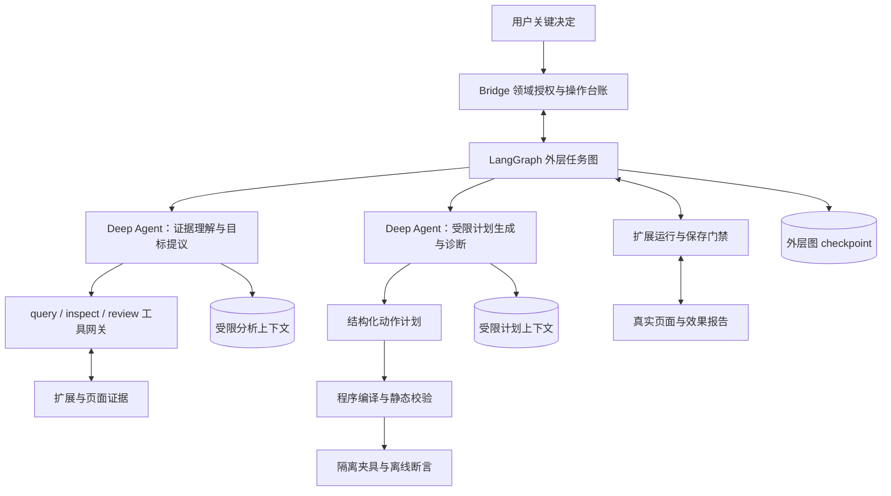
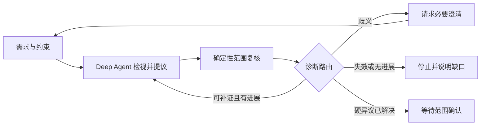
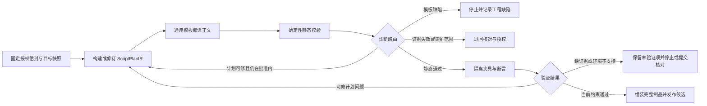
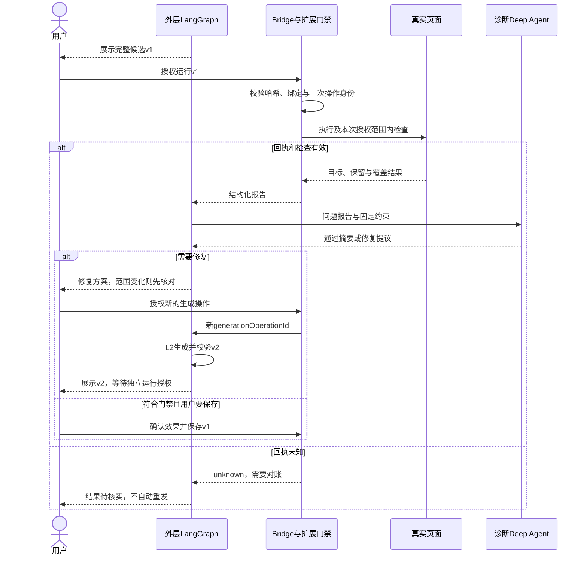

# v4.3 Loop 专项：Deep Agents 与 LangGraph 协作设计

> 2026-10-22：设计以 [总技术方案](05-technical-design.md) 为准。[源码复核](20-technical-review.md) 只记录当日断点。本文中的设计前缺口、外层全生命周期中断和隔离宿主是历史目标，不等于当前生产实现。

> 2026-10-21 补充：DOM 结构检索、只读完成出口和会话绑定的最新方案见 [DOM 检索与 Agent 协作](17-dom-retrieval-agent-design.md)。该稿为待实施设计，不能视作原任务已完成。

日期：2026-10-20。状态：以下为原技术方案草案；实际已实现范围与差异见[实施记录](08-implementation.md)，最新真实链路及金标探针见[验收清单](12-remaining-acceptance.md)。原方案中的隔离宿主与完整图级恢复仍未实现。  
关联：[总技术方案](05-technical-design.md)、[任务拆解](06-task-breakdown.md)、[PRD](02-prd.md)。

## 一、明确结论

采用 **LangGraph 外层流程 + Deep Agents 受限语义节点 + 确定性校验/编译 + 现有领域授权与执行器**。

本稿调整总方案原先“先不新增显式 LangGraph 图”的建议。原因是筛选、生成、检查、修复需要不同状态、退回路线及授权边界，单一自由工具循环难以清楚表达。新增图用于控制既有产品流程，不把图节点显示成用户逐步操作的向导。

**Deep Agents 决定需要看什么证据、哪些对象符合诉求、怎样修订提议；LangGraph 决定现在能做哪一步、失败退到哪里、何时必须停止；Bridge 和扩展决定是否真的有权生成、执行或保存。** 模型判断不能替代确定性门禁。

核心版无需多个子代理。证据理解使用一个受限 Deep Agent。生产生成路径不调用计划修订代理，已批准 hide/dim 由程序编译。证据 Agent 由代码直接调用，不开启通用 `task` 委派工具。独立复核子代理仍为增强项。

## 二、设计前基线缺口（历史，非当前能力清单）

| 当前实现 | 限制 | 改造落点 |
|---|---|---|
| runtime.ts 的 Deep Agent 只开放 5 个领域工具 | 无按需目标检视和集合复核；难以验证选择依据 | 增加 query/inspect/review 工具与结构化提议 |
| worker.ts 的 generate 分支直接调用一次 model.bindTools(...).invoke | 生成分支没有 Deep Agents 循环；主要校验 code/grants/explanation 的响应结构 | 用生成图接管单次调用分支 |
| candidate.ts 校验 JSON 和字段范围 | 合法 JSON 不等于目标正确、作用范围正确、脚本有效 | 增加动作计划、AST/CSS、选择器边界和效果断言 |
| request_generation 工具自身 interrupt | 若外层再中断，会形成双重批准与恢复路径 | 迁移为外层唯一生成授权节点，旧工具返回生成意向，不再在内层暂停 |
| 8 次模型预算、recursionLimit 32、Worker 超时 | 硬保护存在，但不是业务进展与每种循环的边界 | 分阶段预算、外层总预算、确定性路由和停止原因 |
| 执行和效果检查分散在扩展及 Bridge | 模型容易把局部成功当作最终成功 | 回执绑定版本与覆盖，结构化输入修复节点 |

本稿不是把现有一次生成调用改名为 Loop，而是新增可校验的计划与失败反馈通路。

## 三、框架分工与组合方式

### 3.1 调用拓扑

- 图内中断只有尚未登记 operationId 的生成批准。运行和保存的裁判在扩展宿主。checkpoint 保存任务阶段、循环结果与引用。与 [总技术方案](05-technical-design.md) 冲突时以总方案为准。
- Deep Agents 作为图节点中的有界调用，使用阶段专属工具和输入；不在内层再次调用生成/运行/保存 interrupt。
- 现有工具仍经 IPC → Bridge → 扩展 → 页面往返，模型不能直接访问浏览器或数据库。
- 不能仅依赖 Deep Agents 默认工具集合；维持现有白名单和路径权限限制。文件、Shell、通用委派工具继续关闭。
- 规划型待办如有需要由图状态表达；不为启用内置 write_todos 而扩大现有允许工具集合。
- 普通咨询继续走无页面工具的聊天路径，不为一句普通回答启动整条改造图。

框架支持自定义工具/中间件以及图状态、节点和条件路由；这里的分工是 Luban 的设计选择，不是框架会自动提供的业务能力。参考 [Deep Agents 定制](https://docs.langchain.com/oss/javascript/deepagents/customization)、[LangGraph Graph API](https://docs.langchain.com/oss/javascript/langgraph/graph-api)。

### 3.2 为什么不用两个自由 Agent 互相评价

两个模型都说“合理”不能证明目标正确。核心复核依赖真实节点身份、选择器唯一性、范围包含关系、保留约束、静态代码策略和真实检查回执。Agent 负责解释和补证，确定性程序负责硬约束；模型自评分只可用于诊断，不能作为通过条件。

## 四、三个 Loop 和各自授权边界

| Loop | 可以自动循环 | 必须退出循环的事件 | 需要用户决定 |
|---|---|---|---|
| L1 证据/范围循环 | 已授权页面内 query、inspect、提议、review、补证 | 无进展、超预算、页面失效、阻塞歧义 | 范围确认；必要页面授权或澄清 |
| L2 生成/校验循环 | 在一次已批准生成操作内修订动作计划、编译、静态和隔离检查 | 固定计划不满足、越界、预算耗尽、候选已发布/被拒绝 | 第一次生成授权；改变方案或另起生成操作重新授权 |
| L3 效果/修复循环 | 运行回执核实、授权范围内检查、诊断与修复提议 | unknown、页面失效、保留误伤、需修改范围、无新证据 | 每个新版本独立运行；修复生成另行授权；保存独立确认 |

L2 的自动修订不是无限生成权限：批准绑定固定 planHash、预算和 generationOperationId，只允许该操作发布一个最终候选。不修改范围、操作语义、保留要求、权限或适用规则。若当前现有审批模型不能表达这种有界内部修订，先完成领域契约变更；不能用提示词默认为已经授权。

已发布候选后继续修订属于新的生成操作，不能借旧 L2 授权无限生成。人工编辑后也形成新版本，旧运行授权不跟随。

## 五、L1：证据驱动的范围循环

### 5.1 具体步骤

1. **normalizeRequirement**：将原始发言整理成目标、纳入标准、排除标准、保留要求、未明确项。变更必须保留来源与修订；必要歧义通过用户澄清解决。
2. **analyzeEvidence（Deep Agent）**：先读短索引；针对不足之处调用 query/inspect，提出真实 targetId 与逐项依据。不得凭空编 selector 或重新编号。
3. **reviewSelection（确定性）**：复核重复与包含关系、唯一性、原节点身份、范围过大及保留冲突，输出逐项诊断。
4. **routeEvidence（确定性）**：存在可补证缺口且有预算，返回 analyzeEvidence；需要用户信息则 interrupt；全部硬异议已解决才进入范围确认。
5. **awaitScopeConfirmation**：展示建议与覆盖边界。用户确认不代表证据完整覆盖整页，也不代表生成授权。

### 5.2 证据包与诊断

建议 EvidenceBundle 包含 binding、evidenceRevision、targets、关系引用、coverage、excludedTargets。TargetProposal 必须携带 targetId、evidenceRefs、reason、uncertainties；证据引用由宿主核验是否存在及仍有效。

诊断结构建议为 `code, targetIds, severity, evidenceRefs, observed, expected, repairRoute`。例如：

| 诊断 | 路由 | 不能做的事 |
|---|---|---|
| EVIDENCE_INSUFFICIENT | inspect 或补证 | 让 Agent 仅重写 reason 后当作解决 |
| NESTED_SELECTION | 比较父子范围后重新提议 | 同时处理父子然后声称没有重叠 |
| PRESERVATION_CONFLICT | 缩小范围或请求核对 | 只用“保留正文”一句话忽略实际包含关系 |
| TARGET_STALE / NON_UNIQUE | 重新采集并核对 | 复用旧 selector 指向替换节点 |
| COVERAGE_LIMITED | 保留局部范围说明，必要时停止 | 把未覆盖误记为无遗漏 |

语义准确性不能只通过结构校验确定。即使硬异议解决，也只能得到“有证据可核对的建议”，最终范围仍由用户确认。

## 六、L2：结构化计划 → 编译 → 校验 → 修订

### 6.1 先生成计划，再生成代码

针对当前只支持 hide/dim 的范围，建议将模型输出从任意 JavaScript 收紧为 ScriptPlanIR。Agent 负责选择如何满足已批准方案，程序负责将已确认 targetId 解析成当前有效 selector，再使用通用模板编译正文。

建议 IR 字段：

| 字段 | 来源与约束 |
|---|---|
| planHash / requirementRevision / selectionHash | 宿主传入并核验，不接受模型改写成新授权 |
| actions | 仅允许 hide/dim，targetIds 必须是已确认集合中的明确引用 |
| preservedTargetRefs / invariants | 引用已有保留约束；不让模型删减 |
| runAt / requestedGrants / matchesRef | 受当前批准与产品策略约束；不能自行加权限或域名 |
| expectedEffects | 从动作和目标生成可验证断言，如所选区域不可见/透明度降低 |
| uncertainty / evidenceRefs | 指出生成还依赖哪些证据，不直接获得通过标志 |

模型不输出任意 selector、CSS 字符串、动态 JavaScript 或外部依赖来绕过 IR。当前能力只需 hide/dim 时，编译器直接选用通用最小样式模板；模型生成器并非每轮必须调用。若固定方案可直接编译，一次编译校验通过就是成功，不人为制造多轮模型工作。

自由代码编辑仍是已有制品功能，但编辑产物不能冒充 IR 编译代码。脱离受支持语法子集时标为无法自动验证，按现有检查与授权规则处理，不允许扩展自由代码执行范围。

### 6.2 生成子图

### 6.3 四层校验

| 层级 | 检查内容 | 能证明什么 / 不能证明什么 |
|---|---|---|
| 结构与授权 | IR schema、动作白名单、固定 planHash、目标引用、权限/匹配不扩大 | 防越权；不证明业务目标完整 |
| 静态代码 | JS AST、CSS selector规则、禁止网络/依赖/动态求值、元数据一致、私有API兼容 | 防生成偏离策略；一般AST扫描不能证明任意JS安全 |
| 隔离夹具 | 经验证编译器产物在离线结构上的目标与保留断言 | 发现模板、选择范围和基本逻辑问题；不能证明真实页面视觉/动态行为 |
| 真实页面 | 独立运行授权后的真实目标、保留检查与覆盖报告 | 证明本次确认计划的实际效果，仍受覆盖限制 |

Selector 白名单必须解析和规范比较，不能用字符串包含判断；实际命中节点集合必须在确认目标内，禁止模型加父选择器、兄弟组合或逗号扩展。CSS 声明仅来自编译器对 hide/dim 的模板。

离线夹具检查位于受控 Node 测试/验证宿主，不是 MAIN world。仅运行受支持 IR 经可信编译器得到的产物；不执行页面脚本、内联事件、远程资源、用户任意编辑代码，也不把完整含敏感数据 DOM 发给模型。使用脱敏的有界结构快照，网络关闭，隔离进程限制时间和内存。

数据不足或目标依赖布局时输出 `not_assessed`，不能将 jsdom 尺寸模拟通过当成真实 Chrome 结果。离线运行需要新增受限验证宿主和往返协议，是实施工作，不是目前已经存在的能力。

### 6.4 修订反馈必须具体

修订 Agent 的输入包含固定授权信封、当前 IR、生成代码引用、失败断言与证据；输出是受限 IR patch 或“需新证据/需改范围/无法修复”，不是整段自由发挥的代码。

典型例子：候选 12 的 selector 实际匹配两个节点 → 先宿主重查唯一性；不能让模型猜更长 selector。新增父容器会包含保留正文 → 退回 L1 与范围确认，不能在 L2 偷换目标。若可信模板输出错误声明 → 编译器工程缺陷，不让模型绕过模板修成自由代码。

## 七、L3：真实效果与修复循环

效果检查是宿主确定性逻辑；Agent 只能诊断，不能将报告 failed/unknown 改写为 passed。修复中必须同时考虑误伤与遗漏；不能以“选中目标已经隐藏”结束整个任务。

如果必须点击、滚动或操作网页才能获得新证据，而现有授权工具不支持，则说明缺口或请求用户配合；不能借 Loop 新增任意网页操作能力。

## 八、外层图的节点契约与路由

下表是 2026-10-20 的节点草案。生产契约以 [总技术方案](05-technical-design.md) 为准：生成图不注册 `revisePlanIR`；`awaitRun` 和 `awaitSave` 不是图内中断；运行和保存留在扩展宿主。

| 节点 | 执行者 | 主要输入/输出 | 后续 |
|---|---|---|---|
| normalizeRequirement | 语义调用+schema | 原发言 → 目标/约束/歧义 | 澄清或 L1 |
| analyzeEvidence | 受限Deep Agent | 证据与诊断 → TargetProposal | reviewSelection |
| reviewSelection | 宿主确定性 | 提议 → 异议与证据引用 | L1循环/停止/确认 |
| awaitScope | 外层interrupt | scopeHash → 用户确认引用 | 方案核验 |
| awaitGeneration | 外层interrupt | planHash → 生成批准引用 | claimGeneration |
| claimGeneration | Bridge幂等操作 | 批准 → 唯一操作信封 | L2 |
| buildPlanIR / revisePlanIR | 编程构造或受限Deep Agent | 固定信封+诊断 → IR | compileBody |
| compileBody / validateStatic | 程序 | IR与宿主selector → 正文/诊断 | 校验路由 |
| validateFixture | 受控验证宿主 | 编译产物和脱敏快照 → 报告 | 修订/停止/制品 |
| publishArtifact | 扩展制品服务 | 规范正文与元数据 → fullCode/hash | awaitRun |
| awaitRun | 外层interrupt | artifactHash → 运行批准引用 | 扩展运行服务 |
| collectEffect / diagnoseEffect | 宿主检查+受限Agent | 报告 → 修复提议或结论 | 新授权/停止/保存 |
| awaitSave | 外层interrupt | 版本、凭证与效果确认 → 保存请求 | 扩展保存门禁 |

路由函数是普通程序逻辑：先校验 binding/revision/epoch，再处理硬错误，再预算，再决定补证/修订/等待用户。不能用模型自由字符串决定跳到 execute/save。

图节点返回部分状态更新，列表明确 reducer 或按ID去重；同一节点只用一种主路由方式，避免 `Command.goto` 与静态边同时触发两条路径。实施时按当前安装版本核对 `StateGraph`、条件边和 `Command` 类型。设计原则依据 [Graph API](https://docs.langchain.com/oss/javascript/langgraph/graph-api)。

## 九、GraphState、预算与进展

### 9.1 状态建议

- 身份：profileId、workspaceId、conversationId、runEpoch、graphSchemaVersion。
- 约束：requirementRevision、evidenceRef/revision、selectionHash、planHash、bindingRef。
- 生成：generationOperationId、frozenEnvelopeRef、irRevision、candidateRef、artifactHash。
- 检查：diagnostics、staticReportRef、fixtureReportRef、effectReportRef、unassessedChecks。
- 循环：evidenceTurns、generationAttempts、toolCalls、modelCalls、evidenceBytes、elapsedActiveMs、deadline、lastProgressKey、stopReason。
- 批准：只存 approvalRef/subjectHash/operationRef，不存可独立放行的 approved=true。

DOM Element、浏览器句柄、API Key、大块原始页面内容不进入 checkpoint。详情存受控宿主，图持引用；恢复必须重新核验引用有效性。

### 9.2 停止标准

| 条件 | 判定方式 | 结果 |
|---|---|---|
| 无进展 | 相同证据修订+相同目标集合+相同未解决诊断重复出现 | 停止自动分析，解释缺口 |
| 生成无进展 | 相同IR/代码哈希+相同诊断签名重复 | 停止，保留失败报告，不原样重试 |
| 超预算 | 见总方案 5.4：Bridge 记模型次数、120 秒墙钟和证据工具次数；Worker 另记全部工具次数 | 停止并说明耗尽类别 |
| 页面/授权失效 | document/epoch/hash/有效期校验失败 | 退回核对或新授权 |
| 编译器缺陷 | 同受支持IR产生违反模板契约的代码 | 工程错误，不交给Agent绕过 |
| 外部副作用未知 | 无可靠运行回执或超时后可能仍运行 | 对账，不能进入生成-运行自动重试 |

建议先用保守有限额度进行探针，不在本稿编造次数与时延门槛。内层 Deep Agent 必须有自己的模型/工具上限；外层递归上限只是最终防护，不代替业务预算。

人工等待不保持 Worker 常驻。当前 120 秒按墙钟计算，等待不暂停。批准有效期和证据时效仍正常流逝。活动时间暂停没有单独的起止事件，不作为当前规则。恢复先检查有效性与剩余额度。内外层都计费时按实际 modelCallId 去重结算，不能重复扣减。新的一次 `begin` 可以清零；恢复同一 epoch 不能靠重启 Worker 把 Bridge 账本重置。

## 十、中断、恢复与副作用

官方中断机制要求 checkpointer、稳定 thread ID 和可序列化 payload；恢复时会从包含 interrupt 的节点开头重跑，因此批准节点应只返回请求，不做非幂等生成或页面执行。参考 [Interrupts](https://docs.langchain.com/oss/javascript/langgraph/interrupts)。

建议采用：

1. 外层任务线程按 profile/workspace/conversation/graphSchemaVersion 隔离；普通会话、旧图及新流程不混用 checkpoint。
2. 内层 Agent 按阶段调用隔离上下文，恢复时只带必要证据和最近诊断；核心版不让内层 interrupt，减少父节点重放问题。
3. `awaitGeneration` 只中断；恢复值为批准引用，下一独立 `claimGeneration` 节点向 Bridge 核验并消费。
4. 图重放 claim 时，已有相同操作直接返回原信封；不同内容或旧批准拒绝。不能每次进节点随机新建 operationId。
5. `awaitRun` 与执行适配拆开。真正执行前由扩展核验批准和既有记录，执行后先持久化回执，再发布事件。
6. checkpoint 不与 IndexedDB/Bridge SQLite 构成原子事务。宿主成功、图写 checkpoint 前宕机时，从 operationId 对账，不直接再次执行。
7. 已发布候选、运行结果和保存凭证是宿主事实；模型上下文重放不能覆盖它们。
8. 页面变化或用户取消推进 epoch，旧模型结果只能作为审计，不可发布为当前候选。

不得声称 LangGraph 自动保证外部浏览器副作用恰好一次；框架持久化与业务幂等是两件事。

## 十一、如何验证“准确性提升”

### 11.1 比较组

| 组 | 路径 | 目的 |
|---|---|---|
| A 当前基线 | 当前证据和一次生成调用 | 记录现状 |
| B 只增强证据 | L1工具与复核，生成路径尽量不变 | 判断补证是否改善筛选 |
| C 只收紧制品 | 相同已确认范围，IR+编译+静态检查 | 判断代码与边界错误是否减少 |
| D 完整闭环 | L1+L2+独立授权的L3 | 验证整体收益与成本 |

同任务、同金标、同页面版本、同模型配置；先固定范围评估生成，再评估端到端。避免把增加模型预算的效果误当成框架收益。

### 11.2 指标与退出要求

- 目标精准率/召回率、父子范围正确性、保留内容误伤分别统计。
- 代码首次检查通过率、发布前修订次数、IR越界拒绝与真实运行效果分别统计。
- 记录未覆盖、无法判断、预算停止、用户拒绝、未知结果；不删除失败样本再报告成功率。
- 记录模型/工具次数、有效证据字节、任务耗时与修复成本；人工等待时长单列。
- 任何提高“完成率”但扩大未授权范围、增加误伤或弱化unknown处理的改动均不合格。
- 离线夹具仅验证有限结构；真实Native链路、模型、Chrome与Tampermonkey分别验收。

明确可预期收益来源：L1减少证据不足与范围误选，IR编译减少selector/代码漂移，L2诊断防止发布已知错误，L3以真实结果纠正静态假设。**这些是待验证假设，不是已经获得的准确率结果。**

## 十二、实施落点与任务细化

拟新增 `workflow.ts`（外层图）、`workflow-state.ts`、`evidence-agent.ts`、`plan-agent.ts`、`loop-policy.ts`；名称可调整，不要求引入新进程。离线验证宿主作为受限验证器单独隔离。继续复用既有 Bridge IPC、扩展制品及运行服务。

| 工作包 | 新增细项 | 验收关键点 |
|---|---|---|
| T04 | schema化query/inspect/review及证据引用 | 真正页面往返，不只返回缓存列表 |
| T05 | 外层StateGraph、L1路由、总预算、内层限额与中断恢复 | 无内外双重interrupt；无进展可终止 |
| T06 | ScriptPlanIR、通用模板编译、AST/CSS检查、隔离夹具验证 | 不让模型自由编写超出hide/dim的逻辑 |
| T07 | L2生成/校验/修订图与统一claim | 一次批准绑定一个固定有界生成操作和最终候选 |
| T08 | L3效果诊断、修复回退、新版本独立批准 | unknown先对账；修复不自动运行 |
| T09 | 新旧checkpoint隔离、稳定操作引用 | 宿主成功而图未落盘时不重放副作用 |
| T14 | A/B/C/D对比及断点故障注入 | 报告实际准确性与成本，不只检查图能运行 |

实施前增加最小兼容探针：当前锁定的 deepagents 1.15.1、langgraph 1.5.1、SQLite saver 1.1.0 组合，验证图内受限Agent调用、外层interrupt与恢复、Worker退出重建、schema输出和checkpoint命名。当前版本以 package.json 为核对依据，尚未运行此探针，不直接升级依赖或照抄最新文档API。

## 十三、资料与验证边界

- [现有 Worker 生成分支](../../harness/src/worker.ts)、[候选响应校验](../../harness/src/candidate.ts)、[Runtime](../../harness/src/runtime.ts)
- [Deep Agents 定制能力](https://docs.langchain.com/oss/javascript/deepagents/customization)
- [LangGraph 状态、节点与路由](https://docs.langchain.com/oss/javascript/langgraph/graph-api)
- [LangGraph 中断与重放约束](https://docs.langchain.com/oss/javascript/langgraph/interrupts)
- [LangGraph 持久化](https://docs.langchain.com/oss/javascript/langgraph/persistence)

官方资料已读取；Context7 当前认证失败后使用官方文档读取作为替代。本文代码符号为方案说明，未交付可直接运行的SDK实现。Mermaid源码随文档保存，基础结构检查与真实渲染验证分别记录。
