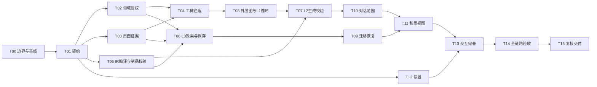

# Luban v4.3 任务拆解与实施门禁

> 2026-10-26 进度更新见 [继续实施与验收](23-continuation-2026-10-26.md)。本文原日期的实施、断点与验收结果保留，不覆盖后续代码；当前关键真实链路已补验，但完整发布门槛仍有未完成项。

> 2026-10-21 补充：DOM 结构检索、只读完成出口和会话绑定的最新方案见 [DOM 检索与 Agent 协作](17-dom-retrieval-agent-design.md)。该稿为待实施设计，不能视作原任务已完成。

日期：2026-10-20。状态：任务范围基线；本轮实际进展见 [实施记录](08-implementation.md) 和 [验收记录](09-acceptance.md)，不将全部任务标为完成；无研发工期承诺。  
依据：[scope](01-scope.md)、[PRD](02-prd.md)、[UI/UX](03-ui-ux.md)、[技术方案](05-technical-design.md)、[Loop 专项](05a-loop-design.md)。

## 一、实施原则

按“契约与领域 → 证据与制品 → 自动编排 → 界面 → 全链路验证”推进。每项交付需包含代码/文档、相关验证及未验证项。Demo 只作交互参照，禁止直接复用固定模拟识别/执行逻辑。

任务中的文件是修改入口，新增文件名称由实施时统一。关联 PRD/AC 作为验收覆盖，不表示已通过。

## 二、任务清单

| ID | 工作包及交付 | 主要修改入口 | 依赖 | 完成标准 | 追踪 |
|---|---|---|---|---|---|
| T00 | 冻结关键边界：保存门禁、重复运行、预算、协议/迁移、模型与浏览器验收矩阵 | v4.3 文档与基线记录 | 无 | 待决项有明确结论；记录当前指标及已知缺陷，不沿用Demo模拟通过 | NF-04/07/10 |
| T01 | 类型化命令/事件、状态维度与握手版本；旧事件适配 | shared/v4-types、messages、bridge协议 | T00 | 定义修订/epoch/requestKey/operationId语义；旧用户消息不被系统事件污染；混合版本明确拒绝或兼容 | PR-01/02、AC-03/12 |
| T02 | 领域修订与授权拆分、原子消费和幂等 claim | bridge/harness-domain、领域store | T01 | 增量证据不全清选择；目标/方案变更使相关授权失效；重复批准不重复生成 | PR-02、AC-04/07/09 |
| T03 | 有界增量证据注册、稳定ID/label及cursor | content/annotations/registry、页面消息处理 | T01 | 翻页保留有效选择；容量回收不删已选；失效cursor拒绝；无站点特判 | PR-03、AC-04–06 |
| T04 | query/inspect/review领域工具及页面往返 | harness/runtime、bridge/harness-service、service-worker网关、Content Script | T02、T03 | correlationId、超时、取消、大小限制完整；关系与覆盖可查；确定性异议不被reason绕过 | PR-03、AC-05/06/19 |
| T05 | LangGraph外层任务图、L1路由、循环预算、进展与停止 | 新增workflow/state/policy、受限Deep Agent、Bridge状态与Worker生命周期 | T02、T04 | 无新证据/重复失败/上限/取消均终止；恢复不重置累计预算；不同任务计数隔离；外层唯一interrupt，完成框架组合探针 | PR-04、AC-11/20 |
| T06 | ScriptPlanIR、模板编译、静态/隔离夹具校验、完整制品与哈希 | 新制品模块、userscript-export、code-quality、shared类型 | T01、T00 | 候选完整头唯一；匹配/权限合法；复制导出相同；新旧hash显式区分；仅执行受支持IR编译产物的隔离检查，任意编辑代码不进入验证器 | PR-06、AC-09/13 |
| T07 | L2生成-校验-IR修订子流程，统一resume/direct与claim | harness-domain/service、worker、workspace-generation、useHarnessChat | T02、T05、T06 | 一次授权绑定固定计划与有限operation，只发布一个最终候选；可修诊断返回IR修订，越界回退授权；无额外继续按钮 | PR-02/06、AC-02/07 |
| T08 | L3真实效果诊断与修复回退、独立批准、结果未知对账 | version-service、trial-runner、trial-operation、目标检查 | T02、T03、T06 | 执行前校验；三层结果分开；unknown不重发；有效凭证与效果确认控制保存；重复正文回执真实；修复生成新operation，新版本不自动运行 | PR-02/04/06、AC-08–14 |
| T09 | 存储迁移、旧制品/配置/会话兼容与恢复 | IndexedDB database/migration、Bridge SQLite、checkpoint命名 | T01、T02、T06、T08 | 旧正文及hash保留；不明规则待复核；升级中断不丢数据；旧checkpoint不错误恢复授权 | NF-05/10、AC-18 |
| T10 | 对话事件投影、过程折叠、决策区和范围核对 | sidepanel/App、v4/HarnessChat、useHarnessChat、样式 | T01、T02、T04、T07 | 单一选择；当前决策可见；历史按钮只读；普通聊天不出现工作流；编号对应页面 | PR-01–03、AC-01–07 |
| T11 | 独立制品视图、编辑/版本/运行/保存/导出 | sidepanel组件、代码预览、版本与导出服务 | T06、T08、T09、T10 | 明确当前版本；编辑使旧授权失效；离开视图不丢回执；复制与保存版导出不混淆 | PR-01/06、AC-08–14/16 |
| T12 | 设置概览与详情、配置测试修订隔离 | options/tabs、settings-store、模型配置/连接适配 | T01、T00 | 先状态再参数；服务/设备分开；测试不保存；旧响应不覆盖新表单；密钥不进日志 | PR-05、AC-15/19 |
| T13 | 阅读与草稿恢复、焦点、IME、窄屏与视觉变量 | sidepanel视图状态、options组件、CSS | T10、T11、T12 | 来源和阅读恢复；任务草稿不串；快捷键尊重IME；实际支持尺寸下无关键操作遮挡 | PR-01、NF-01–03、AC-16/17 |
| T14 | 端到端与故障注入、质量/成本对比、独立脚本验证 | tests、bridge/test、harness/test、验收脚本与证据 | T05、T07–T13 | 覆盖AC-01–20；真实Native/模型/Chrome与Tampermonkey分别记录；失败和未知样本不剔除；比较基线/证据增强/IR编译/完整Loop四组 | 全部核心要求 |
| T15 | 复核与交付报告、未完成清单、迁移及故障处理说明 | v4.3实施/验收/复核记录 | T14 | 问题闭环或明确阻塞；无站点运行时特判；不以Demo和旧版验收代替当前验证 | 项目AGENTS、NF-09/11 |

实际状态以分阶段执行计划及验收记录为准。T14 的相关断言随前置任务逐步补充，不把全部测试集中拖到最后。

## 三、依赖与里程碑

图用于概览，完整依赖以任务表为准；不是研发排期或实际并行承诺。

| 里程碑 | 范围 | 退出门禁 |
|---|---|---|
| M0 设计冻结 | T00–T02、T06契约部分 | 权威状态、授权对象、保存与重复执行规则有结论；契约可评审 |
| M1 证据与制品底座 | T03–T06、T09前置迁移 | 增量证据与制品规范独立通过相关检查，未开放未授权执行 |
| M2 生产链路闭合 | T07–T09 | 真实链路可授权生成、运行与保存；中断不重复执行 |
| M3 交互与设置 | T10–T13 | UI与需求一致，不能靠前端状态绕过门禁，操作恢复与配置隔离可验证 |
| M4 验收交付 | T14–T15 | 逐项证据、质量比较与明确未验证项，无虚假通过 |

## 四、关键测试拆解

| 测试组 | 必要案例 | 证据 |
|---|---|---|
| 授权/幂等 | 双击、旧revision、旧epoch、同key异payload、resume/direct竞态 | 请求与领域事件、仅一次claim的断言 |
| DOM/范围 | 祖先不在批次、嵌套、节点替换、同选择器不同节点、排除项重提、容量截断 | 跨布局夹具、稳定编号与身份断言 |
| 制品/迁移 | 重复头、换行注入、编辑元数据、GM权限不符、私有依赖、旧hash升级 | 规范fullCode比较、AST诊断、迁移前后数据 |
| 执行/保存 | SW在提交前后重启、回执丢失、超时后副作用、结果未知、凭证过期、页面导航 | operationId全链路日志、页面真实结果、无自动重发 |
| 模型闭环 | query/inspect/review真实往返、缺证据停止、重复失败停止、修复重新授权 | 工具活动与预算、版本和授权引用 |
| UI/设置 | 过程折叠不抢焦点、长内容、IME、阅读恢复、测试响应过期、配置切换 | 浏览器记录、键盘走查、脱敏检查 |
| 独立脚本 | Chrome扩展及Tampermonkey分别检查匹配、权限、加载时机和效果 | 两份独立记录；不能互相代替 |

## 五、交付文件与完成定义

实施阶段持续补充以下 Markdown 记录，名称为建议：

- `08-implementation.md`：实际改动、技术决策、偏离本方案的原因和需求对应。
- `09-acceptance.md`：命令/环境、模型与浏览器版本、AC逐项结果、失败样本和证据引用。
- `10-review.md`：复核发现、修复、残余风险和未验证项。
- `11-final-report.md`：最终范围、迁移行为、验证结论、已知限制与后续增强项。

任务完成不等于版本完成；必须满足依赖门禁，测试不得仅重复实现细节。真实模型、Native链路、浏览器或Tampermonkey未验证时分别标明，不继承v4.1或Demo结论。

视觉截图、复核子代理和深层页面读取为增强项，不塞入上述核心任务。实施无需自动调用公司平台、创建Flow或上报度量。

## 六、Loop 实施补充

任务 T05/T06/T07/T08/T09/T14 的节点输入输出、授权和探针要求详见 [Loop 专项第十二节](05a-loop-design.md)。外层图接管任务中断后，删除内层 request_generation 的重复 interrupt 路径；不能同时保留两套批准消费。框架组合探针属于 T05 前置验收，不以编译成功替代Worker退出后的恢复验证。

## 七、2026-10-22 复核后的实施顺序

原 T00–T15 继续保留历史任务映射。当前编码顺序以 [执行计划](07-execution-plan.md) 为准：先失效三元组，再宿主 outcome，再分流与绑定。设计规则以 [总技术方案](05-technical-design.md) 为准。M0–M5 只保留为 2026-10-22 的历史分组。
