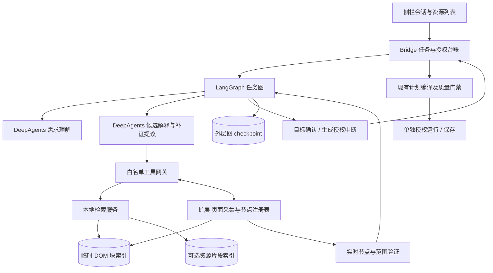
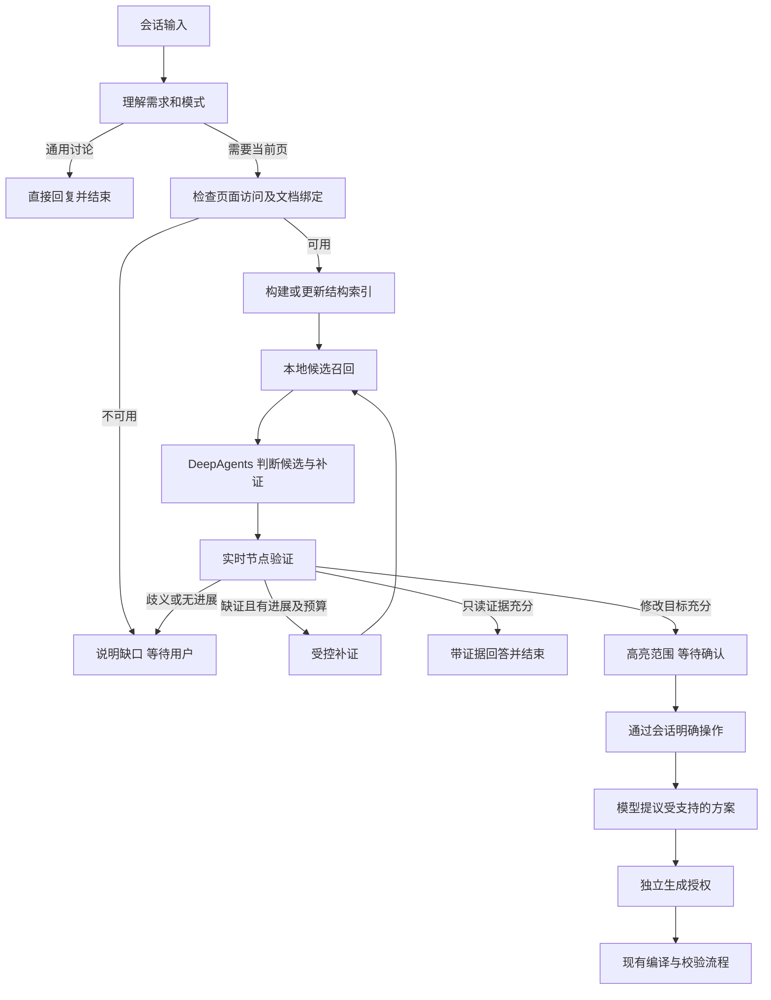
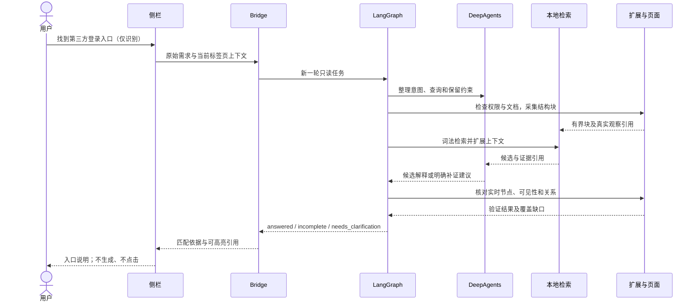

# DOM 结构检索与 Agent 协作方案

> 2026-10-27 更新：结构增强 BM25、批量读取及三组对照已实施；[实施、验收与限制](25-structured-bm25-2026-10-27.md)。仅有限合成样例，完整任务通过数未提升，不作整体准确率或费用承诺。
> 2026-10-22：绑定、只读出口、失效和预算以 [总技术方案](05-technical-design.md) 为准。[源码复核](20-technical-review.md) 只记录当日断点。本稿的资源正文获取及评估口径仍有效，不能只实施检索工具。

日期：2026-10-21。状态：待实施技术方案；不是已实现功能或验收通过报告。

关联：[总技术方案](05-technical-design.md)、[原 Loop 专项](05a-loop-design.md)、[任务拆解](06-task-breakdown.md)、[登录入口实测](15-login-entry-analysis.md)、[会话交互修正](16-conversation-operation-decision.md)。本稿补充 05 尚未展开的 DOM 检索。与 05 冲突时以 05 为准。

## 1. 决策

采用 **LangGraph 外层状态机 + DeepAgents 受限语义节点 + 本地 DOM 结构检索 + 资源证据补充 + 确定性实时验证**。

- DeepAgents 理解需求、选择补证手段、判断候选及解释匹配依据，不控制授权。
- LangGraph 控制任务模式、补证路由、停止条件和人工确认；普通用户只看到会话、候选高亮和必要确认，不看到分步向导。
- 检索层查找相关结构块，不作最终业务判断；验证层保证真实节点仍存在且引用未漂移。
- Bridge 与扩展是实际权限边界。即使模型或图状态称“已批准”，没有当前有效授权凭证也拒绝操作。
- 第一阶段不新增向量数据库，不直接集成整套 HtmlRAG、Crawl4AI 或 Browser Use；先做结构块与关键词/BM25 检索。第二阶段以基准测试证明收益后再加入本地 embedding 混合召回。
- 检索是服务当前任务的临时页面证据，不是永久站点知识库；不写站点专用规则。

这属于任务驱动的结构化检索增强。向量相似度、模型置信度、工具成功回执都不能单独证明元素匹配正确。

## 2. 当前实现与实际缺口

| 当前代码 | 已有能力 | 本次需要增加或纠正 |
| --- | --- | --- |
| `shared/page-resources.ts` | DOM 文件引用及 Resource Timing 索引；最多 500 个脱敏资源路径 | 目前没有正文、内容哈希、资源与节点的映射；不可直接当作 RAG 内容库 |
| `content/annotations/registry.ts` | 候选引用、属性、父子关系、位置、增量读取、inspect/review、节点失效检查 | 增加可检索结构块与索引；当前安全候选不等于完整 DOM，不应把它直接当观察语料全集 |
| `harness/src/runtime.ts` | DeepAgents 白名单工具、预算、SQLite checkpoint | 增加搜索工具和结构化分析结果；修正已删除按钮名称的提示；观察态与修改态工具权限区分 |
| `harness/src/workflow.ts` | 证据图、生成图、LoopBudget | 证据图成功条件目前要求非空 selected；新增只读完成出口，检测内层工具无进展 |
| `harness/src/worker.ts` | analysisOnly 外层图与普通消息内层 Agent 两条路径 | 页面相关消息统一通过外层路由，避免普通消息绕过证据验证；纯讨论直接回复 |
| Bridge / HarnessGateway | 页面引用、目标复核、授权凭证与执行前检查 | 增加受控检索请求、版本隔离及只读绑定；权限能力不能由模型参数扩大 |
| 侧栏 | 资源按类型展示，范围确认后通过会话提出方案 | 资源列表仅作展示，不代表会话已经绑定；补齐工具栏打开后的页面关联与首个页面任务的读取链路 |

## 3. 系统架构

第一阶段检索在本地 Bridge/Harness 进程内运行，扩展只传有界脱敏结构证据。保留现有领域 RPC 和 Native Messaging 传输，不再启动第二套浏览器或复制用户登录状态。资源展示、本地检索、模型推理、页面执行使用不同能力权限。

## 4. 证据模型与 DOM 分块

### 4.1 两类对象，不能混用

- **ObservationBlock**：用于理解和检索，可包含控件、区域及必要上下文。不可直接用于脚本执行。
- **TargetRef**：通过当前注册表注册并实时验证的操作对象。保留现有真实节点身份、选择器唯一性及安全范围要求。

例如登录表单所在容器可被观察和描述，但不能因此成为可整体隐藏或修改的合法目标。输入框只记录类型、标签、role、placeholder 等必要描述，不读取 value、密码、验证码、Cookie 或存储内容。

### 4.2 建议记录

| 字段 | 含义 |
| --- | --- |
| `pageRef / documentId / navigationEpoch` | 证据所属页面和文档 |
| `evidenceRevision / blockId / blockHash` | 当前结构块及版本；hash 用于缓存，不是节点身份凭证 |
| `nodeRef / parentRef / frameRef` | 观察时的页面注册引用及关系；不跨导航复用 |
| `text / accessibleName / role / tag` | 语义字段；accessibleName 标注 DOM 推导或浏览器 AX 来源 |
| `attributes / bounds / visibleState` | 白名单属性和布局；不采集任意 data-* 或输入值 |
| `ancestorSummary / nearbyText / resourceRefs` | 区域语境及资源关系 |
| `coverage / truncated / unavailableScopes` | 覆盖缺口与截断状态 |

普通扩展 DOM 采集不等同于完整浏览器可访问性树。第一阶段从 label、aria-label、aria-labelledby、alt、title 等生成名称，记录来源；不声称已实现完整 accessible-name 算法。复杂情况保留原始证据并补证，CDP/完整 AX 接入是独立后续选项。

### 4.3 分块规则

1. 优先按区域、表单、列表项、卡片和交互单元划分，再保留父级及相邻上下文，不按固定字符数切断控件与标签。
2. 对无文本按钮、图标、图片保留属性与关联上下文；不以文字密度低为由删除。
3. 父子重复块建立关联；召回去重不能自动把子节点扩大为整个父容器。
4. 页面变更采用有界 MutationObserver 增量失效；DOM 引用与索引版本一致。变化频繁时按需采样并标记不稳定，不强制循环全页重建。
5. 初期仅覆盖主文档，明确 iframe/Shadow DOM 未覆盖；后续有授权再逐 frame 扩展，不能静默绕过跨域边界。

## 5. 检索策略

### 5.1 第一阶段：结构与词法召回

输入是用户原始需求、已确认约束及经模型整理的少量查询表达。通用中文/英文分词与字符 n-gram 支持短词、图标名和类名；不预置某网站的业务同义词。

- 精确名称与属性匹配：text、label、aria、alt、title。
- BM25：检索块文本、父级语境及关联文件名。
- 结构扩展：给命中块补充父级、相邻标签及资源引用。
- 模型重排：最多提交 8 个有差异的候选上下文，要求返回依据、反证、歧义和缺口。
- 对缺少语义的纯图标，可在已授权截图能力范围内补充局部视觉证据；未有该能力则明确缺口。

建议初始参数：每个查询词法召回 20 个，结构扩展与去重后重排 8 个，最终向用户建议不超过 5 处。参数是待调优默认值，不是准确率承诺。

### 5.2 第二阶段：可选向量召回

仅为 DOM 语义描述及必要资源片段生成 embedding，不对整页压缩 JS 或每个 DOM 节点盲目建库。关键词和向量各召回，使用 RRF 合并，再补结构、重排、验证。

本地向量实现应通过 TypeScript 接口接入，不先锁定独立数据库；单页短期索引可用进程内向量索引，资源缓存用现有本地存储。只有规模实测需要时才引入持久向量服务。embedding 模型变化必须重建对应索引。

### 5.3 资源检索是补证

- 图标文件 → 通过 img.currentSrc/src、可读 CSS 背景引用映射当前 DOM。
- CSS 片段 → 提取选择器线索，回当前文档查询；样式存在不代表当前有匹配元素。
- JS 字符串/组件片段 → 仅提供假设，通常不能可靠直接映射真实节点；必须补实时证据。
- API 名称/响应 → 第一阶段不读取响应正文；请求存在不代表按钮存在。

现有资源 URL 已脱敏并合并查询参数，因此不能用展示 URL 重新下载并假装原文件内容。新增资源正文能力时，使用不暴露给模型的 resourceId，内部绑定文档、实际资源身份及内容哈希。读取受访问权限、来源、类型、体积及重定向检查限制；没有权限就返回明确缺口，不自动申请全站 host 权限，不读取 source map 或重放接口。

## 6. DeepAgents 的调用边界

复用当前 `createDeepAgent` 和受控领域工具，第一阶段不引入通用子代理委派。主图直接调用有界语义节点，避免“外层循环 × 自由工具循环”放大调用次数。

| 工具 | 作用 | 可产生什么 |
| --- | --- | --- |
| `search_dom`（新增） | 按当前文档查询结构块 | 块引用、候选依据、分数和覆盖 |
| `read_dom_block`（新增） | 按引用读取有界上下文 | 父子关系与附近证据 |
| `search_resources`（新增） | 文件名检索，后续扩展为已允许片段检索 | 资源引用和命中片段 |
| `read_resource_excerpt`（后续） | 受控读取指定资源窗口 | 有界片段，不执行内容 |
| `inspect_target`（复用） | 检视当前真实目标及关系 | 实时证据 |
| `review_selection`（复用） | 检查节点身份、选择器与嵌套范围 | 确定性报告，不判定语义正确 |
| `propose_targets / propose_plan`（复用） | 保存候选范围/方案 | 提议，不确认、不执行 |

模型结果必须结构化：`outcome`、`candidateRefs`、`evidenceRefs`、`reasons`、`ambiguities`、`missingEvidence`、`nextRead`。引用必须存在于当前工具返回，不能输出自造选择器作为授权对象。

`nextRead` 只是补证建议，LangGraph/Bridge 决定是否允许。资源片段及页面指令均按不可信数据处理，不修改系统指令或工具权限。继续禁止任意 shell、文件读写、通用浏览器执行和 `task` 委派。

## 7. LangGraph 状态与路由

### 7.1 状态

保留：任务/会话/轮次标识，需求与约束版本，任务模式，页面绑定，索引版本，候选与证据引用，验证诊断，覆盖，预算，进展键，待决事项，计划引用和回执引用。大 HTML、JS、embedding、凭据不进入 checkpoint，只存受控索引引用与必要摘要。

模式为 `discuss / observe / modify`：模型可解释意图并提出模式，确定性策略限制可用能力；存在歧义时澄清，不能默认进入修改或执行。只读任务不要求确认修改范围。

### 7.2 主图

范围确认后，若前文已明确操作，模型可沿用需求提出方案，不要求用户重复输入；不恢复固定隐藏/弱化按钮。方案改变、约束改变或目标变化时重新验证并失效对应授权。

当前动作合同仍只支持 hide/dim。点击、填写、登录不能由检索功能顺带开放，超出能力时明确说明。新增动作必须另行扩展 PlanIR、编译器、授权粒度、效果验证和回滚策略。

### 7.3 双层停止条件

- 同一次任务默认全局上限：8 次模型调用、24 次工具调用、120 秒；所有内层调用共享预算，不因重启 Agent 或补证重置。
- 其中候选分析最多 3 轮，每轮语义节点建议最多 2 次模型调用；剩余额度用于需求整理和最终回复。模型超时还需受剩余全局时间约束。
- 同一文档版本、工具名与参数重复且结果相同，第二次相同结果后禁止第三次无变化调用。
- 进展键使用“被消费的块内容哈希集合 + 已消除缺口 + 候选变化 + 诊断变化”；不能仅因采集时间或无关页面变化而算新进展。
- 只有获得新证据、消除诊断或缩小歧义才继续。无进展、预算耗尽、页面变化和用户取消分别返回不同原因。
- 观察任务证据充分即 `answered`；未发现匹配且覆盖不足是 `incomplete`；多个有效候选是 `needs_clarification`。不把这些状态一律算模型失败。
- 预算异常保留已验证事实，不能用“请检查模型配置”覆盖真实原因。

## 8. 页面绑定与授权

工具栏点击提供的 activeTab 访问仍是浏览器权限前提。打开侧栏只关联该标签页上下文；首个明确涉及当前页面的请求，在有效权限内执行只读采集并建立会话文档绑定，不再出现被移除的“授权读取”按钮。普通讨论不触发采集。页面资源面板属于用户已经请求的本地只读展示，与模型读取正文的能力分开。

范围确认、生成、运行、保存四种决定分别记录。图用持久 checkpointer、稳定 thread_id 和 interrupt/Command.resume 等待与恢复；Bridge 颁发并校验决策凭证，模型不能提交自签批准。

凭证至少绑定工作区、文档与导航版本、需求/范围/方案哈希、操作类别和有效期；运行/保存再绑定代码版本及相应回执。恢复后重新读取实时页面并检查凭证，checkpoint 本身不是授权。中断节点前无非幂等副作用，生成/运行等副作用独立节点使用 operationId 去重。

页面导航后旧节点引用全部失效；局部 DOM 变化后重新检查受影响引用和范围，不能只用相同文本或指纹自动替换成另一个元素。证据更新不应毫无区别地擦除所有无关状态，但不能复用已经失效的确认。

## 9. 关键时序

若用户随后要求改造：以新一轮意图重新校验目标，确认范围后模型提出操作方案，生成授权后才进入现有生成流程。检索成功和高亮不触发任何执行动作。

## 10. 开发阶段与交付

| 阶段 | 改造项 | 验收出口 |
| --- | --- | --- |
| P0：修正流程 | worker 消息统一路由；只读成功出口；移除过期按钮提示；共享预算/重复调用检测；首个页面任务绑定 | 只识别能结束，未绑定不编造事实，普通讨论不采集；无进展有限停止 |
| P1：结构检索 | ObservationBlock 与 TargetRef 分离；版本化索引；search_dom/read_dom_block；中文检索；实时引用验证 | 无文本图标、重复名称、嵌套目标、动态替换的通用回归通过 |
| P2：资源补证 | 资源 ID/节点关联；受控片段读取；类型与体积门禁；搜索结果可追溯 | 资源命中只能形成线索；无法访问明确报缺口；零接口重放 |
| P3：语义增强 | 本地 embedding、混合召回、结构上下文重排，与 P1 做同集比较 | 在召回改善且误选不增加、成本可接受时启用，否则保留词法默认 |
| P4：完整复验 | 真实 Chrome、实际模型、恢复、取消、导航与授权负例 | 完整结果、失败案例和统计口径归档；不沿用旧验收结论 |

第一阶段优先 P0+P1，不先以新增数据库或更换 Agent 框架替代流程修复。现有依赖以项目锁定版本为准，本稿不要求同步升级到官方文档最新 API。

## 11. 准确性与边界验收

建立至少 40 个带金标的任务，覆盖不少于 5 类布局；同一页面模板的变体不能同时混入调优集和保留测试集。每个任务标记目标节点、允许等价节点、排除对象、任务模式和覆盖限制。

必须包含：文字与属性命中、纯图标、重复“登录”按钮、隐藏模板、父子嵌套、资源含文案但页面没有入口、按钮动态替换、iframe/Shadow DOM 缺口、页面指令注入、只读任务及未授权生成/运行/保存。

| 指标 | 口径 / 初期目标（待测） |
| --- | --- |
| Recall@20 | 金标可访问目标进入候选集的任务比例，目标 ≥90%；覆盖缺口任务单独统计 |
| 最终建议精确率 | 符合金标的建议节点 / 全部建议节点，目标 ≥95%；同时报告任务级完整正确率 |
| 无答案/歧义处理 | 必须单列正确拒答、误报和缺证情况；不能靠大量拒答掩盖低召回 |
| 只读任务完成 | 证据充分时正常回答，不强制修改范围，不生成或运行 |
| 授权负例 | 所有未授权或过期授权操作均被阻止；任一越权失败即阻断发布 |
| Loop 收敛 | 重复无进展及时停止；回传具体缺口，保留已验证事实 |
| 性能 | 记录本地索引/检索和端到端 P50/P95、模型/工具次数、token；先实测再确定体验门槛 |

DOM-only、DOM+词法检索、DOM+混合检索使用同一批金标和模型配置对比，并分别报告首次加载/缓存命中。只通过结构校验不等于语义正确；只通过合成夹具也不等于真实页面通过。

## 12. 官方与研究参考

- [Deep Agents overview](https://docs.langchain.com/oss/javascript/deepagents/overview)：受工具边界约束的 Agent 能力；本方案不默认开放其文件、执行和委派能力。
- [Retrieval](https://docs.langchain.com/oss/javascript/deepagents/retrieval)：检索可封装为 Agent 工具，不要求先部署独立知识库服务。
- [LangGraph interrupts](https://docs.langchain.com/oss/javascript/langgraph/interrupts)：持久状态、稳定线程与暂停恢复；中断不替代领域授权验证。
- [HtmlRAG](https://github.com/plageon/HtmlRAG)：借鉴结构块树与按需求保留证据的思路，不把内容问答剪枝直接当作交互元素选择器。

以上架构、阶段、预算分配及指标是针对 Luban 的设计选择，不是上述框架提供的默认保证。本文仅更新方案，尚未实施这些能力。
