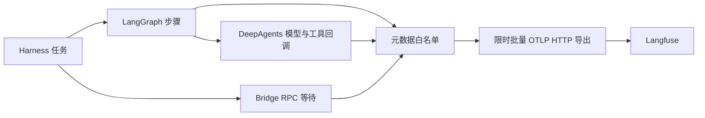

# Langfuse 调用链观测集成

> 2026-10-26 更新：当前包支持逐任务读取日常 Bridge 私有目录的 observability.env，已安装本地配置；隔离真实 Native/Worker 任务已回读入库，宿主保留任务终态与导出状态。下文仅依赖启动环境和必须重启的描述属于旧包；当前进展与日常个人会话未验边界见 [23](23-continuation-2026-10-26.md)。

日期：2026-10-22。状态：代码集成、本地导出及真实本地 Langfuse v4 入库回读通过；日常 Bridge 配置尚未启用。

## 目标与方案

采用 LangChain 元数据回调 → OpenTelemetry span → Langfuse OTLP HTTP 接口。保留 DeepAgents / LangGraph 现有流程与领域授权，不启用会自动记录原始输入输出的默认内容追踪。追踪默认关闭，不自动上传本机数据。



## 已覆盖

- 每个 Worker 任务一个 trace，同会话通过不可逆摘要 sessionId 关联；chat、resume、generate 分别成 trace，不把恢复视作旧模型调用继续运行。
- 外层图步骤、DeepAgents 的模型与工具调用；按实际回调 parentRunId 建立父子关系，缺失父级时挂任务根节点。
- 工具等待 Bridge 的跨度包含 IPC 和页面补证等待时间，可与 Agent 工具总耗时对照。
- 计数：模型/工具调用数、重复工具参数次数、候选/目标/诊断数量；记录确定性诊断码与业务失败状态。
- 同一任务内的工具参数以随机密钥 HMAC 指纹比较重复，不上传参数；不跨任务关联指纹。
- 模型返回 usage 时记录输入/输出 token；未返回则不伪造。未实现费用估算、首 token 延迟和模型价格配置。
- 任务正常或异常结束时先限时导出再通知 Bridge 完成，防止 Bridge 立刻终止 Worker 丢失末尾记录。
- `last-trace.json` 写在 checkpoint 所在私有目录，仅包含最近启用追踪任务的 traceId 与时间，便于在 Langfuse 搜索；不包含服务密钥或页面内容。并发时只代表最后写入的任务。

## 隐私与故障边界

不导出：用户需求/消息正文、模型输入输出、DOM 原文、元素文字/选择器、页面或资源 URL、脚本代码、资源正文、输入值、HTTP 请求头、任意异常文本/堆栈。OpenTelemetry service.name 显式设为 luban-harness，避免默认值包含本地执行路径。不注册进程/主机环境自动探测或通用网络自动埋点。

仅放行结构化数量、有限枚举和诊断码。Langfuse 地址必须是 HTTPS，或本机 HTTP localhost/127.0.0.1/::1；不允许凭据嵌入 URL、查询参数和子路径。密钥只在 Bridge/Worker 进程环境中传递，不发送到扩展或模型，不写入提交文件。

配置缺失/无效时关闭追踪。导出器失败不得改变任务结果或授权；单批导出限时，不无限重试。关闭追踪不会改用 LangSmith，现有 LANGSMITH_TRACING=false 仍保留。

当前强杀、取消、父进程超时或系统崩溃可能丢失尚未刷新的末尾 span；不能声称全过程零丢失。当前没有跨进程传播到扩展内部采集、真实运行/保存的完整分布式 trace；Bridge 工具 span 只能体现这些请求的等待与回执摘要。浏览器主线程性能分析也不在本次范围。

## 配置与启用

模板：`harness/config/langfuse.env.example`。模板不会自动加载，实际密钥放在提交目录以外的私有配置中。

需要设置在 **Bridge daemon 启动环境**：

```dotenv
LUBAN_LANGFUSE_ENABLED=true
LANGFUSE_BASE_URL=http://127.0.0.1:3000
LANGFUSE_PUBLIC_KEY=<Langfuse 项目 public key>
LANGFUSE_SECRET_KEY=<Langfuse 项目 secret key>
```

Bridge 启动 Worker 时通过专用环境白名单转发以上配置项。已经运行的驻留 daemon 不会继承后来终端新增的环境变量；必须先结束当前任务，再按既有 Bridge 启动方式加载配置并重启。仅在终端设置变量后从 Chrome 打开侧栏，不能保证 Chrome 启动的 daemon 能读到这些变量。不要强制终止有运行任务的 daemon。

本次未改日常 Native Messaging 注册，也未重打包/替换运行中的 Bridge。实际使用需重新构建 Harness、按项目流程打包 Bridge，并在配置可见的 daemon 环境下启动。用户已选择本地 Docker，已启动独立容器组并完成 smoke trace 入库回读；未创建任何远程项目。

使用官方 OTLP `/api/public/otel/v1/traces` 接口，避免依赖即将收紧的旧 ingestion 端点。自部署服务应确认版本及 OTLP 支持；本次不宣称兼容所有版本。默认不启用 v4 特有头；针对明确部署的 Langfuse v4，可设置 LUBAN_LANGFUSE_INGESTION_VERSION=4。当前本地部署的私有 bridge.env 已包含该项，以启用 v4 实时入库。

## 如何分析 Loop

1. 按 session 找到一次任务 trace，先看总耗时、调用数和 ERROR 步骤。
2. 工具跨度很长：查看对应 Bridge 等待跨度，区分模型思考与页面证据等待。
3. 同工具相同参数指纹重复：检查是否持续返回相同诊断码、目标数量是否变化；指纹一致不代表结果未变，不能单独当无进展证明。
4. review 步骤反复 TARGET_REQUIRED：结合任务是否只读，判断是否落入“只读任务强制要求修改目标”的错误出口。
5. span 失败或预算耗尽：看安全诊断码；不把所有错误归结为模型配置。
6. trace 正常不等于元素语义匹配正确，也不代表获得执行授权。准确性仍需金标与真实页面验收。

## 实施与验证记录

- 新增 `harness/src/observability.ts`，Worker 在图与 Agent invoke 注入同一元数据回调，Bridge 显式转发配置。
- 已验证默认关闭、配置拒绝、父子 span、token 与计数、正文/凭据不导出、实际 LangGraph 经本地 HTTP 接收端导出、接收端失败不影响任务。
- 完整 Harness 34 项测试通过；Bridge 生命周期、真实 Worker、取消与旧回执 7 项测试通过。
- 本地接收端仅验证 OTLP JSON、认证头与内容边界，不能代替 Langfuse 的实际认证、入库及 UI 验收。
- 待真实服务验收：发起一次普通对话与一次补证任务；核对模型/工具次数、诊断、耗时、token、会话关联；断开服务确认任务继续；验证 UI 中不含页面、代码和密钥。

## 参考

- [Langfuse OpenTelemetry 接口](https://langfuse.com/integrations/native/opentelemetry)
- [LangChain / LangGraph 集成](https://langfuse.com/integrations/frameworks/langchain)

本实现选择自定义元数据回调与标准 OTLP 导出，以满足当前不上传页面/对话正文的要求；并非直接启用 Langfuse 默认输入输出回调。

### 依赖复核

固定使用 OpenTelemetry API 1.9.0、resources/sdk-trace-node 2.12.0 与 OTLP HTTP exporter 0.223.0。避免 0.300 导出器与 API 的运行时不兼容，并移除旧 core <2.8.0 的新增追踪依赖风险；未使用 force/legacy-peer-deps 绕过依赖冲突。现有 DeepAgents 的依赖公告未在本次进行无关升级。最终版本已通过 Harness 34 项回归；最后增加模型名称元数据后，6 项观测专项回归再次通过。

## 部署选择更新

用户已选择本地 Docker 自部署。准备及实际进展见 [本地部署记录](19-langfuse-local-deployment.md)。

真实本地部署验收已完成，结果见 [本地部署与验收](19-langfuse-local-deployment.md)。其中 v4 API 回读已通过，日常 Bridge/真实模型页面任务仍未验证。
