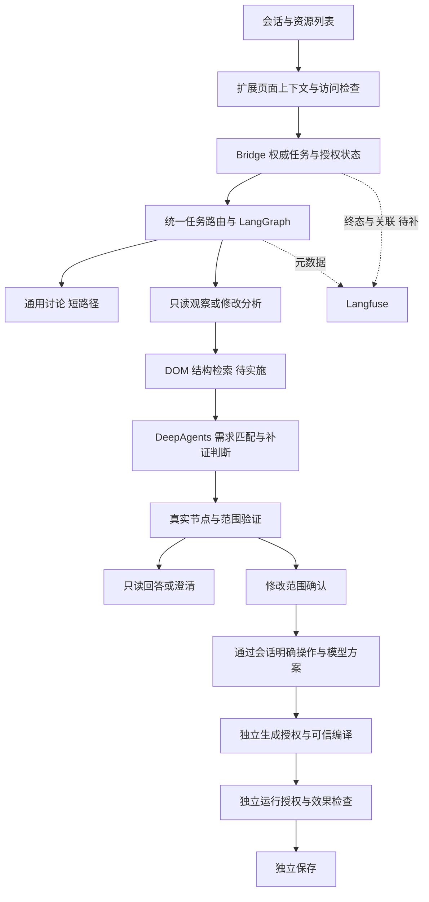

# v4.3 源码复核（2026-10-22）

> 2026-10-26 进度更新见 [继续实施与验收](23-continuation-2026-10-26.md)。本文原日期的实施、断点与验收结果保留，不覆盖后续代码；当前关键真实链路已补验，但完整发布门槛仍有未完成项。

复核日期：2026-10-22。范围：05、05a、06、08、12、14–19 号文档，以及 Harness、Bridge、页面采集、侧栏和脚本合同的当前源码。

本次是方案与源码对照复核，不修改运行逻辑，不重跑历史全部验收，也不把源码推断写成新一次浏览器实测。设计以 [总技术方案](05-technical-design.md) 为准。本稿只记录当日断点；与 05 冲突时以 05 为准。实际能力以源码及对应日期的验收证据为准。

## 1. 总体结论

保留 **Preact/MV3 → Native Host → Bridge → LangGraph/DeepAgents → 受控页面证据与执行器** 的架构，不重写框架，不引入第二个浏览器会话。

方向正确，但尚未形成统一闭环。近期优先级应是：

1. 让日常 Bridge 的观测配置真正生效，获得当前任务链基线。
2. 修正首个页面任务绑定、只读出口、需求/范围失效粒度及统一路由。
3. 接入 DOM 结构块和词法检索，补充真实节点验证。
4. 明确资源正文获取能力后再做资源补证。
5. 用同集评估决定是否加入向量召回，不先部署向量数据库。

Langfuse 已部署、资源列表已展示、固定动作按钮已移除，都不能替代以上流程能力。

## 2. 文档权威与状态

| 文档 | 如何使用 | 本次复核处理 |
| --- | --- | --- |
| 05 总设计 | 当前总设计：架构、授权、本地 Agent、观测、只读出口、失效 | 决策以该文为准；本稿不覆盖 |
| 05a Loop | L1/L2/L3 的目标职责与边界 | 历史缺口与已实现部分区分，按本稿说明当前差异 |
| 06 拆解 | 原 T00–T15 工作包 | 修正交付文件编号；不能整包标完成 |
| 08 实施、12 验收 | 指定日期和指定环境的事实 | 保留；不能覆盖后续 UI 改动或真实页面失败 |
| 14–16 | 工具栏授权、登录案例、会话/UI 修正 | 用于说明新需求和已知回归，不作为全面通过证明 |
| 17 DOM 检索 | 待实施的目标方案 | 补充本稿的失效规则、资源获取和验收口径 |
| 18–19 观测与部署 | 已接入代码、实际本地 Langfuse smoke 入库 | 日常 Bridge 尚未启用，不能标为真实页面全链路观测已完成 |
| 本稿 | 2026-10-22 的源码断点 | 不作为设计入口；与 05 冲突时以 05 为准 |

## 3. 复核发现

优先级 P0 表示阻碍期望主流程，P1 表示下一阶段必须补齐，P2 表示明确后续边界；不等同于已发现越权漏洞。

| ID | 优先级 | 源码/文档事实 | 影响与修订要求 |
| --- | --- | --- | --- |
| F01 | P0 | `useHarnessChat.act('message')` 不做 bind；现有页面绑定入口仍是 scan/manual；读取按钮已移除，Runtime 仍提示点击旧按钮 | 新会话缺少完整的“页面相关需求 → 只读绑定”入口。补受控绑定流程并统一文案；普通讨论不采集 |
| F02 | P0 | EvidenceWorkflow 成功条件是 `ids.length && !diagnostics.length` | 只读识别没有独立成功出口。新增 answered/incomplete/needs_clarification，不能强制选择修改目标 |
| F03 | P0 | `propose_requirement` 无条件调用 invalidate，后者清除 confirmed、plan、decision | 确认范围后继续聊天更新需求，可能把范围确认清掉。必须区分范围、操作、保留约束与无实质变化 |
| F04 | P0 | 普通 message 直接进 DeepAgent；只有 analysisOnly 进入外层证据图 | 两条路径的语义终点、外层复核与诊断路由不一致。页面任务统一路由，纯讨论仍走短路径 |
| F05 | P1 | 内层无进展主要在 review_selection 检查；query/inspect 可在到 review 前耗尽预算；宿主持久工具计数主要针对证据工具 | 17 稿中的全工具共享预算和双层无进展尚未落地。所有领域调用按任务统一计数，补证重复也要停止 |
| F06 | P1 | `modelBudget` 同时以同一个错误表示调用次数耗尽和总时长超过 120 秒 | UI 和观测不能准确区分停止原因。分别记录模型次数、工具次数、截止时间、证据超时、无进展及取消 |
| F07 | P1 | 资源列表仅有脱敏 URL/类型，查询参数合并；未读取正文；注册表没有 DOM 块检索索引 | 有资源清单不等于存在 RAG。新增观察块、词法索引与资源引用；展示索引与内容身份必须分开 |
| F08 | P1 | 资源正文获取尚无确定运输方式；JS/CSS 地址已知不代表正文可读 | 第一阶段主攻实时 DOM；可读 CSSOM 按范围补证。JS 正文或跨源资源需单独确定授权与获取路径，不能直接重放展示 URL |
| F09 | P1 | 生成生产路径是已批准信封 → 确定性 hide/dim 编译，无模型自由代码或生产修订代理；隔离验证服务未实现 | 这是当前明确边界，应从必经流程图中区分。固定方案不必人为多轮生成；生产沙箱不能写成已具备 |
| F10 | P1 | 运行/保存的真实权威仍在宿主，未全部搬到图中；生成图使用已批准 operation 启动 | 不再把“把所有授权都搬入图”作为当前必做重构。保留单一领域授权；图只投影/等待，不成为第二个裁判 |
| F11 | P1 | Langfuse 本地 v4 已 smoke 回读；源码有回调和导出；日常包/daemon 未加载配置；跨进程全链路尚无统一关联 | 必须单独验收日常任务 trace；补 task/epoch/operation 与 trace 关联。取消/强杀由宿主记录终态，不能依赖 Worker 最后刷出 root span |
| F12 | P1 | 12 号 UI 验收包含已移除的固定动作按钮，准确性仅是小样本历史探针 | 历史结果保留，但当前会话入口、纯识别和新资源列表需重新实测。不能用旧 6/6 宣称 DOM 检索准确率 |
| F13 | P2 | 新制品库、完整新哈希体系、生产隔离宿主、全图运行/保存恢复原稿仍列出，但实际采用增量兼容实现 | 先维持完整脚本字节和既有 hash/凭证一致性；独立增强项分别立项，避免为补文档而重复造库和审批 |

F01–F06 为源码确定的逻辑事实，具体用户场景影响仍需新增定向回归及真实会话复验。登录案例已有真实采集成功、分析未收敛的证据，但不能据此倒推出每次工具复核的完整失败参数。

## 4. 当前已具备与尚未具备

| 能力 | 代码/证据现状 |
| --- | --- |
| DeepAgents 领域工具白名单 | 已有 8 个；原稿“5 个工具”为设计前基线 |
| query / inspect / review 页面取证 | 已接入，受候选容量和主文档覆盖限制 |
| 外层证据图 | 已有；成功语义仍偏向修改范围确认 |
| 生成与完整 UserScript 头 | 已有固定 hide/dim 编译及宿主校验；历史 Tampermonkey 5.5.1 场景已验 |
| 运行、效果与保存门禁 | 已有宿主层边界及局部效果/保留检查；未知结果的完整真实故障矩阵尚未补齐 |
| 范围确认后会话提出操作 | UI 固定按钮已移除、模型有 propose_plan；需求更新的失效规则尚未适配完整新流程 |
| 按类型显示资源 | 已有；不包含可全文检索资源库 |
| DOM 结构 RAG / BM25 / embedding | 待实施，不因存在候选列表而算已完成 |
| Langfuse | 本地服务、合成 trace 入库已验；日常任务接入、真实模型/页面链路未验 |
| 全生命周期 graph 恢复、生产沙箱 | 未实施；当前领域门禁与测试夹具不能替代 |

## 5. 当前有效的总体架构

职责保持不变：DeepAgents 负责语义判断；LangGraph 负责路由和收敛；检索返回证据；Content Script 验证节点；Bridge/扩展掌握实际权限。图中的箭头不代表要增加用户逐步点击的界面。

### 5.1 产品能力范围

当前允许：讨论页面、读取/识别可访问证据、建议范围，以及在独立授权下编译 hide/dim 脚本。

点击、填写、登录、抓取数据写文件等不在当前 PlanIR 合同内。模型可以判断需求属于这些操作，但不能因此执行。若本期目标变为通用网页自动化，必须另行定义动作协议、凭证、断言、回执和恢复策略；它不是 DOM 检索的一个附带开关。

### 5.2 不变更的工程决策

- 不因这次复核升级 DeepAgents/LangGraph 依赖或部署第二套浏览器。
- 不启用通用文件/Shell/task 委派，也不新增站点适配器。
- 不把向量召回结果直接登记为可执行 selector。
- 不把 Langfuse 当领域事件库、批准来源或“业务已成功”的依据。
- 不要求将运行/保存领域状态复制进第二套图授权数据库。

## 6. 必须补充的状态规则

### 6.1 失效规则

保留或作废以 [05 状态模型](05-technical-design.md) 为准：只比较目标集合、操作、保留约束；已确认范围、方案和生成授权一起保留或作废。本节不再单列另一套矩阵。

### 6.2 页面绑定与两类证据

- 资源面板的本地读取不自动授权模型读取正文，更不授权生成或运行。
- 首个明确页面任务在有效浏览器权限内做只读绑定；权限缺失说明点击工具栏重新打开侧栏，不指向已经删除的读取按钮。
- ObservationBlock 可描述表单、图标、输入框标签，但排除敏感值；TargetRef 仍遵循操作安全策略。不要为了“能看登录页”而放宽整块密码表单的修改范围。
- 搜索结果到真实 TargetRef 的转换必须经宿主注册和验证；只有源代码线索时停留在“可能关联”，不能伪造当前元素。

### 6.3 预算、进展与观测分开

预算由 Bridge 按 taskId/runEpoch 保有权威账本，覆盖所有模型及领域工具调用；进程内限额是第二道保护。幂等重放不重复结算，实际再次调用计数，恢复不能重置同一任务余额。

进展以新消费的证据内容、消除的缺口与诊断变化判断。工具参数指纹只帮助观测重复，不等同于无进展；evidenceRevision 自增也不自动证明有新知识。

模型 API timeout 应裁剪到任务剩余时间。为收尾留出时间，但不能为上传追踪延长已授权执行预算；追踪失败和页面任务失败分开记录。

## 7. 实施顺序与退出条件

| 阶段 | 工作包 | 退出条件 |
| --- | --- | --- |
| M0：可观测基线 | 当前包与 daemon 加载本地追踪配置；日常普通会话/补证的 trace 关联 | 真实日常任务可回读；无正文/密钥；取消与接收端失败如实标识，不冒充全链路已覆盖 |
| M1：主流程闭合 | F01–F06；observe/modify/discuss；细粒度失效；统一页面路由与预算 | 新会话无需读取按钮可识别；只读正常结束；确认范围后继续聊天不会无故清空；重复无进展停止 |
| M2：DOM 词法检索 | ObservationBlock、结构块、中文检索、候选重排及节点映射 | 金标目标进入候选，动态替换与误选反例通过；不增加执行权限 |
| M3：受控资源补证 | resourceId/内容版本/节点关联；确认正文获取路径与限制 | 不重放接口、不凭展示 URL 猜源文件；不可访问范围可见；资源不存在于 DOM 时不误报 |
| M4：对照与语义增强 | 同集比较当前基线/词法/混合召回，成本与失败保留 | 证明向量召回改善而不增加误选后再默认启用；否则维持词法路径 |
| M5：交付复验 | 当前 UI、Native、真实模型、Tampermonkey、故障矩阵 | 新一轮逐项证据；旧报告明确适用版本；未测项不标通过 |

M0 与 M1 可交错开发，但应在改动前保留可复现的原始基线。生产隔离验证器、全图副作用恢复和通用动作扩展另列增强任务，不让它们阻塞当前只读识别断点的修复。

## 8. 针对新主流程的验收清单

1. 新会话：只说“你好”不采集；说“识别当前页面入口”才在已有浏览器权限内读取；权限不足不编造页面事实。
2. 只读：找到元素就返回依据和位置，不要求选修改目标，不生成或运行；缺证和多候选分别反馈。
3. 会话方案：按 05 的失效表验收。解释且目标集合不变时保留已确认范围、方案和生成授权；改操作、改保留约束、增减目标、换页或节点替换时三者一起作废。
4. 检索：中文短词、纯图标、属性命中、重复文案、父子范围、隐藏模板、动态替换和不可访问 frame 均有正反例。
5. 资源：同路径不同查询版本不能错误复用内容；已加载 JS 出现文案但 DOM 无入口时不能误报；正文无法获取明确说明。
6. Loop：相同 inspect/query 无新证据不会耗尽全部预算才停止；次数与时间耗尽分开；取消无继续调用。
7. 授权：未确认范围/方案、过期批准、新版本或旧文档均不能沿用授权；运行/保存仍独立。
8. 观测：真实日常任务有对应 trace；token 缺失标未知，不伪造；已选范围/敏感值不外泄；强杀缺失 span 不当成功。

准确性评估使用人工金标、保留测试集及至少三次重复（模型非确定性场景）；最少 40 个任务、5 类布局是首批覆盖要求，不足以支持任意网站准确率承诺。候选级 precision/recall 与任务级完整正确率分开；多目标任务明确 gold 集合，Recall@20 同时报告目标级召回及全部 gold 入选的任务比例。拒答、缺证、超时与误报单列。17 稿的 90%/95% 是待测目标，不是结果。

原 A/B/C/D 实验若要宣称框架或完整 Loop 收益，仍需独立可运行快照；新增检索消融不能冒充已完成原四组实验。它们回答不同问题，应分别归档。

## 9. 复核依据

- [证据图与预算](../../harness/src/workflow.ts)、[Worker 路由](../../harness/src/worker.ts)、[受限 Agent](../../harness/src/runtime.ts)
- [领域失效与方案](../../bridge/src/harness-domain.mjs)、[Worker 服务](../../bridge/src/harness-service.mjs)
- [侧栏调用](../../src/sidepanel/v4/useHarnessChat.ts)、[决策区域](../../src/sidepanel/v4/HarnessChat.tsx)
- [页面取证网关](../../src/service-worker/services/harness-gateway.ts)、[注册表](../../src/content/annotations/registry.ts)
- [资源索引](../../src/shared/page-resources.ts)、[可信编译与脚本头](../../contracts/script-plan.mjs)
- [观测实现](../../harness/src/observability.ts)、[本地部署验收](19-langfuse-local-deployment.md)

本次只更新方案入口、复核记录与任务文档。未修复 F01–F13 的运行时逻辑，未重新部署 Bridge，未执行新的页面/模型准确性实验。
