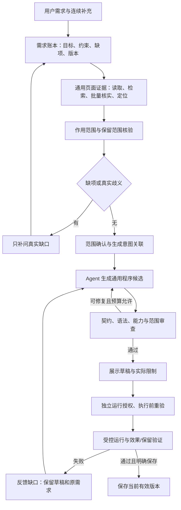

# V4.3 通用页面脚本生成架构

日期：2026-10-28。依据用户最新确认：鲁班提供通用页面理解与脚本生成能力，删除、替换、添加、修改、统计和组合是验收场景，不是分别开发的产品动作工具。本方案取代把 hide/dim 编译器视为产品能力边界的架构假设。

> 后续实施更新：[56 号记录](56-generic-program-draft-integration-2026-10-28.md)已将通用程序候选接入源码并通过本地真实 Worker/模型协议测试。尚未部署或完成线上浏览器验收；受控运行仍未接入。下文“本次”描述本方案建立时的 M0 状态。

> 2026-10-28 后续更新：[66号记录](66-unified-requirement-evidence-and-t02-2026-10-28.md)已统一两条修改入口的需求核验。宿主将完整需求绑定请求/需求版本，取证阶段不能覆盖；新的人类补充重新核验。真实T02需求合并与版本保持通过，但取证未形成范围，仍未生成草稿。后续部署和验收状态以66号及账本为准，下文为方案建立时的历史状态。

## 目标与实施状态

完整目标是：人给出页面改造诉求，系统理解并核实真实目标，生成对应脚本，经过代码与范围检查形成可审阅草稿；在独立运行授权后验证效果及非目标保留，最后按独立保存授权保存。

本次已落地：新架构、验收口径、通用生成契约与契约回归。`contracts/script-generation.mjs` 接受脚本源码与证据/授权绑定，不设置业务动作枚举。**新契约尚未接入 Worker、Bridge、侧栏或执行器；现有生产链路仍是 hide/dim。不能据本文声称 19 项场景已经可用。**

## 当前限制的证据

| 位置 | 当前行为 | 迁移方向 |
| --- | --- | --- |
| `contracts/script-plan.mjs` | validatePlan 只接受 hide/dim，固定生成 CSS | 保留为可选旧优化路径；从通用生成准入条件移除 |
| `harness/src/worker.ts`、`workflow.ts` | generation 不调用模型生成任意任务程序，而是确定性构造旧 IR | 使用已授权上下文调用生成器，产出 Candidate，按反馈有界修订 |
| `bridge/src/harness-service.mjs` | 生成前编译旧 IR；收到候选后要求逐字等于编译器结果 | 校验生成信封、源码、能力与版本关联，接入通用审查与受控试运行 |
| `bridge/src/harness-domain.mjs` | 计划和 propose_plan 的 action 只允许 hide/dim | 改成需求、作用范围、期望结果、风险及能力申请；动作描述是任务数据 |
| `src/shared/v4-types.ts`、侧栏 | 方案只展示固定动作 | 展示用户目标、范围、保留条件、预期变化、制品和各阶段结果 |
| `src/service-worker/services/code-quality.ts` | 语法/权限/风险扫描 | 继续复用，但不能将静态扫描解释为范围隔离或语义正确的证明 |

## 分层职责

- Agent 决定任务的处理方式与代码组织，按真实证据组合逻辑；不把网页内容当作指令或批准。
- 页面工具只提供通用读写所需证据、节点身份、关系、位置、属性和覆盖范围；不内置站点或广告业务知识。
- 宿主负责需求/页面/范围/制品版本、授权账本和能力准入，不能由模型口头自行授予权限。
- 运行层执行受控程序，检查目标变化与保留要求。仅有脚本生成、节点不可见或过程结束，不代表语义任务完成。

## 需求与授权语义

需求账本记录完整目标、参数、保留条件、用户原话与各轮变更来源。补充一句动作或对象时，只补缺口；改写约束必须使旧范围/草稿/授权关联失效。暂不可用不删除原需求。

明确的完整改造请求可以形成生成意图。纯聊天、只读识别、引用页面里的命令不能形成生成意图。继续遵循项目要求：Agent 新提出的具体处理范围需要用户确认；已有有效确认范围不重复确认。范围尚未确认时明确卡在“核对范围”，而不是反复询问用户是否允许生成。范围确认后可使用已记录的生成意图继续，不叠加同一目的的泛化批准。

生成、运行、保存分别授权；生成意图不代表运行或保存许可。原 47 号用例“证据充分直接生成”的共同前置现明确包含有效范围关联；新发现的范围不能静默自动确认来凑一轮完成。

## 通用生成契约

新契约包含：

| 数据 | 内容与约束 |
| --- | --- |
| requirement | goal、constraints、expectedOutcomes；无业务动作枚举 |
| binding | pageRef、documentId、navigationEpoch、scopeRevision、requirementRevision、scopeHash、baselineHash |
| scopes | 已核实目标、保留范围与输出锚点；包含宿主提供的引用和证据关联 |
| operationId / decisionId | 本次生成任务与生成批准；不能复用其他任务的批准 |
| policy | 宿主允许的权限与代码容量；不是模型申请即批准 |
| candidate | 完整代码、解释、实际权限、使用证据与同一 binding |

关联校验拒绝过期页面、变更范围、需求修改、手工草稿基线改变、未知证据、越权申请和模型自报“检查通过”。引用存在不证明它属于正确业务目标，选择器语法合法不证明唯一，合法代码也不证明只影响授权范围。

新契约的 `review` 明确保留 code、scope、effect、runAuthorization 为 required；不输出整体安全或任务完成结论。宿主在可信端计算并核验 scopeHash，不能信任模型提供的任意哈希。

## 通用执行与范围约束

不能简单删除旧编译器等值检查后直接执行模型返回的任意 JavaScript。否则模型可以在绑定正确目标的同时修改全页；静态扫描或运行后截图不足以提供强制隔离。

目标方案为受控脚本运行时：程序使用通用 DOM 能力接口和引用句柄，不获得真实页面 Window、Document、网络或宿主扩展对象。宿主代理对每次操作检查页面身份、作用范围及保留范围；通用节点读取、属性/样式/文本更新、创建/插入/移除、事件绑定等基础能力可由普通程序组合。计数、分支、去重和动作顺序由程序表达，不再为“广告统计”或“搜索框清空”开发独立业务工具。

该运行时尚未实现。隔离引擎必须证明不能逃逸、不能直接触网、不能绕过代理、可终止且具有指令/时间/内存上限后才能上线。新增 DOM 原语只扩展通用基础能力，不为每个用例加入专属动作。

范围规则需要覆盖后代、祖先及间接影响：例如移除父容器会影响其中受保护的子节点；隐藏祖先会让保留内容不可见。涉及保留区域时必须先拒绝或明确扩大范围，不能只检查传入句柄属于目标集合。只读查询、目标写入、输出锚点插入、事件触发必须分别遵守该次策略。

对于传统 Userscript 导出，导出物的运行权限与保证必须另行声明。脱离鲁班执行器后的裸脚本不能沿用鲁班受控运行的隔离保证；不可把宿主签名或过期页面引用写入导出文件后声称长期有效。

## 验证与预算

验证按实际用户目标定义预期，不以旧编译器接受/拒绝作为功能通过依据。

- 生成：有真实调用、候选源码、可审阅解释、范围/需求/授权与制品关联；不要求与预制代码逐字相等。
- 运行：代码通过通用准入；执行前再核验身份；执行后比对目标、保留区域、用户输入值、网络/表单副作用及幂等性。
- 统计：计数单位、去重和覆盖明确，零值合法；截断时只报告已覆盖范围。
- 动态交互：初始状态与点击后的变化分别验收；有按钮不等于点击行为正确。
- 任意文本：参数按数据传递，不能变成 HTML/JS 指令；页面提示注入不能改变需求或授权。

总预算拆分为需求理解、证据采集、候选生成、修复和效果核验。宿主记录每阶段模型/工具调用、输入输出量、采集/检索/模型等待时间、缓存命中、覆盖与终止原因。批量读取/缓存只复用同一文档身份和有效证据版本。没有新增证据时停止重复补证；定位失败提供手动选择并保留原需求。

## 迁移顺序与准出门槛

| 阶段 | 交付 | 准出条件 |
| --- | --- | --- |
| M0（本次） | 架构、契约、场景化清单、历史结论标注 | 契约绑定/越权/伪造反例回归通过；不宣称已接入 |
| M1 | 通用需求与计划替代 action 枚举；统一分流和生成意图 | 完整请求与缺项/否定/只读对照；多轮不丢约束 |
| M2 | 接入实际模型源码生成、通用代码审查、候选版本管理 | 19 个场景都有真实候选生成记录；原草稿不被覆盖；不运行 |
| M3 | 受控运行时与 DOM 代理、资源限制、效果检查 | 无法逃逸或越权；跨布局目标和非目标保留；交互/动态/组合场景通过 |
| M4 | Worker/Bridge/侧栏切换、保存和导出语义、旧数据兼容 | 分别验证生成/运行/保存和过期/取消/重连；通用链路端到端验收 |

可保留旧编译器为内部可验证快路径，但不能让通用候选必须退化成 hide/dim。若后续保留该快路径，其可观察效果、授权和制品规则必须与通用链路一致。新路径未通过准出前，不静默替换当前已部署服务。
