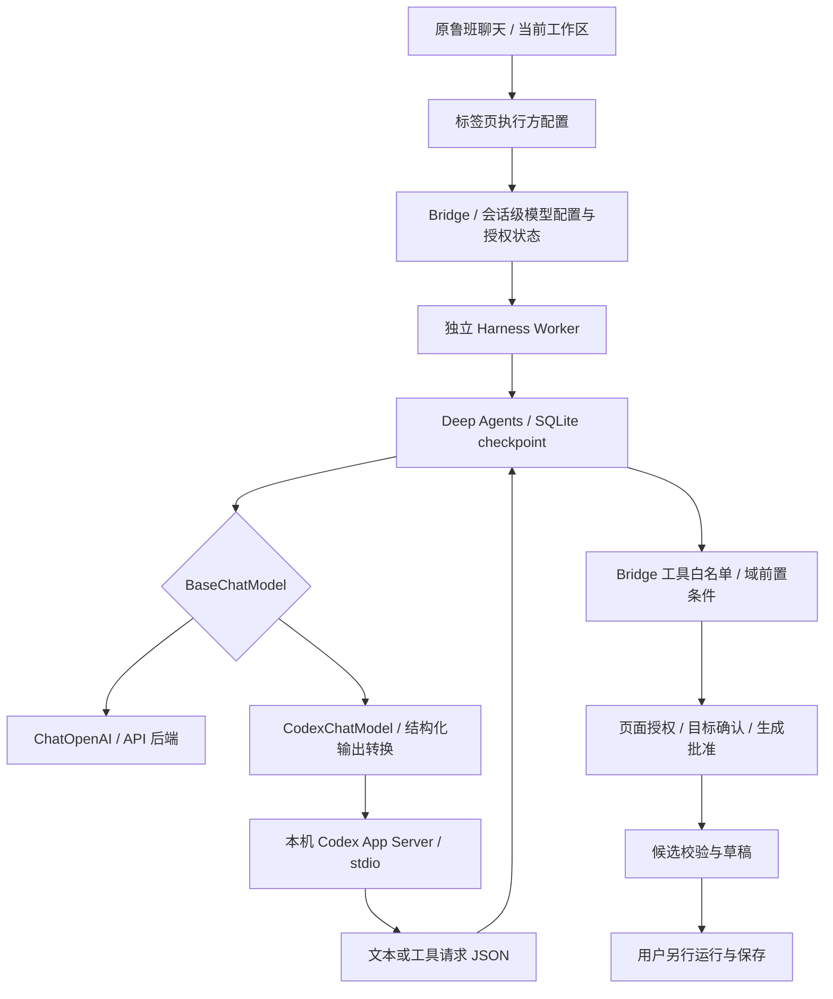

# 阶段 1：架构与边界

## 现状

V4 原有 ChatOpenAI 配置要求 API Key；V3 有专用 Codex App Server 适配器，旧实现严格匹配 0.162.0-alpha.17.2。本机为 0.163.0-alpha.10.2，因此被拒绝。V4 已有 SQLite checkpoint、工具白名单和 Bridge 域状态机，应复用而非替换。

## 架构

Codex 不持有页面执行权限。适配器仅接受当前绑定工具名、JSON 对象参数和有限输出；Deep Agents 校验工具 schema，Bridge 再校验业务状态。模型传输的临时线程不会替换鲁班现有会话；历史及中断续接仍归 SQLite checkpoint 管理。

## 兼容与进程

不再以精确构建号判定兼容。检查版本输出可识别、限制功能实际生效、安装版导出的 ThreadStart/TurnStart schema 包含所需字段，最后在调用中执行 initialize/account/read/thread/start/turn/start。无法证明的能力失败关闭；检查不修改用户配置。成功探测按二进制修改时间与大小缓存。

所有原生工具关闭，并拒绝 App Server 反向权限/工具请求；worker 独立进程组结束时清理 Codex 子进程。认证由 Codex 自身完成，鲁班不读取 auth.json、不复制 token、不要求用户把账号凭据填入 API Key。

模型配置按 profile + conversation 绑定，避免不同标签页互相覆盖。兼容原 API 调用及老测试的 profile 默认配置。

## 验收边界

自动测试覆盖确定性协议和授权反例；真实模型验收仅使用合成数据。实际 Chrome Native UI 尚需单独验证，不能把旧五站页面截图算作新后端证据。

参考：[官方 App Server 协议](https://learn.chatgpt.com/docs/app-server)，已核对 turn/start.outputSchema 和 stdio 交互。已读 ecosystem-primer、deep-agents-core 技能；依赖保持现有锁定版本。
