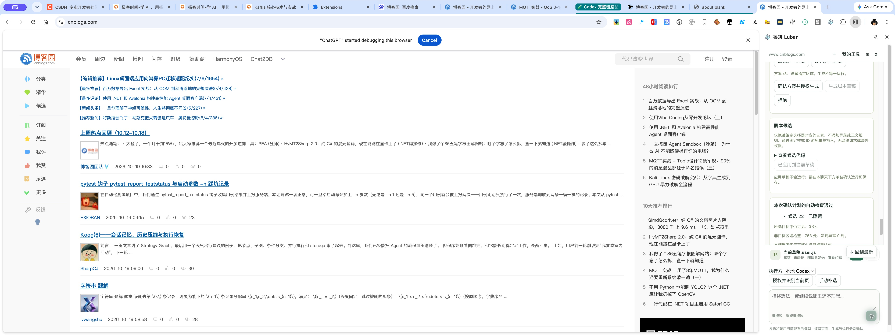

# 本地 Codex 完整交付报告

2026-10-19。实际运行版本：Bridge **0.6.7**；本机Codex **0.163.0-alpha.10.2**。

已在真实Chrome原生鲁班侧栏跑通：选择本地Codex → 普通聊天 → 多轮记忆 → 页面授权 → 模型工具分析/提议目标 → 目标确认 → 独立批准生成 → 结构化候选 → 质量检查并应用草稿 → 单独试运行 → 自动效果检查 → 模型依据证据复核。

真实结果：顶部确认横幅已隐藏；非目标区域检查763处、异常0处；最终DOM检查唯一目标匹配1处，导航和20篇文章可见。未保存脚本、未开启自动运行，自建验收页已关闭。没有新增任何网站定制逻辑。

## 修复

- 原workspace每次操作重新解析Harness会话，修复缓存失效导致HARNESS_CONVERSATION_MISSING；恢复不继承授权，不自动重放生成或提交。
- 本地模型不依赖额外账户UI发现查询；认证由Codex的真实模型请求执行。
- Worker先回传具体脱敏错误，再断开IPC，避免全部退化为笼统失败。

## 验收

12项自动检查、561项测试全部通过。真实原生侧栏已重新加载修复版，实际Bridge已切换并确认0.6.7；同一验收会话成功跨重启续聊。普通聊天没有生成；确认目标后仍须独立批准；生成后仍须独立运行，保存未自动发生。

[真实链路JSON](../../verification/evidence/local-codex/end-to-end/real-ui-flow.json) · [验收记录](./03-acceptance.md) · [复核记录](./04-review.md) · [自动门禁](../../verification/v4-auto-verification.md)

## 使用

在原网页鲁班侧栏选择“本地 Codex”即可继续；无需API Key或新建产品会话。若服务会话引用失效，会按原工作区恢复聊天，输入和草稿保留；页面和生成授权需重新核对。网络、登录或额度错误仍会明确显示，不静默切换其他模型。

本轮没有把所选横幅通过宣称为全页业务目标通过，也没有新做五站全量验收。此前初次失败记录仍在验收聊天中，修复后的成功及时间线独立可查。
