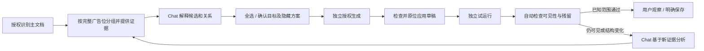

# CSDN 广告隐藏：Chat 与 Harness 优化报告

> 历史记录：本文描述的站点和广告专用实现已被通用能力重构取代，相关特判已删除。旧版真实页面结果不代表当前版本。见 [通用能力重构报告](./v4-generic-capabilities-report.md)。

日期：2026-10-18。结论：本次 CSDN 当前页面的三个完整广告位已在真实 Chrome 中隐藏，约 64 秒后二次复核仍隐藏；已知广告 iframe 可见数 0，三张普通资讯卡、社区推荐和主内容保留。真实模型完成分析、生成与基于效果证据的复核。未保存或开启自动运行。

执行计划与各阶段：[计划](./v4-csdn-ad-optimization-plan.md)、[C1 问题定位](./verification/csdn-c1.md)、[C2 实施](./verification/csdn-c2.md)、[C3 验收](./verification/csdn-c3.md)。本报告为 C4 整体再复核输出。

## 优化点与处理结果

| 优先级 | 原问题 | 本次改变 | 复核 |
|---|---|---|---|
| P0 | 把轮播 iframe 素材当独立广告位，换帧/回退图片仍出现 | 以右侧轮播完整容器归一，包含全部子素材 | 真实页面隐藏，延时约 64 秒仍隐藏；模拟换帧回归 |
| P0 | 选择器唯一性只检查一次；CSDN 存在重复 banner ID | 重新解析实际节点；资讯广告用子容器限定，不泛选全部 banner-box | 真实 3 张新闻卡保留；重复 ID 回归 |
| P0 | “脚本执行完”被当成“效果符合” | 自动检查目标可见性、已知广告残留与覆盖限制 | 运行前 3 处仍可见，运行后 3 处隐藏、残留 0 |
| P1 | 2/3 的重叠关系无法解释 | 给 Agent 容器描述、位置、尺寸、子 iframe 数与命中理由 | 真实模型能解释完整轮播分组与相邻独立广告位 |
| P1 | 用户说隐藏仍反复确认、多个分散按钮 | 全选 + 确认所选并采用隐藏方案 | 真实交互通过；生成/运行仍独立授权 |
| P1 | 失败反馈没有新证据，容易重复生成 | 检查类消息带入当前只读复核结果 | 真实 Chat 依据结果解释已隐藏、无残留与后续风险 |
| P1 | 普通聊天代次变化丢失复核卡 | 按方案版本和生成操作绑定结果，页面失效不显示旧通过结果 | 最终自动测试；见 C3 真实加载范围说明 |

## 为什么旧 2、3 号容易“隐藏不掉”

真实 DOM 证明右侧广告是一整个轮播广告位，多个 iframe 只是不同素材，旁边还有回退图片和广告位外壳。旧逻辑只处理某个 iframe，并没有把整个轮播广告位纳入范围；切换素材后另一个子节点仍可见。新扫描编号按完整广告位重新分配，所以旧 2/3 不能机械对应新 2/3。

本轮右侧整体使用 `#kp_box_www_swiper`，未扩大到包含社区推荐的 `#www-home-silde`。资讯广告因站点重复使用 banner-box ID，采用 `#banner-box:has(#kp_box_987)`，避免连带隐藏正常新闻。

## 优化后的交互与 Harness 闭环

效果检查是受授权与文档/工作区约束的本地 Harness 能力，不让模型自己把“执行成功”写成“验收通过”。模型负责解释与提出下一步；检查本身不扩权、不生成、不运行、不保存。

## 验收证据

真实事件、范围与候选代码见 [Harness 记录](./verification/evidence/csdn-real-harness.json)。DOM 交叉证据见 [首轮](./verification/evidence/csdn-after-first.json)、[延时](./verification/evidence/csdn-delayed.json)。

最终自动回归：`node luban/scripts/verify-v4.mjs --package`，515 项测试（扩展 427、Bridge 79、Harness 9）与 11 项检查，详见 [统一验收日志](./verification/v4-auto-verification.md)。

## 仍需明确的边界及后续优化

- “全部广告”本轮指当前主文档扫描覆盖和已知广告标记。站点可能懒加载、换 DOM 或新增广告位；未读取 iframe 内部，不宣称长期/全站清零。残留或结构变化应重新识别确认，不能静默扩大原授权范围。
- “单个 iframe 隐藏后仍有其他素材”的失败路径由对应真实结构的 fixture 自动复现；本轮没有对真实网页额外注入故障。
- 模型回复仍偶有内部字段和坐标，已进一步收紧表达规则；提示词不保证每次输出完全一致，最终文案补丁未额外远程抽验。
- 反馈输入按既有工作区规则可能使试运行回执失效；后续应将对话元数据与代码效果版本进一步拆开，避免为了保存重复确认。这次保留现有保存门禁，未作高风险状态迁移。
- 可继续合并“批准生成”和“生成草稿”的重复操作，但运行和保存仍应分别明确。本轮已先解决目标与方案确认的重复步骤。
- 需要跨多个网站、长时间轮播/滚动懒加载与更多真实故障注入，才能评估通用广告识别质量。本轮为本地案例优化与验证，未作生产发布。
