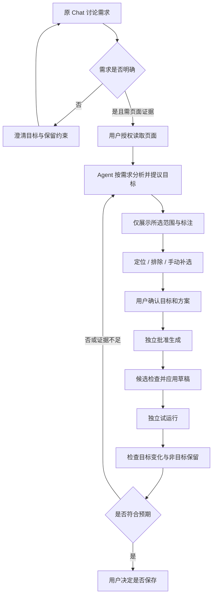
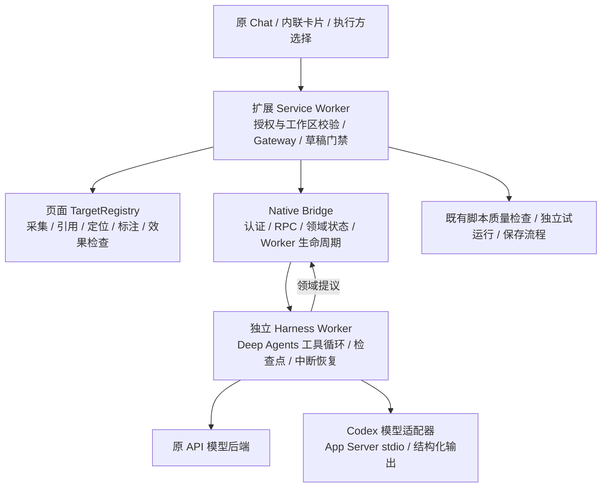
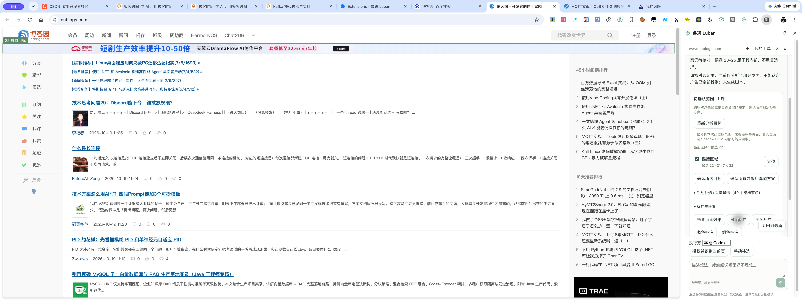

# 鲁班 V4 完整迭代报告

> 整理日期：2026-10-19（Asia/Shanghai）。覆盖本次 V4 从需求抽象、方案与 Demo、Harness 实施，到通用能力重构、真实网站验收、本地 Codex 接入和目标标注补修的全过程。
>
> 本报告汇总仓库内已有实施记录和验收证据，不代表本次编写报告时重新执行了全部测试。历史实现已被替代的地方明确注明；不同批次的测试和真实验收不合并为一个版本的全量通过结论。

## 1. 交付结论

V4 已把原来偏向脚本生成的 Chat，升级为围绕“理解需求、读取证据、提出目标、确认范围、制定方案、授权生成、独立运行、检查效果”的通用 Harness。

核心交付包括：

1. **原 Chat 原位升级**：使用原工作区和消息体系，不要求另开一个 V4 产品会话；需求、目标、方案和脚本候选以内联卡片呈现。
2. **生成前置条件明确**：普通讨论和页面分析不会自动生成脚本。目标确认、生成批准、实际运行、保存分别受控。
3. **通用页面证据与引用**：提供结构、属性、关系、位置及覆盖范围；支持定位、手动补选、范围确认和页面变化后的失效检查。
4. **真实 Deep Agents 运行时**：通过受限领域工具进行分析与提议，以持久检查点处理确认和恢复；模型不直接取得浏览器执行权。
5. **双模型后端**：保留原 API 模型，新增本地 Codex；两者接入同一 Harness 与确认流程，不因切换执行方新建产品聊天。
6. **执行后检查**：同时检查已确认目标的预期变化与非目标区域的保留情况，再由 Chat 根据证据解释结果。
7. **真实链路验收**：已有 API 模型、Chrome Native 配对、多个公开网站以及本地 Codex 原生侧栏的实际验证；最近已修复博客园“只选一个目标却画出几十个框”的问题。

**当前不能交付为“自动识别并隐藏所有网站全部广告”。** 已通过的是有界证据与确认范围内的通用流程；整页语义召回、跨 iframe / Shadow DOM 内部理解、所有动态变化及交互完整性仍有缺口。

## 2. 起点：V3 的问题与 V4 目标

### 2.1 用户最初希望解决的问题

V3 的 Chat 容易把每次对话都推进到脚本生成，即使需求尚未清晰。这使讨论、分析、确认和执行之间缺少清楚的产品边界。

同时，用户希望助手能够理解“需要处理页面上的哪些区域”，在页面上突出、标注这些区域，解释为什么选择它们，再让用户确认。广告隐藏是一个验证案例，而不是要建设一个网站适配或广告过滤规则库。

### 2.2 V4 的产品目标

| 目标 | 实际落地方向 |
|---|---|
| 先聊清楚，再生成 | 保存需求目标、保留约束和待明确问题；未解决项阻止进入可生成方案 |
| 看得懂处理范围 | 候选编号、定位、页面标注、选中摘要、手动补选 |
| 用户知道自己批准了什么 | 目标、方案及生成决定绑定具体范围和版本 |
| 改错范围后可纠正 | 重新选择或采集后撤销旧确认，不继承旧授权 |
| 能解释“执行了但没达到目标” | 检查目标、非目标及覆盖限制，把证据带回对话 |
| 沿用既有使用方式 | 原 Chat、原草稿、原脚本门禁及运行保存链路继续承接 |
| 不针对网站写代码 | 页面层只提供通用证据；任务语义由 Agent 根据当次需求推断 |

原始需求与产品方案：[需求抽象](./v4-product-and-technical-proposal.md)、[产品方案](./v4-product-plan.md)。

## 3. 统一概念与职责

| 概念 | 定义 | 不应混淆的边界 |
|---|---|---|
| 工作区（Workspace） | 用户原聊天、草稿及工具上下文的归属 | 不是每换模型就新开一个聊天 |
| Harness 会话 | 关联工作区的领域状态、事件和运行记录 | 内部会话标识不等于独立产品入口 |
| 页面结构证据 | 已授权文档中的有界节点、属性、关系和位置 | 采集到 40 个节点，不等于识别到 40 个广告 |
| 提议目标 | Agent 根据需求与证据建议的处理范围 | 提议不等于用户确认，更不等于生成授权 |
| 当前选择 | 模型提议或用户手动调整后的范围引用 | 不能将未选结构节点全部画成处理目标 |
| 已确认目标 | 用户已核对的具体范围 | 页面或目标变化后可能失效 |
| 处理方案 | 动作、范围及保留约束的版本化描述 | 确认方案与实际运行仍分开 |
| 生成批准 | 针对当前方案的有限授权 | 不自动批准后续运行、保存或扩大范围 |
| 脚本候选 / 草稿 | 模型生成并经检查后可审阅的制品 | 有代码不等于已经执行 |
| 试运行 | 用户单独触发的实际页面变更 | 运行回执不等于效果验收通过 |
| 效果检查 | 对确认计划和非目标保留情况的检查 | 局部检查通过不等于完整业务目标完成 |
| 本地 Codex | 通过本机 Codex 登录与 App Server 接入模型的后端 | 不代表模型离线运行，也不开放本机任意操作能力 |

## 4. 最终产品流程



流程可以停在普通问答、需求澄清、页面分析或标注阶段，不强制走到生成。分析本身不确认目标，生成本身不运行，保存也不自动开启自动运行。

## 5. 技术实现与 Deep Agents 设计

### 5.1 架构分层



- **侧栏**负责对话、范围展示与明确操作，不自行授予模型执行权。
- **Service Worker / Gateway**负责当前文档、工作区和授权绑定；将候选交给原草稿门禁。
- **TargetRegistry**负责当次页面真实引用与技术证据，不承担预置广告分类。
- **领域层**负责需求、选择、确认、方案、决定、生成操作和请求幂等。
- **Harness Worker**负责模型与工具循环，和浏览器执行隔离。
- **原运行保存链路**继续承接实际脚本操作，避免重新实现一套执行系统。

详见 [技术方案](./v4-technical-design.md) 和 [架构图](./assets/v4-architecture.svg)。

### 5.2 Deep Agents 的实际使用范围

实现使用真实 `createDeepAgent`、`SqliteSaver`、`interrupt` 与 `Command`，而非仅以 Deep Agents 命名的一次普通模型请求。

主 Agent 只开放以下五个领域工具：

| 工具 | 职责 |
|---|---|
| `propose_requirement` | 提议需求目标、约束及未解决问题 |
| `read_page_context` | 读取已经授权绑定的页面证据 |
| `propose_targets` | 从真实引用中提议范围，不确认目标 |
| `propose_plan` | 基于已确认范围提议隐藏或弱化方案 |
| `request_generation` | 发起生成批准请求，不执行或保存 |

模型调用前过滤工具，派发时再次校验；未开放自由子代理、任意命令、主机文件或浏览器工具。虚拟文件后端默认拒绝读写。等待批准不持有网页执行权。

检查点与领域记录分别承担模型恢复和业务确认；通过版本、代次、方案摘要、基线及操作标识防止迟到结果覆盖新状态。取消、拒绝或重建会话后不会静默重放旧生成批准。

依赖记录：`deepagents 1.15.1`、`@langchain/core 1.2.18`、`@langchain/langgraph 1.5.1`、SQLite checkpoint `1.1.0`；完整版本以 [Harness package.json](../../harness/package.json) 及 lockfile 为准。

### 5.3 本地 Codex 接入

本地 Codex 被实现为同一工具循环中的模型后端。通过 App Server 标准输入输出通信，以结构化信封返回回答或工具请求，再经工具名、参数及领域前置条件校验。

兼容策略从精确构建号约束改为限制能力与协议字段探测；缺少必要能力时拒绝运行。API 凭据只在 API 分支加载；模型配置按所属客户端与会话隔离，不静默切换后端。

实际验收时 Bridge 为 **0.6.7**，本机 Codex 为 **0.163.0-alpha.10.2**。这是当时真实环境结果，不构成所有后续 CLI 版本都兼容的承诺。

设计与交付：[本地 Codex 技术方案](./local-codex/02-design.md)、[完整链路报告](./local-codex/end-to-end/05-report.md)。

## 6. 迭代过程与里程碑

| 阶段 | 做的事情 | 关键调整 | 依据 |
|---|---|---|---|
| 需求与方案 | 梳理 V3 缺点、统一概念、定义产品和技术方案 | 从立即生成转向需求与确认驱动 | [产品方案](./v4-product-plan.md) |
| 交互 Demo | 展示聊天、目标标注、确认、生成、试运行及保存 | 先验证交互；模拟能力不冒充真实系统 | [Demo 与说明](./README.md) |
| S0–S6 实施 | 接入 SDK、领域状态、页面注册器、Worker、UI 和门禁 | 按阶段输出记录，自动检查后进行第二轮修复 | [阶段计划](./v4-execution-plan.md) |
| 真实 API / Native 验收 | 使用实际 Chrome、既有配对和 MiMo 模型 | 暴露 Schema、SDK 解析、权限及候选质量问题 | [真实验收](./verification/v4-real-acceptance-record.md) |
| 统一原 Chat | 移除独立 V4 入口 | 延续原历史、草稿、输入与工具操作 | [统一 Chat](./v4-unified-chat-execution-plan.md) |
| 交互补修 | 页面前置条件恢复、Markdown、重复品牌 | 从笼统失败转向可恢复状态和清晰呈现 | [F](./v4-page-grant-fix-plan.md)、[M](./v4-markdown-fix-plan.md)、[H](./v4-header-fix-plan.md) |
| CSDN 闭环 | 分析隐藏不完整、轮播和目标范围问题 | 增加效果证据；其中专项实现后来撤回 | [历史案例](./v4-csdn-ad-optimization-report.md) |
| 通用能力重构 | 删除站点和广告特判，加入项目规则 | 语义由 Agent 推断，页面层只提供通用能力 | [通用重构](./v4-generic-capabilities-report.md) |
| 五站验收 | 在多个真实页面验证所选范围 | 修复编号、预算、展示指纹、自然收缩问题 | [五站报告](./v4-five-site-acceptance-report.md) |
| 本地 Codex | 新增后端、兼容探测、取消清理及原会话切换 | 随后修复运行版本错配和会话缺失 | [Codex 总报告](./local-codex/06-report.md) |
| 目标发现交互 | 原始结构清单折叠，只展示选中范围 | 明确页面已读取不等于目标已识别 | [目标分析](./target-discovery/04-report.md) |
| 博客园标注补修 | 真实模型选 1 处却画 40 框 | Gateway 与页面层统一只标所选目标 | [最新复验](./target-discovery/cnblogs-annotations/04-review.md) |

这些阶段在 2026-10-18 至 2026-10-19 的记录中逐步完成。表格表达先后关系，不为缺少精确时间记录的事项补造时间点。

## 7. 遇到的问题、根因与修复

### 7.1 产品与 Chat 交互

| 问题 | 根因 / 暴露的缺口 | 修复与当前状态 |
|---|---|---|
| 聊天就生成脚本 | 对话与制品流程耦合，需求尚未明确也进入生成 | 需求未明确先澄清；确认和生成门禁独立；普通聊天回归与真实模型路径通过 |
| 需要另起 V4 会话 | 初期产品入口映射了内部 Harness 概念 | 原 Chat 原位升级；内部会话关联原工作区，不要求用户切版本 |
| “本次模型处理失败”无法操作 | 未授权页面等业务前置条件与真正模型故障混在一起 | 已知业务错误返回可恢复结果，提示用户授权；未知错误仍失败，不假装读到页面 |
| Markdown 表格显示管道符 | 渲染器缺少合适的表格支持 | 安全渲染、窄侧栏滚动、保留原列表编号；旧历史文本不重写 |
| 回复大量 UUID / 内部工具名 | 模型把技术字段直接用于产品表达 | 使用原候选编号、位置、可见特征与短列表；保留确定性的选择摘要 |
| Logo / 名称重复 | Chrome 原生侧栏标题与应用内部品牌叠加 | 保留原生标题，内部改为紧凑网站与工具栏 |
| 40 个结构节点看起来像 40 个业务目标 | 原始采集清单直接作为主卡片展开 | 主卡片只显示选中范围；原始清单折叠；增加按当前需求分析入口 |
| 侧栏改了，页面仍满屏标注 | 上轮只改 UI，Gateway 仍将全部 targets 交给标注并画出 excluded | 只标 selected；页面层兼容旧调用时过滤 excluded；无选择时清除。真实博客园已验证 1 个目标对应 1 个框 |

### 7.2 目标理解、定位与效果检查

| 问题 | 根因 / 风险 | 修复及边界 |
|---|---|---|
| CSDN 原 2、3 处隐藏不完整 | 选择某个 iframe / 素材，没有包含标签、其他素材和外壳 | 依据真实父子关系重新确认完整范围；当前通过通用补选/范围提升解决，不保留站点归并规则 |
| 专项代码背离通用目标 | 将广告和站点判断下沉到了页面采集 / Harness | 删除网站、广告关键词和选择器特判；以 AGENTS.md 和边界检查约束后续修改 |
| 重复 ID 导致定位过宽 | 把选择器存在或一次唯一当作长期可靠 | 校验唯一匹配、原节点身份与内容指纹；变化后重新确认 |
| 目标换成新节点仍沿用确认 | 重绑定可能把旧授权转移给新对象 | 替换、真实资源/文本/结构变化使引用失效，不静默继承 |
| 轮播仅切 class 就失效 | 内容指纹将后代展示状态当成业务内容变化 | 归一后代展示 class；仍验证根属性、资源、文本、结构及节点身份 |
| 隐藏了整页却可能显示通过 | 只检查所选目标是否不可见，没有保护未选区域 | 运行前建立非目标基线；误隐藏/移除/弱化时拒绝通过 |
| 空父层自然收缩误报误伤 | 所选内容隐藏后包裹层自然归零，被当成未授权隐藏 | 限定普通无独立文本包裹层的自然收缩；受保护根区域及未选子内容仍检查 |
| 长页面检查不充分 | 发现和保留检查共用过小预算 | 发现预算 800、每批 40；非目标保留预算独立至 10000，超限说明不完整 |
| 满批后无法手动补选 | 原始证据与手动目标共享 40 个上限 | 裁剪未选证据腾位、保留已选引用并提示重新确认；已选满上限则拒绝扩展 |
| 模型选 22 却称 1 | 推荐顺序被当成页面编号 | 回复要求沿用真实 label；UI 确定性显示“候选 22” |
| 空文本图片难以解释 | 只有空字符串，没有资源或目标链接信息 | 提供中性属性与 href/src，主卡片不堆长 URL；不将空文本自动分类为广告 |
| 动态圆点被报为非目标弱化 | 自然动画与执行导致的变化难以区分 | 保留异常与复查记录，未用站点白名单掩盖；动态因果仍是限制 |

### 7.3 协议、模型与运行恢复

| 问题 | 根因 / 暴露的缺口 | 修复与验证 |
|---|---|---|
| 侧栏请求被严格 Schema 拒绝 | 请求带 expectedRevision，而领域层未接收 | 接收并校验版本，增加真实载荷和过期版本回归 |
| SDK 结构化解析 TypeError | 真实返回形状与解析器假设不一致 | 获取原始消息，严格解析指定工具或完整 JSON；拒绝非法工具、多个候选及权限 |
| 候选使用多余权限、修改导航 | 模型生成质量不能由提示词保证 | 质量门禁拒绝；收紧最小 CSS 与 grants，不以扩权换通过 |
| 重连后模型无法恢复 | 内存配置清空，入口状态又使重新配置不可达 | 保留连接/设置入口，每轮必要操作前配置；历史读取无需模型 |
| INVALID_REQUEST | 磁盘新包与常驻旧 Bridge 错配，旧配置 Schema 拒绝新字段 | 能力预检、可操作错误提示；核验实际进程后在无任务时切换，检查 Native health，而不只看磁盘版本 |
| HARNESS_CONVERSATION_MISSING | 前端缓存的内部会话引用失效，服务端已无该引用 | 每次操作按原 workspace 解析会话；轮询恢复；重建后不继承授权，不重放生成/提交 |
| Codex 精确版本锁过脆 | 构建号相等不等于协议兼容 | 探测限制标志与协议字段；必要能力缺失仍拒绝 |
| 额外账号发现阻断可用模型 | 账号 UI / workspace routing 发现失败，但真实推理链路可能可用 | 模型后端不依赖额外账号 UI 发现，认证交由真实模型请求；不靠自动重放推理掩盖失败 |
| 具体错误退化成笼统失败 | Worker 先断 IPC，外层错误尚未回传；包装异常也可能丢失 code | 先回传脱敏错误再断开；有界检查 cause，分类认证、超时、协议等错误 |
| 取消后嵌套进程或临时目录残留 | 强杀 Worker 可能绕过适配器 finally | 进程组取消；Bridge 持有运行目录并清理；补真实进程树与目录测试 |
| 迟到结果或重复提交污染草稿 | 并发、页面变化、基线变化及重试交错 | epoch / revision / 方案摘要 / 基线检查与原子幂等提交，保留原草稿 |

关键材料：[真实初轮失败修复](./verification/v4-real-acceptance-record.md)、[INVALID_REQUEST](./local-codex/invalid-request/04-report.md)、[Codex 复核](./local-codex/05-review.md)、[会话恢复与完整链路](./local-codex/end-to-end/02-implementation.md)。

### 7.4 验收与交付过程本身的问题

- **构建成功不等于用户加载了新版本**：磁盘包、常驻 Bridge、扩展 Service Worker 和页面内容脚本可能不同步。后续真实验收包含重载扩展、刷新页面、检查实际 Native 版本。
- **单元测试通过不等于产品问题消失**：最新 40 框问题正是主卡片测试没有覆盖页面标注链路。补充 Gateway 与 TargetRegistry 两层反例，并在真实页面复验数量一致。
- **局部隐藏不等于完整目标达成**：测试和报告统一表述确认范围，避免用“执行成功”“残留 0”暗示全部广告清零。
- **样本不足不能凑成功率**：菜鸟教程未见填充广告，不计成功；OSChina 混合新闻/活动未确认广告，不整块隐藏；51CTO 品牌直播单列，不冒充付费广告识别样本。
- **测试失败也需要保留和解释**：曾遇夹具 mock 影响继承 spy、样本路径错误、扩展类型环境不能直接引入 Node fs；修正夹具/静态样本后重跑，不删除失败事实。
- **环境限制不等于产品失败**：本机 socket 沙箱限制、浏览器前台变化、锁屏和自动审批超时分别记录；获得相应环境条件后重新执行，不把没执行的操作记成成功。
- **历史记录容易产生“多个最新”**：旧总报告持续追加导致结论分散。本报告统一索引与时间边界，旧文件保留原始证据，不用新结论覆盖旧失败。

## 8. 通用能力边界与被撤回的实现

早期为了修复 CSDN 隐藏不完整，曾加入完整广告位分组及专项识别逻辑。用户明确提出只要通用能力后，相关运行时特判已被删除，历史 CSDN 报告标明已被取代。

当前规则沉淀在 [项目 AGENTS.md](../../AGENTS.md)：

- 不在产品代码、默认提示词或配置中硬编码网站域名、ID/class、选择器、接口或布局规则。
- 不把广告识别、广告归并、专项残留扫描等语义放进页面工具或 Harness。
- 当次任务可以依据真实证据产生选择器及用户确认的脚本制品，但不能回灌为产品预置适配。
- 采集不等于语义判断；范围不完整要说明；元素变化后重新验证。
- 分析、目标确认、生成、运行与保存保持各自边界。

因此，广告案例验证的是通用证据分析和范围处理能力。与价格突出、干扰模块弱化等任务共享同一机制；不以广告关键词或固定推荐数量代替模型分析。

## 9. 验收汇总与证据强度

### 9.1 自动验收批次

| 批次 | 记录结果 | 如何理解 |
|---|---|---|
| 初始真实实现 | 486 项测试、11 项检查 | 初期实现和真实 API / Native 阶段的历史结果 |
| 原 Chat 统一 | 496 项测试、11 项检查 | 覆盖统一聊天增量，不代表新增真实全链路重跑 |
| 页面前置条件 / Markdown | 分别 500 / 504 项 | 对应各自构建的历史回归 |
| CSDN 专项阶段 | 515 项、11 项检查 | 专项实现后来被删除，不能作为当前实现通过证据 |
| 通用能力重构 | 531 项、12 项检查；真实 Chrome 合成 8/8 | 验证通用机制，合成页面不等于真实模型端到端 |
| 五站阶段 | 538 项：扩展 449、Bridge 80、Harness 9 | 多次构建逐步复测，不是最后同一构建五站整条链路全重跑 |
| Codex 完整链路阶段 | 561 项：扩展 455、Bridge 89、Harness 17；12 项检查 | 最近一次记录的完整统一自动门禁批次 |
| 最新目标分析与标注补修 | 扩展 461 项；类型、Lint、构建通过；二轮定向 57 项通过 | 最新改动的扩展回归；本轮未重新执行完整 Bridge / Harness 打包门禁 |

**不能把最新扩展 461 项与历史 Bridge / Harness 数量相加，写成一轮新的全量通过。** 同样，测试总数增长代表覆盖增加，不能直接换算识别准确率或产品完成度。

完整门禁命令：

```sh
node luban/scripts/verify-v4.mjs --package
```

该脚本的本机协议模型测试不是实际远程推理。最近完整日志见 [自动验收记录](./verification/v4-auto-verification.md)；最新扩展补修结果见 [实施与回归](./target-discovery/cnblogs-annotations/02-implementation.md)。

### 9.2 真实环境结果

| 场景 | 实际验证 | 结论边界 |
|---|---|---|
| 原 API + 真实 Native | MiMo 普通讨论、分析、生成、质量拒绝、独立试运行、保存、刷新及保存版复用 | 使用已有配对；早期专项页面实现已被重构，证据只代表当时版本 |
| 五个真实网站 | 博客园、CSDN、IT之家、搜狐、新浪的确认范围隐藏与非目标检查 | 包含手动补选；不证明自动找全五站广告 |
| 本地 Codex 完整链路 | 原生侧栏聊天、多轮记忆、目标提议、确认、批准生成、候选检查、独立运行、效果证据和模型复核 | 目标横幅隐藏，763 处非目标检查 0 异常，导航及 20 篇文章可见；未保存、未开启自动运行 |
| 最新博客园识别标注 | 实际重载扩展、刷新页面、本地 Codex 提议候选 22，内层 23–25 不重复选择，页面只显示 1 框 | 首批证据内验证；未确认、未生成或执行脚本；不证明整页只有 1 个广告 |

### 9.3 五站案例明细

| 网站 | 确认范围与实际结果 | 非目标检查 |
|---|---|---|
| 博客园 | 当时顶部通栏隐藏并延后复查通过 | 757 处、0 异常 |
| CSDN | 右侧完整模块含标签、轮播与占位隐藏，相邻内容保留 | 1312 处；延后曾有动态圆点异常，后续为 0，保留两次记录 |
| IT之家 | 第二批购物横幅含左右素材及标签隐藏 | 1255 处、0 异常 |
| 搜狐 | 下方明确广告标签模块隐藏，相邻栏目保留 | 1774 处、0 异常 |
| 新浪 | 购物推广整块隐藏，修复自然收缩误报后通过 | 2045 处、0 异常 |

51CTO 品牌直播整卡片为补充案例，1483 处非目标检查 0 异常；不计付费广告识别率。具体截图、DOM、模型复核与采样限制见 [五站报告](./v4-five-site-acceptance-report.md)。

### 9.4 最新博客园问题的证据闭环

修复前：模型只提议候选 22，但页面显示 1 个“疑似目标”与 39 个“已排除”框。修复后：模型提议数、主卡片选择数、页面标注数均为 1，真实候选编号保持 22。



[实际界面记录](./target-discovery/cnblogs-annotations/evidence/real-ui.txt) · [真实验收步骤](./target-discovery/cnblogs-annotations/03-acceptance.md)。

### 9.5 提交前统一门禁复验

2026-10-19，按用户提交与推送要求重新执行 `node luban/scripts/verify-v4.mjs --package`：**12/12 项检查通过，567 项测试通过（扩展 461、Bridge 89、Harness 17）**，扩展/Harness 构建、通用边界检查、Bridge 打包与重新定位烟测均通过。这是最新的一轮完整自动结果，更新前文“本轮未重新执行完整门禁”的阶段状态；历史 561 项批次仍保留原时间语境。

本轮未新增真实模型或真实网页验收；真实效果结论继续限于前述各次证据。详细时间、退出码与日志见 [自动验收记录](./verification/v4-auto-verification.md)。

## 10. 当前缺口与后续优先级

以下是依据迭代暴露问题提出的后续建议，**不表示已经完成或已开始执行**。

| 优先级 | 缺口 | 建议方向 | 建议验收标准 |
|---|---|---|---|
| P0 | 有界结构分批导致全页目标遗漏 | 设计通用增量证据读取和覆盖进度，让 Agent 能继续分析后续范围；新范围仍重新确认 | 多区域长页中明确已读/未读，新增目标可追溯，不丢失已有选择或沿用失效授权 |
| P0 | 识别依据与主卡片仍分离 | 目标提议结构化保存标题、理由、不确定性；失效后同步撤销 | 每个主卡片有可理解的依据，和真实引用一致，不能残留旧理由 |
| P1 | 图片文案及跨文档内部缺少证据 | 评估显式授权下的视觉证据或跨文档读取，不假装模型已经看见 | 已读、推断、无法读取区分；不能据空文本直接分类 |
| P1 | 动态自然变化与脚本误伤难区分 | 更严格的时序证据和多时点复核 | 无脚本时自然变化反例不过度报错；真实误伤仍阻止通过 |
| P1 | 识别质量缺少统计评估 | 维护通用跨布局评测集，区分自动发现与手动补选 | 分别报告准确率、召回、重复范围、误伤和覆盖率，不只统计运行成功 |
| P1 | 安装产物与运行版本可能错配 | 展示实际加载能力与构建标识，交付检查覆盖扩展、页面脚本及常驻 Bridge | 用户界面和实际进程版本一致，旧能力给出明确升级指引 |
| P2 | 灾难恢复真实证据不足 | 独立故障注入环境验证崩溃、断连、未知回执与取消 | 保留草稿、拒绝重复执行、迟到结果不覆盖、资源清理可验证 |
| P2 | 新配对及其他入口未完整实测 | 使用隔离配置档与明确入口范围补充验收 | 不改用户现有配对和数据；端到端证据独立归档 |

现有效果检查主要覆盖主文档可见性与透明度，不证明正文文本完整、所有点击行为正确或未来新插入内容都被处理。长期记忆、动态技能、自由多 Agent、跨站自动任务也不属于本轮开放范围。

## 11. 迭代经验与后续执行约束

1. **按用户业务区域表达目标，而不是展示 DOM 数量。** 结构节点是分析输入；主界面和标注需要反映真正被提议或选中的范围。
2. **将提议、确认、生成、执行分开建模。** 模型说“建议处理”不能改变授权状态；恢复会话也不能恢复旧批准。
3. **真实验收需要覆盖用户看到的整条链路。** 仅修改侧栏不足以修复页面标注，测试应同时核对模型引用、卡片数量与覆盖层数量。
4. **领域状态与运行版本必须可验证。** 不能以磁盘构建版本代替实际常驻进程，也不能相信长期缓存的会话引用。
5. **优先修机制，不沉淀案例规则。** CSDN 的范围问题应抽象为真实父子引用、完整范围确认及效果检查，不是新增网站适配器。
6. **把“不完整”和“未知”作为正常结果。** 采集分页、跨文档未知、动态差异都需要诚实呈现，不能用确定性成功措辞填补。
7. **每轮输出可追溯的计划、验收、复核和报告。** 历史证据保留版本语境；新补丁只声明本轮实际验证过的部分。

## 12. 交付物与阅读索引

### 产品与架构

- [原始需求抽象](./v4-product-and-technical-proposal.md)
- [产品方案](./v4-product-plan.md)
- [技术方案与关键架构图](./v4-technical-design.md)
- [交互 Demo](./demo-v4.html)（模拟评审原型）
- [实施阶段计划](./v4-execution-plan.md)
- [项目通用能力规则](../../AGENTS.md)

### 实施与问题记录

- [历史实施总报告](./v4-final-report.md)
- [原 Chat 统一](./v4-unified-chat-execution-plan.md)
- [页面授权错误修复](./v4-page-grant-fix-plan.md)
- [Markdown 修复](./v4-markdown-fix-plan.md)
- [重复标题修复](./v4-header-fix-plan.md)
- [CSDN 专项历史记录（已被通用重构取代）](./v4-csdn-ad-optimization-report.md)
- [通用能力重构](./v4-generic-capabilities-report.md)
- [五站验收](./v4-five-site-acceptance-report.md)
- [本地 Codex 接入与使用](./local-codex/06-report.md)
- [INVALID_REQUEST 根因与修复](./local-codex/invalid-request/04-report.md)
- [HARNESS_CONVERSATION_MISSING 与完整链路交付](./local-codex/end-to-end/05-report.md)
- [目标分析展示调整](./target-discovery/04-report.md)
- [博客园单目标标注补修](./target-discovery/cnblogs-annotations/04-review.md)

### 验收证据

- [统一自动门禁记录](./verification/v4-auto-verification.md)
- [早期真实 API / Chrome / Native 验收](./verification/v4-real-acceptance-record.md)
- [通用合成页面真实 Chrome 验收](./verification/generic-browser-acceptance.md)
- [本地 Codex 完整链路验收](./local-codex/end-to-end/03-acceptance.md)
- [最新博客园真实识别与单框验收](./target-discovery/cnblogs-annotations/03-acceptance.md)

扩展构建产物位于 `luban/dist`；Harness 编译产物位于 `luban/harness/dist`；本地 Bridge 包位于 `luban/bridge/dist/luban-bridge-macos-arm64`。这些是本地交付产物，本报告不表示已经发布远端、启用自动运行或完成生产准出。
