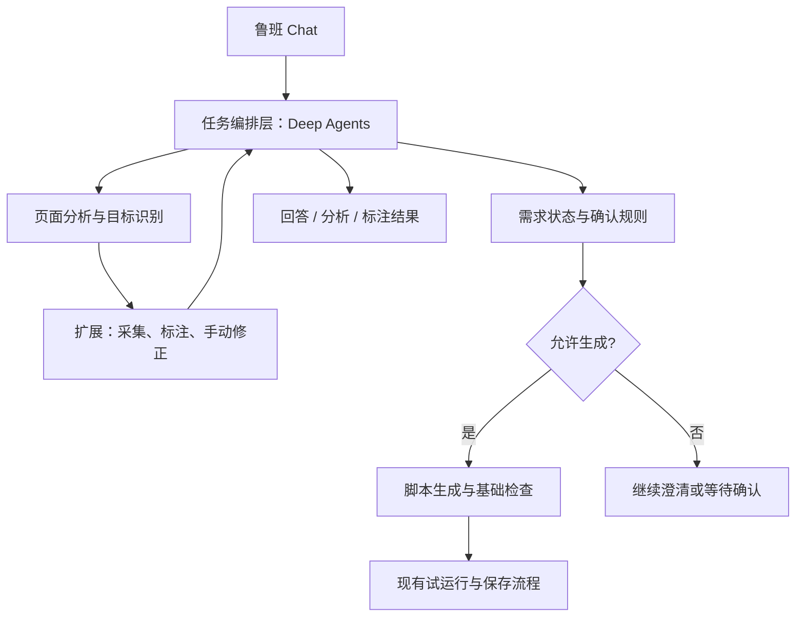

# 鲁班 V4 产品需求与技术方案初稿

版本：V4 / R0 
日期：2026-10-18 
状态：需求抽象与技术建议稿，待评审；不代表实现或技术兼容性已验证。

## 1. 版本定位

**鲁班 V4：基于 Deep Agents 的网页任务协作层。先理解需求、识别页面目标、与用户确认，再按需要生成脚本。**

脚本成为任务的一种交付结果；分析结论、页面标注和展示增强，也可以独立完成用户需求。

- 产品主线：对话驱动的网页理解与改造。
- 技术主线：基于 Deep Agents 的任务编排与页面目标确认。

本文将原始表述中的“VS”按上下文理解为“V4”。沿用仓库个人项目 Markdown 文档约定，未接入企业 PRD 模板流程。

## 2. V3 Chat 的现状与不足

当前核心问题是：**对话入口与脚本生成绑定得太紧。**

| 当前情况 | 用户感受到的问题 | V4 改进方向 |
|---|---|---|
| 发送默认进入生成流程 | 只是讨论想法，也开始生成代码 | 每轮先判断用户需要什么 |
| 模型输出强制包含代码字段 | 普通回答、追问、分析都被塞进生成协议 | 支持独立的回答、问题、目标和方案 |
| 需求澄清位于生成链路内部 | 已开始生成，才发现目标或要求不清楚 | 将澄清提前，并保留多轮需求状态 |
| 主要依赖用户点选和选择器 | 用户说“广告”“重要信息”，系统难以直接对应页面区域 | 增加语义识别、候选标注和人工修正 |
| 反馈围绕草稿和代码组织 | 用户不容易判断系统理解的是不是自己想改的地方 | 先展示“哪些位置、为什么、准备怎么处理” |

以上判断基于当前代码静态阅读，未进行真实模型或浏览器端到端验收：

- [Chat 发送流程](../../src/sidepanel/App.tsx)：`prepare()` 默认自动发送，进入 `generate()`。
- [生成输出协议](../../src/service-worker/prompt-builder.ts)：强制返回包含代码的结构化 JSON。
- [生成服务](../../src/service-worker/services/workspace-generation.ts)：澄清结果在生成流程内处理。

V3 已有独立页面分析、目标候选、策略确认和 `needsClarification` 基础。V4 应将这些能力串进统一对话，而不是全部重做。相关基础见 [页面分析](../../src/service-worker/services/page-analysis.ts) 与 [Workflow 类型](../../src/shared/v21-types.ts)。

## 3. 统一术语

产品界面使用中文，代码与接口采用固定英文名称。

| 统一名称 | 英文 | 定义 |
|---|---|---|
| 会话 | Conversation | 围绕当前页面持续交流，可以包含多个任务 |
| 任务 | Task | 一次有明确目标、范围和完成标准的工作 |
| 需求说明 | RequirementSpec | 用户想达到什么效果、保留什么、哪些问题尚未明确 |
| 页面目标 | PageTarget | 任务涉及的页面元素或区域，例如某个广告卡片 |
| 候选目标 | TargetCandidate | 系统识别出来、尚未被用户确认的目标 |
| 页面标注 | Annotation | 对目标进行描边、编号、标签或说明 |
| 处理方案 | ActionPlan | 对哪些目标采用什么处理方式，以及预期效果 |
| 制品 | Artifact | 可查看和管理的结果，例如脚本、分析报告 |
| 网页工具 | SavedTool | 用户保存下来、可重复使用的网页能力 |
| 任务编排层 | Harness | 管理上下文、工具调用、状态、确认、恢复与验证的技术层 |

### 3.1 三类确认

| 确认类型 | 对应问题 | 确认范围 |
|---|---|---|
| 确认目标 | 这些区域是不是你说的广告？ | 页面目标集合 |
| 确认方案 | 这些广告应该隐藏、弱化，还是加标签？ | 处理方式与预期效果 |
| 确认试运行 | 是否在当前页面执行这个版本的脚本？ | 当前页面与指定脚本版本的执行 |

三个确认对应不同决定，不能用一次“确认”替代全部。

### 3.2 技术角色

- 模型：负责推断。
- Agent：使用工具完成任务。
- Harness：管理任务过程。
- 浏览器执行器：负责受控的页面操作。

## 4. 核心产品需求

| 编号 | 需求 | 产品规则 |
|---|---|---|
| V4-01 | 对话与生成分离 | 普通提问、讨论、分析不会创建脚本草稿 |
| V4-02 | 多轮需求澄清 | 持续维护目标、范围、处理方式、保留约束和待确认项 |
| V4-03 | 页面语义定位 | 将“广告、价格、重要字段、干扰区域”等表达转换为候选目标 |
| V4-04 | 页面可视化标注 | 页面显示编号与标签，侧栏展示对应内容和识别依据 |
| V4-05 | 用户修正目标 | 支持取消误判、手动补选、调整范围 |
| V4-06 | 方案确认后生成 | 需求明确且用户已表达生成意愿，才进入代码生成 |
| V4-07 | 展示增强 | 支持临时高亮、重点标签，以及后续可保存的展示规则 |
| V4-08 | 结果验证与继续修改 | 区分代码检查通过、实际执行成功、用户认可效果 |

### 4.1 需求明确的判断条件

进入脚本生成前，必须满足：

1. 目标页面有效。
2. 目标范围明确。
3. 处理动作明确。
4. 重要保留约束无冲突。
5. 用户已授权生成。

例如，“页面太乱了”需要继续理解；“把刚才确认的 1、3 号广告隐藏，保留导航，生成脚本”可以直接生成，不必重复询问。

纯分析、临时标注任务不需要进入生成阶段。

## 5. 首个场景：广告识别与页面标注

### 5.1 用户需求示例

> 这个页面广告有点多，帮我看看。

### 5.2 完整体验

1. 鲁班识别当前可访问页面中的疑似广告区域。
2. 在页面上标注“疑似广告 1、2、3”，侧栏列出对应区域。
3. 每个候选展示简短依据，例如“带有推广标识”；没有充分依据时明确显示“待确认”。
4. 用户取消误判、补选遗漏，并决定“只标注”“弱化”或“隐藏”。
5. 只要求标注时，任务可以直接完成。
6. 要求长期隐藏时，形成处理方案，获得生成授权后再生成脚本。
7. 用户试运行、查看效果，再决定保存。

### 5.3 页面与侧栏联动

- 点击侧栏条目，定位页面区域。
- 点击页面编号，展开对应说明。
- 用户在任一侧修正目标后，另一侧同步更新。

### 5.4 范围与异常规则

- “广告标签”默认理解为广告相关的页面元素或区域，不限定为 HTML 标签。
- 标注是可清除的临时覆盖层，不修改原页面内容、不触发点击。
- 滚动、缩放后标注跟随目标；目标消失或页面导航后，旧标注失效。
- 未加载内容、不可访问的跨域 iframe 等区域，要说明识别范围，不能宣称扫描了全部广告。
- 临时标注与已保存脚本分别管理。若用户希望刷新后仍保留展示效果，再转为可保存的网页工具。

### 5.5 能力泛化

同一套能力应复用到以下场景：

- 把异常金额标出来。
- 突出待处理订单。
- 标出必填项。
- 让价格信息更容易比较。

广告是首个场景，底层能力应抽象为 **页面语义定位与展示增强**。

## 6. Deep Agents 技术方案

### 6.1 技术选型与部署位置

建议首期使用 **TypeScript**，运行在现有本地 Bridge 一侧，与现有扩展和 Node.js 技术栈衔接。

Deep Agents 本身是 Harness 工具包，提供上下文管理、工具调用和人工介入等能力；鲁班需要补齐网页领域的状态、权限和校验规则。参见 [Deep Agents 官方说明](https://docs.langchain.com/oss/javascript/deepagents/overview)。

本文为架构建议，不冻结依赖版本或承诺现有模型端点兼容；实际依赖、模型工具调用支持和恢复行为需通过工程验证。

### 6.2 逻辑架构

### 6.3 模块职责

| 模块 | 职责 |
|---|---|
| Conversation Service | 保存普通消息、结构化卡片和会话上下文 |
| Task Harness | 推进任务阶段，管理工具调用、暂停、取消和恢复 |
| Page Grounding Service | 将语义需求映射到真实页面目标，管理候选及有效性 |
| Artifact Pipeline | 复用现有脚本生成、检查、版本、试运行和保存能力 |

### 6.4 关键工程规则

#### 输出协议分离

普通对话支持回答、澄清问题、候选目标和方案卡片；只有生成工具返回脚本制品。

#### 生成条件由服务端校验

不能只靠提示词要求“先确认”。生成接口必须检查需求版本、确认范围、页面身份和基线版本。

#### 标注使用预置能力

Agent 返回目标引用和标签数据，由扩展的固定渲染器绘制；不为一次高亮临时生成任意 JavaScript。

#### 页面目标具有有效期

目标引用绑定标签页、文档、页面版本与元素特征；执行前重新验证，失效后重新定位。

#### 恢复状态与执行结果分开

Deep Agents 的暂停恢复需要 checkpointer；工程上仍需复用鲁班的去重和执行回执，避免恢复时重复操作。参见 [Deep Agents 人工介入文档](https://docs.langchain.com/oss/javascript/deepagents/human-in-the-loop)。

### 6.5 与现有 Codex 通道的关系

使用 Deep Agents 不等于默认复用 Codex 登录态或 Codex 会话能力。

首期建议由 Deep Agents 直接使用兼容且支持工具调用的模型；现有 Codex 通道作为独立适配保留，是否纳入编排再做验证，避免两套 Agent 循环嵌套。

## 7. 首期范围与后续范围

### 7.1 首期闭环

**能正常聊天 → 能识别并标注页面目标 → 能修正理解 → 需求明确后生成 → 复用现有试运行和保存。**

### 7.2 后续范围

- 跨站自动任务。
- 复杂多 Agent 协作。
- 长期用户画像。

## 8. 首期验收场景

| 编号 | 场景 | 预期结果 |
|---|---|---|
| AC-01 | 用户询问“这个页面有什么可以优化” | 只返回分析，不产生草稿 |
| AC-02 | 用户说“帮我标出广告” | 展示候选标注，不自动隐藏 |
| AC-03 | 用户排除某个目标 | 后续方案和脚本都不再包含它 |
| AC-04 | 用户只改变标注颜色 | 不重新生成网页脚本 |
| AC-05 | 用户明确要求按已确认方案生成 | 创建新草稿 |
| AC-06 | 页面导航或目标变化 | 旧确认不能用于执行 |
| AC-07 | 生成失败、取消或恢复会话 | 不覆盖原有效草稿，不重复执行 |

## 9. 待评审与技术验证项

1. 确认首期以广告识别为示范场景，并以页面语义定位与展示增强作为通用能力边界。
2. 确认临时标注默认可独立完成任务，持久展示效果转为网页工具。
3. 验证 Deep Agents TypeScript 与现有 Bridge 的集成方式及依赖兼容性。
4. 验证现有模型端点的工具调用、流式事件与暂停恢复支持。
5. 验证页面变化下目标引用的有效性、标注同步及执行前复核。
6. 明确与现有 Codex 适配的边界，验证是否需要进一步接入。

## 10. 依据与交付说明

- 用户对 V4 Harness、需求明确后生成脚本、页面元素突出和广告标注确认的原始描述。
- 本次对话形成的需求抽象与技术建议。
- [V3 产品需求](../v3/v3-prd.md) 与 [V3 技术设计](../v3/v3-technical-design.md)。
- 第 2 节列出的现有代码。
- Deep Agents 官方概览与人工介入文档，核对日期：2026-10-18。

本次仅整理方案文档，未修改功能代码、安装依赖或执行真实页面操作。
