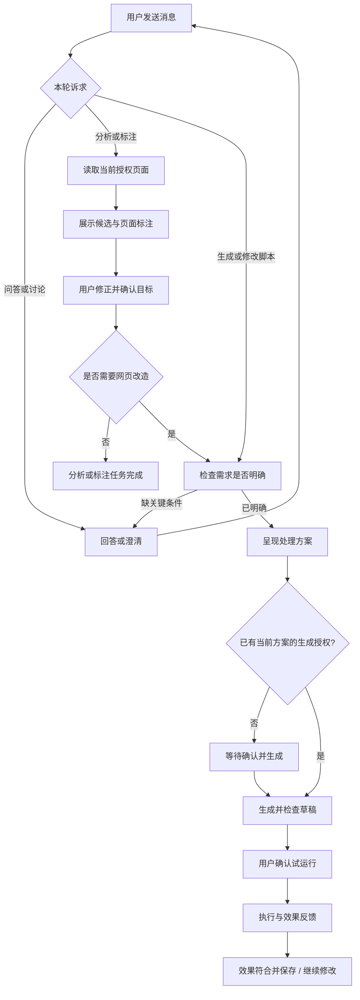

# 鲁班 V4 产品方案：对话驱动的网页理解与改造

> 通用边界更新：Luban 只提供页面证据、目标引用、范围确认、授权、执行与计划验收；具体业务目标由 Agent 根据需求分析。网站及广告场景仅作案例，不允许演变为产品代码中的适配规则。当前实现与边界见 [通用能力报告](./v4-generic-capabilities-report.md)。

> 2026-10-18 最新实现：直接升级原 Chat；独立 V4 会话入口及切换按钮已移除。保留原 workspace、消息、草稿、输入和脚本操作，需求/页面/方案卡片内联；内部 Harness 状态关联原工作区。见 [统一 Chat 执行与验收](./v4-unified-chat-execution-plan.md) 及 [整体报告](./v4-final-report.md)。下方旧原型/阶段设计涉及独立入口时，以本次更新为准。

版本：V4 / R1<br>
日期：2026-10-18<br>
状态：产品评审稿；文中默认值为方案建议，尚未作为已确认实现基线。<br>
依据：[V4 产品需求与技术方案初稿](./v4-product-and-technical-proposal.md)。

## 1. 产品定位与版本目标

鲁班 V4 是一个能够理解网页、与用户共同确认需求，并按需要改造网页的对话助手。

用户可以先提问、讨论、分析和标注页面；只有目标与处理方式明确，并获得用户生成授权后，鲁班才生成脚本。分析和临时标注本身也可以完成任务。

V4 使用 Deep Agents 承载任务编排。产品界面展示“正在分析”“等待选择”等用户可理解的过程，不要求用户理解 Harness、工具调用或检查点。

### 1.1 要解决的问题

| 问题 | V4 目标 | 可观察结果 |
|---|---|---|
| 聊天默认触发生成 | 对话与生成分离 | 普通问答不创建草稿，不改变已有代码 |
| 需求模糊时过早产出脚本 | 先补齐关键要求 | 用户看到已理解的内容与剩余问题 |
| 用户和系统对“这个区域”的理解不同 | 在真实页面确认目标 | 页面编号与侧栏目标一一对应 |
| 用户难以修正识别错误 | 支持排除、补选和修改范围 | 修正后的目标用于后续方案和生成 |
| 脚本生成与需求确认混在一起 | 分清目标、方案和执行确认 | 用户知道每个按钮具体同意了什么 |
| 信息呈现不够直观 | 提供页面标注与重点说明 | 不写脚本也能完成一次页面理解任务 |

### 1.2 成功标准

- 用户可以完成一次没有脚本产出的有效对话或标注任务。
- 用户可以从“帮我看看广告”逐步走到“确认目标、生成隐藏工具、试运行并保存”。
- 用户的排除项、保留约束和页面范围在后续修改中持续生效。
- 页面变化、任务取消和连接恢复不会导致旧确认误用或重复执行。

## 2. 用户与核心场景

首期沿用个人本地使用场景，不引入多人协作角色。

| 用户诉求 | 示例 | 合理交付 |
|---|---|---|
| 了解页面 | “这个页面有哪些值得优化的地方？” | 分析结论与可选建议 |
| 找出目标 | “帮我把广告标出来。” | 页面标注与候选清单 |
| 看清重点 | “把这些关键信息突出一下。” | 临时高亮、标签与说明 |
| 改造页面 | “隐藏确认的广告，保留导航。” | 确认方案后生成脚本 |
| 持续调整 | “第二块不是广告，保留它。” | 修正目标、更新方案，按需重新生成 |
| 复用效果 | “以后打开这个网站也这样。” | 说明作用范围，沿用网页工具保存与自动运行设置 |

“以后也这样”不等于自动开启自动运行。保存工具与启用自动运行仍是独立动作。

## 3. 范围与优先级

| 能力 | P0：首期必需 | P1：后续增强 |
|---|---|---|
| 对话 | 问答、页面分析、澄清与脚本生成分流 | 更丰富的任务建议 |
| 需求 | 需求卡片、多轮补充、保留约束、生成条件检查 | 可复用需求模板 |
| 目标 | 当前页广告候选识别、排除、手动补选、范围调整 | 更丰富的语义类别与组合条件 |
| 标注 | 编号、描边、标签、定位、清除、侧栏联动 | 更丰富的视觉样式与分组 |
| 展示增强 | 临时突出目标；持久效果经脚本生成 | 专用的信息对比、聚合视图 |
| 生成 | 按当前已确认方案生成、修改、检查 | 更多制品类型 |
| 生命周期 | 取消、失效提示、恢复记录、防止迟到覆盖 | 更丰富的任务历史检索 |

首期不包含全站广告拦截、网络请求过滤、自动跨页巡检、跨站自动任务、复杂多 Agent 协作和长期用户画像。

P0 验收以广告为完整样板；数据、金额、订单等场景是通用能力的后续扩展方向，不以首期已支持对外宣传。

## 4. 统一语言与信息对象

| 产品名称 | 定义 | 用户可见内容 |
|---|---|---|
| 会话 | 用户与鲁班持续交流的上下文 | 消息、当前页面、任务结果 |
| 任务 | 一次有明确目标的工作 | 目标、阶段、结果或待操作原因 |
| 需求说明 | 当前理解的目标、范围、动作与约束 | “你想做什么”“保留什么”“还需明确什么” |
| 页面目标 | 被识别或点选的元素、区域 | 稳定编号、摘要与位置 |
| 候选目标 | 尚待用户判断的页面目标 | “疑似广告”等类别与识别依据 |
| 页面标注 | 对页面目标的临时视觉说明 | 描边、编号、标签 |
| 处理方案 | 对指定目标采取的动作与预期效果 | 处理范围、保留项、作用时机 |
| 制品 | 可查看、管理的任务结果 | 脚本草稿、分析结果 |
| 网页工具 | 已保存的可重复使用能力 | 工具名称、适用范围、保存版本 |

候选目标状态与页面标注状态分开：关闭标注不等于排除目标；清除标注不删除需求或脚本。页面编号在同一次目标识别结果内保持稳定，排除 2 号后不把 3 号改成 2 号。

## 5. 信息架构与交互布局

### 5.1 总体布局

保持“当前网页 + 鲁班侧栏”的工作方式。页面承担定位与标注，侧栏承担对话、解释、选择和结果管理。

| 区域 | 展示内容 | 主要操作 |
|---|---|---|
| 侧栏顶部 | 当前网页名称与主机、当前任务、连接状态 | 查看页面范围、切换任务 |
| 消息流 | 普通回答、分析摘要、问题与过程状态 | 继续对话、停止处理 |
| 需求卡片 | 目标、处理范围、动作、保留项、未明确项 | 修改需求、查看目标 |
| 目标卡片 | 编号、类别、内容摘要、识别依据、选择状态 | 定位、排除、重新加入、补选 |
| 方案卡片 | 处理目标、处理方式、触发时机、效果与边界 | 修改方案、确认并生成 |
| 制品区域 | 当前草稿、检查状态、试运行与保存状态 | 查看代码、试运行、保存 |
| 固定输入区 | 输入框、页面上下文范围、发送或停止 | 发送消息、手动选择元素 |
| 页面覆盖层 | 目标描边、编号、标签、当前焦点 | 查看目标、关闭标注 |

默认发送按钮文案为“发送”，不再使用“发送并生成”。“生成脚本”只出现在条件满足的方案卡片或明确的生成操作中。

### 5.2 消息与卡片示意

```text
当前页面：示例资讯站 · example.com

你：帮我看看页面上的广告。

鲁班：在已读取区域中找到 3 处疑似广告，已在页面标出。
      还有 1 个区域无法读取，未参与判断。

[目标卡片]
✓ 1  顶部推广横幅  依据：带有“推广”标识    [定位] [排除]
✓ 2  右侧推荐卡片  依据：疑似推广链接      [定位] [排除]
✓ 3  底部悬浮推广  依据：带有“广告”标识    [定位] [排除]
[手动补选] [确认所选目标] [关闭标注]

鲁班：你想只标注这些区域，还是进一步隐藏或弱化？

[输入消息……]                              [发送]
```

示意内容与数量均为交互样例，不代表真实识别结果。

### 5.3 可用性要求

- 页面与侧栏使用一致编号，不能仅用颜色区分状态。
- 卡片和按钮支持键盘操作，焦点可见；关闭浮层后焦点回到触发入口。
- 侧栏消息独立滚动，输入与关键操作保持可达；阅读历史时不强制滚到底部。
- 标注不遮挡原页面主要操作，普通描边不截获原页面点击；编号入口只响应用户对该入口的操作。
- 多个标注重叠时优先展示当前焦点，其余使用简化编号；侧栏始终保留完整清单。

## 6. 核心流程



流程允许跳过不需要的阶段：普通问答不读取页面；目标已明确的任务不要求重复点选；用户已明确授权当前方案生成时不重复询问。生成授权始终不代替试运行确认。

### 6.1 模糊需求

用户：“这个页面太乱了。”

鲁班先回答可行方向，必要时读取已授权页面并给出候选建议，例如广告干扰、信息层级或悬浮区域。只询问影响下一步的关键问题，不逐项追问名称、颜色等非关键偏好。

### 6.2 只做标注

用户：“帮我把广告标出来。”

识别并展示疑似广告及依据，允许修正。标注展示成功后即可交付，不强制用户确认目标或生成脚本；确认目标仅在需要形成明确范围或继续改造时使用。

### 6.3 从识别到改造

用户确认 1、3 号属于广告并排除 2 号，再提出隐藏要求。鲁班展示方案：隐藏 1、3 号区域，保留导航和正文，说明生效时机与页面范围。用户选择“确认并生成”后生成草稿，后续沿用试运行与保存流程。

### 6.4 一次表达完整需求

用户：“把刚才确认的 1、3 号广告隐藏，保留导航，生成脚本。”

若目标与页面仍有效、要求没有冲突，直接生成，并在消息中展示本轮采用的方案摘要。若引用失效或存在歧义，只追问缺失部分。

### 6.5 已有工具的多轮修改

普通讨论不改草稿。用户明确提出修改并授权生成后，基于当前有效草稿；没有草稿时基于保存版。已确认保留项继续生效。用户仅改变标注颜色时，只更新临时标注。

## 7. 详细功能规则

### 7.1 对话与需求管理

| 编号 | 规则 |
|---|---|
| C01 | 支持问答、讨论、页面分析、临时标注、生成与修改，不要求用户先选择模式 |
| C02 | “看看”“分析一下”“能不能做”不单独构成脚本生成授权 |
| C03 | “生成脚本”“按这个方案生成”或点击“确认并生成”构成指定方案的生成授权 |
| C04 | 每次重要补充更新当前需求说明，用户可查看并纠正；缺失信息标为“待明确” |
| C05 | 只询问阻碍继续处理的问题；已有明确答案不重复询问 |
| C06 | 用户说“确认”时，只有当前唯一待确认对象明确才接受；存在多个对象时说明确认的是目标、方案还是运行 |
| C07 | 用户改变目标、动作、作用范围或关键约束后，旧方案授权失效；不能将旧“确认”用于新方案 |
| C08 | 处理期间可停止；补充要求可先保留为待发送内容，停止或完成后再提交，不静默并发改写当前任务 |

### 7.2 页面读取与目标识别

| 编号 | 规则 |
|---|---|
| T01 | 首期只分析当前明确绑定且具有访问权限的页面，不猜测其他标签页 |
| T02 | 将“广告”等语义表达映射为候选区域，展示可理解的识别依据，不展示未经校准的准确率百分比 |
| T03 | 未经用户确认的广告判断使用“疑似广告”；用户手动确认后显示“已确认目标”，不宣称客观分类准确 |
| T04 | 候选清单可定位、排除、重新加入；被排除目标不参与后续方案或脚本 |
| T05 | 手动补选后展示实际范围；若选到包含正文的父区域，需要用户缩小或明确接受该范围 |
| T06 | 相同区域去重；父子候选范围重叠时展示包含关系，避免重复处理和数量误导 |
| T07 | 无结果时显示“在已读取区域中未发现符合条件的目标”，提供手动选择和重新识别入口 |
| T08 | 识别范围有限、被截断或不可访问时明确告知；不将缺失内容推断成无广告 |
| T09 | 重识别形成新一轮目标结果，旧结果保留为历史且不可操作；编号引用不得跨轮猜测对应 |

### 7.3 页面标注与展示增强

| 编号 | 规则 |
|---|---|
| A01 | 标注包括描边、编号、简短标签；详细说明放在侧栏 |
| A02 | 点击目标卡片定位区域，点击页面编号聚焦卡片；不触发目标原有链接或提交行为 |
| A03 | 支持关闭、重新显示和清除当前标注；关闭保留目标选择，清除移除当前视觉覆盖但保留历史 |
| A04 | 滚动、缩放、布局变化时同步位置；目标消失时显示失效状态，不把标注漂移到其他元素上 |
| A05 | 切换任务时只展示当前任务标注；返回原任务需先检查页面和目标是否有效 |
| A06 | 页面刷新、导航或关闭后清理旧覆盖层；重开页面不自动恢复旧标注 |
| A07 | P0 临时展示支持高亮、编号和标签；隐藏、弱化、改布局等页面改造统一走脚本流程，不作为标注暗中执行 |
| A08 | 自定义颜色采用预置选项，标签作为纯文本展示，不接受可执行内容 |

### 7.4 方案、生成与执行

需求说明至少包含：目标页面、目标范围、处理动作、重要保留项、预期效果。涉及持续效果或事件触发时，还需明确作用时机。信息不足时禁用“确认并生成”，并展示缺失原因。

| 编号 | 规则 |
|---|---|
| G01 | 生成必须同时满足页面有效、范围明确、动作明确、重要约束无冲突、当前方案已获授权 |
| G02 | 确认目标仅确定“处理哪些区域”，不自动授权隐藏、生成或运行 |
| G03 | 方案卡片展示对象、动作、保留项、时机、预期效果与范围限制 |
| G04 | 用户修改方案后，相关旧确认失效；正在生成的旧方案结果不可覆盖当前有效草稿 |
| G05 | 生成期间显示当前阶段和停止入口，不把内部推理作为产品输出 |
| G06 | 通过基础检查只表示获得可试运行草稿，不宣称效果正确 |
| G07 | 试运行确认绑定当前页面、目标范围及脚本版本；变化后必须重新校验和确认 |
| G08 | 运行后区分已执行、失败、结果未知；结果未知不能自动重跑 |
| G09 | 保存沿用已有试运行及版本规则；临时标注完成不改变保存版 |
| G10 | 用户反馈“没生效”后，先收集必要诊断并确认目标有效，再决定是否修改，不自动无限重试 |

## 8. 状态与确认失效规则

### 8.1 任务状态

| 状态 | 用户可见说明 | 下一步 |
|---|---|---|
| 处理中 | 正在理解、读取、识别、生成或检查 | 等待或停止 |
| 等待补充 | 缺少明确目标、动作或约束 | 回答问题或取消 |
| 等待确认目标 | 需要确定处理范围 | 修正并确认目标 |
| 等待确认方案 | 当前方案明确，但尚未授权生成 | 修改、确认并生成或取消 |
| 等待试运行 | 草稿检查通过 | 查看代码、确认试运行 |
| 等待效果反馈 | 已获得执行结果，尚待用户判断 | 效果符合并保存、继续修改 |
| 已完成 | 回答、标注或保存目标已完成 | 查看结果或开始后续任务 |
| 失败 | 本次处理无法继续 | 查看原因，修复后重试 |
| 已取消 | 已停止处理或阻止未执行动作 | 查看保留结果 |

“停止请求中”在确认停止前保留为处理中附加状态。“页面已变化”作为阻塞原因展示，不清除已记录的需求与历史。临时标注任务完成后，覆盖层可以保留到用户清除或页面失效。

任务状态、目标有效性、脚本版本状态分别展示。任务完成不推导脚本已保存或标注永久生效。

### 8.2 变化对确认的影响

| 变化 | 目标确认 | 方案生成授权 | 试运行确认 |
|---|---|---|---|
| 仅修改标注颜色 | 保留 | 保留 | 保留 |
| 排除或新增目标、改变区域范围 | 变更部分需重新确认 | 失效 | 失效 |
| 改变隐藏/弱化等动作或关键保留项 | 目标有效时保留 | 失效 | 失效 |
| 修改脚本代码或权限 | 目标有效时保留 | 脚本不再视为原方案的未修改产物 | 失效 |
| 导航、刷新、页面绑定或关键目标失效 | 失效 | 失效 | 失效 |
| 无关区域布局变化 | 经复核有效则保留 | 经复核有效则保留 | 执行前仍需校验 |
| Bridge 或浏览器重启 | 保留历史判断，重新校验后才可操作 | 不自动恢复生成或执行 | 失效 |

## 9. 广告场景的方案卡片样例

```text
准备创建：隐藏当前页已确认广告

页面：example.com / 当前文章
处理目标：1 号顶部推广横幅、3 号底部悬浮推广
动作：隐藏以上区域
保留：导航、文章正文、2 号推荐卡片
时机：试运行后立即生效
预期效果：减少当前页面的广告干扰
边界：仅针对本次已确认区域，未读取内容不在范围内

[修改方案] [确认并生成]
```

生成后进入草稿卡片，分别提供“查看代码”和“试运行”。试运行成功且用户认可效果后显示“效果符合并保存”。若用户希望未来自动生效，再进入现有适用范围和自动运行设置流程。

## 10. 异常与恢复

| 异常 | 产品反馈 | 恢复规则 |
|---|---|---|
| 页面无访问权限 | “需要访问当前页面后才能分析” | 用户授权后继续，不索取与任务无关的权限 |
| 不支持的页面或不可读取区域 | 说明不可读取范围 | 保留可用部分，允许手动选取可访问目标 |
| 模型或本地连接不可用 | 显示具体不可用环节 | 保留输入与结果，不静默切换执行方 |
| 识别错误或遗漏 | 提供排除、补选、重新识别 | 后续处理采用修正后的结果 |
| 页面已变化 | 显示旧目标失效 | 重新读取并定位，不按旧编号直接执行 |
| 覆盖层展示失败 | “目标已识别，但标注显示失败” | 保留清单，允许重试；不宣称标注完成 |
| 生成失败或结果不完整 | 说明未获得有效新草稿 | 保留旧草稿，用户主动重试 |
| 取消后结果迟到 | 历史记录本次取消 | 不更新当前目标、方案或草稿 |
| 试运行回执丢失 | 显示结果未知 | 引导人工核对，不自动重复运行 |
| 新版本与手动修改冲突 | 提示基线已改变 | 保留候选，重新评估后再提交 |

## 11. 与 V3 的兼容及入口边界

- 升级保留现有工具、有效草稿、保存版、历史与自动运行设置；普通聊天不写入新的脚本版本。
- 旧会话没有结构化需求或目标确认时，以历史消息展示，不伪造已确认状态。
- 旧草稿继续允许按既有规则检查和试运行；用户发起新生成时使用 V4 的需求与授权规则。
- 沿用既有页面权限、数据范围告知和敏感字段处理；普通问答不为补充上下文而自动读取整页。
- 首期 V4 新体验以鲁班侧栏为入口。飞书和外部 MCP 沿用 V3 已定义行为，不将其写入或生成接口默认为侧栏已确认需求。
- 外部入口接入 V4 编排前，须补充目标展示、需求确认及状态回传设计；本方案不宣称外部入口已具备新体验。
- 不因一次临时标注自动保存工具、开启自动运行、发送消息或扩展页面访问范围。

## 12. 验收清单

| 编号 | 输入或操作 | 验收结果 |
|---|---|---|
| AC01 | 普通问题“你能做什么？” | 回答能力范围，不采集页面、不创建草稿 |
| AC02 | “这个页面有什么可以优化？” | 在必要权限下分析，返回建议，不创建草稿 |
| AC03 | “帮我标出广告” | 展示疑似候选与依据，不隐藏元素、不生成脚本 |
| AC04 | 排除 2 号目标 | 页面与侧栏同步，后续方案不包含 2 号，其他编号不变 |
| AC05 | 手动补选包含正文的父区域 | 展示实际范围，未确认前不按扩大范围生成 |
| AC06 | 关闭并重新显示标注 | 目标选择保持一致，不改变脚本版本 |
| AC07 | 只修改标注颜色 | 只改变覆盖层，不触发生成和运行 |
| AC08 | 用户只确认目标 | 不自动生成或运行 |
| AC09 | 目标与动作明确，点击“确认并生成” | 只按当前方案创建一个候选草稿 |
| AC10 | 一句话明确范围、约束并要求生成 | 无冲突且目标有效时直接生成，不重复提问 |
| AC11 | 生成后改变目标集合 | 旧授权失效，旧结果不能覆盖当前草稿 |
| AC12 | 页面导航后点击旧方案按钮 | 阻止操作，要求重新定位与确认 |
| AC13 | 无识别结果或部分不可读取 | 准确说明范围与限制，不宣称全页无广告 |
| AC14 | 标注区域滚动、缩放或消失 | 标注跟随或失效，不指向其他元素 |
| AC15 | 取消后收到迟到结果 | 不更新目标或草稿，不自动恢复任务 |
| AC16 | 生成失败、断连或重启 | 保留有效成果，不自动重放生成或执行 |
| AC17 | 试运行结果未知 | 不宣称成功、不自动重跑 |
| AC18 | 从 V3 升级后打开已有工具 | 既有数据可用，旧消息不被伪造为已确认需求 |
| AC19 | 原页面按钮位于标注区域 | 普通覆盖层不拦截原页面操作；编号入口不触发原页面链接 |
| AC20 | 任务完成但用户未保存 | 不显示已保存，不开启自动运行 |

## 13. 效果衡量与发布阶段

### 13.1 建议指标

当前无真实基线，不预设成功率或延迟承诺。先以固定验收样例和本地测试记录衡量；如后续增加遥测，需另行明确数据收集方式。

| 指标 | 定义 | 用途 |
|---|---|---|
| 非生成诉求误触发数 | 预期问答、分析、标注样例中实际触发脚本生成的次数 | 发布门槛为固定验收集内 0 次 |
| 无授权执行数 | 未具备有效运行确认却实际执行的次数 | 发布门槛为固定验收集内 0 次 |
| 需求到草稿完成率 | 获授权生成且最终获得有效草稿的任务数 / 获授权生成任务数 | 定位生成链路问题，取消和失败分项记录 |
| 候选排除比例 | 被用户排除的候选数 / 已被用户审阅的候选数 | 识别质量观察项，不单独作为准确率 |
| 用户补选数量 | 每次审阅中手动新增的目标数量 | 观察遗漏，不据此推算召回率 |
| 纠正后保留率 | 后续方案正确保留用户修正的次数 / 已验证修正次数 | 验证多轮一致性 |

### 13.2 建议交付阶段

| 阶段 | 交付内容 | 准出依据 |
|---|---|---|
| P0-A 对话解耦 | 独立问答、需求卡片、生成授权规则 | 非生成输入不创建草稿，旧流程可用 |
| P0-B 目标与标注 | 广告候选、双向定位、排除补选、有效性管理 | 广告识别到修正流程与页面变化场景通过 |
| P0-C 改造闭环 | 方案卡片、生成、试运行、保存、恢复保护 | 完整验收清单与 V3 数据兼容检查通过 |

阶段不代表排期承诺，工程拆解和实现成本在技术方案中确定。

## 14. 待评审决策

| 事项 | 本稿建议 | 状态 |
|---|---|---|
| 首期核心入口 | 鲁班侧栏 | 待评审 |
| 首期示范场景 | 当前页广告识别与标注 | 待评审 |
| 临时展示边界 | 高亮、编号、标签；隐藏和弱化经脚本处理 | 待评审 |
| 生成确认方式 | 方案按钮或语义明确的自然语言授权 | 待评审 |
| 重启后恢复 | 恢复记录，重新校验，不自动执行 | 待评审 |
| 外部入口 | V3 行为继续保留，V4 新体验后续接入 | 待评审 |
| 模型与部署 | Deep Agents 承载编排，兼容与配置细节由技术验证确定 | 待验证 |

本稿已给出可评审的产品默认方案；以上事项未被标记为用户已确认。未创建实现代码、安装依赖或进行真实模型与页面操作。
