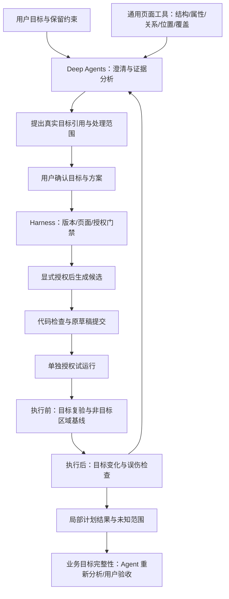

# G2 通用能力实施记录

## 已实施

- 删除特定域名、ID/class、广告关键词过滤、专属选择器归并和专属文案。所有页面使用同一结构采集逻辑，嵌入文档只采集外层节点证据。
- 每批最多 40 个结构候选，最多检查 800 个结构节点，提供下一批入口与明确覆盖说明。下一批重新绑定页面证据，清除旧目标确认、方案和生成授权。
- 结构证据增加属性、最近已采集父候选引用、位置、尺寸与嵌入数量。业务用途由 Agent 根据需求分析，清单不会直接标记为广告或自动扩大父容器范围。
- 全部目标采用同一内容指纹与原节点身份校验；内容/嵌入资源/结构变化重新确认；唯一选择器实时重验。显示样式和 hidden 属性变化允许用于效果检查。
- 试运行前重新采集非目标区域可见性和透明度基线；正文、导航及共同祖先误隐藏/弱化会阻止通过。旧效果记录在试运行准备时清除，旧版验收记录不会被当作新版报告。
- 效果检查只判断所选计划，不将未选结构候选算作残留目标。结果明确标记“完整业务目标尚未自动判断”，并向 Chat 提供非目标区域异常证据。
- 保留生成、运行、保存分离；采集、分页与检查均不执行生成脚本。
- 新增运行时边界扫描脚本并接入完整验收；已知站点或广告特判进入相关运行时代码时失败。它只补充人工代码审查，不声称能证明任何未来代码都通用。

## 架构边界

当前通用动作仍限于隐藏、弱化；不是任意网页编辑器。跨 iframe/Shadow DOM、视觉语义、交互功能与完整业务目标未宣称已自动验收。
